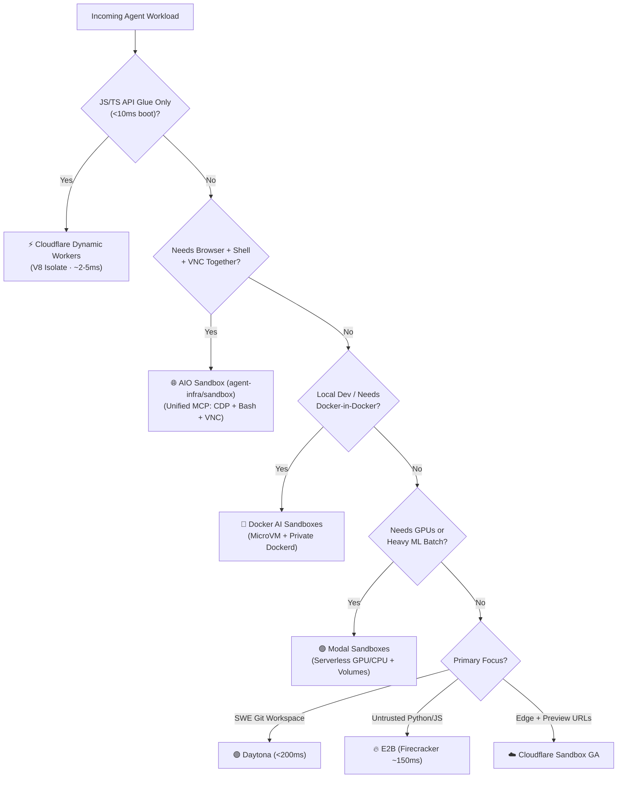

# Chapter 07 — Managed Platforms (`E2B`, `Modal`, `Daytona`) & Selection Matrix

> **Lecture 38 · Chapter 07 of 07** · Level: 🔴 Expert · Phase 8 — Multimodality, Full-Stack Apps & Agent Scaling
> **References:** [Mastra — Best AI Agent Sandbox Platforms](https://mastra.ai/articles/best-ai-agent-sandbox-platforms) · [LangChain — How to Choose the Right Sandbox for Your Agent](https://www.langchain.com/blog/how-to-choose-the-right-sandbox-for-your-agent)
> **Roadmap topics:** Comparing **E2B**, **Modal**, **Daytona**, **Cloudflare Sandbox (GA)**, **Dynamic Workers**, **Docker AI Sandboxes**, and **AIO Sandbox** · stateful lifecycle (snapshots, hibernation/sleep-to-wake, live preview URLs, egress policies).

---

## 07.0 What this chapter is for

No single sandbox platform wins every workload. An engineer who uses a 2-second GPU container for simple JSON filtering wastes latency and money; an engineer who uses a JS-only V8 isolate for Python data science hits a brick wall.

This chapter gives you the **complete 7-platform selection matrix** and the **stateful lifecycle checklist** (snapshots, hibernation, preview URLs, and egress rules) needed to ship agent sandboxes in production.

By the end of this chapter you should be able to:

1. Route any agent workload to the right platform among **Dynamic Workers**, **Cloudflare Sandbox GA**, **E2B**, **Daytona**, **Modal**, **Docker AI Sandboxes**, and **`agent-infra/sandbox`**.
2. Design a **snapshot + sleep-to-wake hibernation** lifecycle for multi-turn HITL agents.

---

## 07.1 Complete 7-Platform Selection Matrix

| Platform | Isolation | Typical Boot | State / Snapshots | Best For |
| :--- | :--- | :---: | :--- | :--- |
| **Cloudflare Dynamic Workers** | V8 Isolate | **~2–5 ms** | Stateless | High-frequency JS/TS Code Mode MCP |
| **Cloudflare Sandbox (GA)** | DO + Linux Container | ~1–2 s | Persistent disk + sleep/wake | Edge Python/bash, git, live preview URLs |
| **E2B** | Firecracker MicroVM | **~150 ms** | Memory + disk snapshots | Multi-tenant untrusted Python/JS code interpreter |
| **Daytona** | Container / VM | **<200 ms** | Persistent Git workspaces | Stateful SWE coding & PR-review environments |
| **Modal Sandboxes** | gVisor / Container | ~1–3 s | Volume mounts + image cache | GPU inference/evals, heavy scientific Python |
| **Docker AI Sandboxes** | MicroVM + Private Dockerd | ~1–3 s | Local workspace sync | Local/hybrid `docker compose` coding agents |
| **`agent-infra/sandbox`** | Container / gVisor Pod | ~2–4 s | Shared `/workspace` volume | Unified Browser + Shell + VNC + MCP |

---

## 07.2 Stateful Sandbox Lifecycle: Snapshots, Hibernation & Previews

1. **Pre-baked Snapshots:** Never run `npm install` or `pip install` on every user request. Bake dependencies into a snapshot/Manifest so sandboxes resume in **<200 ms**.
2. **Hibernation (Sleep-to-Wake):** When an agent pauses for a 10-minute Human-in-the-Loop approval, hibernate the sandbox to stop compute billing while preserving `/workspace` and memory state.
3. **Authenticated Preview URLs:** Platforms like **Cloudflare Sandbox (GA)** and **E2B** expose ephemeral preview URLs for dev servers inside the sandbox — ideal for `MCP Apps` and `AG-UI` live previews.
4. **Per-Tenant Egress Governance:** Default-deny `169.254.169.254` and private VPC CIDRs; inject API credentials exclusively via host-side proxies.

---

## 07.3 Common Mistakes & Key Takeaways

| # | Common Mistake | Why It Hurts | What To Do Instead |
| :---: | :--- | :--- | :--- |
| 1 | Leaving sandboxes running during idle HITL pauses | Burns 100% compute cost while waiting on a human | Use **sleep-to-wake hibernation** |
| 2 | Building a custom Firecracker scheduler from scratch | Months of kernel, snapshot, and networking toil | Use **E2B**, **Cloudflare Sandbox GA**, **Modal**, or **Daytona** unless VPC rules forbid it |

### Key Takeaways
1. **Match the sandbox to the workload:** V8 isolates for JS/TS glue, MicroVMs for untrusted Python/SWE, AIO for Browser+Shell+VNC, Modal for GPUs.
2. **Snapshots + hibernation + egress allow-lists** are what turn a toy code runner into a production platform.
