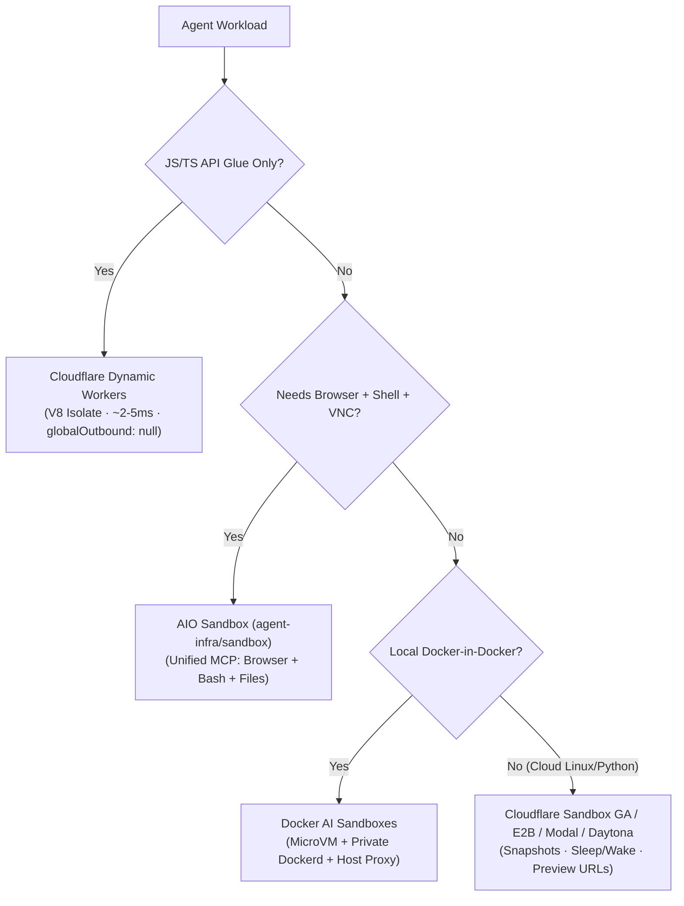

# Lecture 38 — Complete Notes
## AI Agent Sandboxes All-in-One (`MicroVMs`, `Docker`, `Cloudflare`, `E2B`, `AIO`)

> **Phase:** 8 · Multimodality, Full-Stack Apps & Agent Scaling · **Level:** 🔴 Expert
> **Scope:** Single-pass consolidation of all 7 chapters.
>
> | Chapter | File |
> | :--- | :--- |
> | 01 · Why Agents Need Sandboxes & Core Topologies | [01_Why_Agents_Need_Sandboxes_and_Core_Topologies.md](./01_Why_Agents_Need_Sandboxes_and_Core_Topologies.md) |
> | 02 · Isolation Layers: V8, Containers, gVisor & MicroVMs | [02_Isolation_Layers_V8_Containers_gVisor_MicroVMs.md](./02_Isolation_Layers_V8_Containers_gVisor_MicroVMs.md) |
> | 03 · Docker AI Sandboxes | [03_Docker_AI_Sandboxes_Local_and_Hybrid_Workflows.md](./03_Docker_AI_Sandboxes_Local_and_Hybrid_Workflows.md) |
> | 04 · OpenAI Agents SDK Sandboxes | [04_OpenAI_Agents_SDK_Sandboxes_and_Abstractions.md](./04_OpenAI_Agents_SDK_Sandboxes_and_Abstractions.md) |
> | 05 · Cloudflare Sandbox SDK (GA) vs. Dynamic Workers | [05_Cloudflare_Sandbox_SDK_GA_vs_Dynamic_Workers.md](./05_Cloudflare_Sandbox_SDK_GA_vs_Dynamic_Workers.md) |
> | 06 · AIO Multimodal Sandboxes (`agent-infra/sandbox`) | [06_AIO_Multimodal_Sandboxes_Browser_Shell_MCP.md](./06_AIO_Multimodal_Sandboxes_Browser_Shell_MCP.md) |
> | 07 · Managed Platforms & Selection Matrix | [07_Managed_Platforms_E2B_Modal_Daytona_and_Selection_Matrix.md](./07_Managed_Platforms_E2B_Modal_Daytona_and_Selection_Matrix.md) |

---

## 1. Executive Summary

1. **Topologies:** *Sandbox-as-a-Tool* maximizes secret isolation (orchestrator stays outside); *Agent-in-Sandbox* minimizes tool latency for coding agents (requires a host credential proxy).
2. **Isolation Tiers:** V8 Isolates (~2–5 ms, JS/TS only) → Standard Containers (shared kernel, unsafe for untrusted code) → `gVisor` (user-space kernel) → Firecracker/Kata/Docker AI MicroVMs (dedicated guest kernel).
3. **Cloudflare:** Choose **Dynamic Workers** (`env.LOADER`) for sub-5 ms JS/TS Code Mode, and **Cloudflare Sandbox SDK (GA)** (`@cloudflare/sandbox`) for full Linux containers, Python/bash/git, and OpenAI Agents SDK workspaces.
4. **AIO Sandbox (`agent-infra/sandbox`):** Combines Browser + Shell + Filesystem + Jupyter + VS Code + VNC in one container over unified MCP/REST.
5. **Managed Platforms:** **E2B** (Firecracker snapshots), **Daytona** (Git/SWE workspaces), **Modal** (GPUs/batch Python), and **Docker AI Sandboxes** (local microVMs + private `dockerd`) cover every production workload.

---

## 2. Master Architecture Diagram

