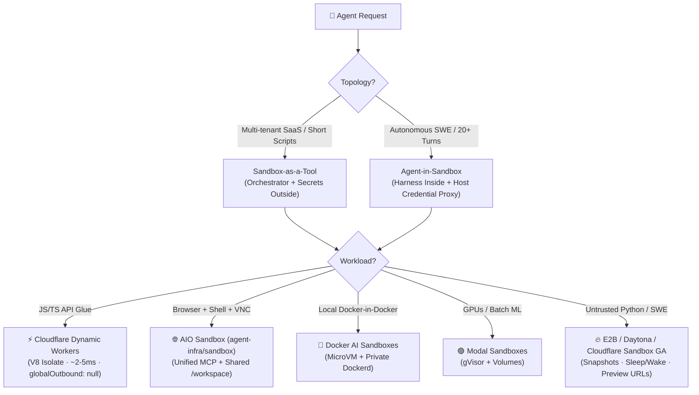

# Lecture 38 — Complete Notes
## AI Agent Sandboxes All-in-One (`MicroVMs`, `Docker`, `Cloudflare`, `E2B`, `AIO`)

> **Phase:** 8 · Multimodality, Full-Stack Apps & Agent Scaling · **Level:** 🔴 Expert
> **Scope:** A single-pass consolidation of all seven chapters in this folder.
>
> | Chapter | File |
> | :--- | :--- |
> | 01 · Why Agents Need Sandboxes & Core Topologies | [01_Why_Agents_Need_Sandboxes_and_Core_Topologies.md](./01_Why_Agents_Need_Sandboxes_and_Core_Topologies.md) |
> | 02 · Isolation Layers: V8, Containers, gVisor & MicroVMs | [02_Isolation_Layers_V8_Containers_gVisor_MicroVMs.md](./02_Isolation_Layers_V8_Containers_gVisor_MicroVMs.md) |
> | 03 · Docker AI Sandboxes (Local & Hybrid Workflows) | [03_Docker_AI_Sandboxes_Local_and_Hybrid_Workflows.md](./03_Docker_AI_Sandboxes_Local_and_Hybrid_Workflows.md) |
> | 04 · OpenAI Agents SDK Sandboxes & Abstractions | [04_OpenAI_Agents_SDK_Sandboxes_and_Abstractions.md](./04_OpenAI_Agents_SDK_Sandboxes_and_Abstractions.md) |
> | 05 · Cloudflare Sandbox SDK (GA) vs. Dynamic Workers | [05_Cloudflare_Sandbox_SDK_GA_vs_Dynamic_Workers.md](./05_Cloudflare_Sandbox_SDK_GA_vs_Dynamic_Workers.md) |
> | 06 · AIO Multimodal Sandboxes (`agent-infra/sandbox`) | [06_AIO_Multimodal_Sandboxes_Browser_Shell_MCP.md](./06_AIO_Multimodal_Sandboxes_Browser_Shell_MCP.md) |
> | 07 · Managed Platforms (`E2B`, `Modal`, `Daytona`) & Selection Matrix | [07_Managed_Platforms_E2B_Modal_Daytona_and_Selection_Matrix.md](./07_Managed_Platforms_E2B_Modal_Daytona_and_Selection_Matrix.md) |

---

## 1. Executive Summary

1. **In-process path jails (`safePath`) fail** as soon as an agent can spawn `bash`, `python3`, or browsers — OS/kernel/hypervisor isolation is mandatory.
2. **Two core topologies:** **Sandbox-as-a-Tool** keeps the orchestrator and secrets outside the sandbox; **Agent-in-Sandbox** gives coding harnesses 0-hop local speed behind a **Host Credential Proxy**.
3. **Isolation tiers:** V8 Isolates (~2–5 ms, JS/TS only) → Standard `runc` containers (shared kernel — unsafe for untrusted code) → `gVisor` (user-space kernel) → Firecracker / Kata / Docker AI MicroVMs (dedicated guest kernel).
4. **Cloudflare & OpenAI:** Use **Dynamic Workers** for sub-5 ms JS/TS Code Mode, **Cloudflare Sandbox SDK (GA)** (`@cloudflare/sandbox`) for persistent Linux containers, and **OpenAI Agents SDK `SandboxSession`** to keep agent tools provider-agnostic.
5. **Multimodal & Managed Landscape:** **`agent-infra/sandbox`** unifies Browser + Shell + VNC + MCP in one container; **E2B**, **Daytona**, **Modal**, and **Docker AI Sandboxes** cover specialized Firecracker, SWE Git, GPU, and local Docker-in-Docker workloads.

---

## 2. Master Architecture Diagram

---

## 3. Cheat Sheet

| Concept | One-Line Definition | Chapter |
| :--- | :--- | :---: |
| **Sandbox-as-a-Tool** | Orchestrator stays outside and invokes `exec()` / `files` over RPC | [01](./01_Why_Agents_Need_Sandboxes_and_Core_Topologies.md) |
| **Agent-in-Sandbox** | Coding harness runs inside the VM with a Host Credential Proxy | [01](./01_Why_Agents_Need_Sandboxes_and_Core_Topologies.md) |
| **Three Sandbox Axes** | Filesystem, Network (`169.254.169.254` blocked), and Process/Resources | [02](./02_Isolation_Layers_V8_Containers_gVisor_MicroVMs.md) |
| **Docker AI Sandboxes** | MicroVM-per-workspace with private `dockerd` and host secret proxy | [03](./03_Docker_AI_Sandboxes_Local_and_Hybrid_Workflows.md) |
| **`SandboxSession` / `Manifest`** | Provider-agnostic OpenAI Agents SDK workspace + snapshot contract | [04](./04_OpenAI_Agents_SDK_Sandboxes_and_Abstractions.md) |
| **Cloudflare Sandbox GA** | Durable Object + Linux container (`@cloudflare/sandbox`) with sleep/wake | [05](./05_Cloudflare_Sandbox_SDK_GA_vs_Dynamic_Workers.md) |
| **AIO Sandbox** | Browser (CDP) + Shell + Filesystem + Jupyter + VNC over unified MCP | [06](./06_AIO_Multimodal_Sandboxes_Browser_Shell_MCP.md) |
| **Hibernation & Snapshots** | Pre-baked dependencies + sleep-to-wake during HITL pauses | [07](./07_Managed_Platforms_E2B_Modal_Daytona_and_Selection_Matrix.md) |

---

## 4. Self-Check Questions

1. Why is mounting `/var/run/docker.sock` inside an agent container equivalent to giving root on the host?
2. When would you choose **Cloudflare Dynamic Workers** over **Cloudflare Sandbox SDK (GA)**?
3. What problem does **`agent-infra/sandbox`** solve when an agent combines Playwright browser downloads with Python data processing?
4. Why must **169.254.169.254** always be blocked on the sandbox Network Axis?
