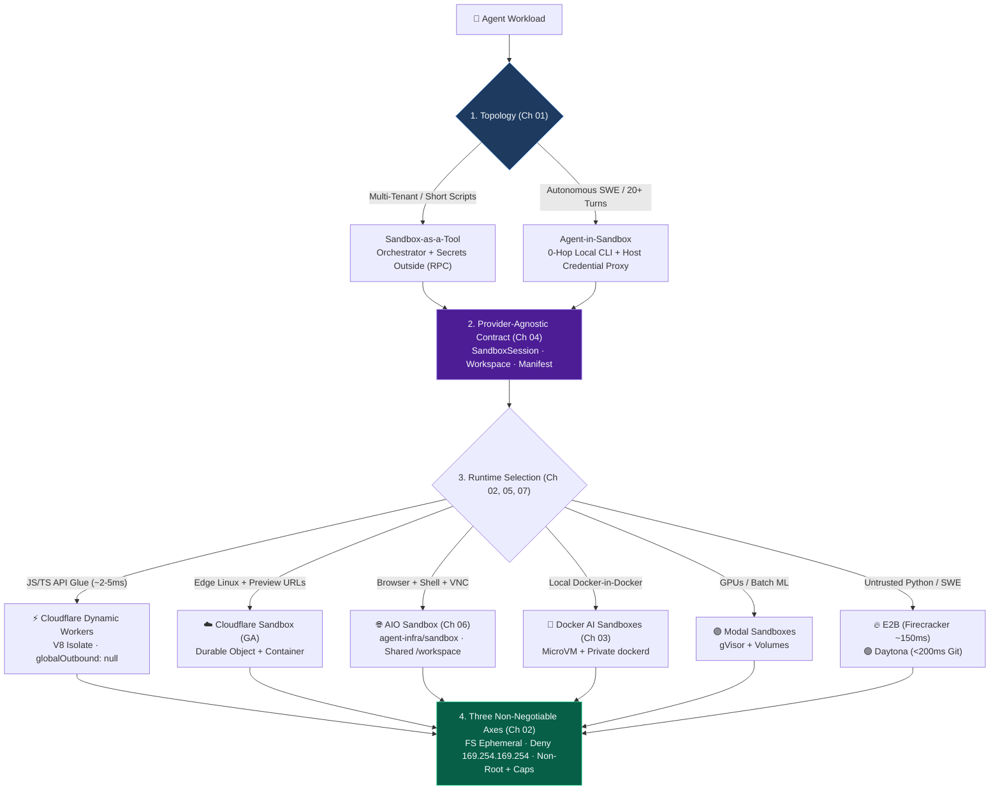

# Lecture 38 — Complete Notes
## AI Agent Sandboxes All-in-One (`MicroVMs`, `Docker`, `Cloudflare`, `E2B`, `AIO`)

> **Phase:** 8 · Multimodality, Full-Stack Apps & Agent Scaling · **Level:** 🔴 Expert
> **Scope:** Single-pass revision guide consolidating all seven chapter notes in this folder.
> **How to use this file:** Revise the topology, isolation tiers, platform selection matrix, and release-gate checks here; jump to any chapter file for full diagrams, code snippets, and vendor details.

---

## 1. Executive Summary

**Thesis:** In-process path checks (`safePath`) collapse the moment an agent can spawn `bash`, `python3`, or browsers; production agents require **OS/kernel/hypervisor isolation across all three sandbox axes** (Filesystem, Network, Process), with secrets kept strictly outside the sandbox behind a **Host Credential Proxy** and workloads routed to the right runtime (**V8 Isolates**, **MicroVMs**, **AIO Containers**, or **Managed Cloud Sandboxes**).

**The lecture in five sentences:**

1. **In-process path jails (`safePath`) fail** against OS-level `os.environ` exfiltration, `169.254.169.254` metadata SSRF, symlinks, and fork bombs whenever an agent executes `bash`, `python3`, or browser actions.
2. **Two core topologies** govern agent compute: **Sandbox-as-a-Tool** (orchestrator + secrets outside, RPC `exec()`) for multi-tenant SaaS, and **Agent-in-Sandbox** (0-hop local CLI/repo access behind a **Host Credential Proxy**) for autonomous SWE harnesses.
3. **Isolation tiers** span **V8 Isolates** (~2–5 ms, JS/TS only), **Standard `runc` Containers** (shared host kernel — unsafe for untrusted code), **`gVisor`** (user-space kernel), and **Firecracker/Kata/Docker AI MicroVMs** (dedicated guest kernel).
4. **Docker AI Sandboxes** eliminate the fatal `/var/run/docker.sock` trap via a MicroVM + private `dockerd`, **OpenAI Agents SDK** (`Workspace`, `SandboxSession`, `Manifest`) keeps tools provider-agnostic, and **Cloudflare** splits JS/TS **Dynamic Workers** from Linux **`@cloudflare/sandbox` (GA)**.
5. **`agent-infra/sandbox` (AIO)** unifies Browser (CDP/Playwright) + Shell + Filesystem + Jupyter + VS Code + VNC in one container over MCP, while **E2B**, **Daytona**, and **Modal** complete the 7-platform selection matrix with **snapshots + sleep-to-wake hibernation**.

| Chapter | Core Topic | Link |
| :--- | :--- | :--- |
| **01** | Why Agents Need Sandboxes & Core Topologies | [01_Why_Agents_Need_Sandboxes_and_Core_Topologies.md](./01_Why_Agents_Need_Sandboxes_and_Core_Topologies.md) |
| **02** | Isolation Layers: V8, Containers, gVisor & MicroVMs | [02_Isolation_Layers_V8_Containers_gVisor_MicroVMs.md](./02_Isolation_Layers_V8_Containers_gVisor_MicroVMs.md) |
| **03** | Docker AI Sandboxes (Local & Hybrid Workflows) | [03_Docker_AI_Sandboxes_Local_and_Hybrid_Workflows.md](./03_Docker_AI_Sandboxes_Local_and_Hybrid_Workflows.md) |
| **04** | OpenAI Agents SDK Sandboxes & Abstractions | [04_OpenAI_Agents_SDK_Sandboxes_and_Abstractions.md](./04_OpenAI_Agents_SDK_Sandboxes_and_Abstractions.md) |
| **05** | Cloudflare Sandbox SDK (GA) vs. Dynamic Workers | [05_Cloudflare_Sandbox_SDK_GA_vs_Dynamic_Workers.md](./05_Cloudflare_Sandbox_SDK_GA_vs_Dynamic_Workers.md) |
| **06** | AIO Multimodal Sandboxes (`agent-infra/sandbox`) | [06_AIO_Multimodal_Sandboxes_Browser_Shell_MCP.md](./06_AIO_Multimodal_Sandboxes_Browser_Shell_MCP.md) |
| **07** | Managed Platforms (`E2B`, `Modal`, `Daytona`) & Selection Matrix | [07_Managed_Platforms_E2B_Modal_Daytona_and_Selection_Matrix.md](./07_Managed_Platforms_E2B_Modal_Daytona_and_Selection_Matrix.md) |

---

## 2. Master Architecture Diagram

---

## 3. Chapter-by-Chapter Short Revision Notes

### 3.1 Chapter 01 — Why Agents Need Sandboxes & Core Topologies

An LLM is an *untrusted code generator* because indirect prompt injection in any README, ticket, or CSV can hijack its next command. Once `bash` or `python3` is exposed, in-process TypeScript `safePath` checks fail against `os.environ` exfiltration, `169.254.169.254` cloud metadata SSRF, symlinks (`/etc/shadow`), and fork bombs.

- **Sandbox-as-a-Tool:** Orchestrator and secrets stay outside; tools run via `sandbox.exec()` RPC (~20–100 ms/step). Strongest default for multi-tenant SaaS.
- **Agent-in-Sandbox:** Coding harness (Claude Code / Codex) runs inside the VM for `< 1 ms` local syscalls across 20+ turns, with API/Git keys injected externally by a **Host Credential Proxy**.

> 📖 **Need depth?** Read [Chapter 01 — Why Agents Need Sandboxes & Core Topologies](./01_Why_Agents_Need_Sandboxes_and_Core_Topologies.md)

### 3.2 Chapter 02 — Isolation Layers: V8 Isolates, Containers, gVisor & MicroVMs

Standard Docker (`runc`) containers share the **host Linux kernel** (`io_uring`, `bpf`, `ptrace`), making them unsafe for multi-tenant untrusted LLM code. Production sandboxes must use **V8 Isolates** (~2–5 ms, ~3–10 MB, JS/TS only), **`gVisor`** (user-space Go kernel trapping syscalls), or **Firecracker/Kata MicroVMs** (dedicated guest kernel + KVM, ~120–250 ms snapshot boot).

- **The Three Non-Negotiable Sandbox Axes:** (1) **Filesystem:** read-only/CoW root, size-capped `/workspace`, never mount `~/.ssh` or `docker.sock`; (2) **Network:** default-deny egress blocking `169.254.169.254` and RFC-1918 VPC CIDRs; (3) **Process/Resource:** `runAsNonRoot`, `capabilities.drop: ["ALL"]`, CPU/RAM/PID/timeout caps.

> 📖 **Need depth?** Read [Chapter 02 — Isolation Layers: V8 Isolates, Containers, gVisor & MicroVMs](./02_Isolation_Layers_V8_Containers_gVisor_MicroVMs.md)

### 3.3 Chapter 03 — Docker AI Sandboxes (Local & Hybrid Workflows)

Mounting `/var/run/docker.sock` inside an agent container is equivalent to giving the agent **root on your laptop** (`docker run -v /:/host`). **Docker AI Sandboxes (`docker sandbox run`)** solve local/CI Docker-in-Docker safely by provisioning a **dedicated MicroVM per workspace** with a **private `dockerd`** inside.

- **4 Guarantees:** Isolated guest kernel, private `dockerd` for `docker compose up` test DBs, **Host Credential Proxy** (keys never enter VM `env`), and scoped project-only folder sync (hiding `~/.ssh`, `~/.aws`, and browser cookies).

> 📖 **Need depth?** Read [Chapter 03 — Docker AI Sandboxes (Local & Hybrid Workflows)](./03_Docker_AI_Sandboxes_Local_and_Hybrid_Workflows.md)

### 3.4 Chapter 04 — OpenAI Agents SDK Sandboxes & Abstractions

Hardcoding E2B or `child_process.exec` inside agent tools locks you to one runtime. The **OpenAI Agents SDK Sandboxes** pattern decouples agent reasoning from compute using three primitives: **`Workspace`**, **`SandboxSession`**, and **`Manifest`**.

- **Swappable Backends:** Standardized tools (`exec`, `read_file`, `write_file`, `apply_patch`) target `SandboxSession`, letting you swap local **Docker AI Sandboxes** for **Cloudflare Sandbox**, **E2B**, **Modal**, or **Daytona** via config while **`Manifest` snapshots** turn 30 s `pip install`s into sub-second boots.

> 📖 **Need depth?** Read [Chapter 04 — OpenAI Agents SDK Sandboxes & Abstractions](./04_OpenAI_Agents_SDK_Sandboxes_and_Abstractions.md)

### 3.5 Chapter 05 — Cloudflare Sandbox SDK (GA) vs. Dynamic Workers

Cloudflare offers two distinct edge runtimes: **Dynamic Workers (`env.LOADER`)** for sub-5 ms JS/TS Code Mode, and **Cloudflare Sandbox SDK (GA) (`@cloudflare/sandbox`)** for persistent Durable Object + Linux container workspaces (`python3`, `bash`, `git`, `exposePort()` preview URLs).

| Feature | Dynamic Workers (`env.LOADER`) | Cloudflare Sandbox SDK (GA) |
| :--- | :--- | :--- |
| **Runtime / Boot** | V8 Isolate (~2–5 ms) | Durable Object + Linux Container (~1–2 s, sleep/wake) |
| **Languages** | JS / TS only | Full Linux (`python3`, `bash`, `git`, CLI binaries) |
| **Secret Safety** | `globalOutbound: null` + Host RPC proxy | Live secrets & outbound handlers in Host Worker only |

> 📖 **Need depth?** Read [Chapter 05 — Cloudflare Sandbox SDK (GA) vs. Dynamic Workers](./05_Cloudflare_Sandbox_SDK_GA_vs_Dynamic_Workers.md)

### 3.6 Chapter 06 — AIO Multimodal Sandboxes (`agent-infra/sandbox`)

When an agent downloads a CSV in Playwright and then processes it with `pandas` in Python, separate Browser and Shell containers strand files and cookies across boundaries. **`agent-infra/sandbox` (AIO Sandbox)** packages **Chromium (CDP/Playwright) + Shell/Bash + Filesystem + Jupyter + VS Code + VNC** in one container with a shared `/workspace` and unified MCP/REST API.

- **Built-in HITL via VNC:** Human operators can view or take over the authenticated VNC stream for 2FA, CAPTCHAs, or final submit approvals. Run AIO pods under **`gVisor`** or **Kata** with strict `NetworkPolicy` in production.

> 📖 **Need depth?** Read [Chapter 06 — AIO Multimodal Sandboxes (`agent-infra/sandbox`)](./06_AIO_Multimodal_Sandboxes_Browser_Shell_MCP.md)

### 3.7 Chapter 07 — Managed Platforms (`E2B`, `Modal`, `Daytona`) & Selection Matrix

No single platform wins every workload. Route **JS/TS API glue** to **Dynamic Workers** (~2–5 ms), **untrusted Python/JS** to **E2B** (Firecracker ~150 ms), **SWE Git workspaces** to **Daytona** (`< 200 ms`), **GPUs/ML batch** to **Modal** (`gVisor` + volumes), **edge Linux + previews** to **Cloudflare Sandbox GA**, **local `docker compose`** to **Docker AI Sandboxes**, and **Browser+Shell+VNC** to **`agent-infra/sandbox`**.

- **Production Lifecycle:** Pre-bake dependencies into **snapshots** (`< 200 ms` boot), **hibernate (sleep-to-wake)** during idle HITL pauses to stop compute billing, and enforce **default-deny egress** on every tenant sandbox.

> 📖 **Need depth?** Read [Chapter 07 — Managed Platforms (`E2B`, `Modal`, `Daytona`) & Selection Matrix](./07_Managed_Platforms_E2B_Modal_Daytona_and_Selection_Matrix.md)

---

## 4. Cheat Sheet & Common Traps

| Concept / Platform | Key Rule / Spec | Common Trap to Avoid |
| :--- | :--- | :--- |
| **Path Jails** | OS/kernel/hypervisor isolation required for `bash`/`python3` | Relying on in-process `safePath` once shells are exposed |
| **`runc` vs. `gVisor`/MicroVM** | Use `gVisor` or Firecracker/Kata for untrusted code | Running multi-tenant LLM code in standard `runc` containers |
| **Network Axis** | Default-deny egress; block `169.254.169.254` & RFC-1918 | Leaving outbound `curl` or cloud metadata IPs reachable |
| **Docker AI Sandboxes** | MicroVM + private `dockerd` + Host Credential Proxy | Mounting `/var/run/docker.sock` (instant host root!) |
| **Cloudflare Runtimes** | Dynamic Workers = JS/TS; `@cloudflare/sandbox` = Linux | Booting a Linux container for 5-line JSON filtering (or vice versa) |
| **AIO Sandbox** | Shared `/workspace` + unified MCP + authenticated VNC | Splitting Browser & Shell pods or exposing VNC without auth |
| **Stateful Lifecycle** | Pre-baked `Manifest`/snapshots + sleep-to-wake hibernation | Running `pip install` per turn or billing idle HITL sandboxes |

---

## 5. Self-Check Questions (Release Gate Prep)

1. **Path Jail Failure:** Name three concrete OS-level attacks that bypass an in-process TypeScript `safePath` check as soon as `python3` or `bash` is exposed.
   - *Key check:* (1) `os.environ` secret exfiltration over outbound HTTP; (2) `curl http://169.254.169.254/...` cloud metadata SSRF; (3) `os.symlink("/etc/shadow", ...)` or fork-bomb resource DoS.
2. **Topology Trade-Off:** When should you choose **Sandbox-as-a-Tool** vs. **Agent-in-Sandbox**, and how do secrets stay protected in **Agent-in-Sandbox**?
   - *Key check:* Use **Sandbox-as-a-Tool** for short, multi-tenant untrusted scripts; use **Agent-in-Sandbox** for 20+ turn SWE workflows needing `< 1 ms` local CLI/repo access, with API/Git keys injected externally by a **Host Credential Proxy**.
3. **The `docker.sock` Trap:** Why is mounting `/var/run/docker.sock` inside an agent container equivalent to giving root on the host, and how do **Docker AI Sandboxes** fix it?
   - *Key check:* `docker.sock` lets the agent run `docker run -v /:/host ...` to read any host file; **Docker AI Sandboxes** isolate each workspace in a dedicated **MicroVM** with a **private `dockerd`** and a Host Credential Proxy.
4. **Cloudflare Choice:** When would you choose **Cloudflare Dynamic Workers (`env.LOADER`)** over **Cloudflare Sandbox SDK (GA) (`@cloudflare/sandbox`)**?
   - *Key check:* Choose **Dynamic Workers** (~2–5 ms boot, `globalOutbound: null`) for JS/TS Code Mode API glue; choose **`@cloudflare/sandbox` (GA)** (~1–2 s boot, sleep/wake) for `python3`, `bash`, `git`, persistent disk, or `exposePort` preview URLs.
5. **Multimodal & Lifecycle:** What problem does **`agent-infra/sandbox`** solve for Browser + Python workflows, and why are **snapshots + sleep-to-wake hibernation** essential for production HITL sandboxes?
   - *Key check:* `agent-infra/sandbox` eliminates stranded downloads/cookies by sharing one `/workspace` across Chromium (CDP), Shell/Jupyter, and VNC; snapshots cut cold starts to `< 200 ms`, while hibernation stops compute billing during idle HITL pauses.
6. **Three Sandbox Axes:** What must be locked down on the **Filesystem**, **Network** (`169.254.169.254`), and **Process** axes before shipping any sandbox to production?
   - *Key check:* **Filesystem:** ephemeral/read-only root, no `~/.ssh` or `docker.sock`; **Network:** default-deny egress blocking `169.254.169.254` and RFC-1918 CIDRs; **Process:** `runAsNonRoot`, `capabilities.drop: ["ALL"]`, plus CPU/RAM/PID/timeout caps.

---

## 6. Quick Reference: 7-Platform Selection Cheat Sheet

| Workload | Platform | Isolation | Typical Boot |
| :--- | :--- | :--- | :---: |
| **JS/TS Code Mode API glue** | Cloudflare Dynamic Workers | V8 Isolate | **~2–5 ms** |
| **Multi-tenant untrusted Python/JS** | E2B | Firecracker MicroVM | **~150 ms** |
| **Stateful SWE Git workspaces** | Daytona | Container / VM | **< 200 ms** |
| **Edge Linux + live preview URLs** | Cloudflare Sandbox (GA) | DO + Linux Container | ~1–2 s |
| **GPUs / heavy scientific ML batch** | Modal Sandboxes | gVisor / Container | ~1–3 s |
| **Local/CI `docker compose` SWE** | Docker AI Sandboxes | MicroVM + Private `dockerd` | ~1–3 s |
| **Browser + Shell + Jupyter + VNC** | `agent-infra/sandbox` (AIO) | Container / `gVisor` Pod | ~2–4 s |
