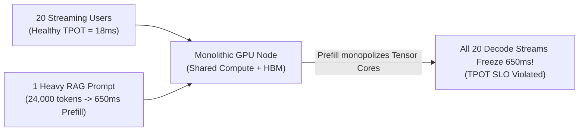

# Chapter 01 — Limits of Single-Node Inference Serving

> **Lecture 39 · Chapter 01 of 07** · Level: 🔴 Expert · Phase 9 — Distributed & Sovereign Inference
> **Source:** `FDE S24` · **Roadmap Reference:** [`roadmap-v1.md`](../../roadmap-v1.md#lecture-39--distributed-inference-sglang-llm-d--dynamo--capacity-engineering)
> **Roadmap topics:** Compute-bound prefill vs. memory-bandwidth-bound decode · prefill-decode interference · TTFT vs. TPOT SLO violations · why round-robin load balancing destroys KV reuse.

---

## 01.0 What this chapter is for

In [Lecture 38](../../Lecture%2038%20-%20vLLM%20and%20PagedAttention/), you learned how a single GPU node running **vLLM + PagedAttention + Continuous Batching** squeezes maximum throughput out of one machine. That works well for 5–10 concurrent users.

Now imagine you are deploying a **Global Legal & Financial AI Copilot** (our running case study for Lecture 39):
- **Peak load:** `20` requests per second (`RPS`).
- **Average request:** `6,000` input tokens (system instructions + RAG policy chunks) and `300` output tokens.
- **Strict SLOs:** **TTFT `< 400 ms`** (first token appears fast) and **TPOT `< 30 ms`** (streaming reads smoothly at > 33 tokens/sec).
- **Legal constraint:** `EU` traffic must stay on `EU` GPUs; `IN` traffic must stay on `IN` GPUs.

If you simply deploy 8 identical vLLM pods behind a standard Kubernetes `ClusterIP` round-robin load balancer, **the system fails both latency SLOs and compliance**. This chapter explains *why* at the GPU hardware level.

By the end of this chapter you should be able to:

1. Contrast the hardware physics of **Prefill (compute-bound)** vs. **Decode (memory-bandwidth-bound)**.
2. Explain **Prefill-Decode Interference** and show numerically why one 24k-token prompt spikes TPOT for 20 other streaming users.
3. Explain why **round-robin load balancing** reduces prefix KV-cache hit rates from `85%` to `1/N`.

---

## 01.1 The two opposing physics of LLM inference

Every LLM request executes two completely different workloads on the GPU:

| Phase | What the GPU Actually Computes | Hardware Bottleneck | User-Facing Metric |
| :--- | :--- | :--- | :--- |
| **1. Prefill** | Multiplies all $N_{\text{input}}$ prompt tokens in parallel ($QK^T V$ matrix-matrix multiplies) to build the initial KV cache and emit token #1 | **Tensor Core FLOPs** (Compute-bound: GPU cores are 90%+ busy) | **TTFT** (Time To First Token, target `< 400 ms`) |
| **2. Decode** | Generates 1 token at a time per active user, reading the entire model's weights + KV cache from GPU HBM on every single step | **HBM Memory Bandwidth** (Bandwidth-bound: Tensor Cores sit 80% idle waiting on memory) | **TPOT** (Time Per Output Token, target `< 30 ms`) |

Notice the contradiction:
- **Prefill** wants **maximum FLOPs** and zero interruptions.
- **Decode** wants **large batch sizes** (amortizing weight reads across 32–64 users) and **zero long pauses** between steps.

---

## 01.2 Prefill-Decode Interference: How one user stalls 20 others

On a **monolithic** inference node (one GPU pool doing both Prefill and Decode):

Suppose 20 users are happily streaming answers at `18 ms` per token (`TPOT = 18 ms < 30 ms`). Then User #21 submits a **24,000-token** contract review prompt:

1. Continuous batching schedules User #21's **Prefill** chunk.
2. Computing $QK^T V$ for 24,000 tokens saturates the GPU's Tensor Cores for **~650 ms**.
3. During those 650 ms, Users #1–#20 **cannot decode a single token** — their streaming output freezes!
4. Their observed TPOT jumps from `18 ms` to `650 ms` (**21× worse than the `30 ms` SLO**).

Even with **chunked prefill** (splitting 24k tokens into 512-token chunks), heavy prefill chunks still inflate decode latency by `1.8×–2.5×` under peak load (`18 ms * 2.1 = 37.8 ms > 30 ms` SLO!).

---

## 01.3 Why round-robin load balancing destroys KV-cache reuse

In our case study, `75%` of the 6,000 input tokens (`4,500` tokens) are shared system instructions, tool schemas, and policy documents.

With a standard Kubernetes round-robin Service across `8` monolithic replicas:
- **Turn 1** lands on **Pod 3** (computes KV cache for the 4,500-token prefix).
- **Turn 2** lands on **Pod 7** (cold! Recomputes the exact same 4,500 tokens from scratch).
- **Result:** Your cluster-wide KV hit rate collapses to $\sim 1/8 = 12.5\%$, forcing you to buy `3×` more GPUs just to recompute identical prefixes!

---

## 01.4 Key takeaways

1. **Prefill is compute-bound (TTFT); Decode is memory-bandwidth-bound (TPOT).** Running both on the same GPU creates prefill-decode interference.
2. **Round-robin load balancing is KV-cache-blind**, wasting 75%+ of prefill compute on redundant prefix recomputation.
3. **Production distributed inference fixes all three walls** using **Disaggregated `P/D` Pools** (Chapter 02), **RadixAttention / LMCache** (Chapter 03), and **Prefix-Affinity + Residency Routing** (Chapters 04–06).

---

**Next:** [Chapter 02 — Disaggregated Prefill & Decode Architecture](./02_Disaggregated_Prefill_and_Decode_Architecture.md)
