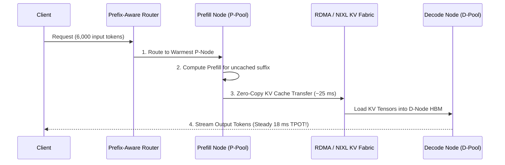

# Chapter 02 — Disaggregated Prefill & Decode Architecture

> **Lecture 39 · Chapter 02 of 07** · Level: 🔴 Expert · Phase 9 — Distributed & Sovereign Inference
> **Source:** `FDE S24` · **Roadmap Reference:** [`roadmap-v1.md`](../../roadmap-v1.md#lecture-39--distributed-inference-sglang-llm-d--dynamo--capacity-engineering)
> **Roadmap topics:** Separating Prefill (`P`) and Decode (`D`) GPU pools · KV-cache transfer over RDMA/NVLink/NIXL · independent `P:D` scaling ratios · eliminating TTFT/TPOT interference.

---

## 02.0 What this chapter is for

Once you see that Prefill (FLOP-bound) and Decode (HBM-bandwidth-bound) fight each other on the same GPU, the architectural solution is **Disaggregated Prefill & Decode (`P/D` Disaggregation)**:

Split your GPU fleet into **two specialized pools**:
1. **Prefill Pool (`P` Nodes):** Dedicated to processing input prompts in parallel and producing the initial KV cache + first token (**optimizes TTFT**).
2. **Decode Pool (`D` Nodes):** Dedicated to streaming output tokens across large batches with zero prefill interruptions (**optimizes TPOT**).

By the end of this chapter you should be able to:

1. Trace the **4-step `P/D` request lifecycle** from router $\rightarrow$ Prefill node $\rightarrow$ KV transfer $\rightarrow$ Decode node.
2. Calculate the **KV-cache transfer size** for a prompt and explain why InfiniBand RDMA / NVLink / **NVIDIA NIXL** is required.
3. Choose the right **`P : D` GPU ratio** for RAG-heavy vs. reasoning-heavy workloads.

---

## 02.1 The 4-Step Disaggregated `P/D` Lifecycle

### How big is a KV-cache transfer? (Worked math)

For a Llama-3 70B model using Grouped-Query Attention (`GQA = 8` KV heads, `80` layers, `head_dim = 128`, `FP16 = 2 bytes`):

$$\text{KV per token} = 2\text{ (K+V)} \times 80\text{ layers} \times 8\text{ heads} \times 128\text{ dim} \times 2\text{ bytes} \approx \mathbf{320\text{ KB/token}}$$

For `6,000` input tokens: $6{,}000 \times 320\text{ KB} \approx \mathbf{1.92\text{ GB}}$!
- Over standard `10 Gbps` (~1.25 GB/s) Ethernet: `1.92 GB` takes **`1,536 ms`** (way too slow!).
- Over **`400 Gbps` InfiniBand RDMA / NVLink (`50 GB/s`)** with **NIXL**: `1.92 GB` transfers in **`~38 ms`** (or **`~10 ms`** if `75%` of the prefix was already cached on `D` or only the uncached `1,500` tokens transfer)!

> [!IMPORTANT]
> **Hardware prerequisite:** Disaggregated `P/D` serving requires high-bandwidth GPU-to-GPU networking (InfiniBand RDMA, RoCEv2, or NVLink). Over slow 10GbE TCP, KV transfer latency destroys your TTFT gain.

---

## 02.2 Independent `P : D` Scaling Ratios

Because `P` and `D` pools are decoupled, you can match GPU hardware and replica counts to your exact workload:

| Workload Type | Typical Input : Output | Bottleneck | Optimal `P : D` Ratio |
| :--- | :---: | :--- | :---: |
| **Enterprise RAG / Summarization** | `16,000 : 200` (`80:1`) | Compute-bound Prefill | **`3P : 1D`** (or `2P : 1D` with KV reuse) |
| **Interactive Chat** | `2,000 : 400` (`5:1`) | Balanced | **`1P : 1D`** |
| **System-2 Reasoning / Codegen** | `2,000 : 4,000` (`1:2`) | Bandwidth-bound Decode | **`1P : 3D`** |

---

## 02.3 Key takeaways

1. **`P/D` disaggregation completely eliminates prefill-decode interference**, keeping TPOT flat even during 32k-token RAG bursts.
2. **High-speed RDMA/NVLink + NIXL** transfers KV tensors in `10–40 ms`, making disaggregation faster than monolithic interference.
3. **You scale `P` GPUs for TTFT and `D` GPUs for TPOT independently**, matching your workload's `input : output` ratio.

---

**Next:** [Chapter 03 — KV Cache Reuse, RadixAttention & Offloading](./03_KV_Cache_Reuse_RadixAttention_and_Offloading.md)
