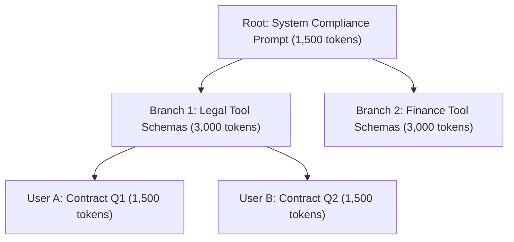

# Chapter 03 — KV Cache Reuse, RadixAttention & Offloading

> **Lecture 39 · Chapter 03 of 07** · Level: 🔴 Expert · Phase 9 — Distributed & Sovereign Inference
> **Source:** `FDE S24` · **Roadmap Reference:** [`roadmap-v1.md`](../../roadmap-v1.md#lecture-39--distributed-inference-sglang-llm-d--dynamo--capacity-engineering)
> **External Reference:** [SGLang RadixAttention](https://docs.sglang.ai/)
> **Roadmap topics:** SGLang RadixAttention (prefix radix tree in GPU HBM) · tiered KV offloading (`GPU HBM -> Host CPU DRAM -> NVMe/LMCache/Mooncake`) · cache hit-rate math on TTFT.

---

## 03.0 What this chapter is for

In our Global Legal & Financial Copilot case study, every request starts with:
- `1,500` tokens of system prompt + compliance rules
- `3,000` tokens of shared policy / tool schemas
- `1,500` tokens of user-specific question & recent turn

That means **`4,500 / 6,000 = 75%`** of the prompt is **identical across requests**. Recomputing those 4,500 tokens on every call wastes 75% of your Prefill GPUs!

Two complementary architectures eliminate that waste:
1. **SGLang `RadixAttention`** (in-GPU prefix tree sharing).
2. **`LMCache` / `Mooncake`** (tiered KV offloading beyond GPU HBM).

By the end of this chapter you should be able to:

1. Explain how **SGLang `RadixAttention`** organizes KV-cache pages in a prefix radix tree with LRU eviction.
2. Trace the **3-tier KV memory hierarchy** (`GPU HBM` $\rightarrow$ `Host CPU DRAM` $\rightarrow$ `Distributed LMCache / Mooncake`).
3. Quantify the **TTFT speedup** and **GPU savings** from a `75%` KV-cache hit rate.

---

## 03.1 How SGLang `RadixAttention` Works

Standard vLLM PagedAttention manages KV blocks per individual request and frees them when the request finishes. **SGLang `RadixAttention`** keeps finished KV blocks alive inside a **Radix Tree (compressed prefix trie)** in GPU HBM:

When **User B** sends a legal question:
1. SGLang walks the Radix Tree and finds `Root + Branch 1` (`4,500` tokens) **already in GPU HBM**.
2. It computes Prefill **only for the remaining `1,500` tokens** (`25%` of the prompt)!
3. When GPU HBM runs full, the **LRU (Least Recently Used)** policy evicts cold leaf nodes first, keeping hot shared prefixes pinned.

---

## 03.2 Tiered KV Offloading: `LMCache` & `Mooncake`

GPU HBM is expensive and small (`80 GB` on an H100). If 100 tenants each have a `10,000`-token knowledge base, their combined KV cache (`100 * 3.2 GB = 320 GB`) **does not fit in GPU HBM**.

**`LMCache`** and **Moonshot AI's `Mooncake`** solve this by adding **tiered KV offloading**:

| Tier | Medium | Capacity | Load Latency (for 4,500 tokens) | vs. Recomputing Prefill |
| :--- | :--- | :---: | :---: | :---: |
| **Tier 1** | **GPU HBM** (SGLang RadixAttention) | `80 GB / GPU` | **`0 ms`** (already resident) | **Instant** |
| **Tier 2** | **Host CPU DRAM** (PCIe Gen5) | `512 GB – 2 TB / node` | `~25–45 ms` | **6×–10× faster** than recomputing |
| **Tier 3** | **Distributed RDMA DRAM / NVMe Pool** (`LMCache` / `Mooncake`) | `10s of TB` cluster-wide | `~40–80 ms` | **4×–8× faster** than recomputing |

---

## 03.3 Key takeaways

1. **SGLang `RadixAttention`** turns single-request KV pages into a **shared prefix radix tree** across all users.
2. **`LMCache` and `Mooncake`** prevent cache eviction cliff-drops by offloading warm KV blocks to CPU DRAM and distributed RDMA memory.
3. **A `75%` KV hit rate cuts Prefill FLOPs by 4×**, slashing both TTFT and required Prefill GPUs.

---

**Next:** [Chapter 04 — Model-Aware & Prefix-Affinity Routing (`llm-d`)](./04_Model_Aware_and_Prefix_Affinity_Routing_llmd.md)
