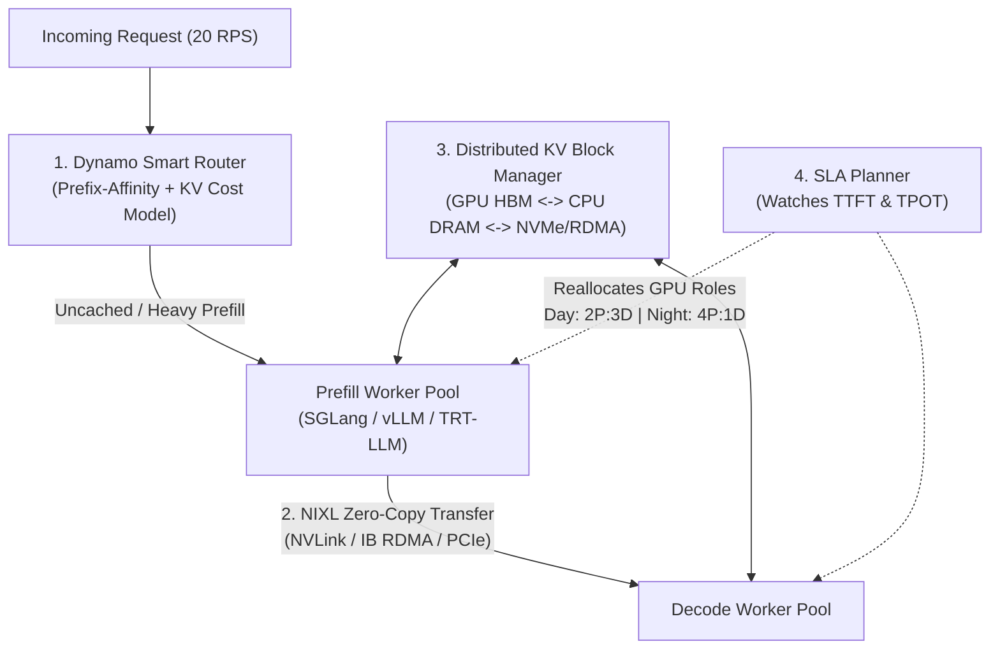

# Chapter 05 — NVIDIA Dynamo & Multi-Node Orchestration

> **Lecture 39 · Chapter 05 of 07** · Level: 🔴 Expert · Phase 9 — Distributed & Sovereign Inference
> **Source:** `FDE S24` · **Roadmap Reference:** [`roadmap-v1.md`](../../roadmap-v1.md#lecture-39--distributed-inference-sglang-llm-d--dynamo--capacity-engineering)
> **External Reference:** [NVIDIA Dynamo](https://github.com/ai-dynamo/dynamo)
> **Roadmap topics:** NVIDIA Dynamo 4-component architecture · NIXL zero-copy KV transfer · Distributed KV Block Manager · SLA-driven dynamic P/D worker reallocation · comparing SGLang, `llm-d`, and Dynamo.

---

## 05.0 What this chapter is for

Chapters 02–04 introduced the building blocks: disaggregated `P/D` pools, RadixAttention/LMCache KV reuse, and prefix-affinity routing. **NVIDIA Dynamo** (successor to Triton's LLM serving patterns) combines all of those into a single **multi-node, GPU-cluster-scale orchestration framework** that works across TensorRT-LLM, vLLM, and SGLang.

By the end of this chapter you should be able to:

1. Explain the **four core components** of NVIDIA Dynamo (Smart Router, NIXL, Distributed KV Manager, SLA Planner).
2. Trace how **NIXL (NVIDIA Inference Xfer Library)** abstracts NVLink, InfiniBand RDMA, and PCIe into one non-blocking KV transfer API.
3. Explain how Dynamo's **SLA Planner** dynamically shifts GPUs between `Prefill` and `Decode` pools as traffic changes.
4. Compare **SGLang**, **`llm-d`**, and **NVIDIA Dynamo** and know when to use each.

---

## 05.1 The Four Components of NVIDIA Dynamo

### What each component actually does

| Component | Problem It Solves | How It Works |
| :--- | :--- | :--- |
| **1. Smart Router** | Avoids redundant prefill & hot-spotting | Maintains a cluster-wide radix tree of where KV blocks live; routes to minimize total `(recompute_cost + queue_wait)` |
| **2. NIXL (Transfer Library)** | Slow TCP/gRPC KV copying stalls TTFT | Non-blocking, asynchronous **RDMA / NVLink** memory-to-memory transfer of KV-cache pages between `P` and `D` GPUs |
| **3. Distributed KV Block Manager** | Limited GPU HBM capacity | Coordinates tiered KV offloading (HBM $\rightarrow$ CPU DRAM $\rightarrow$ NVMe/storage) across all nodes |
| **4. SLA Planner** | Fixed `P:D` ratios waste GPUs when traffic shifts | Continuously monitors live **TTFT** and **TPOT**; converts idle `D` workers into `P` workers during batch RAG spikes (and vice versa) |

---

## 05.2 Why the SLA Planner matters in enterprise fleets

Consider our Global Legal & Financial Copilot over 24 hours:
- **9:00 AM – 5:00 PM (Interactive Chat & Drafting):** Users stream long memos (`2,000` input : `1,500` output). **Decode** is the bottleneck $\rightarrow$ SLA Planner shifts the fleet to **`1P : 3D`**.
- **11:00 PM – 4:00 AM (Overnight Contract Indexing & Batch QA):** Pipelines send massive 20k-token contracts for short JSON extraction (`20,000` input : `100` output). **Prefill** is the bottleneck $\rightarrow$ SLA Planner shifts the exact same GPUs to **`4P : 1D`**!

Without dynamic `P/D` reallocation, you would have to buy enough GPUs to cover **both** peak `P` and peak `D` simultaneously.

---

## 05.3 Comparing `SGLang`, `llm-d`, and `NVIDIA Dynamo`

| Dimension | **SGLang** | **`llm-d`** | **NVIDIA Dynamo** |
| :--- | :--- | :--- | :--- |
| **Layer** | Inference Engine (runs on GPUs) | Kubernetes Inference Gateway + Orchestrator | Full Multi-Node GPU Fleet Framework |
| **KV Cache Magic** | **RadixAttention** (in-HBM prefix tree) | Integrates vLLM/SGLang + LMCache | **Distributed KV Manager** + NIXL |
| **P/D Disaggregation** | Supported via Mooncake / SGLang router | Native K8s Gateway API `P/D` routing | Native **`P/D` + dynamic SLA Planner** |
| **Best For** | Fastest single/multi-GPU engine & structured outputs | Cloud-native Kubernetes teams (Envoy/Gateway API) | Large-scale multi-node NVIDIA InfiniBand/NVLink clusters |

---

## 05.4 Key takeaways

1. **NVIDIA Dynamo** combines a **Smart Router**, **NIXL**, a **Distributed KV Manager**, and a dynamic **SLA Planner** into one multi-node fabric.
2. **NIXL** moves KV tensors asynchronously over NVLink/RDMA so `P/D` handoff adds only `~25 ms` instead of seconds.
3. **Dynamic `P/D` reallocation** lets the same GPU fleet serve interactive daytime chat and overnight batch RAG without double-buying hardware.

---

**Next:** [Chapter 06 — Data Residency, Multi-Region HA & Failover](./06_Data_Residency_Multi_Region_HA_and_Failover.md)
