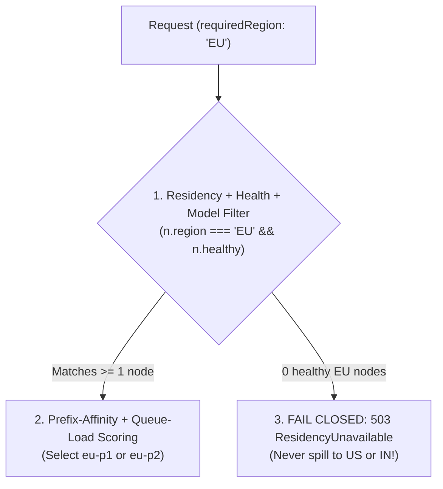

# Chapter 06 — Data Residency, Multi-Region HA & Failover

> **Lecture 39 · Chapter 06 of 07** · Level: 🔴 Expert · Phase 9 — Distributed & Sovereign Inference
> **Source:** `FDE S24` · **Roadmap Reference:** [`roadmap-v1.md`](../../roadmap-v1.md#lecture-39--distributed-inference-sglang-llm-d--dynamo--capacity-engineering)
> **Roadmap topics:** Regional data residency (`EU` GDPR, `IN` DPDP, `US`) · fail-closed residency routing · active-active HA within a jurisdiction · cross-region failover boundaries.

---

## 06.0 What this chapter is for

In a global deployment, latency is **not** the only routing constraint. If a European bank's contract prompt or an Indian healthcare query is routed to a GPU in `us-east-1` because `eu-central-1` is overloaded, **you have just committed a GDPR / DPDP compliance violation** — even if the response came back in 200 ms.

By the end of this chapter you should be able to:

1. Enforce **fail-closed data residency** in your inference router (`EU` $\rightarrow$ `EU` only; `IN` $\rightarrow$ `IN` only).
2. Design **intra-jurisdiction Active-Active High Availability** (e.g., Frankfurt `AZ-1` + Dublin `AZ-2` inside `EU`) so node failures never cross legal borders.
3. Explain why **503 `ResidencyUnavailable`** is the only compliant response when a region has zero healthy nodes.

---

## 06.1 Fail-Closed Residency vs. Unsafe Global Failover

| Pattern | What Happens When `eu-p1` Goes Down | Compliance Status |
| :--- | :--- | :---: |
| **Unsafe Global Spillover** | Router sees `us-p1` has `queue = 0` and sends EU user's prompt to `us-east-1` | ❌ **GDPR Violation** |
| **Fail-Closed + Intra-Region HA** | Router fails over to `eu-p2` (same EU jurisdiction); if **all** EU nodes are down, returns **`503 ResidencyUnavailable`** | ✅ **100% Compliant** |



---

## 06.2 Designing Sovereign & Multi-Region HA

1. **Tag every GPU pool with `region` and `jurisdiction`:** Never rely on DNS geo-routing alone; enforce `requiredRegion` inside the `DistributedInferenceRouter` itself.
2. **Minimum 2 Availability Zones per region:** To avoid ever hitting `503 ResidencyUnavailable`, deploy at least `N+1` capacity across 2+ AZs within `EU` (and within `IN`).
3. **Audit-log every routing decision:** Record `{ requestId, requiredRegion, selectedNodeId, nodeRegion }` so compliance auditors can prove 0% cross-border leakage:
   ```json
   { "requestId": "req_881", "requiredRegion": "EU", "selectedNodeId": "eu-dublin-az2", "nodeRegion": "EU", "failClosed": true }
   ```

---

## 06.3 Key takeaways

1. **Residency filtering runs *before* prefix-affinity and queue-load scoring.**
2. **Never fail over across legal borders** — fail closed with `503 ResidencyUnavailable` if all regional nodes are unhealthy.
3. **Achieve High Availability across multiple AZs inside the same jurisdiction.**

---

**Next:** [Chapter 07 — Capacity Engineering & Cost-per-Token Modeling](./07_Capacity_Engineering_and_Cost_per_Token_Modeling.md)
