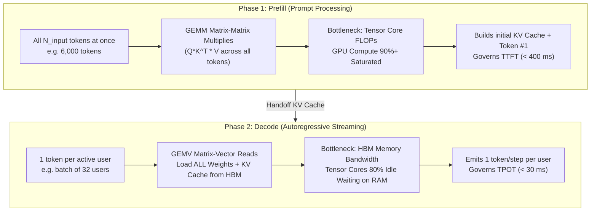
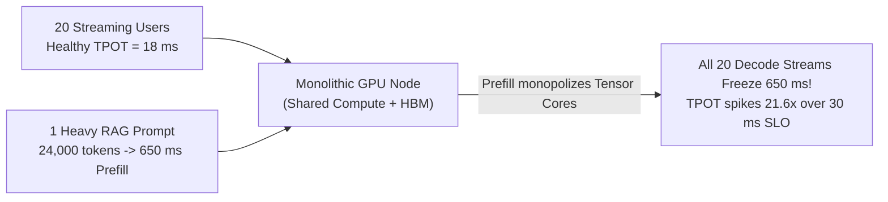

# Chapter 01 — Limits of Single-Node Inference Serving

> **Lecture 40 · Chapter 01 of 07** · Level: 🔴 Expert · Phase 9 — Distributed & Sovereign Inference
> **Source:** `FDE S24` · **Roadmap Reference:** [`roadmap-v1.md`](../../roadmap-v1.md#lecture-39--distributed-inference-sglang-llm-d--dynamo--capacity-engineering)
> **Roadmap topics:** Compute-bound prefill vs. memory-bandwidth-bound decode · prefill-decode interference · TTFT vs. TPOT SLO violations · why round-robin load balancing destroys KV reuse.

---

## 01.0 What this chapter is for

In [Lecture 38](../../Lecture%2038%20-%20vLLM%20and%20PagedAttention/), you learned how a single GPU node running **vLLM + PagedAttention + Continuous Batching** squeezes high throughput out of one machine. That architecture works well for 5–10 concurrent users on a single team prototype.

Now scale that same architecture to an enterprise production workload. Throughout Lecture 40, we will use one concrete running case study — the **Global Legal & Financial AI Copilot**:

- **Peak load:** `20` requests per second (`RPS`).
- **Average request:** `6,000` input tokens (`4,500` shared system prompt + compliance rules + tool schemas, and `1,500` user query + RAG chunks) and `300` output tokens.
- **Strict SLOs:** **TTFT `< 400 ms`** (first token appears fast) and **TPOT `< 30 ms`** (streaming reads smoothly at `> 33` tokens/sec).
- **Legal constraint:** `EU` traffic must stay on `EU` GPUs; `IN` traffic must stay on `IN` GPUs.

If you simply deploy `8` identical vLLM pods behind a standard Kubernetes `ClusterIP` round-robin load balancer, **the system fails both latency SLOs and compliance** — even though your GPU cluster looks "only 65% utilized" on Grafana. This chapter explains *why* at the GPU hardware and routing level.

By the end of this chapter you should be able to:

1. Contrast the GPU hardware physics of **Prefill (compute-bound)** vs. **Decode (memory-bandwidth-bound)** and map each to its user-facing SLO (**TTFT** vs. **TPOT**).
2. Explain **Prefill-Decode Interference** and show numerically why a single `24,000`-token prompt spikes TPOT by `21×` for `20` concurrent streaming users.
3. Quantify why **chunked prefill** mitigates total freezes yet still breaks strict TPOT SLOs under peak load.
4. Calculate why **round-robin load balancing** collapses cluster-wide prefix KV-cache hit rates from `75–85%` down to `1/N`.
5. Identify the four architectural walls that motivate Disaggregated `P/D` pools, RadixAttention, `llm-d`, and NVIDIA Dynamo.

---

## 01.1 The two opposing physics of LLM inference

Every autoregressive LLM request executes two completely different workloads on the GPU. Treating them as one homogeneous job is the root cause of single-node serving collapse.

| Dimension | Phase 1: Prefill | Phase 2: Decode |
| :--- | :--- | :--- |
| **Computation Shape** | `N × d` matrix-matrix multiply (`GEMM`) | `1 × d` matrix-vector multiply (`GEMV`) per sequence |
| **Arithmetic Intensity** | **High** (thousands of FLOPs per byte loaded from HBM) | **Extremely Low** (`~1–2` FLOPs per byte loaded from HBM) |
| **Hardware Bottleneck** | **Tensor Core FLOPs** (Compute-bound) | **HBM Memory Bandwidth** (Bandwidth-bound, e.g., `3.35 TB/s` on H100) |
| **Optimal Batching Strategy** | Small batch or single long prompt already saturates FLOPs | Large batch (`32–128` users) to amortize reading model weights |
| **User-Facing SLO** | **TTFT** (Time To First Token, target `< 400 ms`) | **TPOT** (Time Per Output Token, target `< 30 ms`) |

Notice the fundamental contradiction:
- **Prefill** wants **maximum FLOPs** and zero interruptions so TTFT stays low.
- **Decode** wants **large batch sizes** (amortizing `140 GB` of FP16 70B weight reads across many users) and **zero long pauses** between steps so TPOT stays steady.

> [!IMPORTANT]
> **Why arithmetic intensity dictates everything.** In Decode, generating just 1 token for 1 user on a 70B FP16 model forces the GPU to read ~`140 GB` of weights from HBM. On an H100 (`3.35 TB/s` HBM3), reading `140 GB` takes `140 / 3350 ≈ 41.8 ms` for a single GPU (or `~10–18 ms` with Tensor Parallelism `TP=4/8`). Tensor Cores finish the math in microseconds and sit idle waiting for the next weight read.

---

## 01.2 Prefill-Decode Interference: How one user stalls 20 others

On a **monolithic** inference node (one GPU pool executing both Prefill and Decode in the same continuous batching loop), the two phases fight for the same Tensor Cores and HBM scheduler.

### Worked interference example

Suppose `20` users on our Legal Copilot are happily streaming answers at `TPOT = 18 ms` (`55.5` tokens/sec, well under the `30 ms` SLO). Then User #21 submits a **24,000-token** contract review prompt:

1. Continuous batching admits User #21's **Prefill** into the next iteration.
2. Computing $QK^T V$ and MLP projections for `24,000` tokens saturates the GPU's Tensor Cores for **~650 ms** (at `~37,000` tok/s effective prefill across a `TP=4` node, or even longer on `TP=1/2`).
3. During those `650 ms`, Users #1–#20 **cannot execute a single decode step** — their streaming cursor freezes!
4. Their observed TPOT for that step jumps from `18 ms` to `650 ms` (**`21.6×` worse than the `30 ms` SLO**).

### Why chunked prefill is not a complete cure

Modern engines like vLLM offer **chunked prefill** (splitting the `24,000`-token prompt into `47` chunks of `512` tokens each, interleaving one decode step between chunks). While chunked prefill prevents a `650 ms` total freeze, it **still degrades both metrics under peak load**:
- Every `512`-token prefill chunk adds `~15–25 ms` of compute time *before* the decode step runs.
- Decode TPOT rises from `18 ms` to `18 ms × 2.1 = 37.8 ms` — **still violating the `< 30 ms` TPOT SLO!**
- Meanwhile, User #21's TTFT stretches out because their prefill is paused `46` times to serve decode steps.

> [!WARNING]
> **Chunked prefill trades a catastrophic spike for chronic SLO violation.** Under `20 RPS` peak load with `6,000`-token prompts, interleaved prefill chunks consistently push p95 TPOT above `35 ms` and p95 TTFT above `550 ms`.

---

## 01.3 Why round-robin load balancing destroys KV-cache reuse

In our Legal & Financial Copilot case study, `75%` of every `6,000`-token prompt (`4,500` tokens) is **identical across requests**: system instructions, compliance rules, and JSON tool schemas.

If you place `8` identical vLLM pods behind a standard Kubernetes `ClusterIP` or NGINX round-robin load balancer:

1. **Request 1** (User A, Legal) lands on **Pod 3**. Pod 3 computes the KV cache for the `4,500`-token prefix from scratch (`~225 ms` prefill).
2. **Request 2** (User B, Legal — *exact same `4,500`-token prefix*) lands on **Pod 7**. Pod 7 has a cold cache for that prefix and recomputes all `4,500` tokens from scratch!
3. **Request 3** lands on **Pod 1** — cold again.

With `N = 8` replicas and a KV-cache-blind round-robin router, the probability that a request lands on a pod that already holds its prefix drops toward `1/N = 12.5%` (or even lower if each pod's LRU cache evicts prefixes between visits).

### The GPU cost of KV-cache blindness

| Routing Strategy | Prefix KV Hit Rate | Effective Prefill Tokens / Req | Prefill Compute at `20 RPS` | Required H100 GPUs (Prefill) |
| :--- | :---: | :---: | :---: | :---: |
| **Round-Robin (`8` Pods)** | `~12.5%` (worst-case `0%`) | `5,438` – `6,000` tok | `108,750` – `120,000` tok/s | **`6` GPUs** (`8` with HA) |
| **Prefix-Aware + RadixTree** | **`75.0%`** | **`1,500` tok** | **`30,000` tok/s** | **`2` GPUs** (**`3×` fewer!**) |

---

## 01.4 Traps & Where Single-Node Assumptions Break

| Trap | What Teams Assume | Why It Breaks in Production |
| :--- | :--- | :--- |
| **"GPU utilization is 65%, we have headroom."** | Average SM utilization reflects user latency | Decode is HBM-bandwidth-bound; SM utilization looks low even when HBM is 100% saturated and TPOT is spiking. |
| **"Just enable chunked prefill."** | Chunking eliminates prefill-decode interference | Chunking stops 650 ms freezes, but interleaved chunks still inflate TPOT by `1.8×–2.5×`, breaking `< 30 ms` SLOs. |
| **"Kubernetes `ClusterIP` scales horizontally."** | Adding more pods behind round-robin scales linearly | Round-robin is blind to KV-cache state, destroying prefix hit rates and forcing `3×` redundant prefill FLOPs. |
| **"Fail over to `us-east-1` if `eu-central-1` is busy."** | Standard multi-region DNS/LB failover | Cross-border routing of EU/IN prompts violates GDPR/DPDP data residency laws. |

---

## 01.5 Common mistakes

| # | Common Mistake | Why It Hurts | What To Do Instead |
| :---: | :--- | :--- | :--- |
| 1 | **Monitoring average latency instead of p95/p99 TTFT and TPOT** | A single 24k-token prompt ruins streaming for 20 users while averages look fine | Track **TTFT** and **TPOT** separately at p50, p95, and p99 |
| 2 | **Using round-robin K8s Services for LLM pods** | Drops prefix KV-cache hit rates to `1/N`, wasting up to `75%` of prefill GPUs | Use a **prefix-affinity router** (`llm-d` or Dynamo Smart Router, Ch 04–05) |
| 3 | **Co-locating long-context RAG and latency-sensitive chat on monolithic GPUs** | Heavy RAG prefills stall chat decode streams | **Disaggregate Prefill (`P`) and Decode (`D`)** into separate GPU pools (Ch 02) |
| 4 | **Sizing GPUs only by model weights + VRAM** | Model fits in VRAM, but `20 RPS` prefill FLOPs or decode HBM bandwidth saturates | Size `P` GPUs by `tok/s` FLOPs and `D` GPUs by `tok/s` HBM bandwidth (Ch 07) |

---

## 01.6 Key takeaways

1. **Prefill is compute-bound (governs TTFT); Decode is HBM-bandwidth-bound (governs TPOT).** Running both on the same GPU creates destructive prefill-decode interference.
2. **A single 24k-token prefill stalls 20 active decode streams for `~650 ms`**, spiking TPOT `21×` past a `30 ms` SLO.
3. **Round-robin load balancing is KV-cache-blind**, collapsing `75%` prefix reuse down to `~12.5%` across 8 replicas and forcing `3×` more prefill compute.
4. **Production distributed inference solves all three walls** via **Disaggregated `P/D` Pools** (Ch 02), **RadixAttention & Tiered Offloading** (Ch 03), **Prefix-Affinity Routing (`llm-d`)** (Ch 04), **NVIDIA Dynamo** (Ch 05), and **Fail-Closed Residency** (Ch 06).

---

## 01.7 Self-check questions

1. Why does Decode leave Tensor Cores ~80% idle while still saturating the GPU? Which hardware resource is the true bottleneck?
2. Given a 70B FP16 model (`~140 GB` weights) on an H100 (`3.35 TB/s` HBM3), explain why batching 32 decode users together barely increases step latency compared to 1 user.
3. Why does **chunked prefill** eliminate total `650 ms` freezes yet still cause a `30 ms` TPOT SLO breach at `20 RPS`?
4. In our Legal Copilot (`4,500` shared prefix tokens out of `6,000`), calculate how many redundant prefill tokens/sec are wasted across `8` round-robin pods at `20 RPS` if hit rate drops from `75%` to `12.5%`.
5. Why is DNS/ClusterIP round-robin fundamentally incompatible with stateful KV-cache reuse?

---

**Next:** [Chapter 02 — Disaggregated Prefill & Decode Architecture](./02_Disaggregated_Prefill_and_Decode_Architecture.md)
