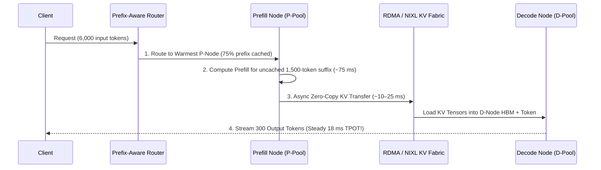
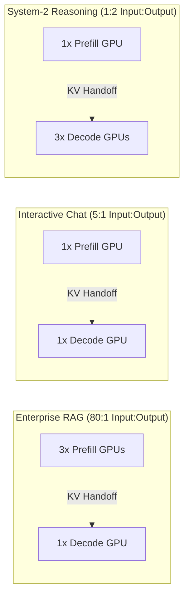

# Chapter 02 — Disaggregated Prefill & Decode Architecture

> **Lecture 40 · Chapter 02 of 07** · Level: 🔴 Expert · Phase 9 — Distributed & Sovereign Inference
> **Source:** `FDE S24` · **Roadmap Reference:** [`roadmap-v1.md`](../../roadmap-v1.md#lecture-39--distributed-inference-sglang-llm-d--dynamo--capacity-engineering)
> **Roadmap topics:** Separating Prefill (`P`) and Decode (`D`) GPU pools · KV-cache transfer over RDMA/NVLink/NIXL · independent `P:D` scaling ratios · eliminating TTFT/TPOT interference.

---

## 02.0 What this chapter is for

In Chapter 01, we saw that **Prefill** (Tensor Core FLOP-bound) and **Decode** (HBM memory-bandwidth-bound) have opposing hardware needs. Running them together on monolithic GPUs causes prefill-decode interference: one heavy prompt stalls every streaming user.

The architectural cure is **Disaggregated Prefill & Decode (`P/D` Disaggregation)**. Instead of one homogeneous pool of GPUs, you split your fleet into two specialized pools:

1. **Prefill Pool (`P` Nodes):** Dedicated to processing input prompts in parallel, building the initial KV cache, and emitting token `#1` (**optimizes TTFT**).
2. **Decode Pool (`D` Nodes):** Dedicated to streaming output tokens across large batches with zero prefill interruptions (**optimizes TPOT**).

By the end of this chapter you should be able to:

1. Trace the **4-step `P/D` request lifecycle** from prefix-aware router $\rightarrow$ `P`-Node $\rightarrow$ RDMA/NIXL fabric $\rightarrow$ `D`-Node.
2. Calculate the exact **KV-cache byte size per token** for a GQA model (e.g., Llama-3 70B) and derive the network transfer time over `10GbE` vs. `400 Gbps` InfiniBand RDMA / NVLink.
3. Explain why **NVIDIA NIXL** (or Mooncake Transfer Engine) is required for zero-copy, non-blocking KV handoff.
4. Choose and justify the right **`P : D` GPU ratio** for RAG-heavy (`3P:1D`), interactive chat (`1P:1D`), and reasoning/codegen (`1P:3D`) workloads.
5. Identify when `P/D` disaggregation is *not* worth the networking complexity.

---

## 02.1 The 4-Step Disaggregated `P/D` Lifecycle

In a disaggregated cluster, a request never stays on one GPU from start to finish. Instead, it flows through a clean 4-step pipeline:

Notice what happens on both sides of the fabric:
- **`P`-Pool GPUs** never run a decode step. They operate at `90%+` Tensor Core utilization, chewing through prompts and immediately handing off the resulting KV tensors.
- **`D`-Pool GPUs** never run a heavy prefill. They maintain large, steady decode batches (`32–64` active streams) with a flat `18 ms` TPOT — even if 50 users simultaneously upload 24,000-token contracts to the `P`-Pool!

---

## 02.2 KV-Cache Transfer Math: Why RDMA / NVLink / NIXL is Mandatory

The catch with `P/D` disaggregation is that the `P`-Node must **send the computed KV cache** to the `D`-Node before decoding can begin. How much data is that?

### Worked math: Llama-3 70B (`GQA = 8`)

For Llama-3 70B using Grouped-Query Attention (`8` KV heads, `80` transformer layers, `head_dim = 128`, `FP16 = 2 bytes`):

$$\text{KV bytes per token} = 2\text{ (K and V)} \times 80\text{ layers} \times 8\text{ KV heads} \times 128\text{ dim} \times 2\text{ bytes} = 327{,}680\text{ bytes} \approx \mathbf{320\text{ KB/token}}$$

Now plug in our Legal Copilot's `6,000`-token prompt:

- **Full `6,000`-token KV cache:** $6{,}000 \times 320\text{ KB} = \mathbf{1.92\text{ GB}}$
- **Uncached `1,500`-token suffix** (when `75%` prefix is already cached on `D` or transferred incrementally): $1{,}500 \times 320\text{ KB} = \mathbf{480\text{ MB}}$

Let's compare transfer latency across three network fabrics:

| Network Fabric | Effective Bandwidth | Transfer `1.92 GB` (Full) | Transfer `480 MB` (Incremental) | Viable for `< 400 ms` TTFT? |
| :--- | :---: | :---: | :---: | :---: |
| **Standard `10 Gbps` Ethernet** | `~1.25 GB/s` | `1,536 ms` | `384 ms` | ❌ **No** (TCP/CPU copy destroys TTFT) |
| **`100 Gbps` RoCEv2** | `~12.5 GB/s` | `154 ms` | `38 ms` | ⚠️ Borderline for full; OK for incremental |
| **`400 Gbps` InfiniBand RDMA / NVLink (NIXL)** | `~50 GB/s` | **`38.4 ms`** | **`9.6 ms`** | ✅ **Yes** (`10–38 ms` fits easily inside `400 ms`) |

> [!IMPORTANT]
> **Hardware prerequisite.** Disaggregated `P/D` serving requires high-bandwidth GPU-to-GPU networking (**InfiniBand RDMA**, **RoCEv2**, or **NVLink** across NVSwitch domains) paired with a zero-copy library like **NVIDIA NIXL**. Over standard 10GbE TCP, CPU-bounce serialization + network transfer adds `1.5 seconds` to TTFT, wiping out every benefit of disaggregation.

### Layer-by-layer pipelining (hiding transfer latency)

In production frameworks (SGLang, Dynamo, Mooncake), the `P`-Node doesn't even wait until all `80` layers finish prefill before starting the transfer. As soon as Layer `0`'s KV tensors are computed, **NIXL** asynchronously streams Layer `0` over RDMA while the GPU computes Layer `1` — overlapping compute and network transfer so the user sees `< 15–25 ms` effective handoff overhead.

---

## 02.3 Independent `P : D` Scaling Ratios

Because `P` and `D` pools are decoupled, you can scale their replica counts — and even use **different GPU SKUs** (e.g., compute-dense H100/B200 for `P`, memory-bandwidth-dense or quantized FP8 nodes for `D`) — to match your exact `input : output` token ratio.

| Workload Type | Typical `Input : Output` | Bottleneck | Optimal `P : D` Ratio | Why |
| :--- | :---: | :--- | :---: | :--- |
| **Enterprise RAG / Doc QA** | `16,000 : 200` (`80:1`) | Compute-bound Prefill | **`3P : 1D`** (or `2P : 1D` with KV reuse) | Long prompts burn FLOPs; short answers finish quickly |
| **Interactive Chat** | `2,000 : 400` (`5:1`) | Balanced | **`1P : 1D`** | Moderate prompts and moderate streaming responses |
| **System-2 Reasoning / Codegen** | `2,000 : 4,000` (`1:2`) | Bandwidth-bound Decode | **`1P : 3D`** | Short prompts, but long `<think>` chains hold decode slots for 60+ seconds |

> [!TIP]
> **Capacity rule of thumb:** In Chapter 07, you will compute exact `P` and `D` counts from `peakRps`, `avgInputTokens`, `avgOutputTokens`, and `kvCacheHitRate`. Notice that **higher KV hit rates shrink the `P` pool** without changing the `D` pool!

---

## 02.4 Traps & When NOT to Disaggregate

| Trap / Scenario | Reality | What To Do Instead |
| :--- | :--- | :--- |
| **"Disaggregate on a single 8-GPU node with slow PCIe."** | Without NVLink/NVSwitch or RDMA, KV transfer over PCIe/TCP can stall TTFT | Keep monolithic serving with chunked prefill if you lack fast GPU-to-GPU fabric |
| **"Disaggregate for tiny prompts (`< 256` tokens) at low RPS (`< 2`)."** | At low load, there is no prefill-decode interference to fix | Start with single-node vLLM/SGLang; disaggregate once p95 TPOT or TTFT breaches SLO |
| **"Forget to reuse KV on `D`-Nodes too."** | Transferring `1.92 GB` every time wastes RDMA fabric | Cache shared system prefixes on both `P` and `D` so only the uncached delta transfers |

---

## 02.5 Common mistakes

| # | Common Mistake | Why It Hurts | What To Do Instead |
| :---: | :--- | :--- | :--- |
| 1 | **Deploying `P/D` disaggregation over 10GbE TCP** | `1.92 GB` KV transfer takes `> 1.5 s`, blowing past TTFT SLO | Require `200–400 Gbps` InfiniBand RDMA, RoCEv2, or NVLink with **NIXL** |
| 2 | **Hardcoding a `1P : 1D` ratio for all workloads** | Over-provisions `D` for RAG or starves `D` during reasoning bursts | Size `P:D` from `input:output` token ratios or use Dynamo's **SLA Planner** (Ch 05) |
| 3 | **Transferring the entire `6,000`-token KV cache when `4,500` tokens are static** | Wastes `4×` RDMA bandwidth on every request | Pin/cache shared prefixes on `D`-Nodes and transfer only the **uncached suffix** |
| 4 | **Ignoring `P`-to-`D` backpressure** | If `D`-Pool is full, `P`-Nodes compute KV caches that sit idle and expire | Propagate `D`-Pool queue depth to the router so `P` and `D` admit requests together |

---

## 02.6 Key takeaways

1. **`P/D` disaggregation separates FLOP-bound Prefill from bandwidth-bound Decode**, eliminating the `650 ms` decode stalls caused by heavy prompts.
2. **Llama-3 70B (`GQA=8`) requires `~320 KB` of KV cache per token** (`1.92 GB` for `6,000` tokens), making `400 Gbps` RDMA / NVLink + **NIXL** (`10–38 ms`) mandatory.
3. **Decoupled `P` and `D` pools scale independently** (`3P:1D` for RAG, `1P:1D` for chat, `1P:3D` for reasoning).

---

## 02.7 Self-check questions

1. Walk through the 4 steps of a disaggregated `P/D` request from the client's HTTP POST to the final streamed token.
2. Compute the KV-cache size per token for a model with `40` layers, `8` GQA KV heads, `head_dim = 128`, in `FP16` (`2` bytes). How large is a `10,000`-token prompt's KV cache?
3. Why does `P/D` disaggregation fail over `10 Gbps` Ethernet, and how does **layer-by-layer pipelining** over `400 Gbps` RDMA / NIXL solve it?
4. Why does a System-2 reasoning workload (`2,000` input : `4,000` output) invert the optimal `P:D` ratio compared to Enterprise RAG (`16,000` input : `200` output)?
5. Name two scenarios where keeping a monolithic node with chunked prefill is better than deploying `P/D` disaggregation.

---

**Next:** [Chapter 03 — KV Cache Reuse, RadixAttention & Offloading](./03_KV_Cache_Reuse_RadixAttention_and_Offloading.md)
