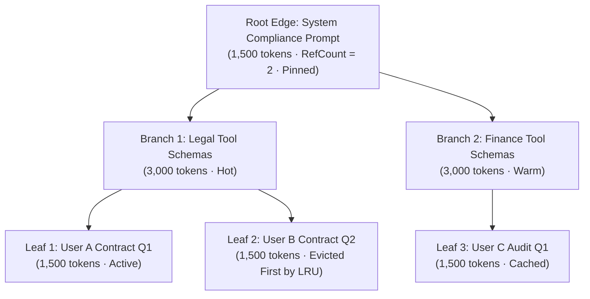
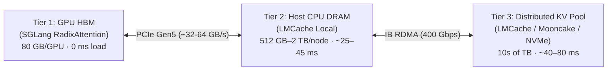

# Chapter 03 — KV Cache Reuse, RadixAttention & Offloading

> **Lecture 40 · Chapter 03 of 07** · Level: 🔴 Expert · Phase 9 — Distributed & Sovereign Inference
> **Source:** `FDE S24` · **Roadmap Reference:** [`roadmap-v1.md`](../../roadmap-v1.md#lecture-39--distributed-inference-sglang-llm-d--dynamo--capacity-engineering)
> **External Reference:** [SGLang RadixAttention](https://docs.sglang.ai/)
> **Roadmap topics:** SGLang RadixAttention (prefix radix tree in GPU HBM) · tiered KV offloading (`GPU HBM -> Host CPU DRAM -> NVMe/LMCache/Mooncake`) · cache hit-rate math on TTFT.

---

## 03.0 What this chapter is for

In our Global Legal & Financial Copilot case study, every incoming request of `6,000` tokens consists of:
- `1,500` tokens of system prompt + compliance rules
- `3,000` tokens of shared legal or finance tool schemas & policy documents
- `1,500` tokens of user-specific query + retrieved contract chunk

That means **`4,500 / 6,000 = 75%`** of the prompt is **identical across requests**. Recomputing the KV cache for those `4,500` tokens on every request wastes `75%` of your Prefill GPUs!

Two complementary technologies eliminate that redundant computation:
1. **SGLang `RadixAttention`** — keeps finished KV-cache pages alive inside an in-GPU **prefix radix tree** with LRU eviction.
2. **`LMCache` & `Mooncake`** — extend KV storage beyond expensive GPU HBM into **Host CPU DRAM** and **distributed RDMA DRAM / NVMe pools**.

By the end of this chapter you should be able to:

1. Explain how **SGLang `RadixAttention`** differs from standard PagedAttention and how it shares prefixes across users, turns, and few-shot branches.
2. Trace **LRU leaf eviction** in a Radix Tree and explain why shared root prefixes stay pinned in GPU HBM.
3. Quantify the **TTFT speedup** and **Prefill GPU savings** from a `75%` KV-cache hit rate.
4. Design a **3-tier KV memory hierarchy** (`GPU HBM` $\rightarrow$ `Host CPU DRAM` $\rightarrow$ `LMCache / Mooncake`) and compute its capacity vs. load-latency trade-offs.

---

## 03.1 How SGLang `RadixAttention` Works

Standard vLLM PagedAttention manages KV blocks per individual request and **frees them the moment the request finishes**. If User B sends the exact same `4,500`-token system prompt 200 milliseconds later, the GPU has already discarded User A's KV blocks.

**SGLang `RadixAttention`** solves this by retaining finished KV blocks inside a **Radix Tree (compressed prefix trie)** in GPU HBM:

### Step-by-step execution when User D arrives

Suppose User D sends a new Legal question (`1,500` unique tokens) sharing the Legal system prompt + tool schemas (`4,500` tokens):

1. **Longest-Prefix Match:** SGLang walks the Radix Tree from `Root` $\rightarrow$ `Branch 1` and matches `4,500` tokens **already resident in GPU HBM** (`0 ms` recompute!).
2. **Delta Prefill Only:** The GPU computes Prefill **only for the remaining `1,500` tokens** (`25%` of the prompt).
3. **Tree Insertion:** User D's `1,500` new KV tokens are attached as a new leaf under `Branch 1`.
4. **LRU Eviction (when HBM fills up):** SGLang evicts **cold leaf nodes first** (e.g., `Leaf 2` from 10 minutes ago), working upward only if needed. Because `Root` and `Branch 1` are hit constantly, their timestamps stay fresh and they remain pinned in HBM.

> [!TIP]
> **Beyond system prompts.** RadixAttention automatically accelerates **multi-turn chat** (each new turn reuses all prior turns), **few-shot prompting** (all queries share the same examples), and **tree-of-thought / self-consistency** (parallel branches share the same reasoning prefix).

---

## 03.2 Worked Math: How `75%` KV Reuse Slashes TTFT and GPU Count

Let's plug numbers from our Legal Copilot (`6,000` input tokens, H100 `P`-Node at `20,000` prefill tok/s, `baseTtftMs = 45 ms`, `nixlTransferMs = 25 ms`):

- **Without KV Reuse (`0%` hit rate):**
  - Prefill compute time: $(6{,}000 / 20{,}000) \times 1000 = 300\text{ ms}$.
  - Total TTFT: $45 + 300 + 25 = \mathbf{370\text{ ms}}$ (barely under `400 ms` with zero queueing!).
  - At `20 RPS`: $20 \times 6{,}000 = 120{,}000\text{ tok/s} \implies \mathbf{6\text{ Prefill GPUs}}$.
- **With `75%` KV Reuse (`4,500` tokens hit in RadixAttention):**
  - Prefill compute time: $(1{,}500 / 20{,}000) \times 1000 = \mathbf{75\text{ ms}}$ (`4×` faster!).
  - Total TTFT: $45 + 75 + 25 = \mathbf{145\text{ ms}}$ (**`2.55×` faster**, massive `255 ms` headroom under the `400 ms` SLO!).
  - At `20 RPS`: $20 \times 1{,}500 = 30{,}000\text{ tok/s} \implies \mathbf{2\text{ Prefill GPUs}}$ (**`3×` fewer Prefill GPUs!**).

---

## 03.3 Tiered KV Offloading: `LMCache` & `Mooncake`

GPU HBM is fast (`3.35 TB/s`) but tiny (`80 GB` on an H100). After storing `~70 GB` of 70B model weights (across `TP=2` or `TP=4` shards), only a fraction of HBM remains for KV cache.

Recall from Chapter 02 that Llama-3 70B uses **`~320 KB/token`**:
- `4,500` shared tokens = `1.44 GB`.
- `10,000`-token tenant knowledge base = `3.2 GB`.
- If you serve **`100` enterprise tenants**, each with a `10,000`-token policy KB, their combined KV cache is $100 \times 3.2\text{ GB} = \mathbf{320\text{ GB}}$ — **it cannot fit in a single GPU's HBM!**

Without offloading, Tenant #1's KV cache gets evicted when Tenant #20 arrives, causing a **cache-eviction cliff** where hit rates plummet. **`LMCache`** and **Moonshot AI's `Mooncake`** solve this by building a **3-tier KV memory hierarchy**:

| Tier | Storage Medium | Typical Capacity | Load Latency (`4,500` tok = `1.44 GB`) | Speedup vs. Recomputing (`~225 ms`) |
| :--- | :--- | :---: | :---: | :---: |
| **Tier 1** | **GPU HBM** (SGLang RadixAttention) | `10–40 GB` free / GPU | **`0 ms`** (resident) | **Instant** |
| **Tier 2** | **Host CPU DRAM** (Pinned RAM over PCIe Gen5) | `512 GB – 2 TB / node` | `~25–45 ms` | **`5×–9×` faster** than recompute |
| **Tier 3** | **Distributed RDMA DRAM / NVMe** (`LMCache` / `Mooncake`) | `10s of TB` cluster-wide | `~40–80 ms` | **`3×–5×` faster** than recompute |

> [!IMPORTANT]
> **When offloading stops paying off.** Offloading only wins when `KV_Load_Latency < Prefill_Recompute_Latency`. For a tiny `200`-token prefix (`64 MB`), recomputing takes `10 ms` while fetching from Tier 3 NVMe might take `15 ms`. Always set a **minimum prefix chunk size** (e.g., `>= 512–1,024` tokens) before offloading to Tier 2/3.

---

## 03.4 Traps & Where KV Caching Breaks

| Trap | What Happens | How to Prevent It |
| :--- | :--- | :--- |
| **Dynamic timestamps at the start of the prompt** | Putting `Current time: 14:03:22` on line 1 invalidates the entire `4,500`-token prefix hash on every request! | **Always place static system prompts and tool schemas first**, and put dynamic timestamps/user IDs at the **very end** of the prompt. |
| **Unpinned CPU memory** | OS paging slows PCIe transfers by `5×` | Use `cudaHostAlloc` / pinned DRAM pages in `LMCache` for predictable DMA speeds. |
| **Cross-tenant KV leakage** | Tenant A's cached prefix is accidentally matched by Tenant B if not namespace-isolated | Scope Radix tree keys by `(tenantId, modelId, promptPrefix)` for tenant-specific RAG docs. |

---

## 03.5 Common mistakes

| # | Common Mistake | Why It Hurts | What To Do Instead |
| :---: | :--- | :--- | :--- |
| 1 | **Putting volatile variables (`date`, `request_id`) at the top of the system prompt** | Busts `100%` of the RadixAttention prefix tree on every call | Keep static instructions + tool schemas at the **top**; append dynamic context at the **bottom** |
| 2 | **Assuming GPU HBM alone can cache 100+ tenant KBs** | Causes constant LRU thrashing and cache-eviction cliffs | Add **Tier 2 CPU DRAM** and **Tier 3 `LMCache` / `Mooncake`** offloading |
| 3 | **Offloading tiny prefixes (`< 256` tokens) to NVMe** | Network/disk fetch latency exceeds GPU recompute latency | Enforce a minimum block/chunk threshold (`>= 512` tokens) for Tier 2/3 offloading |
| 4 | **Enabling KV reuse without prefix-affinity routing** | Requests still scatter across pods, keeping hit rates at `1/N` | Pair RadixAttention with **`llm-d` Prefix-Affinity Routing** (Ch 04) |

---

## 03.6 Key takeaways

1. **SGLang `RadixAttention`** turns single-request KV pages into a **shared prefix radix tree** in GPU HBM with LRU leaf eviction.
2. **A `75%` KV hit rate cuts Prefill FLOPs by `4×`**, slashing TTFT from `370 ms` to `145 ms` and cutting required Prefill GPUs from `6` to `2`.
3. **`LMCache` and `Mooncake`** extend KV capacity from `80 GB` HBM to terabytes of CPU DRAM and distributed RDMA memory, avoiding eviction cliffs.
4. **Prompt ordering matters:** static content must precede dynamic timestamps/user variables, or prefix caching drops to `0%`.

---

## 03.7 Self-check questions

1. How does SGLang `RadixAttention` differ from standard vLLM PagedAttention when a request finishes?
2. Why does LRU eviction in a Radix Tree evict **leaf nodes first** rather than the root edge?
3. If `100` tenants each have a `10,000`-token knowledge base (`3.2 GB` KV each on Llama-3 70B), why does Tier-1 GPU HBM suffer an eviction cliff, and how do `LMCache` / `Mooncake` fix it?
4. A developer puts `Current timestamp: {{now}}` on line 1 of the system prompt before `4,500` tokens of tool schemas. What happens to the RadixAttention hit rate, and how do you fix it?
5. When is offloading a prefix to Tier-3 NVMe *slower* than recomputing it on the GPU?

---

**Next:** [Chapter 04 — Model-Aware & Prefix-Affinity Routing (`llm-d`)](./04_Model_Aware_and_Prefix_Affinity_Routing_llmd.md)
