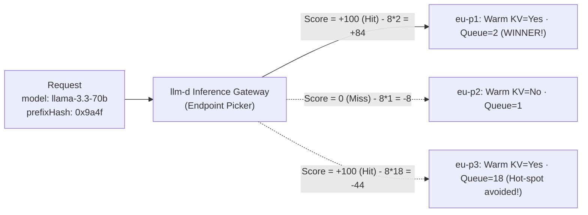

# Chapter 04 — Model-Aware & Prefix-Affinity Routing (`llm-d`)

> **Lecture 40 · Chapter 04 of 07** · Level: 🔴 Expert · Phase 9 — Distributed & Sovereign Inference
> **Source:** `FDE S24` · **Roadmap Reference:** [`roadmap-v1.md`](../../roadmap-v1.md#lecture-39--distributed-inference-sglang-llm-d--dynamo--capacity-engineering)
> **External Reference:** [llm-d Distributed Inference](https://llm-d.ai/)
> **Roadmap topics:** Why K8s round-robin fails KV reuse · `llm-d` Inference Gateway · prefix-affinity scoring + load-aware tie-breaking · avoiding hot-spotting.

---

## 04.0 What this chapter is for

Even if every GPU pod runs SGLang RadixAttention, **none of it helps if your load balancer sends Request 1 to Pod A and Request 2 (same 4,500-token prefix) to Pod B!**

**`llm-d`** (a Kubernetes-native distributed LLM inference stack built on Envoy/Gateway API + vLLM/SGLang) replaces blind HTTP round-robin with a **Model-Aware, Prefix-Affinity Endpoint Picker**.

By the end of this chapter you should be able to:

1. Explain how **`llm-d` Prefix-Affinity Routing** hashes prompt prefixes to locate warm KV pods.
2. Balance **Cache Affinity** vs. **Queue Depth** so a popular prefix never creates a hot-spot on one GPU pod.
3. Trace how **Model-Aware Routing** handles multi-LoRA or multi-model fleets behind one gateway.

---

## 04.1 Prefix-Affinity + Load-Aware Scoring



### Why the queue-depth penalty (`- w2 * queueDepth`) is mandatory

If you route purely by **100% prefix affinity**, then when 500 users all share the same system prompt at 9:00 AM, **every single request goes to `eu-p1`** while `eu-p2` sits idle!

Using a composite score:

$$\text{Score}(\text{node}) = w_{\text{hit}} \cdot \mathbb{1}[\text{prefixHash} \in \text{node.warmPrefixes}] - w_{\text{load}} \cdot \text{node.queueDepth}$$

- When `eu-p1` has `queue = 2` (`Score = +84`), it beats cold `eu-p2` (`Score = -8`) — preserving KV reuse.
- When `eu-p3` backs up to `queue = 18` (`Score = -44`), the router **spills to a less-loaded node**, preventing queueing-induced TTFT spikes!

### Concrete `llm-d` Routing Policy Config
```yaml
# llm-d InferencePool Endpoint Picker weights
scoring:
  kvCacheAffinityWeight: 100   # +100 if prefixHash is warm on pod
  queueDepthPenaltyWeight: 8   # -8 per active request in pod queue
  loraAdapterMatchRequired: true
```

---

## 04.2 Key takeaways

1. **`llm-d` brings KV-cache awareness to Kubernetes**, turning 12% round-robin hit rates into 75%–90% warm hit rates.
2. **Always combine prefix affinity with queue-load penalties** so popular prefixes never hot-spot a single GPU.
3. **Model-aware routing** ensures requests only hit nodes hosting the requested `modelId` (or LoRA adapter).

---

**Next:** [Chapter 05 — NVIDIA Dynamo & Multi-Node Orchestration](./05_NVIDIA_Dynamo_and_Multi_Node_Orchestration.md)
