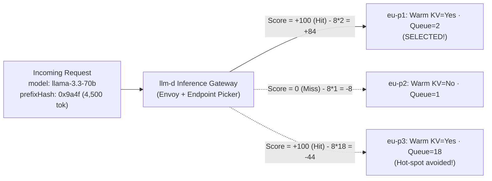
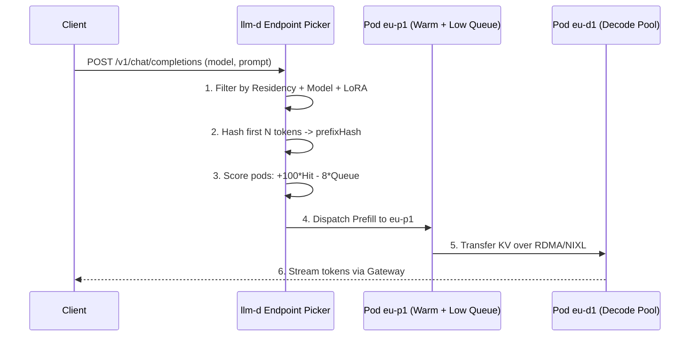

# Chapter 04 — Model-Aware & Prefix-Affinity Routing (`llm-d`)

> **Lecture 40 · Chapter 04 of 07** · Level: 🔴 Expert · Phase 9 — Distributed & Sovereign Inference
> **Source:** `FDE S24` · **Roadmap Reference:** [`roadmap-v1.md`](../../roadmap-v1.md#lecture-39--distributed-inference-sglang-llm-d--dynamo--capacity-engineering)
> **External Reference:** [llm-d Distributed Inference](https://llm-d.ai/)
> **Roadmap topics:** Why K8s round-robin fails KV reuse · `llm-d` Inference Gateway · prefix-affinity scoring + load-aware tie-breaking · avoiding hot-spotting.

---

## 04.0 What this chapter is for

Even if every GPU pod in your cluster runs SGLang `RadixAttention` and `LMCache`, **none of it works if your load balancer sends Request 1 to Pod A and Request 2 (same `4,500`-token prefix) to Pod B!** Standard Kubernetes Ingress and `ClusterIP` Services only inspect Layer-4/Layer-7 HTTP headers; they have zero visibility into prompt prefixes, KV-cache residency, or GPU queue depths.

**`llm-d`** (a Kubernetes-native distributed LLM inference stack built on Envoy, the Kubernetes Gateway API Inference Extension, and vLLM/SGLang) replaces blind HTTP round-robin with a **Model-Aware, Prefix-Affinity Endpoint Picker**.

By the end of this chapter you should be able to:

1. Explain how the **`llm-d` Inference Gateway + Endpoint Picker (EPP)** inspects requests and scores candidate GPU pods.
2. Compute the **composite routing score** combining KV-cache prefix affinity (`+w_hit`) and queue-depth penalty (`-w_load * queueDepth`).
3. Show numerically how load-aware tie-breaking prevents **hot-spotting** when hundreds of users share the same popular prefix.
4. Trace how **Model-Aware Routing** handles multi-LoRA or multi-model fleets behind a single gateway endpoint.

---

## 04.1 How `llm-d` Prefix-Affinity + Load-Aware Scoring Works

Instead of picking the next pod in a circular list, `llm-d`'s Endpoint Picker runs a fast (`< 1 ms`) scoring pass over all healthy pods that host the requested `modelId` (and optional `loraAdapter`):

$$\text{Score}(\text{node}) = w_{\text{hit}} \cdot \mathbb{1}[\text{prefixHash} \in \text{node.warmPrefixes}] - w_{\text{load}} \cdot \text{node.queueDepth}$$



### Worked scoring trace

Assume weights `kvCacheAffinityWeight = 100` and `queueDepthPenaltyWeight = 8`:

1. **`eu-p1` (Warm KV, `queue = 2`):** `Score = 100 - (8 × 2) = +84` $\rightarrow$ **Winner!** Request hits the `4,500`-token prefix in HBM (`145 ms` TTFT) with almost no queue wait.
2. **`eu-p2` (Cold KV, `queue = 1`):** `Score = 0 - (8 × 1) = -8`. Only chosen if warm nodes are heavily backed up.
3. **`eu-p3` (Warm KV, `queue = 18`):** `Score = 100 - (8 × 18) = -44`. Even though `eu-p3` has the prefix warm, its queue is `18` requests deep! Sending another request there would add `18 × 75 ms = 1,350 ms` of queueing delay.

### Why pure 100% prefix affinity fails (the hot-spot trap)

If you route **purely** by consistent hashing on `prefixHash` without a queue-depth penalty (`w_load = 0`):
- At 9:00 AM, 500 Legal Copilot users all open the app with the **exact same `4,500`-token system prompt**.
- Every single request hashes to `eu-p1`.
- **`eu-p1` melts down** with a 200-request queue (`TTFT > 10 seconds`), while `eu-p2` and `eu-p3` sit at `0%` utilization!

With `w_load = 8`, once `eu-p1`'s queue reaches `13` requests (`100 - 8×13 = -4`), its score drops below an idle cold node (`0`), **automatically spilling** excess traffic to `eu-p2`, which then warms up its own copy of the prefix!

---

## 04.2 Model-Aware Routing & Concrete `llm-d` Policy

In enterprise clusters, you rarely serve just one monolithic model. You might run:
- `llama-3.3-70b` base weights + `legal-lora-v2` on Pods `1–4`
- `llama-3.3-70b` base weights + `finance-lora-v4` on Pods `5–8`
- `qwen-2.5-72b` on Pods `9–12`

`llm-d` filters candidate endpoints by `modelId` and `loraAdapter` **before** running prefix-affinity scoring, ensuring a `finance-lora-v4` request never lands on a pod that only has `legal-lora-v2` loaded.

```yaml
# Example llm-d InferencePool Endpoint Picker scoring policy
apiVersion: inference.networking.x-k8s.io/v1alpha2
kind: InferenceModel
metadata:
  name: legal-copilot-70b
spec:
  modelName: llama-3.3-70b
  criticality: Critical   # Prioritize over batch/background jobs
  scoring:
    kvCacheAffinityWeight: 100   # +100 if prefixHash is warm on pod
    queueDepthPenaltyWeight: 8   # -8 per active request in pod queue
    loraAdapterMatchRequired: true
```



> [!TIP]
> **Tuning `w_hit` vs `w_load`.** Set the crossover point `w_hit / w_load` equal to the number of queued requests whose wait time equals one prefix recompute. In our case study, recomputing `4,500` tokens takes `~225 ms`, and each queued delta prefill takes `~20 ms`, so the crossover is `225 / 20 ≈ 11–13` requests (`100 / 8 = 12.5`).

---

## 04.3 Traps & Where Routing Breaks

| Trap | What Happens | How to Prevent It |
| :--- | :--- | :--- |
| **Consistent hashing with no load penalty** | Popular prefix hot-spots 1 GPU to death while others sit idle | Always include `- w_load * queueDepth` (or KV-cache memory pressure) in the score |
| **Hashing the entire prompt instead of prefix blocks** | Two requests with different user questions never match | Hash **only the leading prefix blocks** (e.g., first `512`-token or `1,024`-token chunks) |
| **Stale telemetry in Endpoint Picker** | Router thinks `eu-p1` has `queue = 0` for 5 seconds while it's flooded | Stream real-time pod queue & KV-index updates (`< 100 ms` interval) or track in-flight requests inside the gateway |

---

## 04.4 Common mistakes

| # | Common Mistake | Why It Hurts | What To Do Instead |
| :---: | :--- | :--- | :--- |
| 1 | **Using NGINX/ALB round-robin in front of SGLang/vLLM** | Destroys prefix locality; KV hit rate drops to `1/N` | Deploy **`llm-d` Inference Gateway** with prefix-affinity scoring |
| 2 | **Setting `kvCacheAffinityWeight` too high relative to `queueDepthPenaltyWeight`** | Causes severe queueing delays on warm pods during traffic spikes | Calibrate `w_hit / w_load` to match `(recompute_ms / queued_req_ms)` |
| 3 | **Ignoring `criticality` tiers** | Overnight batch jobs saturate GPUs and starve interactive users | Use `llm-d` criticality levels (`Critical` vs `Sheddable`) for queue priority |
| 4 | **Putting residency filtering *after* affinity scoring** | A warm US pod could outscore a cold EU pod, leaking EU data | Run **Residency + Health + Model filtering *first*** (Ch 06) |

---

## 04.5 Key takeaways

1. **`llm-d` brings KV-cache and model awareness to Kubernetes**, lifting round-robin `12%` hit rates to `75%–90%`.
2. **Composite scoring (`+w_hit * hit - w_load * queueDepth`)** preserves KV locality under normal load while automatically spilling to idle pods during hot-spots.
3. **Model-aware filtering** routes requests only to pods hosting the exact `modelId` and `loraAdapter` before scoring begins.

---

## 04.6 Self-check questions

1. Why does a standard Kubernetes `ClusterIP` Service collapse KV-cache hit rates even when every pod runs SGLang RadixAttention?
2. Given `w_hit = 100` and `w_load = 8`, compute the scores for Pod A (`Hit=Yes, Queue=4`), Pod B (`Hit=No, Queue=0`), and Pod C (`Hit=Yes, Queue=15`). Which pod wins?
3. At what queue depth does a warm pod lose to an idle cold pod under `w_hit = 100, w_load = 8`, and why is that spillover desirable?
4. Why must `llm-d` hash only the **leading prefix blocks** rather than the entire prompt string?
5. In a multi-LoRA fleet, why must `loraAdapter` and `requiredRegion` filtering happen *before* prefix-affinity scoring?

---

**Next:** [Chapter 05 — NVIDIA Dynamo & Multi-Node Orchestration](./05_NVIDIA_Dynamo_and_Multi_Node_Orchestration.md)
