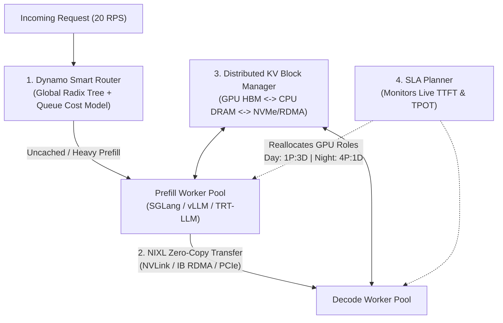
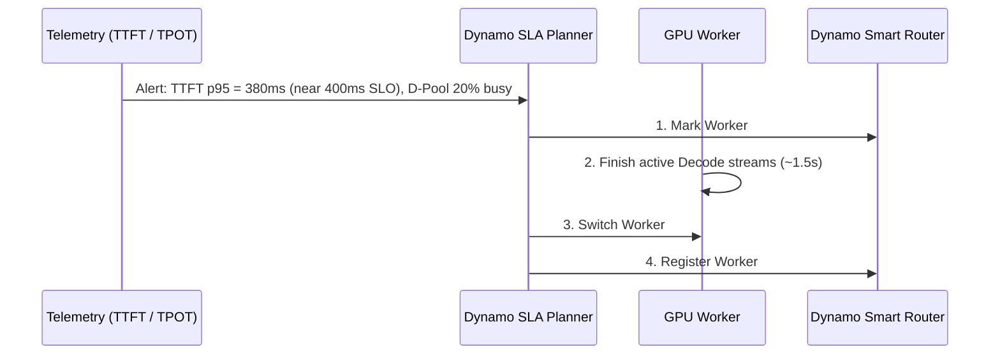

# Chapter 05 — NVIDIA Dynamo & Multi-Node Orchestration

> **Lecture 40 · Chapter 05 of 07** · Level: 🔴 Expert · Phase 9 — Distributed & Sovereign Inference
> **Source:** `FDE S24` · **Roadmap Reference:** [`roadmap-v1.md`](../../roadmap-v1.md#lecture-39--distributed-inference-sglang-llm-d--dynamo--capacity-engineering)
> **External Reference:** [NVIDIA Dynamo](https://github.com/ai-dynamo/dynamo)
> **Roadmap topics:** NVIDIA Dynamo 4-component architecture · NIXL zero-copy KV transfer · Distributed KV Block Manager · SLA-driven dynamic P/D worker reallocation · comparing SGLang, `llm-d`, and Dynamo.

---

## 05.0 What this chapter is for

Chapters 02–04 introduced the core building blocks of modern distributed inference: disaggregated `P/D` pools, RadixAttention/LMCache KV reuse, and prefix-affinity routing. **NVIDIA Dynamo** (the open-source successor to Triton's LLM serving patterns) unifies all of those into a single **multi-node, GPU-cluster-scale orchestration framework** that runs seamlessly across **TensorRT-LLM**, **vLLM**, and **SGLang** backends.

In a real enterprise deployment, traffic is never static: daytime users run interactive chat (Decode-heavy), while midnight pipelines run massive contract indexing (Prefill-heavy). Static `P:D` GPU ratios force you to buy enough hardware for *both* peaks simultaneously. Dynamo solves this dynamically.

By the end of this chapter you should be able to:

1. Explain the **four core components** of NVIDIA Dynamo (Smart Router, NIXL, Distributed KV Block Manager, SLA Planner) and how they interact.
2. Trace how **NIXL (NVIDIA Inference Xfer Library)** abstracts NVLink, InfiniBand RDMA, RoCEv2, and PCIe into one non-blocking KV transfer API.
3. Show numerically how Dynamo's **SLA Planner** dynamically shifts GPUs between `Prefill` and `Decode` pools as day/night `input:output` ratios flip.
4. Compare **SGLang**, **`llm-d`**, and **NVIDIA Dynamo** across architecture layer, KV management, and ideal use case.

---

## 05.1 The Four Components of NVIDIA Dynamo

### What each component actually solves

| Component | Problem It Solves | How It Works |
| :--- | :--- | :--- |
| **1. Smart Router** | Redundant prefill & hot-spotting across nodes | Maintains a cluster-wide radix tree of KV block locations; routes each request to minimize `(kv_recompute_cost + queue_wait_ms)` |
| **2. NIXL (Transfer Library)** | Slow TCP/gRPC KV copying stalls TTFT | Non-blocking, asynchronous **RDMA / NVLink / GPUDirect** memory-to-memory transfer of KV-cache pages between `P` and `D` GPUs |
| **3. Distributed KV Block Manager** | Limited `80 GB` GPU HBM capacity | Coordinates tiered KV offloading (`HBM -> CPU DRAM -> NVMe / object store`) across all nodes in the cluster |
| **4. SLA Planner** | Fixed `P:D` ratios waste GPUs when traffic shifts | Continuously watches live **TTFT** and **TPOT** against SLOs; drains and converts idle `D` workers into `P` workers during RAG spikes (and vice versa) |

> [!IMPORTANT]
> **Why NIXL matters as an abstraction.** Without NIXL, writing a `P/D` engine requires separate code paths for NVLink (intra-node), InfiniBand (inter-node), RoCEv2, and CPU DRAM offloading. NIXL exposes a single asynchronous `transfer(src_mem_desc, dst_mem_desc)` API and automatically picks the fastest hardware path available.

---

## 05.2 How the SLA Planner Saves 40%+ Fleet Cost Over 24 Hours

Consider our **Global Legal & Financial Copilot** across a 24-hour cycle on a `10`-GPU cluster:

- **9:00 AM – 5:00 PM (Interactive Drafting & Legal Chat):**
  - Workload: `2,000` input tokens : `1,500` output tokens (`Decode`-heavy).
  - **SLA Planner action:** Notices `TPOT` creeping toward `27 ms` while `P`-Pool sits at `35%` utilization. It drains 2 `P` workers and re-provisions them as `D` workers $\rightarrow$ **`2P : 8D`** (`1P : 4D`).
- **11:00 PM – 4:00 AM (Overnight Contract Indexing & Batch Compliance QA):**
  - Workload: `20,000` input tokens : `100` output tokens (`Prefill`-heavy).
  - **SLA Planner action:** Notices `TTFT` climbing above `350 ms` while `D`-Pool sits at `15%` utilization. It shifts 6 `D` workers into `P` mode $\rightarrow$ **`8P : 2D`** (`4P : 1D`)!

Without Dynamo's dynamic `P/D` reallocation, you would have to provision **`8P + 8D = 16 GPUs`** statically to survive both daytime chat and overnight batch RAG. With Dynamo, **`10 GPUs` handle both peaks**.

---

## 05.3 Comparing `SGLang`, `llm-d`, and `NVIDIA Dynamo`

Engineers often confuse these three projects because they overlap. Think of them as operating at **different layers of the stack**:

| Dimension | **SGLang** | **`llm-d`** | **NVIDIA Dynamo** |
| :--- | :--- | :--- | :--- |
| **Primary Layer** | **Inference Engine** (runs inside each GPU pod) | **Kubernetes Gateway + Orchestrator** | **Full Multi-Node GPU Fleet Framework** |
| **KV-Cache Innovation** | **RadixAttention** (in-HBM prefix radix tree) | Integrates vLLM/SGLang + `LMCache` | **Distributed KV Block Manager** + NIXL |
| **Routing Intelligence** | SGLang Router (cache-aware) | Envoy + Gateway API **Endpoint Picker (EPP)** | **Dynamo Smart Router** (global KV cost model) |
| **`P/D` Disaggregation** | Supported (with Mooncake / NIXL) | Native K8s Gateway `P/D` routing | Native **`P/D` + Dynamic SLA Planner** |
| **Engine Agnostic?** | No (is itself the engine) | Yes (vLLM, SGLang) | Yes (TRT-LLM, vLLM, SGLang) |
| **Best For** | Maximum single/multi-GPU speed & structured JSON | Cloud-native K8s platform teams on Envoy/Gateway API | Large multi-node NVIDIA IB/NVLink clusters with shifting workloads |

> [!TIP]
> **They compose together.** You can run **SGLang** as the GPU worker engine *inside* **NVIDIA Dynamo** (or behind **`llm-d`**) to get RadixAttention's HBM prefix tree plus cluster-wide NIXL `P/D` disaggregation.

---

## 05.4 Traps & Where Multi-Node Orchestration Breaks

| Trap | What Happens | How to Prevent It |
| :--- | :--- | :--- |
| **Aggressively thrashing `P <-> D` roles every 10 seconds** | Draining active decode streams and warming KV caches takes `2–10 seconds`; rapid flipping destroys throughput | Use **hysteresis + cooldown windows** (e.g., evaluate every `60 s`, require 3 consecutive SLO/utilization triggers before role swap) |
| **Evicting hot KV blocks when a `P` node converts to `D`** | Prefix hit rate drops right after scaling | Offload warm KV blocks to the **Distributed KV Block Manager** (Tier 2/3) before draining the worker |
| **Running Dynamo across mixed-MTU or non-RDMA subnets** | NIXL falls back to slow TCP sockets, causing `P/D` handoff spikes | Verify `ibstat` / RoCEv2 PFC and GPUDirect RDMA health in cluster pre-flight checks |

---

## 05.5 Common mistakes

| # | Common Mistake | Why It Hurts | What To Do Instead |
| :--- | :--- | :--- | :--- |
| 1 | **Treating SGLang, `llm-d`, and Dynamo as mutually exclusive** | Misses how engine-level RadixAttention composes with cluster-level orchestration | Use **SGLang/vLLM** as the worker engine, **`llm-d`** for K8s Gateway routing, or **Dynamo** for full-stack IB/NVLink orchestration |
| 2 | **Using static `P:D` ratios when day/night workloads differ** | Forces `~1.6×` over-provisioning of GPUs | Enable **SLA Planner** dynamic `P/D` reallocation with cooldown hysteresis |
| 3 | **Converting a `D` worker to `P` without graceful drain** | Mid-stream users get `HTTP 500` / dropped SSE connections | Always **drain active decode requests** before flipping worker role |
| 4 | **Ignoring Distributed KV Manager sizing** | Tier 2/3 offload fills up, causing silent cache misses | Monitor cluster KV hit rate and CPU DRAM / NVMe eviction rates alongside TTFT |

---

## 05.6 Key takeaways

1. **NVIDIA Dynamo** unifies a **Smart Router**, **NIXL**, a **Distributed KV Block Manager**, and a dynamic **SLA Planner** into one multi-node inference fabric.
2. **NIXL** abstracts NVLink, InfiniBand RDMA, and PCIe into a single zero-copy, non-blocking KV transfer layer (`~10–25 ms` handoff).
3. **Dynamic `P/D` reallocation** lets the exact same GPU fleet serve decode-heavy daytime chat (`1P:4D`) and prefill-heavy overnight batch RAG (`4P:1D`).
4. **SGLang** is the GPU engine, **`llm-d`** is the Kubernetes Gateway router, and **Dynamo** is the full multi-node NVIDIA cluster orchestrator.

---

## 05.7 Self-check questions

1. Name the four core components of NVIDIA Dynamo and state the exact problem each one solves.
2. How does **NIXL** simplify `P/D` KV-cache handoff across heterogeneous interconnects (NVLink, InfiniBand RDMA, RoCEv2, PCIe)?
3. Walk through how Dynamo's **SLA Planner** shifts a `10`-GPU cluster from `1P:4D` during daytime chat to `4P:1D` during overnight batch RAG without dropping active user streams.
4. Why is cooldown hysteresis required before flipping a GPU between `Prefill` and `Decode` roles?
5. How do **SGLang**, **`llm-d`**, and **NVIDIA Dynamo** differ in architectural layer, and how can SGLang compose inside Dynamo?

---

**Next:** [Chapter 06 — Data Residency, Multi-Region HA & Failover](./06_Data_Residency_Multi_Region_HA_and_Failover.md)
