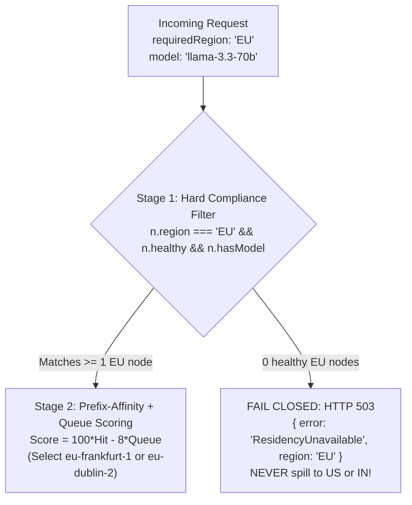
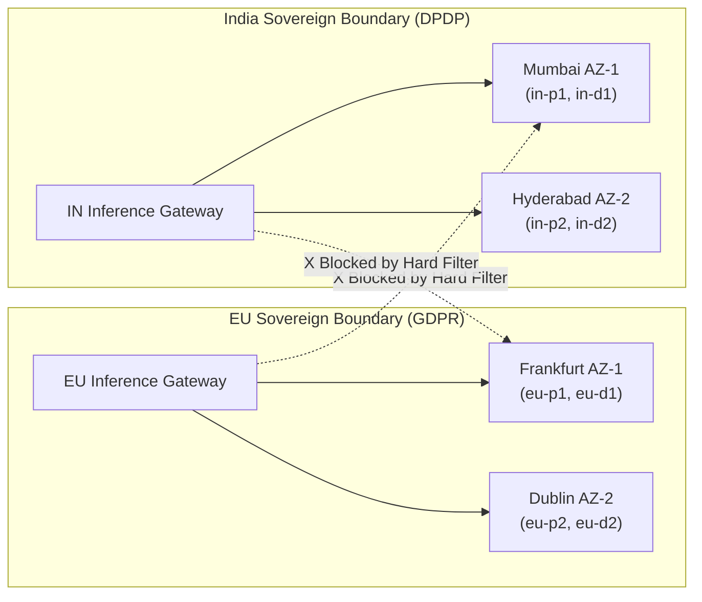

# Chapter 06 — Data Residency, Multi-Region HA & Failover

> **Lecture 40 · Chapter 06 of 07** · Level: 🔴 Expert · Phase 9 — Distributed & Sovereign Inference
> **Source:** `FDE S24` · **Roadmap Reference:** [`roadmap-v1.md`](../../roadmap-v1.md#lecture-39--distributed-inference-sglang-llm-d--dynamo--capacity-engineering)
> **Roadmap topics:** Regional data residency (`EU` GDPR, `IN` DPDP, `US`) · fail-closed residency routing · active-active HA within a jurisdiction · cross-region failover boundaries.

---

## 06.0 What this chapter is for

In a global enterprise deployment, latency and GPU cost are **not** your highest-priority constraints. Compliance is.

If a European bank's contract prompt (`requiredRegion: "EU"`) or an Indian healthcare query (`requiredRegion: "IN"`) is routed to a GPU in `us-east-1` because `eu-central-1` is overloaded or undergoing maintenance, **you have just committed a GDPR / India DPDP data residency violation** — even if the response came back in `180 ms`.

Standard cloud load balancers are built for **availability first** (fail over anywhere healthy). Sovereign AI inference must be built for **residency first** (fail over *only* inside the legal boundary, and **fail closed** if no compliant GPU exists).

By the end of this chapter you should be able to:

1. Enforce **fail-closed data residency** inside your `DistributedInferenceRouter` (`EU` $\rightarrow$ `EU` only; `IN` $\rightarrow$ `IN` only).
2. Explain the exact **2-stage routing pipeline** (Residency/Health/Model hard filter *before* Prefix-Affinity + Queue-Load scoring).
3. Design **intra-jurisdiction Active-Active High Availability** across multiple Availability Zones / regions within the same legal border (e.g., Frankfurt + Dublin for `EU`; Mumbai + Hyderabad for `IN`).
4. Implement **verifiable routing audit logs** and `503 ResidencyUnavailable` handling so compliance teams can prove `0%` cross-border leakage.

---

## 06.1 Fail-Closed Residency vs. Unsafe Global Failover

Compare what happens when `eu-p1` (Frankfurt) goes offline during a traffic spike:

| Pattern | Router Behavior When `eu-p1` Goes Down | Latency Impact | Compliance Status |
| :--- | :--- | :--- | :---: |
| **Unsafe Global Spillover** | Router sees `us-p1` (`us-east-1`) has `queue = 0` and forwards EU user's prompt across the Atlantic | Fast (`~250 ms`) | ❌ **GDPR Breach** (Data left EU!) |
| **Fail-Closed + Intra-Region HA** | Router fails over to `eu-p2` (Dublin, same EU jurisdiction); if **all** EU nodes are down, returns **`503 ResidencyUnavailable`** | Healthy (`~160 ms`) when `eu-p2` is up; controlled error if all EU down | ✅ **100% Compliant** |



> [!IMPORTANT]
> **Residency is a hard filter, never a soft weight.** Never model data residency as a scoring weight like `+1000` for same-region. If you use a soft weight, `0` healthy EU nodes would still leave `us-p1` with a positive or highest score, causing silent cross-border leakage!

---

## 06.2 Intra-Jurisdiction Active-Active High Availability

"Fail closed" does **not** mean "accept frequent downtime." It means you achieve High Availability **inside** each jurisdiction by deploying across **2+ independent Availability Zones (or sovereign regions)** with `+20%` capacity headroom:



### Four engineering rules for Sovereign HA

1. **Tag every GPU pool with immutable `region` and `jurisdiction` metadata:** Never rely on DNS geo-routing alone (corporate VPNs misroute users). Bind `requiredRegion` from the **tenant's contractual profile** (JWT/API key claim) and enforce it inside the router.
2. **Isolate KV-cache & Tier-3 storage per jurisdiction:** `LMCache` / `Mooncake` / `Redis` KV pools for `EU` must reside physically in `EU` — KV tensors themselves can leak prompt contents!
3. **Provision `N+1` capacity across 2+ AZs per jurisdiction:** With `+20%` HA headroom (Chapter 07), losing an entire AZ in Frankfurt shifts traffic to Dublin with zero `503`s.
4. **Emit immutable routing audit logs:** Every request logs `{ requestId, tenantId, requiredRegion, selectedNodeId, nodeRegion, failClosed }` so auditors can verify `selectedNode.region === requiredRegion` across 100% of requests.

```json
{
  "requestId": "req_8812f",
  "tenantId": "de_bank_01",
  "requiredRegion": "EU",
  "selectedNodeId": "eu-dublin-az2-p2",
  "nodeRegion": "EU",
  "kvCacheHit": true,
  "failClosed": true
}
```

---

## 06.3 Traps & Where Sovereign Routing Breaks

| Trap | What Happens | How to Prevent It |
| :--- | :--- | :--- |
| **Using GeoDNS for compliance** | A German employee on a US corporate VPN gets routed to `us-east-1` | Derive `requiredRegion` from **tenant/account metadata**, not client IP |
| **Sharing a global observability / prompt-logging bucket** | EU prompts stay on EU GPUs, but raw prompts get shipped to a US Datadog/S3 bucket | Keep **telemetry, prompt logs, and KV offload stores** inside the same sovereign region |
| **Caching `503` responses or retrying blindly across regions** | Client SDK retries an EU `503` against a global fallback URL | Return explicit `503 ResidencyUnavailable` with `Retry-After` and disable cross-region fallback in SDKs |

---

## 06.4 Common mistakes

| # | Common Mistake | Why It Hurts | What To Do Instead |
| :--- | :--- | :--- | :--- |
| 1 | **Modeling region affinity as a soft router score** | When local GPUs are down or full, traffic silently leaks to another country | Implement residency as a **hard pre-filter** before scoring |
| 2 | **Putting all EU GPUs in a single Availability Zone** | One AZ outage triggers `503 ResidencyUnavailable` for all EU customers | Spread `N+1` capacity across **2+ AZs within the same jurisdiction** |
| 3 | **Forgetting Tier-2/3 KV caches and prompt logs** | KV tensors and logs cross borders even when GPUs don't | Pin **LMCache, Redis, and audit logs** inside each sovereign boundary |
| 4 | **Using client IP geolocation for residency** | VPNs and traveling employees break compliance | Read `requiredRegion` from the authenticated **tenant record** |

---

## 06.5 Key takeaways

1. **Residency filtering must run *before* prefix-affinity and queue-load scoring**, as a hard boolean gate.
2. **Never fail over across legal borders** — if all healthy nodes in `requiredRegion` are down, **fail closed** with `503 ResidencyUnavailable`.
3. **Achieve High Availability inside each jurisdiction** using 2+ AZs, `+20%` HA headroom, and region-pinned KV/logging stores.

---

## 06.6 Self-check questions

1. Why is modeling `requiredRegion` as a `+1000` soft router weight a compliance bug?
2. Suppose `eu-frankfurt-1` goes down during peak traffic. Trace what a **fail-closed intra-region HA** router does vs. an **unsafe global spillover** router.
3. Why is GeoDNS / client IP insufficient for enforcing GDPR or India DPDP residency?
4. Beyond GPU inference pods, which two supporting subsystems must also be pinned inside each sovereign jurisdiction?
5. What four fields should every routing audit log record to prove `0%` cross-border leakage?

---

**Next:** [Chapter 07 — Capacity Engineering & Cost-per-Token Modeling](./07_Capacity_Engineering_and_Cost_per_Token_Modeling.md)
