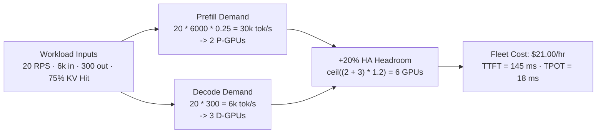
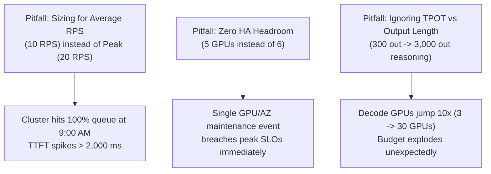

# Chapter 07 — Capacity Engineering & Cost-per-Token Modeling

> **Lecture 40 · Chapter 07 of 07** · Level: 🔴 Expert · Phase 9 — Distributed & Sovereign Inference
> **Source:** `FDE S24` · **Roadmap Reference:** [`roadmap-v1.md`](../../roadmap-v1.md#lecture-39--distributed-inference-sglang-llm-d--dynamo--capacity-engineering)
> **Roadmap topics:** Sizing Prefill vs. Decode GPU counts · TTFT & TPOT capacity formulas · impact of KV-cache hit rate on required GPUs · +20% HA headroom · hourly & per-1M-token cost modeling.

---

## 07.0 What this chapter is for

At the end of every enterprise AI engagement, the VP of Engineering and CFO ask the same two questions:

> *"How many GPUs do we need to buy, what will it cost per hour and per 1M tokens, and can you prove we will stay under `400 ms` TTFT and `30 ms` TPOT at `20 RPS` peak?"*

This chapter turns everything in Lecture 40 — `P/D` disaggregation, RadixAttention KV hit rates, NIXL transfer latency, and intra-region HA — into **exact capacity sizing math**. These are the exact equations implemented in `code/Basic Code/src/simulator.ts`.

By the end of this chapter you should be able to:

1. Compute **Effective Prefill Tokens/sec** and **Prefill GPU count (`P`)** from `peakRps`, `avgInputTokens`, and `kvCacheHitRate`.
2. Compute **Decode GPU count (`D`)** from `peakRps * avgOutputTokens` and per-GPU decode throughput.
3. Calculate **estimated p95 TTFT and TPOT** for both **Monolithic** (with interference) and **Disaggregated `P/D`** architectures.
4. Apply **`+20%` HA headroom** and compute **hourly fleet cost** and **cost per 1M tokens**.
5. Run sensitivity checks to see how KV hit rate (`0%` vs `75%` vs `90%`) shifts your optimal `P:D` ratio.

---

## 07.1 The Capacity Sizing Formulas

Given workload parameters (`peakRps`, `avgInputTokens`, `avgOutputTokens`, `kvCacheHitRate`) and GPU tier specs (`prefillTokPerSecPerGpu`, `decodeTokPerSecPerGpu`, `gpuHourlyUsd`):

1. **Effective Prefill Demand (tokens/sec):**
   $$\text{Prefill}_{\text{eff}} = \text{peakRps} \times \text{avgInputTokens} \times (1 - \text{kvCacheHitRate})$$
2. **Prefill GPUs (`P`):**
   $$N_P = \left\lceil \frac{\text{Prefill}_{\text{eff}}}{\text{prefillTokPerSecPerGpu}} \right\rceil$$
3. **Decode Demand & GPUs (`D`):**
   $$\text{Decode}_{\text{req}} = \text{peakRps} \times \text{avgOutputTokens}, \qquad N_D = \left\lceil \frac{\text{Decode}_{\text{req}}}{\text{decodeTokPerSecPerGpu}} \right\rceil$$
4. **Total GPUs with `+20%` HA Headroom:**
   $$N_{\text{total}} = \left\lceil (N_P + N_D) \times 1.20 \right\rceil$$
5. **Latency Estimates (Disaggregated `P/D`):**
   $$\text{TTFT}_{\text{est}} = \text{baseTtftMs} + \frac{\text{avgInputTokens} \times (1 - \text{kvCacheHitRate})}{\text{prefillTokPerSecPerGpu}} \times 1000 + \text{nixlTransferMs}$$
   $$\text{TPOT}_{\text{est}} = \text{baseTpotMs} \quad (\text{zero prefill interference!})$$

---

## 07.2 Worked Comparison: Monolithic vs. Disaggregated `P/D`

Let's size our **Global Legal & Financial Copilot** on an **H100 tier**:
- **Workload:** `peakRps = 20`, `avgInputTokens = 6,000`, `avgOutputTokens = 300`, `kvCacheHitRate = 0.75`.
- **SLOs:** `TTFT <= 400 ms`, `TPOT <= 30 ms`.
- **H100 Specs:** `prefillTokPerSecPerGpu = 20,000`, `decodeTokPerSecPerGpu = 2,500`, `baseTtftMs = 45 ms`, `baseTpotMs = 18 ms`, `nixlTransferMs = 25 ms`, `gpuHourlyUsd = $3.50/hr`.

### Option A: Monolithic Serving (Round-Robin, No Cross-Node KV Reuse, Interference)

- **Prefill demand (`0%` cross-node hit):** $20 \times 6{,}000 = 120{,}000\text{ tok/s} \implies \lceil 120{,}000 / 20{,}000 \rceil = 6\text{ GPUs}$.
- **Decode demand:** $20 \times 300 = 6{,}000\text{ tok/s}$ (shared on the same GPUs, competing with prefill).
- **With `+20%` HA headroom:** $\lceil 6 \times 1.2 \rceil = \mathbf{8\text{ GPUs}}$ (`$28.00 / hr`).
- **Latency under interference (`1.8×` prefill queueing, `2.1×` decode stall):**
  - $\text{TTFT} \approx 45 + (6{,}000 / 20{,}000) \times 1000 \times 1.8 = \mathbf{585\text{ ms}}$ (❌ **Fails `< 400 ms` SLO!**)
  - $\text{TPOT} \approx 18 \times 2.1 = \mathbf{37.8\text{ ms}}$ (❌ **Fails `< 30 ms` SLO!**)

### Option B: Disaggregated `P/D` + `75%` KV Prefix Reuse

- **Effective Prefill demand:** $20 \times 6{,}000 \times (1 - 0.75) = \mathbf{30{,}000\text{ tok/s}} \implies \lceil 30{,}000 / 20{,}000 \rceil = \mathbf{2\text{ P-GPUs}}$.
- **Decode demand:** $20 \times 300 = 6{,}000\text{ tok/s} \implies \lceil 6{,}000 / 2{,}500 \rceil = \mathbf{3\text{ D-GPUs}}$.
- **Total GPUs with `+20%` HA headroom:** $\lceil (2 + 3) \times 1.2 \rceil = \mathbf{6\text{ GPUs}}$ (`$21.00 / hr` — **`25%` cheaper than Monolithic!**).
- **Latency:**
  - $\text{TTFT} \approx 45 + (1{,}500 / 20{,}000) \times 1000 + 25 = \mathbf{145\text{ ms}}$ (✅ **Passes `< 400 ms` SLO!**)
  - $\text{TPOT} = \mathbf{18\text{ ms}}$ (✅ **Zero prefill interference — passes `< 30 ms` SLO!**)

### Cost per 1M Tokens

At `20 RPS`, the cluster processes `20 × (6,000 + 300) = 126,000` total tokens/sec = **`453.6M` tokens/hour**:
- **Monolithic (`$28.00/hr`):** `$28.00 / 453.6 = $0.0617` per 1M tokens (and fails both SLOs!).
- **Disaggregated `P/D` + KV Reuse (`$21.00/hr`):** `$21.00 / 453.6 = $0.0463` per 1M tokens (**25% cheaper AND passes both SLOs!**).

| Metric | Monolithic (8 GPUs) | Disaggregated `P/D` + KV Reuse (6 GPUs) | Winner |
| :--- | :---: | :---: | :---: |
| **Total GPUs (incl. 20% HA)** | `8` | **`6`** | Disaggregated (`-25%` GPUs) |
| **Hourly Fleet Cost** | `$28.00 / hr` | **`$21.00 / hr`** | Disaggregated (`-25%` cost) |
| **Cost per 1M Tokens** | `$0.0617` | **`$0.0463`** | Disaggregated (`-25%` unit cost) |
| **Estimated TTFT** | `585 ms` (❌) | **`145 ms`** (✅) | Disaggregated (`4.0×` faster) |
| **Estimated TPOT** | `37.8 ms` (❌) | **`18.0 ms`** (✅) | Disaggregated (`2.1×` faster) |

> [!TIP]
> **Why `N_P` shrinks while `N_D` stays constant.** Notice that improving `kvCacheHitRate` from `0%` to `75%` cut `P`-GPUs from `6` to `2`, but `D`-GPUs stayed at `3`. Every token still has to be decoded one by one! That is why KV reuse shifts your fleet ratio from `P`-heavy toward `D`-heavy.

---

## 07.3 Traps & Capacity Modeling Pitfalls

| Trap | Why It Breaks | How to Prevent It |
| :--- | :--- | :--- |
| **Sizing for daily average RPS** | Enterprise traffic is spiky (9 AM login, market open) | Always size `N_P` and `N_D` for **p99 peak RPS**, and use autoscaling / Dynamo SLA Planner for off-peak |
| **Forgetting `+20%` HA headroom per sovereign region** | `EU` cannot borrow `US` GPUs during an AZ failure | Apply `× 1.20` headroom **inside each sovereign region** (`EU`, `IN`, `US`) separately |
| **Assuming `avgOutputTokens` stays fixed when enabling reasoning** | Reasoning models (`<think>`) expand output `5×–10×` | Re-run capacity sizing whenever enabling CoT/reasoning modes |

---

## 07.4 Common mistakes

| # | Common Mistake | Why It Hurts | What To Do Instead |
| :--- | :--- | :--- | :--- |
| 1 | **Buying GPUs based on model VRAM alone** | Fits weights in memory, but fails TTFT/TPOT at `20 RPS` | Size `P`-GPUs by `tok/s` FLOPs and `D`-GPUs by `tok/s` HBM bandwidth |
| 2 | **Omitting `+20%` HA headroom** | Any single GPU crash or AZ maintenance breaks peak SLOs | Always multiply `(N_P + N_D)` by `1.20` (rounded up) per region |
| 3 | **Counting only input or only output tokens in cost-per-1M-tokens** | Distorts unit economics when comparing RAG vs. reasoning | Report cost per 1M **input**, **output**, and **blended** tokens separately |
| 4 | **Skipping capacity re-runs after prompt/RAG changes** | Doubling RAG chunk size doubles `P`-GPU demand overnight | Re-run `code/Basic Code/src/simulator.ts` before shipping prompt or RAG changes |

---

## 07.5 Key takeaways

1. **Disaggregated `P/D` + `75%` KV reuse is both cheaper AND faster** than monolithic serving (`6` GPUs at `$21/hr` vs. `8` GPUs at `$28/hr`, while passing `< 400 ms` TTFT and `< 30 ms` TPOT).
2. **Higher KV hit rates shrink `P`-GPUs and lower TTFT**, while `D`-GPUs scale linearly with `peakRps × avgOutputTokens`.
3. **Always apply `+20%` HA headroom per sovereign region** so AZ maintenance never causes `503 ResidencyUnavailable`.
4. **Use the capacity simulator (`code/Basic Code/src/simulator.ts`)** whenever `peakRps`, `avgInputTokens`, `avgOutputTokens`, or `kvCacheHitRate` changes.

---

## 07.6 Self-check questions

1. Using the formulas in 07.1, re-size the Legal Copilot if `peakRps` doubles from `20` to `40` (`kvCacheHitRate = 0.75`). How many `P`-GPUs, `D`-GPUs, and total HA GPUs are required?
2. Why does increasing `kvCacheHitRate` from `0%` to `75%` reduce `P`-GPUs by `3×` while leaving `D`-GPUs unchanged?
3. If `avgOutputTokens` jumps from `300` to `1,500` (e.g., enabling chain-of-thought reasoning), what happens to `N_D` and the `P:D` ratio?
4. Why must `+20%` HA headroom be computed **per sovereign region** (`EU`, `IN`) rather than pooled globally?
5. Calculate the blended cost per 1M tokens if `6` H100 GPUs (`$3.50/hr` each) serve `453.6M` tokens/hour.

---

**Next:** [Lecture 40 — Complete Notes (Master Consolidation)](./Lecture_40_Complete_Notes.md)
