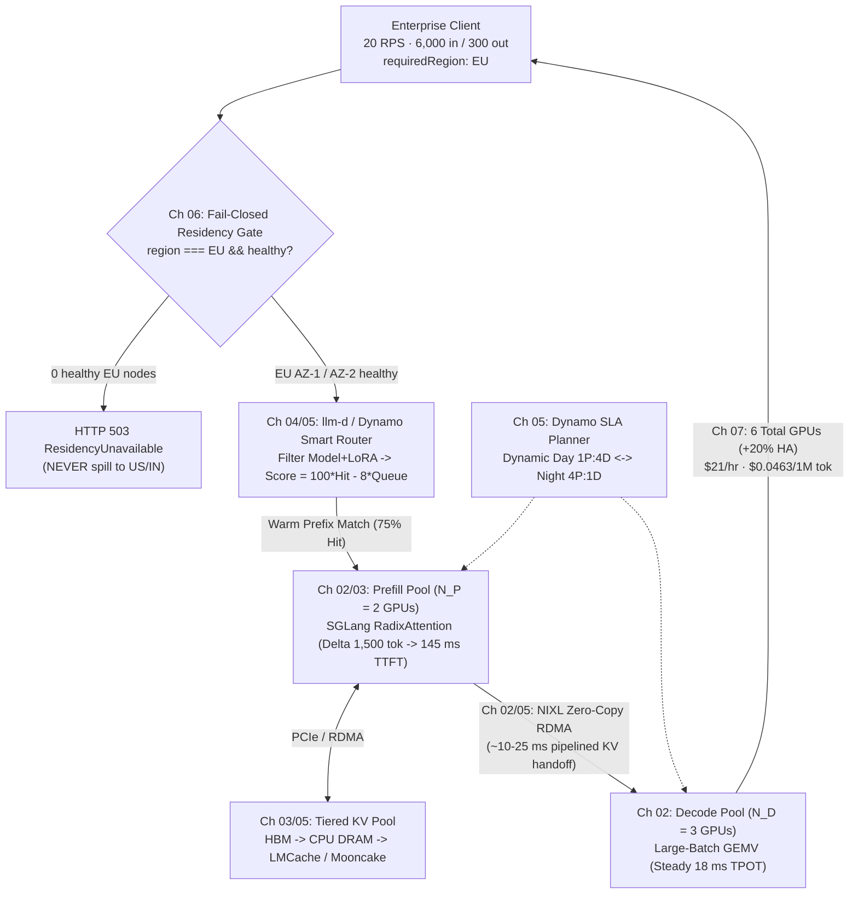

# Lecture 40 — Complete Notes
## Distributed Inference (`SGLang`, `llm-d`, `Dynamo`) & Capacity Engineering

> **Phase:** 9 · Distributed & Sovereign Inference · **Level:** 🔴 Expert
> **Running Case Study:** Global Legal & Financial AI Copilot (`20 RPS` peak · `6,000` input tokens [`4,500` shared prefix + `1,500` query] · `300` output tokens · SLOs: `TTFT < 400 ms`, `TPOT < 30 ms` · `EU`/`IN` strict residency)

---

## 1. Executive Summary

**Thesis:** Single-node monolithic LLM serving collapses under enterprise load because Prefill and Decode have opposing hardware physics, round-robin routing destroys KV-cache reuse, and global failover violates data residency; production distributed inference solves all three with **Disaggregated `P/D` Pools**, **RadixAttention + Tiered KV Offloading**, **Prefix-Affinity Routing (`llm-d` / Dynamo)**, and **Fail-Closed Sovereign Boundaries**.

**The lecture in five sentences:**
1. Monolithic GPU serving suffers from **prefill-decode interference** (compute-bound prefills stall memory-bandwidth-bound decode streams by `21×`) and **KV-cache blindness** under round-robin load balancing (`75%` prefix reuse collapses to `1/N`).
2. **Disaggregated Prefill & Decode (`P/D`)** separates FLOP-bound `P` GPUs (**TTFT**) from HBM-bandwidth-bound `D` GPUs (**TPOT**), streaming KV tensors over `400 Gbps` InfiniBand RDMA / NVLink via **NVIDIA NIXL**.
3. **SGLang `RadixAttention`** and **`LMCache`/`Mooncake`** retain and offload shared prefix KV trees across GPU HBM, CPU DRAM, and distributed RDMA pools, cutting effective prefill FLOPs by `75%+`.
4. **`llm-d`** and **NVIDIA Dynamo** combine **prefix-affinity + queue-load scoring**, **dynamic `P/D` SLA planning**, and **fail-closed residency filtering** (`EU`/`IN`/`US`) so traffic never crosses legal borders.
5. **Capacity engineering** sizes `N_P` from `peakRps * avgInput * (1 - hitRate)` and `N_D` from `peakRps * avgOutput` with `+20%` HA headroom per sovereign region—making `P/D` both **`25%` cheaper** (`6` vs `8` GPUs) and **SLO-compliant**.

| Chapter | Topic | Core Artifact / Takeaway | File |
| :---: | :--- | :--- | :--- |
| **01** | Limits of Single-Node Serving | Prefill (`GEMM`/TTFT) vs. Decode (`GEMV`/TPOT) interference | [01_Limits_of_Single_Node_Inference_Serving.md](./01_Limits_of_Single_Node_Inference_Serving.md) |
| **02** | Disaggregated `P/D` Architecture | Independent `P`/`D` pools + `320 KB/tok` KV over RDMA/NIXL | [02_Disaggregated_Prefill_and_Decode_Architecture.md](./02_Disaggregated_Prefill_and_Decode_Architecture.md) |
| **03** | KV Reuse, RadixAttention & Offload | Prefix radix tree in HBM + Tier 2/3 `LMCache`/`Mooncake` | [03_KV_Cache_Reuse_RadixAttention_and_Offloading.md](./03_KV_Cache_Reuse_RadixAttention_and_Offloading.md) |
| **04** | Prefix-Affinity Routing (`llm-d`) | `Score = w_hit * Hit - w_load * Queue` after model/LoRA filter | [04_Model_Aware_and_Prefix_Affinity_Routing_llmd.md](./04_Model_Aware_and_Prefix_Affinity_Routing_llmd.md) |
| **05** | NVIDIA Dynamo Orchestration | Smart Router + NIXL + Distributed KV Manager + SLA Planner | [05_NVIDIA_Dynamo_and_Multi_Node_Orchestration.md](./05_NVIDIA_Dynamo_and_Multi_Node_Orchestration.md) |
| **06** | Data Residency & Multi-Region HA | Hard pre-filter (`503 ResidencyUnavailable`) + intra-region `N+1` | [06_Data_Residency_Multi_Region_HA_and_Failover.md](./06_Data_Residency_Multi_Region_HA_and_Failover.md) |
| **07** | Capacity & Cost/Token Modeling | `N_P`, `N_D`, `+20%` HA headroom, `$0.0463 / 1M` tokens | [07_Capacity_Engineering_and_Cost_per_Token_Modeling.md](./07_Capacity_Engineering_and_Cost_per_Token_Modeling.md) |

---

## 2. Master Architecture Diagram

---

## 3. Chapter-by-Chapter Short Revision Notes

### 3.1 Chapter 01 — Limits of Single-Node Inference Serving
Monolithic vLLM pods fail at scale because **Prefill** (`N × d` GEMM, high arithmetic intensity, Tensor Core FLOP-bound, governs **TTFT**) and **Decode** (`1 × d` GEMV, `~1–2` FLOPs/byte, HBM memory-bandwidth-bound, governs **TPOT**) fight for the same GPU. A single `24,000`-token contract prompt monopolizes Tensor Cores for `~650 ms`, freezing `20` active decode streams and spiking TPOT `21.6×` past a `30 ms` SLO. Chunked prefill stops total freezes but still inflates TPOT (`18 ms -> 37.8 ms`). Meanwhile, Kubernetes `ClusterIP` round-robin is KV-cache-blind, collapsing `75%` prefix reuse to `~1/N = 12.5%` across `8` pods.

| Dimension | Phase 1: Prefill | Phase 2: Decode |
| :--- | :--- | :--- |
| **Compute & Bottleneck** | `GEMM` · Tensor Core FLOPs (Compute-bound) | `GEMV` · HBM Bandwidth (`3.35 TB/s` H100) |
| **70B FP16 Physics** | Saturates FLOPs on single long prompt | Reads `140 GB` weights/step (`~41.8 ms` on 1 GPU); Tensor Cores `~80%` idle |
| **SLO & Batching** | Governs **TTFT** (`< 400 ms`) · small batch | Governs **TPOT** (`< 30 ms`) · large batch (`32–128`) |
| **Round-Robin Penalty** | `12.5%` hit $\rightarrow$ `108k–120k tok/s` (`6` GPUs) | Prefix-aware `75%` hit $\rightarrow$ `30k tok/s` (`2` GPUs, `3×` fewer) |

> 📖 **Need depth?** Read [Chapter 01 — Limits of Single-Node Inference Serving](./01_Limits_of_Single_Node_Inference_Serving.md)

### 3.2 Chapter 02 — Disaggregated Prefill & Decode Architecture
**`P/D` Disaggregation** splits the cluster into a **Prefill Pool (`P`)** running at `90%+` FLOP utilization and a **Decode Pool (`D`)** running large, uninterrupted decode batches (`32–64` users). The 4-step lifecycle routes to the warmest `P`-node, computes only the uncached delta prefill, streams KV tensors layer-by-layer over RDMA/NVLink via **NVIDIA NIXL**, and streams tokens from `D`.
- **KV size formula (Llama-3 70B, GQA=8, 80 layers, head_dim=128, FP16):**
  $$\text{KV/token} = 2 \times 80 \times 8 \times 128 \times 2\text{ B} = 327{,}680\text{ B} \approx \mathbf{320\text{ KB/token}}$$
  (`1.92 GB` for `6,000` tokens; `480 MB` for `1,500` uncached suffix tokens).
- **Fabric requirement:** `400 Gbps` InfiniBand RDMA / NVLink (`~50 GB/s`) transfers `480 MB` in `9.6 ms` (`38.4 ms` full), whereas `10 Gbps` Ethernet takes `1,536 ms` (breaks TTFT).
- **Workload `P:D` ratios:** Enterprise RAG (`80:1` in:out) $\rightarrow$ `3P:1D`; Interactive Chat (`5:1`) $\rightarrow$ `1P:1D`; System-2 Reasoning (`1:2`) $\rightarrow$ `1P:3D`.
- **When NOT to disaggregate:** Single PCIe node without NVLink/RDMA, or tiny prompts (`< 256` tokens) at low RPS (`< 2`).

> 📖 **Need depth?** Read [Chapter 02 — Disaggregated Prefill & Decode Architecture](./02_Disaggregated_Prefill_and_Decode_Architecture.md)

### 3.3 Chapter 03 — KV Cache Reuse, RadixAttention & Offloading
Standard PagedAttention frees KV blocks immediately when a request finishes. **SGLang `RadixAttention`** retains finished KV pages in an in-HBM **compressed prefix radix tree** and evicts cold **leaves** first via LRU, keeping shared system/tool prefixes pinned. At `75%` reuse (`4,500 / 6,000` tokens), prefill time drops `4×` (`300 ms -> 75 ms`), TTFT drops `370 ms -> 145 ms`, and `P`-GPUs shrink from `6` to `2`. When `100+` tenant KBs exceed `80 GB` HBM (`320 GB` total), **`LMCache`** and **`Mooncake`** offload KV blocks to **Tier 2 Host CPU DRAM** (`~25–45 ms`) and **Tier 3 Distributed RDMA DRAM / NVMe** (`~40–80 ms`).
- **Prompt ordering rule:** Always place static system prompts and tool schemas **first**, and dynamic variables (`timestamp`, `request_id`) at the **very end** — otherwise line-1 timestamps bust `100%` of prefix caching.
- **Minimum offload threshold:** Only offload prefixes `>= 512–1,024` tokens so `KV_Load_Latency < Prefill_Recompute_Latency`, and scope keys by `(tenantId, modelId, promptPrefix)` to prevent cross-tenant KV leakage.

> 📖 **Need depth?** Read [Chapter 03 — KV Cache Reuse, RadixAttention & Offloading](./03_KV_Cache_Reuse_RadixAttention_and_Offloading.md)

### 3.4 Chapter 04 — Model-Aware & Prefix-Affinity Routing (`llm-d`)
**`llm-d`** replaces blind Kubernetes `ClusterIP` routing with an Envoy + Gateway API **Endpoint Picker (EPP)** that first filters pods by `requiredRegion`, `modelId`, and `loraAdapter`, then scores candidates in `< 1 ms`:
$$\text{Score}(\text{node}) = w_{\text{hit}} \cdot \mathbb{1}[\text{prefixHash} \in \text{node.warmPrefixes}] - w_{\text{load}} \cdot \text{node.queueDepth}$$
- **Hot-spot prevention:** With `w_hit = 100` and `w_load = 8`, `eu-p1` (Warm, `Q=2`) scores `+84`, `eu-p2` (Cold, `Q=1`) scores `-8`, and `eu-p3` (Warm, `Q=18`) scores `-44`. Once a warm pod's queue hits `13` requests (`100 - 8×13 = -4 < 0`), traffic automatically spills to an idle cold pod (`Score = 0`).
- **Calibration rule:** Set `w_hit / w_load ≈ recompute_ms / queued_req_ms` (`225 ms / 20 ms ≈ 11–13`), and hash **leading prefix blocks** (`512–1,024` tokens), not the full prompt string.

> 📖 **Need depth?** Read [Chapter 04 — Model-Aware & Prefix-Affinity Routing (`llm-d`)](./04_Model_Aware_and_Prefix_Affinity_Routing_llmd.md)

### 3.5 Chapter 05 — NVIDIA Dynamo & Multi-Node Orchestration
**NVIDIA Dynamo** unifies cluster-scale serving across **TensorRT-LLM**, **vLLM**, and **SGLang** using four components: **(1) Smart Router** (global radix tree + queue cost), **(2) NIXL** (zero-copy async transfer over NVLink, IB RDMA, RoCEv2, PCIe), **(3) Distributed KV Block Manager** (cluster-wide `HBM <-> DRAM <-> NVMe` tiering), and **(4) SLA Planner**.
- **Dynamic `P/D` savings:** A `10`-GPU cluster shifts from `2P:8D` (`1P:4D`) during decode-heavy daytime chat to `8P:2D` (`4P:1D`) during prefill-heavy overnight contract indexing — avoiding `16`-GPU static over-provisioning (`~40%` savings).
- **Stack layering:** **SGLang** = GPU worker engine; **`llm-d`** = K8s Gateway router; **Dynamo** = full multi-node NVIDIA IB/NVLink orchestrator (and SGLang composes inside both). Use cooldown hysteresis and graceful decode draining before role swaps.

> 📖 **Need depth?** Read [Chapter 05 — NVIDIA Dynamo & Multi-Node Orchestration](./05_NVIDIA_Dynamo_and_Multi_Node_Orchestration.md)

### 3.6 Chapter 06 — Data Residency, Multi-Region HA & Failover
Sovereign AI prioritizes **compliance over global availability**: `EU` (GDPR) and `IN` (DPDP) traffic must never spill to `us-east-1` during an outage. Routing uses a strict **2-stage pipeline**: Stage 1 applies a **hard boolean filter** (`node.region === requiredRegion && healthy && hasModel`); Stage 2 runs prefix-affinity + queue scoring. If `0` compliant nodes are healthy, the gateway **fails closed** with `HTTP 503 ResidencyUnavailable`.
- **Intra-jurisdiction HA:** Deploy `N+1` capacity (`+20%` headroom) across `2+` AZs inside the same legal border (e.g., Frankfurt + Dublin for `EU`; Mumbai + Hyderabad for `IN`).
- **Scope:** Derive `requiredRegion` from the authenticated **tenant record** (never GeoDNS/IP), and pin **Tier-2/3 KV caches and prompt/audit logs** inside the same jurisdiction, emitting `{ requestId, tenantId, requiredRegion, selectedNodeId, nodeRegion, failClosed }`.

> 📖 **Need depth?** Read [Chapter 06 — Data Residency, Multi-Region HA & Failover](./06_Data_Residency_Multi_Region_HA_and_Failover.md)

### 3.7 Chapter 07 — Capacity Engineering & Cost-per-Token Modeling
Exact sizing equations (`code/Basic Code/src/simulator.ts`) for `20 RPS`, `6,000` in, `300` out, `75%` KV hit rate on H100s (`20,000` prefill tok/s, `2,500` decode tok/s, `baseTtft = 45 ms`, `baseTpot = 18 ms`, `nixl = 25 ms`, `$3.50/hr`):
- **Formulas:** $N_P = \lceil \text{peakRps} \times \text{avgIn} \times (1 - h) / \text{P\_tps} \rceil$, $N_D = \lceil \text{peakRps} \times \text{avgOut} / \text{D\_tps} \rceil$, $N_{\text{total}} = \lceil (N_P + N_D) \times 1.20 \rceil$.

| Architecture | Total GPUs (incl. +20% HA) | Hourly Cost | Cost / 1M Tokens (`453.6M/hr`) | Est. TTFT | Est. TPOT |
| :--- | :---: | :---: | :---: | :---: | :---: |
| **Monolithic (`0%` cross-node hit)** | `8` GPUs | `$28.00 / hr` | `$0.0617` | `585 ms` (❌) | `37.8 ms` (❌) |
| **Disaggregated `P/D` + `75%` KV** | **`6` GPUs (`2P + 3D + HA`)** | **`$21.00 / hr`** | **`$0.0463`** | **`145 ms`** (✅) | **`18.0 ms`** (✅) |

> 📖 **Need depth?** Read [Chapter 07 — Capacity Engineering & Cost-per-Token Modeling](./07_Capacity_Engineering_and_Cost_per_Token_Modeling.md)

---

## 4. Cheat Sheet & Common Traps

### Quick Reference
| Concept / Metric | Formula / Target | Chapter |
| :--- | :--- | :---: |
| **Prefill vs. Decode** | Prefill = `GEMM` (FLOPs, TTFT); Decode = `GEMV` (HBM BW, TPOT) | [01](./01_Limits_of_Single_Node_Inference_Serving.md) |
| **Llama-3 70B KV Size** | `~320 KB/token` (`1.92 GB` per `6,000`-tok prompt) | [02](./02_Disaggregated_Prefill_and_Decode_Architecture.md) |
| **RadixAttention** | In-HBM prefix tree; LRU evicts leaves first; `>= 512` tok for offload | [03](./03_KV_Cache_Reuse_RadixAttention_and_Offloading.md) |
| **`llm-d` Scoring** | `100 * Hit - 8 * Queue` (crossover at `12–13` queued reqs) | [04](./04_Model_Aware_and_Prefix_Affinity_Routing_llmd.md) |
| **Dynamo SLA Planner** | Dynamic `1P:4D` (day) $\leftrightarrow$ `4P:1D` (night) via NIXL | [05](./05_NVIDIA_Dynamo_and_Multi_Node_Orchestration.md) |
| **Residency Gate** | Hard pre-filter; `503 ResidencyUnavailable` if `0` local nodes | [06](./06_Data_Residency_Multi_Region_HA_and_Failover.md) |
| **Capacity Sizing** | `N_P` shrinks with KV hit rate; `N_D` scales with output tokens | [07](./07_Capacity_Engineering_and_Cost_per_Token_Modeling.md) |

### Common Production Traps
- **Trusting average SM utilization (`65%`):** Decode saturates HBM bandwidth while Tensor Cores sit idle—monitor **p95/p99 TTFT and TPOT** separately.
- **Deploying `P/D` over `10GbE` TCP:** `1.92 GB` KV handoff takes `1.5 s`, destroying TTFT; require `200–400 Gbps` IB RDMA / RoCEv2 / NVLink + NIXL.
- **Line-1 dynamic timestamps:** Putting `{{now}}` or `request_id` at the top of the system prompt drops RadixAttention hit rates to `0%`.
- **Soft region weights (`+1000`):** If all EU GPUs go down, soft weights route EU prompts to US GPUs, causing a GDPR breach. Always **fail closed**.
- **Sizing for average RPS or omitting `+20%` HA per region:** Peak 9 AM bursts or single-AZ maintenance immediately breach SLOs.

---

## 5. Self-Check Questions (Release Gate Prep)

1. Why does a single `24,000`-token RAG prompt spike TPOT by `21.6×` for `20` streaming users on a monolithic GPU, and why does chunked prefill still fail strict `< 30 ms` TPOT SLOs at `20 RPS`?
   *Hint:* `24k` tokens monopolize Tensor Cores for `~650 ms`; chunking interleaves `15–25 ms` prefill chunks before every decode step (`18 ms -> 37.8 ms`).
2. Compute the KV-cache transfer time for `1,500` uncached Llama-3 70B tokens (`320 KB/tok` = `480 MB`) over `10 Gbps` Ethernet (`1.25 GB/s`) vs. `400 Gbps` InfiniBand RDMA / NIXL (`50 GB/s`).
   *Hint:* `384 ms` (breaks `< 400 ms` TTFT) vs. `9.6 ms`.
3. Why does SGLang `RadixAttention` require static system prompts and tool schemas *before* dynamic variables, and when should `LMCache`/`Mooncake` skip Tier-2/3 offloading?
   *Hint:* Prefix hashes match from token `0`; skip offloading when `chunk < 512` tokens (`KV_Load_Latency > Prefill_Recompute_Latency`).
4. With `w_hit = 100` and `w_load = 8`, at what queue depth does a warm pod lose to an idle cold pod, and why must `requiredRegion` and `loraAdapter` filtering run *before* scoring?
   *Hint:* `13` requests (`100 - 8×13 = -4 < 0`); hard pre-filtering guarantees `0%` cross-border leakage and zero LoRA mismatches.
5. Why does Dynamo's SLA Planner require cooldown hysteresis and graceful decode draining before flipping a GPU from `D` to `P`?
   *Hint:* Prevents role thrashing every `10 s` and avoids dropping active SSE decode streams (`HTTP 500`).
6. Re-size our Legal Copilot (`6,000` in, `300` out, `75%` KV hit, H100s at `20k` P / `2.5k` D tok/s) if `peakRps` doubles from `20` to `40`.
   *Hint:* `Prefill_eff = 40 × 6,000 × 0.25 = 60,000 tok/s -> N_P = 3`; `Decode_req = 40 × 300 = 12,000 tok/s -> N_D = 5`; `N_total = ceil((3 + 5) × 1.20) = 10 GPUs`.
