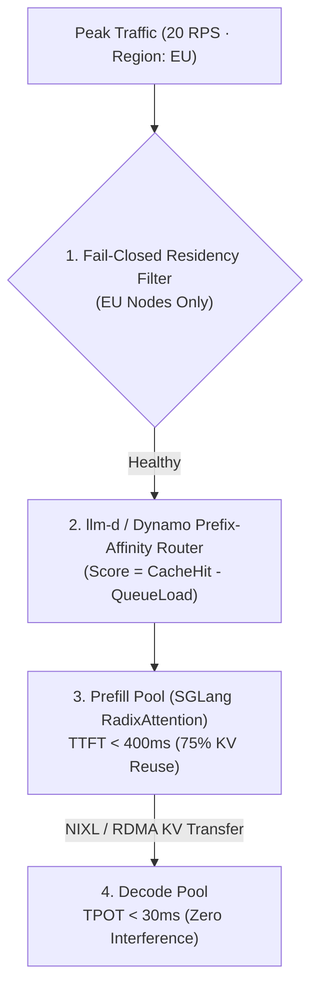

# Lecture 40 — Complete Notes
## Distributed Inference (`SGLang`, `llm-d`, `Dynamo`) & Capacity Engineering

> **Phase:** 9 · Distributed & Sovereign Inference · **Level:** 🔴 Expert
> **Scope:** A single-pass consolidation of the seven chapter notes in this folder.
>
> | Chapter | File |
> | :--- | :--- |
> | 01 · Limits of single-node inference serving | [01_Limits_of_Single_Node_Inference_Serving.md](./01_Limits_of_Single_Node_Inference_Serving.md) |
> | 02 · Disaggregated prefill & decode architecture | [02_Disaggregated_Prefill_and_Decode_Architecture.md](./02_Disaggregated_Prefill_and_Decode_Architecture.md) |
> | 03 · KV cache reuse, RadixAttention & offloading | [03_KV_Cache_Reuse_RadixAttention_and_Offloading.md](./03_KV_Cache_Reuse_RadixAttention_and_Offloading.md) |
> | 04 · Model-aware & prefix-affinity routing (`llm-d`) | [04_Model_Aware_and_Prefix_Affinity_Routing_llmd.md](./04_Model_Aware_and_Prefix_Affinity_Routing_llmd.md) |
> | 05 · NVIDIA Dynamo & multi-node orchestration | [05_NVIDIA_Dynamo_and_Multi_Node_Orchestration.md](./05_NVIDIA_Dynamo_and_Multi_Node_Orchestration.md) |
> | 06 · Data residency, multi-region HA & failover | [06_Data_Residency_Multi_Region_HA_and_Failover.md](./06_Data_Residency_Multi_Region_HA_and_Failover.md) |
> | 07 · Capacity engineering & cost-per-token modeling | [07_Capacity_Engineering_and_Cost_per_Token_Modeling.md](./07_Capacity_Engineering_and_Cost_per_Token_Modeling.md) |

---

## 1. Executive summary

**The lecture in five sentences.**

1. Monolithic GPU serving suffers from **prefill-decode interference** (long compute-bound prefills stall memory-bandwidth-bound decode streams) and **cold KV-cache thrashing** under round-robin load balancing.
2. **Disaggregated Prefill & Decode (`P/D`)** isolates `P` GPUs (optimized for **TTFT**) from `D` GPUs (optimized for **TPOT**), transferring KV tensors over RDMA/NVLink/NIXL.
3. **SGLang `RadixAttention`** and **`LMCache`/`Mooncake`** reuse and offload shared KV prefixes, cutting effective prefill FLOPs by `75%+`.
4. **`llm-d`** and **NVIDIA Dynamo** add **prefix-affinity + load-aware routing** and dynamic `P/D` GPU reallocation, while **fail-closed residency filters** keep `EU`/`IN`/`US` traffic inside legal borders.
5. **Capacity sizing** computes independent `P` and `D` GPU counts from peak RPS, `(1 - kvCacheHitRate)`, and `< 400ms` TTFT / `< 30ms` TPOT SLOs.

---

## 2. The arc of the lecture in one diagram

---

## 3. Cheat sheet

| Concept | One-line definition | Chapter |
| :--- | :--- | :--- |
| **Prefill vs. Decode** | Compute-bound (TTFT) vs. memory-bandwidth-bound (TPOT) | [01](./01_Limits_of_Single_Node_Inference_Serving.md) |
| **`P/D` Disaggregation** | Separate Prefill and Decode GPU pools linked by RDMA/NIXL | [02](./02_Disaggregated_Prefill_and_Decode_Architecture.md) |
| **RadixAttention / LMCache** | Prefix radix tree in HBM + tiered offloading to DRAM/RDMA | [03](./03_KV_Cache_Reuse_RadixAttention_and_Offloading.md) |
| **`llm-d` Prefix Routing** | Routing to warm KV pods balanced by active queue depth | [04](./04_Model_Aware_and_Prefix_Affinity_Routing_llmd.md) |
| **NVIDIA Dynamo** | Multi-node orchestrator with NIXL KV transfer & SLA planner | [05](./05_NVIDIA_Dynamo_and_Multi_Node_Orchestration.md) |
| **Fail-Closed Residency** | Never spill `EU`/`IN` traffic outside its legal region on outage | [06](./06_Data_Residency_Multi_Region_HA_and_Failover.md) |
| **Capacity Sizing** | `EffectivePrefill = RPS * InputTokens * (1 - HitRate)` | [07](./07_Capacity_Engineering_and_Cost_per_Token_Modeling.md) |

---

## 4. Self-check questions (Release Gate Prep)

1. Why does a single 24k-token RAG prompt spike TPOT for 20 other users on a monolithic GPU?
2. How does a `75%` KV-cache hit rate change your required Prefill GPU count?
3. Why must a residency router **fail closed** (`503`) rather than failing over from `EU` to `US`?

