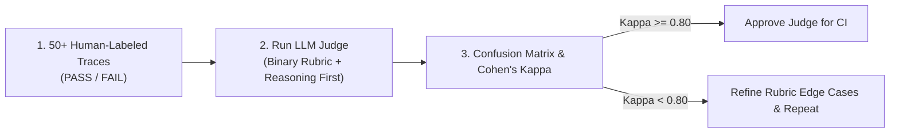

# Chapter 02 — Tool-Action Correctness & Calibrated Judges

> **Lecture 41 · Chapter 02 of 07** · Level: 🔴 Expert · Phase 10 — Quality, FinOps, Identity & Security
> **Source:** `FDE S08` · **Roadmap Reference:** [`roadmap-v1.md`](../../roadmap-v1.md#lecture-41--neuro-symbolic-verification-trajectory-evals-z3-constraints--gepa)
> **Roadmap topics:** Measuring side-effect correctness · deterministic assertions vs. LLM-as-a-Judge · rubric calibration against human labels (Cohen's $\kappa$) · eliminating judge biases.

---

## 02.0 What this chapter is for

When you evaluate an agent trajectory, you quickly realize there are **two kinds of truth**:
1. **Hard Side-Effect Truth:** *"Did `db.orders['ORD-101'].refundedAmount` equal `45`?"* — 100% objective, checkable in TypeScript in `< 1 ms`.
2. **Semantic Quality Truth:** *"Did the agent's escalation handoff note clearly explain why the refund was paused?"* — requires reading natural language.

Many teams lazily throw an uncalibrated LLM judge (*"Rate this agent trace 1 to 10"*) at **both**. That is expensive, slow, and noisy: `1–10` scores fluctuate between `7` and `9` on identical inputs.

By the end of this chapter you should be able to:

1. Separate **Deterministic Side-Effect Assertions** (always first) from **Calibrated Semantic Judges** (only for prose).
2. Design a **binary/3-level judge rubric** with CoT-before-verdict to eliminate noise.
3. Calibrate an LLM judge against **50+ human-labeled traces** using precision, recall, and **Cohen's Kappa ($\kappa \ge 0.80$)**.

---

## 02.1 Deterministic Assertions vs. Calibrated LLM Judges

| What You Are Checking | Example | Deterministic Check | Calibrated LLM Judge |
| :--- | :--- | :---: | :---: |
| **Database state mutation** | `order.status === "refunded"` and `order.amount === 45` | ✅ Always | ❌ Never |
| **Tool preconditions** | `verifyPolicy` ran before `refundOrder` | ✅ Always | ❌ Never |
| **Token / step budget** | `steps.length <= 5` | ✅ Always | ❌ Never |
| **Escalation note clarity** | *"Explain clearly why HITL is needed"* | ❌ Cannot regex | ✅ Binary (`PASS` / `FAIL`) |

---

## 02.2 How to Calibrate an LLM Judge (Step-by-Step)

Never deploy an LLM judge without calibrating it against human ground truth:

### Three rules that make LLM judges reliable

1. **Use Binary (`PASS`/`FAIL`) or 3-Point (`0`/`1`/`2`) Rubrics:** Never `1–10` scales — humans themselves don't agree on a `6` vs. a `7`.
2. **Force `reasoning` *before* `verdict`:** `{ reasoning: string, verdict: "PASS" | "FAIL" }`. Because decoding is autoregressive, generating the verdict *first* locks the model into a snap guess.
3. **Neutralize Verbosity & Self-Preference Bias:** Explicitly tell the judge *"Do not reward longer responses; concise and accurate beats verbose."*

### Worked Calibration Example (50 Human-Labeled Traces)
Suppose on `50` human-labeled traces, your binary judge agrees on `24 PASS` and `22 FAIL`, with `2 FP` and `2 FN`:
- Observed agreement $p_o = 46 / 50 = 0.92$, expected chance agreement $p_e \approx 0.50$.
- **Cohen's Kappa:** $\kappa = \frac{p_o - p_e}{1 - p_e} = \frac{0.92 - 0.50}{1 - 0.50} = \mathbf{0.84} \ge 0.80$ ✅ (Judge approved for CI!).

---

## 02.3 Key takeaways

1. **Deterministic state assertions always beat LLM judges** for tool arguments, ordering, and DB side effects.
2. **Calibrate semantic judges on 50+ human labels** and require $\kappa \ge 0.80$ before trusting them in CI.

---

**Next:** [Chapter 03 — Property-Based Testing for Stochastic Agents](./03_Property_Based_Testing_for_Stochastic_Agents.md)
