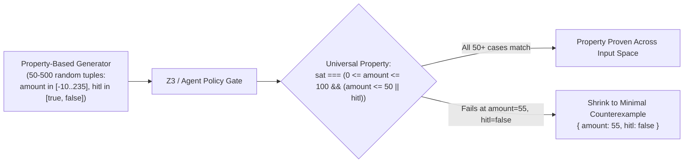

# Chapter 03 — Property-Based Testing for Stochastic Agents

> **Lecture 41 · Chapter 03 of 07** · Level: 🔴 Expert · Phase 10 — Quality, FinOps, Identity & Security
> **Source:** `FDE S08` · **Roadmap Reference:** [`roadmap-v1.md`](../../roadmap-v1.md#lecture-41--neuro-symbolic-verification-trajectory-evals-z3-constraints--gepa)
> **Roadmap topics:** Why example-based unit tests miss AI edge cases · property-based testing (`fast-check` / Hypothesis) · universal invariants across randomized inputs · counterexample shrinking.

---

## 03.0 What this chapter is for

Traditional unit tests check **3 handpicked examples**:
- `refund(30)` $\rightarrow$ allowed
- `refund(75, approved=true)` $\rightarrow$ allowed
- `refund(120)` $\rightarrow$ blocked

Because LLMs are **stochastic** and real users trigger bizarre combinations, handpicked examples routinely miss **boundary bugs**: what happens at `amount = -10`, `amount = 0`, `amount = 50` (exact boundary), `amount = 51`, or `amount = 100` vs. `101`?

**Property-Based Testing (PBT)** flips testing around: instead of writing 3 examples, you state a **universal invariant** that must hold for *all* inputs, and the test runner generates **50 to 1,000+ randomized inputs** to try to falsify it.

By the end of this chapter you should be able to:

1. Contrast **Example-Based Testing** with **Property-Based Testing**.
2. State **3 universal agent invariants** (budget conservation, HITL threshold, idempotency).
3. Explain **counterexample shrinking** and why it makes debugging stochastic failures fast.

---

## 03.1 Example-Based vs. Property-Based Testing

### Three universal invariants every agent should test with PBT

| Invariant Category | Universal Statement ("For ALL inputs...") | Bug It Catches |
| :--- | :--- | :--- |
| **1. Budget Conservation** | `totalRefund >= 0 && totalRefund <= 100` | Negative refunds (`-$50` turning into a charge!) or off-by-one `<=` vs. `<` |
| **2. Authorization / HITL** | `amount > 50 && !hasHitlApproval => BLOCKED` | Boundary leak at `amount = 50.01` or `51` |
| **3. Idempotency** | `run(call, key) === run(replay(call, key))` | Duplicate mutations on network retries |

---

## 03.2 Key takeaways

1. **Handpicked examples test what you remembered; Property-Based Testing tests what you forgot.**
2. **State universal invariants** over randomized amounts, flags, and tool sequences to catch boundary bugs early.

---

**Next:** [Chapter 04 — Neuro-Symbolic Verification & Deterministic Invariants](./04_Neuro_Symbolic_Verification_and_Deterministic_Invariants.md)
