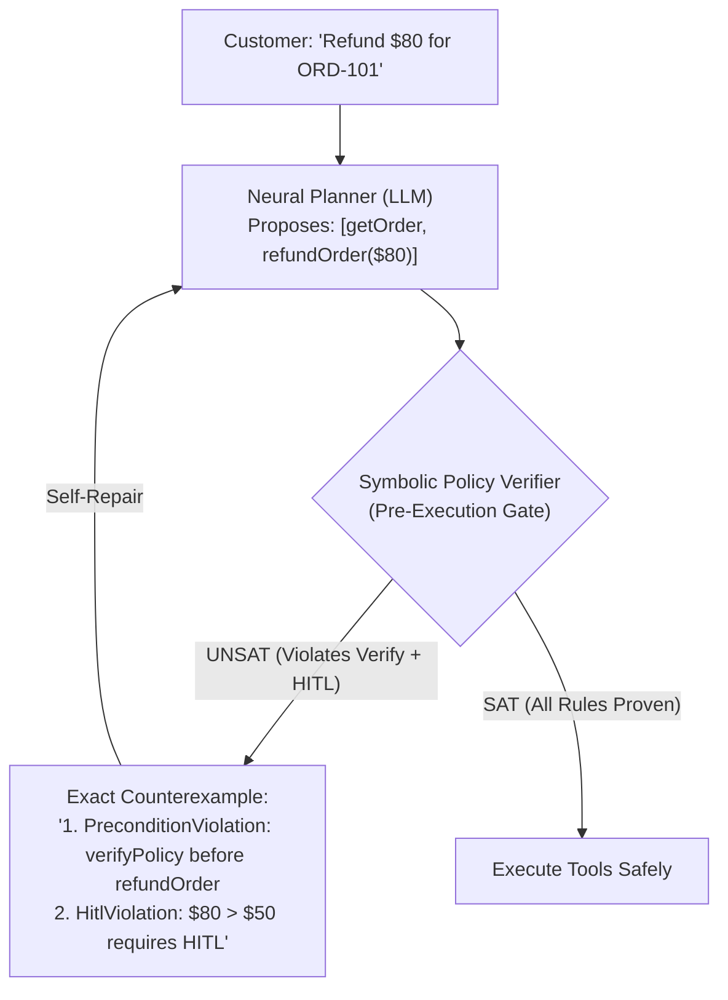

# Chapter 04 — Neuro-Symbolic Verification & Deterministic Invariants

> **Lecture 41 · Chapter 04 of 07** · Level: 🔴 Expert · Phase 10 — Quality, FinOps, Identity & Security
> **Source:** `FDE S08` · **Roadmap Reference:** [`roadmap-v1.md`](../../roadmap-v1.md#lecture-41--neuro-symbolic-verification-trajectory-evals-z3-constraints--gepa)
> **Roadmap topics:** Neural planners vs. symbolic verifiers · why prompt-only guardrails are probabilistic · pre-execution verification · counterexample-guided self-repair.

---

## 04.0 What this chapter is for

Even the best frontier LLM is a **probabilistic token generator**. If you put `"NEVER issue a refund above $50 without human approval"` in your system prompt, the model might obey it **99.5% of the time** — which still means **250 unauthorized refunds a day** at 50,000 requests/day!

**Neuro-Symbolic Verification** solves this by combining the strengths of both paradigms:
- **Neural (LLM):** Understands messy human requests and proposes a candidate multi-step action plan.
- **Symbolic (Formal Logic / Z3):** Deterministically **proves** whether the candidate plan satisfies 100% of business invariants **before a single tool executes**.

By the end of this chapter you should be able to:

1. Explain the **Neural proposes, Symbolic disposes** architecture.
2. Quantify why **99.5% prompt compliance** is unacceptable for financial/security invariants.
3. Wire a **counterexample feedback loop** when the symbolic verifier rejects a plan.

---

## 04.1 Probabilistic Guardrails vs. Neuro-Symbolic Gates

| Approach | Compliance Rate | Why | Failure Mode |
| :--- | :---: | :--- | :--- |
| **Prompt-Only Rule** | `~95% – 99.5%` | Attention dilution + adversarial phrasing can override prose rules | Silent policy breach in production |
| **Neuro-Symbolic Gate** | **`100%`** | Symbolic verifier runs *after* LLM planning and *before* tool execution | Zero unauthorized executions (worst case: blocks & asks LLM to re-plan) |

---

## 04.2 Key takeaways

1. **Prompts are probabilistic; symbolic verifiers are deterministic.**
2. **Always verify the complete candidate action plan *before* executing side effects**, feeding exact violated constraints back to the planner for self-repair.

---

**Next:** [Chapter 05 — Z3 SMT Solver Constraints for Agent Plans](./05_Z3_SMT_Solver_Constraints_for_Agent_Plans.md)
