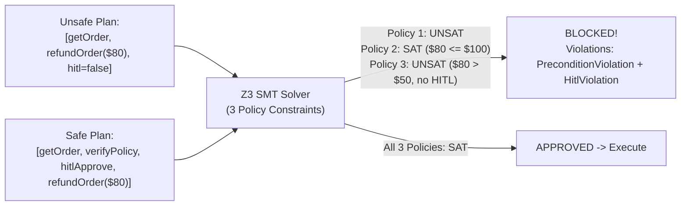

# Chapter 05 — Z3 SMT Solver Constraints for Agent Plans

> **Lecture 41 · Chapter 05 of 07** · Level: 🔴 Expert · Phase 10 — Quality, FinOps, Identity & Security
> **Source:** `FDE S08` · **Roadmap Reference:** [`roadmap-v1.md`](../../roadmap-v1.md#lecture-41--neuro-symbolic-verification-trajectory-evals-z3-constraints--gepa)
> **External Reference:** [Z3 Theorem Prover (`z3-solver`)](https://github.com/Z3Prover/z3)
> **Roadmap topics:** What an SMT solver is · encoding agent policies (ordering, cumulative budgets, conditional HITL, mutual exclusion) in Z3 · `SAT` vs. `UNSAT` · extracting exact violated policies.

---

## 05.0 What this chapter is for

Why use an **SMT (Satisfiability Modulo Theories) Solver** like **Z3** instead of writing 20 nested `if/else` statements in TypeScript?

With 3 rules, `if/else` is easy. With **25 interacting enterprise rules** (*"Cumulative refunds $\le \$100$, VIP tier raises cap to `\$150` unless account age `< 30` days, `verifyPolicy` must precede `refundOrder`, and `deleteAccount` cannot run in the same plan as `exportData`"*), hand-coded `if/else` trees develop hidden contradictions and edge-case holes.

**Z3** lets you declare each business rule as an independent mathematical constraint. In `< 10 ms`, Z3 checks whether all rules can be satisfied simultaneously (`SAT`) or whether a policy is violated (`UNSAT`).

By the end of this chapter you should be able to:

1. Explain what **SMT (`SAT` / `UNSAT`)** means in plain engineering terms.
2. Encode **precondition ordering**, **cumulative budget bounds**, and **conditional HITL rules** using `z3-solver` in TypeScript.
3. Run each policy in its own solver check (or use Z3 UNSAT cores) so the agent receives **exact violated policy names** when a plan is blocked.

---

## 05.1 Translating Business Policies into Z3 Constraints

Using our E-Commerce Refund Agent case study (`code/Basic Code/src/z3-verifier.ts`):

| Policy | Plain English Rule | Z3 TypeScript (`z3-solver`) |
| :--- | :--- | :--- |
| **1. Precondition Ordering** | If `refundOrder` is in the plan, `verifyPolicy` must exist at an earlier step index (`verifyIdx < refundIdx`) | `s.add(Z3.Implies(hasRefund, Z3.And(hasVerify, verifyIdx.lt(refundIdx))))` |
| **2. Cumulative Budget** | Total refund across all `refundOrder` steps must be in `[0, 100]` | `s.add(total.ge(0)); s.add(total.le(100));` |
| **3. Conditional HITL** | If total refund `> 50`, `hasHitlApproval` must be `true` | `s.add(Z3.Implies(total.gt(50), approved))` |

### Why per-policy checks give better agent feedback

If you put all 25 constraints into a single `solver.check()` call and it returns `"unsat"`, you only know *"something failed"*. By checking each policy (or using Z3's `unsatCore()`), you can tell the planner **exactly which rule broke** (`"HitlViolation: refund $80 > $50 requires hasHitlApproval"`), enabling instant self-repair.

---

## 05.2 Key takeaways

1. **Z3 turns complex, interacting policies into clean declarative constraints** (`Implies`, `And`, `lt`, `ge`, `le`).
2. **Pre-execution `SAT` / `UNSAT` checks block 100% of policy-violating plans** before any external API is called.
3. **Returning exact violated policy names** lets the LLM planner repair its plan on the next turn.

---

**Next:** [Chapter 06 — Evaluation-Driven Optimization (`GEPA`)](./06_Evaluation_Driven_Optimization_GEPA.md)
