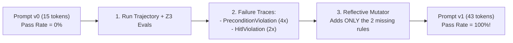

# Chapter 06 — Evaluation-Driven Optimization (`GEPA`)

> **Lecture 41 · Chapter 06 of 07** · Level: 🔴 Expert · Phase 10 — Quality, FinOps, Identity & Security
> **Source:** `FDE S08` · **Roadmap Reference:** [`roadmap-v1.md`](../../roadmap-v1.md#lecture-41--neuro-symbolic-verification-trajectory-evals-z3-constraints--gepa)
> **External Reference:** [GEPA: Reflective Prompt Evolution](https://arxiv.org/abs/2507.19457)
> **Roadmap topics:** Manual prompt tweaking vs. automated reflective evolution (`GEPA`) · Pareto frontier (accuracy vs. token cost) · mutating instructions from Z3/trajectory failure traces · preventing overfitting.

---

## 06.0 What this chapter is for

Once you have a **Trajectory Evaluator** (Chapter 01) and a **Z3 Policy Verifier** (Chapter 05), you run your baseline prompt:

> `v0`: *"You are a helpful support agent. Process customer refunds."*

On a 4-case benchmark (`$30`, `$75`, `$45`, `$90`), `v0` scores **`0%` pass rate**:
- Every case fails `PreconditionViolation` (forgot `verifyPolicy`).
- `$75` and `$90` also fail `HitlViolation` (forgot `requestHitlApproval`).

Instead of a human engineer guessing prompt edits for hours, **GEPA (Genetic-Pareto Reflective Prompt Evolution)** automates prompt tuning directly from those **exact failure traces**.

By the end of this chapter you should be able to:

1. Trace the **4-step GEPA Reflective Evolution Loop** (`Evaluate -> Reflect on Failures -> Mutate -> Pareto Select`).
2. Explain why GEPA optimizes on a **Pareto frontier** (Pass Rate vs. Token Cost) rather than Pass Rate alone.
3. Prevent **prompt overfitting** using a held-out validation split.

---

## 06.1 The 4-Step GEPA Reflective Loop (Worked Example)

| Candidate | Prompt Size (Tokens) | Pass Rate | On Pareto Frontier? |
| :--- | :---: | :---: | :---: |
| **`v0` (Baseline)** | `15` | `0%` | Dominated |
| **`v1` (GEPA Evolved)** | **`43`** | **`100%`** | ✅ **Winner (Optimal accuracy/cost)** |
| **`v2` (Bloated 800-word essay)** | `1,100` | `100%` | ❌ Dominated by `v1` (same accuracy, 25× more tokens!) |

Notice how **Pareto selection** automatically rejects `v2` (prompt bloat) because `v1` achieves `100%` pass rate in only `43` tokens!

---

## 06.2 Avoiding Overfitting in GEPA

If you mutate a prompt until it passes 10 training cases, it might memorize those exact 10 cases (*"If user asks for `$75`, call HITL"*). Always:
1. **Split your eval set** into `Train/Dev` (used for reflection) and `Held-Out Test` (used only for final promotion).
2. **Enforce generalizable rules** (`amountUsd > 50`, not `amountUsd === 75`).

---

## 06.3 Key takeaways

1. **GEPA turns Z3 and Trajectory failure traces into targeted prompt mutations** automatically.
2. **Pareto selection** balances pass rate against prompt token cost, preventing bloated prompts.
3. **Always validate evolved prompts on a held-out test split** before merging.

---

**Next:** [Chapter 07 — Integrating Symbolic Gates into CI/CD](./07_Integrating_Symbolic_Gates_into_CI_CD.md)
