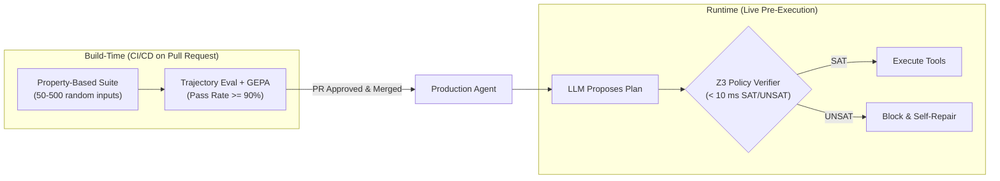

# Chapter 07 — Integrating Symbolic Gates into CI/CD

> **Lecture 41 · Chapter 07 of 07** · Level: 🔴 Expert · Phase 10 — Quality, FinOps, Identity & Security
> **Source:** `FDE S08` · **Roadmap Reference:** [`roadmap-v1.md`](../../roadmap-v1.md#lecture-41--neuro-symbolic-verification-trajectory-evals-z3-constraints--gepa)
> **Roadmap topics:** Runtime vs. build-time verification · wiring Z3, Property-Based Testing, Trajectory Evals, and GEPA into CI/CD · blocking regressions on pull requests.

---

## 07.0 What this chapter is for

Verification only protects your users if it runs **automatically** at two distinct boundaries:
1. **Build-Time (CI/CD on every PR):** Runs Property-Based Testing, Trajectory Evals, and GEPA regression checks before a prompt, tool schema, or model upgrade is merged.
2. **Runtime (Pre-Execution in Production):** Runs the Z3 SMT Policy Verifier in `< 10 ms` on *every* live candidate action plan before any mutating tool executes.

By the end of this chapter you should be able to:

1. Map each Lecture 41 technique to its **Build-Time CI** vs. **Runtime Production** boundary.
2. Define quantitative **CI Release Gate thresholds** that block unsafe or suboptimal PRs.

---

## 07.1 The Two-Boundary Verification Architecture



| Verification Layer | When It Runs | Target Latency | Failure Action |
| :--- | :--- | :---: | :--- |
| **Z3 Policy Verifier** | **Runtime** (every mutating plan) | `< 10 ms` | Block execution (`UNSAT`) + return violated policy to planner |
| **Property-Based Suite** | **CI/CD** (every PR) | `1–5 s` | Fail build on any counterexample |
| **Trajectory Eval + GEPA** | **CI/CD** (prompt/model PR) | `10–60 s` | Fail build if trajectory score `< 0.90` or token cost regresses |

### Concrete CI Release Gate Workflow (`.github/workflows/ai-gate.yml`)
```yaml
- name: Run Neuro-Symbolic & Trajectory Release Gates
  run: |
    npm run typecheck
    npm test   # Runs Trajectory Eval + Z3 Policy + 50-case PBT + GEPA Pareto Gate
```

---

## 07.2 Key takeaways

1. **Runtime Z3 (`< 10 ms`)** is your deterministic safety net against stochastic LLM mistakes.
2. **CI/CD Trajectory Evals + PBT + GEPA** ensure prompts and planners measurably improve without silent regressions.

---

**Next:** [Lecture 41 — Complete Notes (Master Consolidation)](./Lecture_41_Complete_Notes.md)
