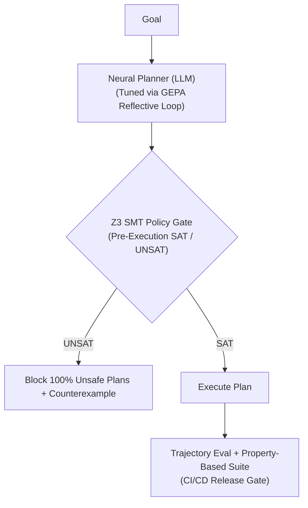

# Lecture 41 — Complete Notes
## Neuro-Symbolic Verification, Trajectory Evals, Z3 Constraints & GEPA

> **Phase:** 10 · Quality, FinOps, Identity & Security · **Level:** 🔴 Expert
> **Scope:** A single-pass consolidation of the seven chapter notes in this folder.
>
> | Chapter | File |
> | :--- | :--- |
> | 01 · Task evaluation vs. trajectory evaluation | [01_Task_Evaluation_vs_Trajectory_Evaluation.md](./01_Task_Evaluation_vs_Trajectory_Evaluation.md) |
> | 02 · Tool-action correctness & calibrated judges | [02_Tool_Action_Correctness_and_Calibrated_Judges.md](./02_Tool_Action_Correctness_and_Calibrated_Judges.md) |
> | 03 · Property-based testing for stochastic agents | [03_Property_Based_Testing_for_Stochastic_Agents.md](./03_Property_Based_Testing_for_Stochastic_Agents.md) |
> | 04 · Neuro-symbolic verification & deterministic invariants | [04_Neuro_Symbolic_Verification_and_Deterministic_Invariants.md](./04_Neuro_Symbolic_Verification_and_Deterministic_Invariants.md) |
> | 05 · Z3 SMT solver constraints for agent plans | [05_Z3_SMT_Solver_Constraints_for_Agent_Plans.md](./05_Z3_SMT_Solver_Constraints_for_Agent_Plans.md) |
> | 06 · Evaluation-driven optimization (`GEPA`) | [06_Evaluation_Driven_Optimization_GEPA.md](./06_Evaluation_Driven_Optimization_GEPA.md) |
> | 07 · Integrating symbolic gates into CI/CD | [07_Integrating_Symbolic_Gates_into_CI_CD.md](./07_Integrating_Symbolic_Gates_into_CI_CD.md) |

---

## 1. Executive summary

**The lecture in five sentences.**

1. **Trajectory Evaluation** grades the entire tool-call path (tool recall, precondition ordering, argument accuracy, step efficiency) because final-answer evals miss dangerous intermediate side effects.
2. Prefer **deterministic state assertions** first, reserving **calibrated binary/3-point LLM judges** ($\ge 90\%$ human agreement) only for semantic prose.
3. **Property-Based Testing (PBT)** tests universal invariants across 100+ randomized inputs to catch boundary bugs that handpicked unit tests miss.
4. **Neuro-Symbolic Verification with Z3** encodes business policies (precondition ordering, cumulative budgets, conditional HITL) as SMT constraints — blocking **100%** of `UNSAT` plans before execution.
5. **GEPA (Reflective Prompt Evolution)** automatically mutates prompts from failure traces and selects Pareto-optimal improvements verified on a held-out split.

---

## 2. The arc of the lecture in one diagram

---

## 3. Cheat sheet

| Concept | One-line definition | Chapter |
| :--- | :--- | :--- |
| **Trajectory Eval** | Scoring tool recall, precondition order, arg accuracy, & step efficiency | [01](./01_Task_Evaluation_vs_Trajectory_Evaluation.md) |
| **Calibrated Judge** | Binary/3-level rubric calibrated to $\ge 90\%$ human agreement | [02](./02_Tool_Action_Correctness_and_Calibrated_Judges.md) |
| **Property-Based Testing** | Testing universal invariants across 100+ randomized inputs | [03](./03_Property_Based_Testing_for_Stochastic_Agents.md) |
| **Neuro-Symbolic Gate** | Neural LLM proposes plan; symbolic verifier proves policy compliance | [04](./04_Neuro_Symbolic_Verification_and_Deterministic_Invariants.md) |
| **Z3 SMT Constraints** | Formal logic encoding ordering, budgets, & HITL (`SAT`/`UNSAT`) | [05](./05_Z3_SMT_Solver_Constraints_for_Agent_Plans.md) |
| **GEPA Optimization** | Reflective prompt evolution from failure traces on a Pareto frontier | [06](./06_Evaluation_Driven_Optimization_GEPA.md) |

---

## 4. Self-check questions (Release Gate Prep)

1. Why can two agent runs produce identical final text while one scores `100%` and the other `40%` on a Trajectory Eval?
2. Why does Z3 scale better than nested `if/else` checks when 10+ business policies interact?
3. How does GEPA prevent overfitting when mutating prompts against evaluation failures?

