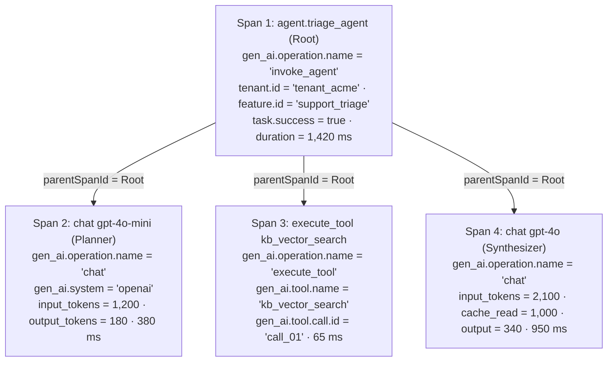

# Chapter 01 — OpenTelemetry (OTel) GenAI Semantic Conventions

> **Lecture 42 · Chapter 01 of 07** · Level: 🟠 Advanced · Phase 10 — Quality, FinOps, Identity & Security
> **Source:** `FDE S17` · **Roadmap Reference:** [`roadmap-v1.md`](../../roadmap-v1.md#lecture-42--ai-observability-opentelemetry-openobserve--focus-finops)
> **External Reference:** [OpenTelemetry GenAI Semantic Conventions](https://opentelemetry.io/docs/specs/semconv/gen-ai/)

---

## 1. Why Vendor-Neutral Instrumentation Matters

Imagine your company runs:
- An **API Gateway** in Go/TypeScript
- An **Agent Orchestrator** in Node.js (calling OpenAI and Anthropic)
- A **RAG Vector Service** in Python (calling Qdrant/Postgres)
- A **Self-Hosted Inference Cluster** running vLLM or SGLang

If you instrument only the agent with a proprietary LLM-tracing SDK, you create **two painful problems**:
1. **Vendor Lock-In:** Switching from Vendor A to Vendor B means rewriting tracing decorators across dozens of services.
2. **Broken Trace Context:** Your SRE team's Jaeger/OpenObserve dashboard shows the HTTP request hitting the gateway, then a mysterious 4-second black hole, because the proprietary LLM SDK created a *separate* trace ID that doesn't link to Postgres or Redis!

**OpenTelemetry (OTel)** solves this with a single open standard (`traceId`, `spanId`, `parentSpanId`, and W3C `traceparent` headers). Its **GenAI Semantic Conventions (`gen_ai.*`)** define exact attribute names for prompts, models, token counts, and tool calls so **any** OTel-compatible backend (OpenObserve, Grafana Tempo, Datadog, Honeycomb) understands your AI telemetry out of the box.

---

## 2. Mental Model: The `agent -> model -> tool` Span Tree

Think of a single user request as a **tree of nested timers (spans)** sharing one **`traceId`**:

### Why the Hierarchy Matters
- **Root Span (`invoke_agent`):** Answers *"Did the overall business task succeed (`task.success`), for which customer (`tenant.id`), and how long did the user wait?"*
- **Model Child Spans (`chat`):** Answers *"Which model burned the tokens? Did prompt caching (`cache_read_input_tokens`) actually hit? Why did `gpt-4o` take 950 ms?"*
- **Tool Child Spans (`execute_tool`):** Answers *"Did the agent loop 6 times because the SQL/KB tool kept returning errors?"*

---

## 3. Standard `gen_ai.*` + Business Attribution Attributes

OTel splits attributes into **GenAI standard keys** (understood by every observability UI) and **business FinOps keys** (required for cost attribution):

| Attribute Key | Span Level | Example Value | Purpose |
| :--- | :--- | :--- | :--- |
| `gen_ai.operation.name` | All | `"invoke_agent"`, `"chat"`, `"execute_tool"` | Classifies span role without fragile string parsing on span names |
| `gen_ai.system` | Model | `"openai"`, `"anthropic"`, `"aws.bedrock"` | Vendor-neutral provider attribution |
| `gen_ai.request.model` | Model | `"gpt-4o-2024-11-20"` | Tracks exact model snapshot (critical for drift debugging!) |
| `gen_ai.usage.input_tokens` | Model | `1200` | Uncached prompt tokens billed at `1.0x` rate |
| `gen_ai.usage.cache_read_input_tokens` | Model | `1000` | Prefix-cached tokens billed at `0.1x–0.5x` rate |
| `gen_ai.usage.output_tokens` | Model | `340` | Completion + reasoning tokens billed at `3x–5x` rate |
| `gen_ai.response.finish_reasons` | Model | `["stop"]` or `["length"]` | Instantly spots truncated answers (`"length"`) or safety blocks (`"content_filter"`) |
| `gen_ai.tool.name` / `call.id` | Tool | `"kb_vector_search"`, `"call_01"` | Links tool execution back to the exact LLM tool call |
| `tenant.id` / `feature.id` | Root + Child | `"tenant_acme"`, `"support_triage"` | Enables multi-tenant cost & SLO slicing |
| `task.success` | Root | `true` / `false` | Enables true **Cost per Successful Task (CPST)** |

---

## 4. PII-Safe Telemetry: What Never Belongs on Default Spans

> [!WARNING]
> **Never attach raw user prompts or full LLM completions as default span attributes in production.** Customer support tickets, medical records, and SQL results contain PII/PCI/PHI—if they land in an unencrypted telemetry index, you create a compliance breach.

### Production Privacy Rules
1. **Default Off:** Record **metadata** (`token counts`, `latency`, `finish_reasons`, `prompt_template_version`, `sha256(prompt)`) on spans, not raw text.
2. **Opt-In / Redacted Capture:** When debugging is required, emit prompt/completion **OTel Events** only in `staging`/`eval`, or pass them through a **PII scrubber** (stripping emails, SSNs, API keys, Bearer tokens) inside the OTel Collector before storage.
3. **High-Cardinality Guard:** Never put raw `user_query` or `session_uuid` into **metric labels** (which explode Prometheus/OpenObserve memory). Keep high-cardinality IDs (`trace_id`, `call_id`, `tenant_id`) on **spans and logs**, not metric dimensions.

---

## 5. Common Pitfalls vs. Production Fixes

| Pitfall | What Goes Wrong | Production Fix |
| :--- | :--- | :--- |
| **Missing `parentSpanId` / broken `Context`** | Async `Promise.all` or worker queues lose active context, splitting 1 agent run into 5 orphan traces | Propagate `rootCtx` explicitly (`tracer.startSpan(..., rootCtx)`) or inject/extract W3C `traceparent` across queues |
| **Using `SpanStatusCode.OK` when `task.success=false`** | Agent returns polite `"I cannot help"` after 3 tool errors; trace looks green | Set `task.success = false` and `SpanStatusCode.ERROR` whenever business verification fails |
| **Putting raw prompts in OTel Metrics** | High-cardinality labels crash your metrics backend | Keep raw/redacted payloads in **Logs/Events** linked by `trace_id`; keep **Metrics** low-cardinality (`model`, `feature.id`, `status`) |

---

## 6. Chapter Summary
- Use **OpenTelemetry `gen_ai.*` semantic conventions** for vendor-neutral observability across agents, models, tools, and downstream databases.
- Model every request as a linked **`agent -> model -> tool`** tree sharing one `traceId`.
- Attach `tenant.id`, `feature.id`, and `task.success` to bridge SRE telemetry with FinOps, while keeping raw PII out of default span attributes.

---
**Next:** [Chapter 02 — Shipping Traces, Metrics & Logs to OpenObserve](./02_Shipping_Traces_Metrics_and_Logs_to_OpenObserve.md)
