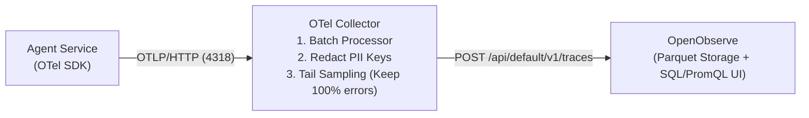
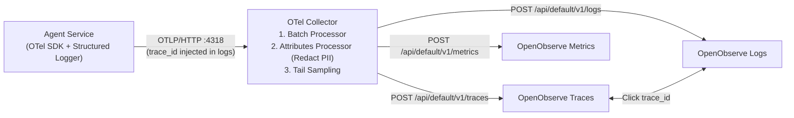

# Chapter 02 — Shipping Traces, Metrics & Logs to OpenObserve

> **Lecture 42 · Chapter 02 of 07** · Level: 🟠 Advanced · Phase 10 — Quality, FinOps, Identity & Security
> **Source:** `FDE S17` · **Roadmap Reference:** [`roadmap-v1.md`](../../roadmap-v1.md#lecture-42--ai-observability-opentelemetry-openobserve--focus-finops)
> **External Reference:** [OpenObserve Documentation](https://openobserve.ai/docs/)
> **Roadmap topics:** OTel Collector pipeline (Receivers $\rightarrow$ Processors $\rightarrow$ Exporters) · OTLP HTTP/gRPC ingestion into OpenObserve · correlating traces, metrics, and logs via `traceId`.

---

## 02.0 What this chapter is for

Emitting OTel spans in memory is useless unless they land in a fast, searchable backend. **OpenObserve** is an open-source, cloud-native observability platform (written in Rust, storing Parquet on S3/disk) that ingests **OTLP (OpenTelemetry Protocol)** traces, metrics, and logs natively at a fraction of traditional APM costs.

By the end of this chapter you should be able to:

1. Wire the **OTel Collector** (`OTLP Receiver -> Batch + PII Redaction Processor -> OTLP/HTTP OpenObserve Exporter`).
2. Correlate **Traces** (latency waterfall), **Metrics** (p95 TTFT, token rate), and **Logs** (exact tool error stderr) using a single `traceId`.
3. Configure **tail-based sampling** so 100% of error/slow traces are kept while high-volume routine `200 OK` traces are sampled economically.

---

## 02.1 The OTel Collector $\rightarrow$ OpenObserve Pipeline



### Why an OTel Collector sits in the middle

1. **Decouples app from backend:** Your agent always sends OTLP to `localhost:4318`; swapping OpenObserve for another backend is a 3-line YAML change.
2. **Centralized PII scrubbing:** Collector processors strip `authorization` headers or email regexes *before* telemetry leaves your VPC.
3. **Buffering & Retries:** If OpenObserve restarts, the Collector buffers spans without slowing down user requests.

---

## 02.2 Key takeaways

1. **Ship OTLP through an OTel Collector** for batching, PII redaction, and backend portability.
2. **OpenObserve ingests OTLP traces, metrics, and logs natively**, letting you query AI traces with SQL.

---

**Next:** [Chapter 03 — Continuous Quality Monitoring & Drift Detection](./03_Continuous_Quality_Monitoring_and_Drift_Detection.md)

# Chapter 02 — Shipping Traces, Metrics & Logs to OpenObserve

> **Lecture 42 · Chapter 02 of 07** · Level: 🟠 Advanced · Phase 10 — Quality, FinOps, Identity & Security
> **Source:** `FDE S17` · **Roadmap Reference:** [`roadmap-v1.md`](../../roadmap-v1.md#lecture-42--ai-observability-opentelemetry-openobserve--focus-finops)
> **External Reference:** [OpenObserve Documentation](https://openobserve.ai/docs/)

---

## 1. Why OpenObserve + OTel Collector?

Emitting OTel spans inside your Node.js/Python process is only half the story—they need to be **buffered, scrubbed, sampled, and stored** somewhere you can query in seconds during an outage.

**OpenObserve** is an open-source, Rust-based observability backend designed as a high-efficiency alternative to Elasticsearch/Splunk/Datadog:
- **Native OTLP Ingestion:** Accepts OpenTelemetry **Traces, Metrics, and Logs** directly over OTLP/HTTP (`4318`) or OTLP/gRPC (`4317`).
- **Parquet + Object Storage (S3/MinIO):** Stores telemetry in compressed Apache Parquet files rather than expensive JVM heap/Lucene indexes—cutting storage costs by **10x–30x** for high-volume AI traces.
- **SQL & PromQL Querying:** Lets engineers run standard SQL across `gen_ai.*` span attributes (`SELECT tenant_id, SUM(gen_ai_cost_usd) ...`).

---

## 2. Three Signals Correlated by `trace_id`

Each telemetry signal answers a different operational question—and **`trace_id` is the glue** connecting them:

| Signal | Best Used For | Example AI Query |
| :--- | :--- | :--- |
| **Traces** | Debugging *one slow or failed agent run* end-to-end | *"Why did `trace_id=7b9cd45c...` take 9.2 seconds? Oh, `execute_tool sql_query` retried 4 times!"* |
| **Metrics** | Fast dashboards, `p95` percentiles, and SLO burn-rate alerts | *"What is `p95(gen_ai.client.operation.duration)` for `gpt-4o` over the last 15 minutes?"* |
| **Logs** | Detailed structured payloads (guardrail blocks, JSON repair diffs, stack traces) | *"Show the exact Zod validation error emitted during `trace_id=7b9cd45c...`."* |



---

## 3. Why You Put an OTel Collector in the Middle

Never point 50 microservices directly at a remote observability SaaS URL with synchronous HTTP calls. Put an **OpenTelemetry Collector** sidecar or DaemonSet in front:

1. **Zero Request Latency Impact:** Your agent writes spans to `localhost:4318` in sub-millisecond memory; the Collector batches and retries exports asynchronously.
2. **Centralized PII Redaction:** One `attributes` / `transform` processor strips `authorization`, `cookie`, and regex-matched emails/SSNs across *all* services before anything leaves your VPC.
3. **Backend Portability:** Switching from local Jaeger $\rightarrow$ OpenObserve $\rightarrow$ Grafana Cloud is a 4-line Collector YAML change—zero application code redeploys.

### Minimal OTel Collector Config for OpenObserve (`otel-collector.yaml`)

```yaml
receivers:
  otlp:
    protocols:
      http:
        endpoint: 0.0.0.0:4318
      grpc:
        endpoint: 0.0.0.0:4317

processors:
  batch:
    send_batch_size: 512
    timeout: 2s

  # Scrub accidental secrets before leaving the VPC
  attributes/redact:
    actions:
      - key: http.request.header.authorization
        action: delete
      - key: user.email
        action: hash

exporters:
  otlphttp/openobserve:
    endpoint: "http://openobserve:5080/api/default"
    headers:
      Authorization: "Basic ${OPENOBSERVE_AUTH_TOKEN}"

service:
  pipelines:
    traces:
      receivers: [otlp]
      processors: [attributes/redact, batch]
      exporters: [otlphttp/openobserve]
    metrics:
      receivers: [otlp]
      processors: [batch]
      exporters: [otlphttp/openobserve]
    logs:
      receivers: [otlp]
      processors: [attributes/redact, batch]
      exporters: [otlphttp/openobserve]
```

---

## 4. Head Sampling vs. Tail-Based Sampling

At 1,000,000 agent runs/day, storing 100% of routine traces can still get expensive. How do you sample without losing the bugs?

| Strategy | Where Decision Happens | Fatal Flaw / Benefit |
| :--- | :--- | :--- |
| **Head Sampling (e.g., 10% random)** | At the *start* of the request | **Flaw:** Drops **90% of your errors and latency spikes** because you didn't know the request would fail when it started! |
| **Tail-Based Sampling (Smart)** | In the OTel Collector *after* the trace finishes | **Benefit:** Keeps **100% of errors** (`status == ERROR` or `task.success == false`), **100% of slow/expensive runs** (`duration > 5s` or `cost > $0.10`), and only samples `5%` of fast `OK` runs! |

> [!TIP]
> **Cost & FinOps Rule:** Even if you tail-sample **traces** at 10% for fast `OK` requests, **always keep 100% of billing/cost records** (via metrics or FOCUS event logs) so your financial ledger never undercounts customer spend!

---

## 5. Chapter Summary
- **OpenObserve** ingests native OTLP traces, metrics, and logs into Parquet storage with SQL/PromQL querying.
- Always correlate **Traces, Metrics, and Logs** with the same `trace_id`.
- Deploy an **OTel Collector** for async batching, PII redaction, and **tail-based sampling** (100% of errors/slow/expensive traces kept, routine successes sampled).

---
**Next:** [Chapter 03 — Continuous Quality Monitoring & Drift Detection](./03_Continuous_Quality_Monitoring_and_Drift_Detection.md)

