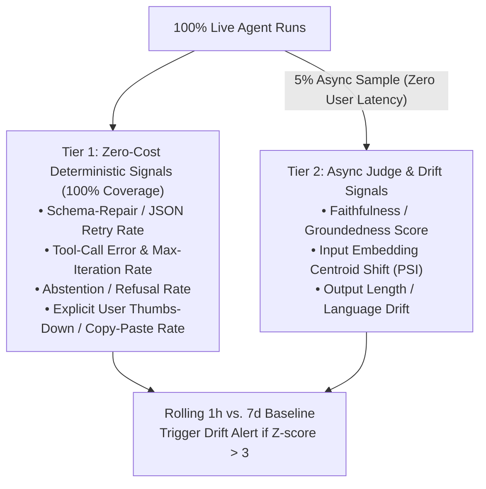

# Chapter 03 — Continuous Quality Monitoring & Drift Detection

> **Lecture 42 · Chapter 03 of 07** · Level: 🟠 Advanced · Phase 10 — Quality, FinOps, Identity & Security
> **Source:** `FDE S17` · **Roadmap Reference:** [`roadmap-v1.md`](../../roadmap-v1.md#lecture-42--ai-observability-opentelemetry-openobserve--focus-finops)

---

## 1. The Silent Failure Problem: "0% Errors, 100% Broken"

Imagine this real-world Monday morning incident:
- Your CI evaluation suite passed `96%` on Friday afternoon.
- Over the weekend, **HTTP `500` rate is `0.00%`**, and `p95` latency looks totally normal.
- On Monday at 9:00 AM, support tickets flood in: *"The contract assistant keeps saying 'I cannot find any payment terms' on every PDF!"*

Nothing crashed. No exception was thrown. Why did the agent silently break?
1. **Upstream Data / RAG Drift:** Someone updated the document parser on Saturday, turning PDF tables into empty whitespace chunks.
2. **Model Provider Drift:** A hosted model alias (`gpt-4o-latest` or a quantized endpoint) received a silent weight/routing update, changing its JSON adherence or refusal threshold.
3. **User Behavior Drift:** A new enterprise tenant uploaded German-language invoices when your golden eval dataset only tested English.

**Continuous Quality Monitoring** bridges the gap between offline CI evals and live production traffic.

---

## 2. Two Tiers of Online Quality Signals

Running an expensive LLM judge on **100% of live traffic** would double your AI bill and add seconds of latency. Instead, combine **Tier 1 (Zero-Cost Structural Proxies on 100% of traffic)** with **Tier 2 (Async Sampled Judges on 1%–5% of traffic)**:

### Detailed Signal Breakdown

| Signal | Cost | What Failure Mode It Catches | Example Alert Rule |
| :--- | :---: | :--- | :--- |
| **Schema-Repair Rate** | `$0` | Model stopped obeying structured output / Zod schema | Jumps from `0.5%` $\rightarrow$ `> 4%` over 30m |
| **Tool-Error / Loop Rate** | `$0` | Downstream API changed schema or auth token expired | Tool failures `> 5%` or avg turns/task `> 4.5` |
| **Abstention / Refusal Rate** | `$0` | Broken RAG ingestion (empty chunks) or overly strict safety filter | `"Insufficient evidence"` jumps `4%` $\rightarrow$ `20%` |
| **User Negative Feedback** | `$0` | Subtle UX/tone/accuracy regressions | Thumbs-down or human-escalation rate `> 2x` 7d baseline |
| **Async Faithfulness Judge (`5%`)** | Low | Hallucinations not caught by schema checks | Rolling 1h faithfulness drops `< 0.85` |

---

## 3. Worked Example: Catching RAG Ingestion Drift in 15 Minutes

Suppose your **Support Triage Agent** normally sees these 7-day baseline metrics:
- **Abstention rate:** `3.5%` ($\sigma = 0.6\%$)
- **Avg retrieved chunk length:** `420 tokens`
- **Sampled faithfulness:** `0.93`

At `14:00`, a cron job re-indexes Confluence with a broken HTML stripper:
- By `14:15`, `avg_chunk_length` drops from `420` $\rightarrow$ `18 tokens`.
- **Abstention rate** spikes from `3.5%` $\rightarrow$ `38%` (a **+57 $\sigma$** jump!).
- Your OpenObserve alert fires in 15 minutes with the exact `trace_id`s of abstained runs, letting SREs roll back the Confluence index before most customers even notice.

---

## 4. Calibrating Online Judges & Avoiding Alert Fatigue

1. **Pin Model Snapshots:** Never use floating aliases like `gpt-4o-latest` in production—pin exact snapshots (e.g., `gpt-4o-2024-11-20`) and log `gen_ai.response.model` on every span so you know immediately if a provider routed you elsewhere.
2. **Calibrate Judges Against Human Labels:** Before trusting an automated faithfulness judge for PagerDuty alerts, verify its agreement (Cohen's $\kappa \ge 0.75$ or F1 $\ge 0.85$) on 200 human-labeled production traces.
3. **Compare Against 7-Day Same-Hour Baselines:** Enterprise traffic looks completely different at 2:00 AM Sunday vs. 10:00 AM Tuesday. Compare rolling windows against the same hour/day-of-week baseline to avoid false pages.
4. **Auto-Harvest Failures into Golden Evals:** Every trace flagged by drift detection (`task.success = false` or `faithfulness < 0.7`) should be scrubbed of PII and added to your regression suite (see Lecture 41 GEPA) so the bug never returns.

---

## 5. Chapter Summary
- Passing Friday's CI evals does not guarantee Tuesday's production quality—**data drift, model drift, and user drift** happen silently with `0%` HTTP 500s.
- Monitor **100% of traffic with `$0` deterministic proxies** (schema repairs, tool errors, abstentions, escalations) and **5% asynchronously with calibrated LLM judges**.
- Feed detected production failures straight back into your offline golden evaluation dataset.

---
**Next:** [Chapter 04 — AI SLOs & Error Budgets](./04_AI_SLOs_and_Error_Budgets.md)
