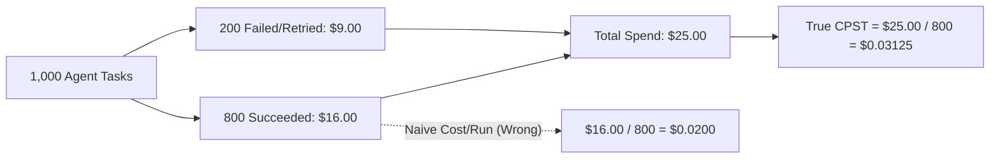

# Chapter 05: AI FinOps — Cost per Successful Task

> **Goal:** Understand why raw token cost is a misleading vanity metric, and learn how to calculate, track, and optimize **Cost per Successful Task (CPST)**—including failed runs, retries, tool calls, and human escalation costs.

---

## 1. Why "Cost per 1M Tokens" Lies to You

In traditional software, compute cost scales roughly linearly with traffic. In agentic AI, cost scales with **reasoning loops, retries, and failures**.

Consider two models running an invoice-extraction agent:
- **Model A (Cheap & Fragile):** \$0.15 / 1M input tokens. Average run uses 4,000 tokens (\$0.0006), **but** fails JSON validation 40% of the time and triggers 2 retries + fallback to a human reviewer.
- **Model B (Pricier & Reliable):** \$1.50 / 1M input tokens (10x more expensive per token!). Average run uses 3,000 tokens (\$0.0045), succeeds 98% of the time on the first try.

If your FinOps dashboard only tracks **cost per 1,000 tokens**, Model A looks 10x cheaper. If your dashboard tracks **Cost per Successful Task (CPST)**, Model B is dramatically cheaper once you count retries, wasted compute on failed runs, and human fallback.

| Metric | What It Measures | Blind Spot |
| :--- | :--- | :--- |
| **Token Price (\$ / 1M)** | Vendor rate card | Ignores prompt bloat, caching, and success rate |
| **Cost per API Call** | Average spend per HTTP request | Ignores multi-turn agent loops (1 task = 8 calls) |
| **Cost per Run** | Spend per agent invocation | Counts failed/hallucinated runs as "output" |
| **Cost per Successful Task (CPST)** | Total spend divided by **verified** successes | **Gold standard** — aligns engineering with business value |

---

## 2. The Cost per Successful Task Formula

To compute true CPST over any time window (hour, day, month) or feature slice:

$$\text{CPST} = \frac{\sum C_{\text{all\_runs}} + \sum C_{\text{tools}} + \sum C_{\text{eval\_judges}} + \sum C_{\text{human\_escalation}}}{N_{\text{successful\_tasks}}}$$

Where:
- $\sum C_{\text{all\_runs}}$ = Sum of LLM input, cached-input, output, and reasoning token costs across **both succeeded AND failed** runs (including all retries).
- $\sum C_{\text{tools}}$ = External API costs triggered by the agent (web search, code-execution sandbox seconds, OCR APIs).
- $\sum C_{\text{eval\_judges}}$ = Cost of online LLM-as-a-judge checks or guardrails.
- $\sum C_{\text{human\_escalation}}$ = Cost of human-in-the-loop review when the agent gives up or fails confidence thresholds (optional for pure-compute CPST, essential for **Total Cost of Ownership**).
- $N_{\text{successful\_tasks}}$ = Count of tasks where `task.success == true` (verified by schema, Z3/policy check, or user acceptance—not just HTTP `200 OK`).

---

## 3. Worked Example: Anatomy of an Agent Task Cost

Suppose our **Support Triage Agent** handles 100 tickets in an hour:

1. **75 tickets succeed on Attempt 1:**
   - 2,000 input tokens @ \$2.50/1M = \$0.0050
   - 500 output tokens @ \$10.00/1M = \$0.0050
   - 1 Knowledge Base vector search tool call = \$0.0002
   - Cost per clean ticket = \$0.0102 $\rightarrow$ $75 \times 0.0102 = \$0.7650$
2. **15 tickets fail Attempt 1, retry, and succeed on Attempt 2:**
   - Attempt 1 wasted \$0.0102 + Attempt 2 cost \$0.0120 (longer error-correction context) = \$0.0222 each
   - $15 \times 0.0222 = \$0.3330$
3. **10 tickets hit max-iteration limit (3 attempts) and fail (`task.success = false`):**
   - Each burned \$0.0350 before failing
   - $10 \times 0.0350 = \$0.3500$

**Calculation:**
- **Total Spend:** $\$0.7650 + \$0.3330 + \$0.3500 = \$1.4480$
- **Successful Tasks:** $75 + 15 = 90$
- **Naive Average Cost per Call:** $\approx \$0.011$
- **True CPST:** $\$1.4480 / 90 = \$0.0161$ (**46% higher** than the naive single-call estimate!)

> [!TIP]
> Track the **Failure Tax Ratio** alongside CPST:
> $$\text{Failure Tax} = \frac{\text{Spend on Failed Attempts & Retries}}{\text{Total Spend}}$$
> In the example above, $\$0.153$ (Attempt 1 failures on retried tasks) + $\$0.350$ (dead-end failures) = $\$0.503$, or **34.7% Failure Tax**. Reducing failures cuts your bill by a third without changing models!

---

## 4. Token Cost Components & Prompt Caching Math

Modern LLM pricing has four distinct token rates that your OTel span attributes must capture separately:

| Token Type | OTel Attribute | Typical Price Multiplier | Optimization Lever |
| :--- | :--- | :---: | :--- |
| **Uncached Input** | `gen_ai.usage.input_tokens` | `1.0x` | Trim system prompt, prune dead tool schemas |
| **Cached Input (Read)** | `gen_ai.usage.cache_read_input_tokens` | `0.1x` – `0.25x` | Put static instructions + tool definitions at the **top** of prompt |
| **Output** | `gen_ai.usage.output_tokens` | `3x` – `5x` | Structured JSON outputs, concise reasoning, stop sequences |
| **Reasoning / Thinking** | `gen_ai.usage.reasoning_tokens` | `3x` – `5x` (billed as output) | Set `reasoning_effort` low for simple classification tasks |

### Exact Token Cost Formula
$$\text{Cost}_{\text{model}} = \frac{T_{\text{in\_uncached}} \cdot P_{\text{in}} + T_{\text{in\_cached}} \cdot P_{\text{cache\_read}} + (T_{\text{out}} + T_{\text{reasoning}}) \cdot P_{\text{out}}}{1{,}000{,}000}$$

---

## 5. Five High-Leverage Ways to Lower CPST

1. **Model Routing (Cascading):** Route 80% of simple intent/classification steps to a small fast model (\$0.10/1M), reserving frontier models (\$2.50–\$15/1M) for complex synthesis or fallback.
2. **Prefix Prompt Caching:** Keep system prompts, few-shot examples, and MCP tool schemas byte-identical at the start of every request to earn 75%–90% discounts on input tokens.
3. **Code Mode / Tool Compaction:** Instead of passing 50 verbose JSON tool schemas (15,000+ input tokens per turn), expose a compact search/execute interface (see Lecture 31).
4. **Early Exit & Circuit Breakers:** Stop runaway loops after 2 identical tool errors instead of burning 10 iterations on a broken API.
5. **Semantic Caching:** Cache deterministic or high-similarity queries (e.g., FAQ lookups) before calling the LLM at all.

---

## 6. Chapter Summary
- Never optimize for raw token price in isolation; optimize for **Cost per Successful Task (CPST)**.
- Always include the spend from **failed tasks, retries, tool calls, and online judges** in the numerator, and divide only by **verified successful tasks**.
- Measure your **Failure Tax** (`failed_spend / total_spend`)—fixing reliability is often the fastest FinOps win.

---
**Next:** [Chapter 06: Tenant & Feature Attribution and Hard Budgets](./06_Tenant_and_Feature_Attribution_and_Hard_Budgets.md)

