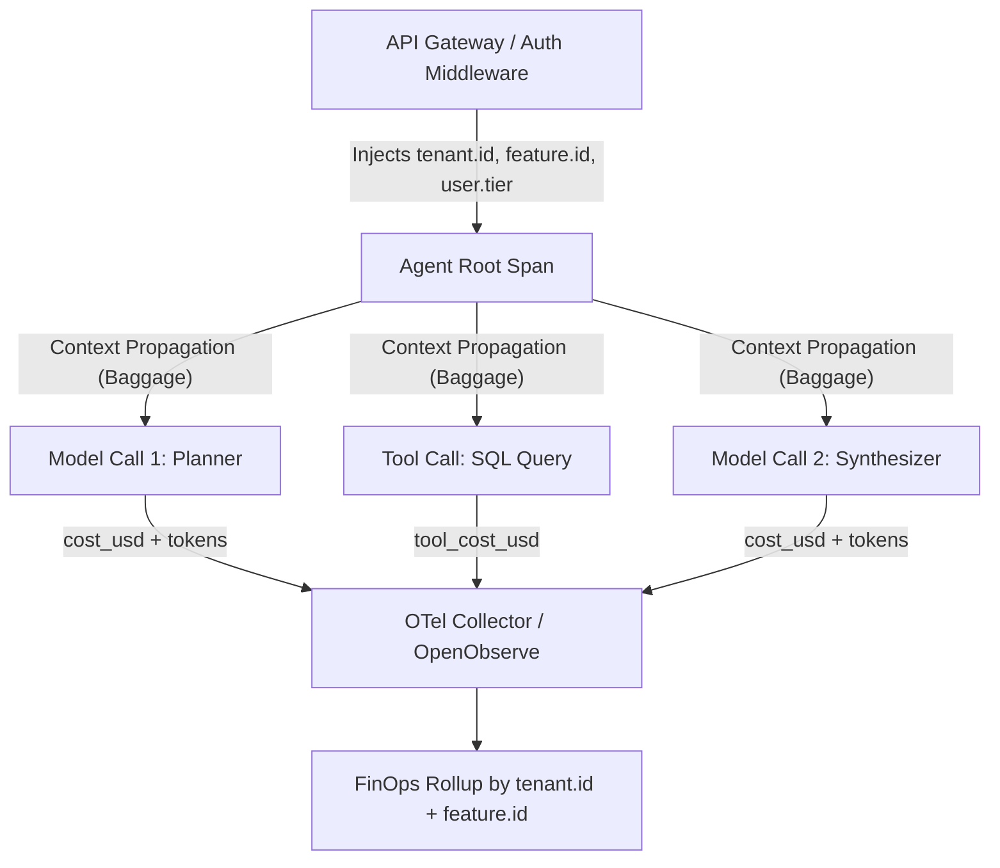

# Chapter 06: Tenant & Feature Attribution and Hard Budgets

> **Goal:** Design multi-tenant cost attribution from every OTel span up to business units, and implement deterministic **hard budgets** (soft warnings, graceful downgrade, and hard circuit breakers) to prevent runaway agent spend.

---

## 1. The Attribution Problem in Multi-Tenant AI

Imagine your SaaS product has three AI features (`invoice_extraction`, `support_triage`, `contract_review`) used by 500 enterprise customers (`tenant_acme`, `tenant_globex`, ...).

At the end of the month, your OpenAI / Anthropic / Bedrock bill arrives: **\$48,200**.
The CFO asks three questions:
1. *"Which customer (`tenant.id`) cost us \$12,000 on a \$500/month plan?"* (Negative gross margin!)
2. *"Did our new `contract_review` feature actually pay for itself?"*
3. *"Why did spend spike \$4,000 at 2:00 AM on Tuesday?"*

Without **mandatory attribution tags** propagated from the API gateway through every OTel span, that \$48,200 bill is an unallocated black box.



---

## 2. Mandatory Attribution Dimensions

Every root `agent.run` span—and every child `gen_ai.chat` / `tool.execute` span—must carry non-nullable attribution tags:

| Tag Key | Example Values | Owner / Purpose |
| :--- | :--- | :--- |
| `tenant.id` | `"tenant_acme"`, `"tenant_free_882"` | Customer chargeback & gross-margin analysis |
| `feature.id` | `"support_triage"`, `"sql_copilot"` | Product P&L and feature ROI |
| `cost_center` | `"eng-platform"`, `"cs-automation"` | Internal FinOps department billing |
| `environment` | `"prod"`, `"staging"`, `"eval"` | Separate customer traffic from CI/eval runs! |
| `pricing.tier` | `"enterprise"`, `"pro"`, `"free"` | Enforce tier-specific budget caps |

> [!IMPORTANT]
> **Reject Unattributed Calls in Production:** A common FinOps rule is *"No `tenant.id` + `feature.id`, no LLM call."* Enforce this in your central LLM gateway / wrapper so a developer cannot ship a new agent without cost tags.

---

## 3. Allocating Shared & Overhead Costs

Not every dollar maps cleanly to a single request. Handle shared costs explicitly:

| Cost Category | Example | Allocation Strategy |
| :--- | :--- | :--- |
| **Direct Model Spend** | Chat completions for `tenant_acme` | 100% direct attribution via `tenant.id` |
| **Shared GPU / Self-Hosted Cluster** | vLLM / SGLang H100 node (\$3/hr) | Proportional by `(tenant_tokens / total_cluster_tokens)` per hour |
| **Idle Capacity / Reserved Throughput** | Provisioned Throughput (PTU) unused slack | Split across tenants by peak quota reservation or absorbed into platform overhead (`tenant.id = "platform_shared"`) |
| **CI/CD & Offline Evals** | Nightly GEPA / regression suite | Tagged `environment = "eval"` and `cost_center = "ai-eng"` — **never** billed to customer COGS |

---

## 4. Hard Budgets & Tiered Enforcement

Monitoring spend *after* the month ends only tells you how much money you already lost. Production AI systems need **real-time budget enforcement** at three levels:

### Level 1: Per-Request Token & Iteration Cap (In-Process Guard)
Protects against single-request infinite loops (e.g., an agent stuck calling a failing tool 50 times):
- `max_iterations`: e.g., `8` turns
- `max_request_cost_usd`: e.g., `$0.25` per task
- `max_output_tokens`: hard `max_tokens` parameter on every LLM call

### Level 2: Tenant & Feature Sliding-Window Budgets (Gateway Guard)
Tracks cumulative spend in Redis / in-memory counter per `(tenant.id, billing_period)`:

| Budget Threshold | Action | User / System Behavior |
| :--- | :--- | :--- |
| **< 80% of budget** | `ALLOW` | Normal execution on primary model |
| **80% – 99% of budget** | `WARN + DOWNGRADE` | Emit `budget.alert` event; optionally route to cheaper fallback model (e.g., Mini/Haiku) |
| **>= 100% of budget** | `BLOCK (HTTP 429)` | Hard circuit breaker rejects new LLM calls; returns structured `BudgetExceededError` |

### Level 3: Global Kill-Switch (Account Protection)
A global daily ceiling (e.g., \$5,000/day across all tenants) prevents a buggy deployment or DDoS from draining your cloud/API account overnight.

---

## 5. Handling Concurrent Requests & Atomic Reservations

A subtle bug in naive budget checks:
1. Tenant has \$0.10 remaining.
2. 20 concurrent requests arrive at the exact same millisecond.
3. All 20 check `remaining > 0` $\rightarrow$ all 20 pass $\rightarrow$ tenant overspends by 20x!

**Production Fix — Two-Phase Budget Reservation:**
1. **Reserve:** Before calling the LLM, atomically decrement an estimated max cost (e.g., `estimated_cost = $0.05`) using Redis `DECRBYFLOAT` or a Lua script. If remaining < 0, immediately roll back and return `429 Budget Exceeded`.
2. **Reconcile:** When the LLM response returns with actual `input_tokens` and `output_tokens`, compute `actual_cost` and adjust the balance by `(estimated_cost - actual_cost)`.

```typescript
const check = budgetGuard.checkAndReserve("tenant_acme", 0.02);
if (!check.allowed) throw new Error("429 Budget Exceeded"); // Hard circuit breaker
const run = await executeAgent();
budgetGuard.reconcile("tenant_acme", 0.02, run.totalCostUsd); // Refund unused estimate
```

---

## 6. Chapter Summary
- Tag every OTel span with `tenant.id`, `feature.id`, `cost_center`, and `environment` at the entry gateway.
- Separate **customer COGS** (`environment=prod`) from **R&D / eval spend** (`environment=eval`).
- Enforce **three layers of budgets**: per-request loop caps, per-tenant soft-warn/downgrade/hard-block thresholds, and a global daily circuit breaker—using atomic reserve-and-reconcile for concurrency safety.

---
**Next:** [Chapter 07: FOCUS-Aligned Cost Reporting](./07_FOCUS_Aligned_Cost_Reporting.md)

