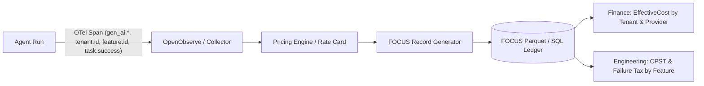

# Chapter 07: FOCUS-Aligned Cost Reporting

> **Goal:** Normalize messy, vendor-specific AI and cloud billing data (OpenAI, Anthropic, AWS Bedrock, GCP Vertex, Kubernetes GPUs) into the **FinOps Open Cost and Usage Specification (FOCUS)** so finance and engineering share one unified ledger.

---

## 1. What Is FOCUS and Why Does AI Need It?

Every AI and cloud vendor formats invoices differently:
- **OpenAI** bills `prompt_tokens`, `cached_tokens`, `completion_tokens` by model snapshot.
- **AWS Bedrock** uses `EffectiveCost`, `lineItem/UsageAmount`, `product/region`.
- **GCP Vertex AI** exports BigQuery rows with `sku.description`, `cost`, `credits`.
- **Self-Hosted K8s GPUs** bill EC2/GKE instance-hours (`BilledCost` for `p5.48xlarge`).

Without a common schema, building a unified *"Total AI Cost by Feature & Tenant"* report requires brittle, one-off ETL scripts for every provider.

**FOCUS (FinOps Open Cost and Usage Specification)**—maintained by the **FinOps Foundation** (Linux Foundation)—is an open, vendor-neutral standard schema for cloud, SaaS, and AI billing data.

---

## 2. Core FOCUS Columns Mapped to GenAI

FOCUS defines standard column names and meanings. Here is how an AI agent run maps into FOCUS v1.0+:

| FOCUS Column | Type | Meaning | GenAI / Agent Mapping Example |
| :--- | :--- | :--- | :--- |
| `BillingAccountId` | String | Top-level payer account | `"org_acme_ai_prod"` |
| `BillingPeriodStart` / `End` | ISO Timestamp | Invoice cycle window | `"2026-11-01T00:00:00Z"` |
| `ChargePeriodStart` / `End` | ISO Timestamp | Usage window for this row | Span start/end time (or hourly rollup) |
| `ProviderName` | String | Vendor supplying the service | `"OpenAI"`, `"Anthropic"`, `"AWS"`, `"Internal-K8s"` |
| `ServiceCategory` | Enum | High-level service bucket | `"AI and Machine Learning"` (for LLMs/Embeddings), `"Compute"` (for Agent Pods) |
| `ServiceName` | String | Specific product | `"Azure OpenAI"`, `"Amazon Bedrock"`, `"Vertex AI"` |
| `ResourceId` | String | Model, endpoint, or cluster ID | `"gpt-4o-2024-11-20"`, `"claude-3-5-sonnet"` |
| `ChargeCategory` | Enum | Type of financial charge | `"Usage"`, `"Purchase"` (PTU), `"Credit"` |
| `PricingCategory` | Enum | Pricing model | `"On-Demand"`, `"Committed"` (Reserved PTU) |
| `PricingQuantity` | Decimal | Amount consumed in pricing unit | `12500` (tokens) or `0.25` (GPU-hours) |
| `PricingUnit` | String | Unit of measure | `"Tokens"`, `"1K Tokens"`, `"GPU-Hours"` |
| `ListCost` | Decimal | Retail cost before discounts | `$0.0625` |
| `EffectiveCost` | Decimal | **Amortized net cost after discounts/credits** | `$0.0500` |
| `BilledCost` | Decimal | Cash invoice amount in period | `$0.0500` |
| `Tags` | JSON Map | Business attribution metadata | `{"tenant_id": "acme", "feature_id": "triage", "task_success": "true"}` |

> [!NOTE]
> **`EffectiveCost` vs. `BilledCost`:** If you prepay \$120,000 upfront for a 1-year GPU reservation or Bedrock Provisioned Throughput (`Purchase`), `BilledCost` spikes to \$120,000 in Month 1 and \$0 in Months 2–12. **`EffectiveCost`** amortizes that \$10,000/month evenly so your unit economics (`CPST`) stay accurate every day!

---

## 3. Extending FOCUS with `x_` Custom Columns for AI Units

FOCUS explicitly reserves the `x_` prefix for organization-specific extensions. For AI FinOps, adding 4 `x_` columns bridges **OTel observability** and **FOCUS finance**:

| Custom Column | Type | Purpose |
| :--- | :--- | :--- |
| `x_GenAiTokenType` | String | `"input"`, `"cache_read"`, `"output"`, `"reasoning"`, `"tool_call"` |
| `x_TraceId` | String | Links the billing row directly back to the OTel Trace in OpenObserve |
| `x_TaskSuccess` | Boolean | `true` or `false` — enables SQL `CPST` directly on the FOCUS table |
| `x_FeatureId` / `x_TenantId` | String | Promoted first-class columns for fast GROUP BY queries |

---

## 4. End-to-End Trace-to-FOCUS Pipeline



### Example SQL Query on a FOCUS-Aligned Ledger
Because every provider row is normalized into one table, one SQL query answers both finance and engineering questions:

```json
// Sample FOCUS v1.0 Record Generated from an OTel Span
{
  "BillingAccountId": "org_ai_prod_001",
  "ProviderName": "OpenAI",
  "ServiceCategory": "AI and Machine Learning",
  "ResourceId": "gpt-4o",
  "PricingQuantity": 3450,
  "PricingUnit": "Tokens",
  "ListCost": 0.01095,
  "EffectiveCost": 0.009855,
  "Tags": { "tenant_id": "tenant_acme", "feature_id": "support_triage" },
  "x_TraceId": "7b9cd45c34a022b8c378cb18a9a568bc",
  "x_TaskSuccess": true
}
```

```sql
SELECT
    Tags['tenant_id'] AS tenant_id,
    Tags['feature_id'] AS feature_id,
    ProviderName,
    SUM(EffectiveCost) AS total_effective_cost_usd,
    COUNT(DISTINCT CASE WHEN x_TaskSuccess THEN x_TraceId END) AS successful_tasks,
    SUM(EffectiveCost) / NULLIF(COUNT(DISTINCT CASE WHEN x_TaskSuccess THEN x_TraceId END), 0) AS cpst_usd
FROM focus_ai_usage
WHERE ServiceCategory = 'AI and Machine Learning'
  AND ChargePeriodStart >= '2026-11-01T00:00:00Z'
GROUP BY 1, 2, 3
ORDER BY total_effective_cost_usd DESC;
```

---

## 5. Reconciling Estimated Telemetry Costs vs. Vendor Invoices

Telemetry-calculated costs (`tokens * rate_card`) typically match vendor invoices within **1%–3%**, with small differences caused by:
- Rounding rules (per-request vs. monthly token aggregation)
- Enterprise volume discounts or free-tier credits applied at invoice time
- Prompt-cache hit rate differences or failed-stream billing edge cases

**Best Practice:**
1. Use **OTel-derived FOCUS rows** for **real-time** budgets, alerts, and daily `CPST` dashboards.
2. Run a **weekly/monthly reconciliation job** comparing `SUM(EffectiveCost)` from OTel against the official vendor invoice, adjusting an `x_ReconciliationFactor` or `Credit` row if variance exceeds 2%.

---

## 6. Chapter Summary
- **FOCUS** eliminates vendor-specific billing silos by normalizing OpenAI, Anthropic, Bedrock, Vertex, and K8s GPU costs into a single schema (`ProviderName`, `ServiceCategory`, `EffectiveCost`, `PricingQuantity`, `Tags`).
- Use `EffectiveCost` (amortized net cost) rather than raw `BilledCost` when computing unit economics.
- Adding `x_TraceId` and `x_TaskSuccess` to FOCUS records creates an unbroken audit chain from **CFO invoice $\rightarrow$ tenant/feature $\rightarrow$ exact OTel trace**.

---
**Back to:** [Course Index](../index.md) | **Complete Guide:** [Lecture 42 Complete Notes](./Lecture_42_Complete_Notes.md)

