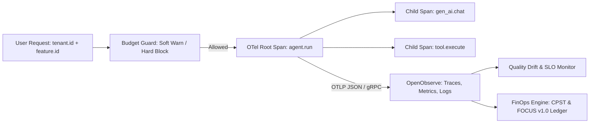

# Lecture 42: Complete Notes — AI Observability (OTel, OpenObserve) & FOCUS FinOps

> **Goal:** Build vendor-neutral observability and financial governance for production AI agents—tracing `agent -> model -> tool` spans with OpenTelemetry GenAI semantic conventions, shipping to OpenObserve, monitoring drift and SLOs, enforcing tenant/feature hard budgets, and reporting **Cost per Successful Task (CPST)** in **FOCUS-aligned** schemas.

---

## End-to-End Architecture

---

## Chapter 1: OpenTelemetry (OTel) GenAI Semantic Conventions
- **Why OTel?** Vendor-neutral instrumentation avoids lock-in to proprietary tracing SDKs; one codebase exports to OpenObserve, Jaeger, Datadog, or Grafana.
- **Span Hierarchy:**
  1. `agent.<name>` (`gen_ai.operation.name = "invoke_agent"`) — root orchestration span with `tenant.id`, `feature.id`, `task.success`.
  2. `chat <model>` (`gen_ai.operation.name = "chat"`) — captures `gen_ai.system`, `gen_ai.request.model`, `gen_ai.usage.input_tokens`, `gen_ai.usage.output_tokens`, `gen_ai.usage.cache_read_input_tokens`, `gen_ai.response.finish_reasons`.
  3. `execute_tool <name>` (`gen_ai.operation.name = "execute_tool"`) — captures `gen_ai.tool.name`, `gen_ai.tool.call.id`, latency, and errors.
- **Privacy:** Keep raw prompts/completions out of default span attributes unless explicitly sampled/redacted.

---

## Chapter 2: Shipping Traces, Metrics, and Logs to OpenObserve
- **Three Signals Correlated by `trace_id`:**
  - **Traces** show *where* latency and tokens went (`agent -> model -> tool`).
  - **Metrics** (histograms/counters) power fast dashboards and alerts (`gen_ai.client.token.usage`, `gen_ai.client.operation.duration`).
  - **Logs** capture structured events (guardrail triggers, budget warnings, prompt snapshots) injected with `trace_id` + `span_id`.
- **OpenObserve Ingestion:** Exposes native OTLP HTTP (`/api/<org>/v1/traces`, `/v1/metrics`, `/v1/logs`) and gRPC endpoints with Parquet/S3-backed storage and SQL querying.
- **Best Practice:** Use **BatchSpanProcessor** and tail-based sampling in production (keep 100% of errors, high-latency, and high-cost traces; sample routine successes).

---

## Chapter 3: Continuous Quality Monitoring & Drift Detection
- **Silent Failure Modes:** Upstream model snapshot updates, embedding drift, RAG index staleness, and user-behavior shifts degrade quality without throwing HTTP `500`s.
- **Four Drift Signals:** Input distribution drift (PSI / embedding centroid shift), Output format/refusal drift, Tool-call & latency drift, and Semantic quality drift (online LLM-as-a-judge sampling + user feedback).
- **Guardrail:** Calibrate judges against golden human labels and alert on 7-day rolling baselines rather than single noisy spikes.

---

## Chapter 4: AI SLOs & Error Budgets
- **SLIs for Agents:** Task Success Rate, End-to-End Latency (`p95`), TTFT (`p95`), Groundedness/Hallucination Rate, and Budget Compliance.
- **SLO & Error Budget:** A `99.0%` monthly Task Success SLO gives a `1.0%` error budget (`100` allowed failures per `10,000` tasks).
- **Burn-Rate Policy:** Fast burn (>14x budget rate) pages on-call; slow burn freezes risky prompt/model rollouts until reliability recovers.

---

## Chapter 5: AI FinOps — Cost per Successful Task (CPST)
- **Why Raw Token Cost Fails:** A cheap model that fails 40% of the time and retries 2x can have a higher true cost than a reliable frontier model.
- **CPST Formula:**
  $$\text{CPST} = \frac{\sum C_{\text{all\_runs (success + failed)}} + \sum C_{\text{tools}} + \sum C_{\text{evals}}}{N_{\text{successful\_tasks}}}$$
- **Failure Tax:** `failed_and_retry_spend / total_spend` highlights how much money reliability bugs are burning.

---

## Chapter 6: Tenant & Feature Attribution and Hard Budgets
- **Mandatory Attribution:** Every span carries `tenant.id`, `feature.id`, `cost_center`, and `environment` (`prod` vs. `eval` so CI tests never pollute customer COGS).
- **Three-Layer Budget Enforcement:**
  1. Per-request loop & `max_tokens` cap.
  2. Tenant/feature sliding-window guard (`<80%` allow, `80–99%` warn/downgrade, `>=100%` hard `429` circuit breaker).
  3. Global daily kill-switch, backed by atomic reserve-and-reconcile for concurrent requests.

---

## Chapter 7: FOCUS-Aligned Cost Reporting
- **FOCUS (FinOps Open Cost and Usage Specification):** Normalizes OpenAI, Anthropic, Bedrock, Vertex, and K8s GPU billing into one schema (`ProviderName`, `ServiceCategory`, `ResourceId`, `PricingQuantity`, `PricingUnit`, `ListCost`, `EffectiveCost`, `BilledCost`, `Tags`).
- **Amortization:** Use `EffectiveCost` (net amortized cost) for accurate daily unit economics.
- **Trace-to-Ledger Link:** Custom `x_TraceId`, `x_TaskSuccess`, `x_TenantId`, and `x_FeatureId` columns let finance and engineering run a single SQL query from invoice down to exact OTel traces.

---

## Release Gate Checklist
- [x] OTel `agent -> model -> tool` spans carry `gen_ai.*`, `tenant.id`, `feature.id`, and `task.success`.
- [x] OpenObserve OTLP JSON payload formats resource attributes, scope spans, and trace hierarchy cleanly.
- [x] Cost per Successful Task includes failed/retried runs in total cost and divides only by verified successes.
- [x] Hard budget guard triggers `WARN` at 80% and `BLOCK` at 100% per tenant.
- [x] FOCUS v1.0 reporter outputs valid `EffectiveCost`, `PricingQuantity`, `ServiceCategory`, and `Tags` linked to `x_TraceId`.

