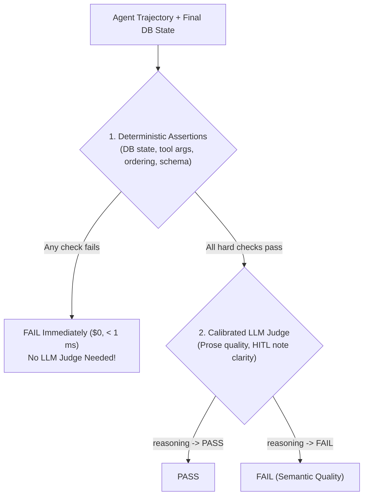
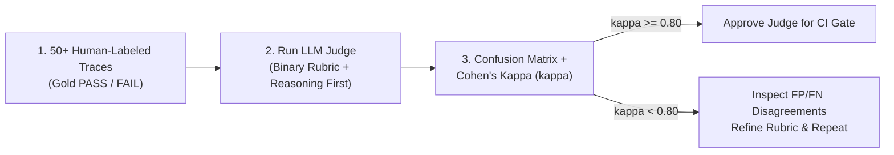

# Chapter 02 — Tool-Action Correctness & Calibrated Judges

> **Lecture 42 · Chapter 02 of 07** · Level: 🔴 Expert · Phase 10 — Quality, FinOps, Identity & Security
> **Source:** `FDE S08` · **Roadmap Reference:** [`roadmap-v1.md`](../../roadmap-v1.md#lecture-41--neuro-symbolic-verification-trajectory-evals-z3-constraints--gepa)
> **Roadmap topics:** Measuring side-effect correctness · deterministic assertions vs. LLM-as-a-Judge · rubric calibration against human labels (Cohen's $\kappa$) · eliminating judge biases.

---

## 02.0 What this chapter is for

When you evaluate an agent trajectory, you quickly discover there are **two fundamentally different kinds of truth**:

1. **Hard Side-Effect Truth:** *"Did `db.orders['ORD-101'].refundedAmount` equal `45` and `status === 'refunded'`?"* — 100% objective, checkable in TypeScript/SQL in `< 1 ms` for `$0.00`.
2. **Semantic Quality Truth:** *"Did the agent's escalation handoff note clearly explain to the human reviewer why HITL approval is needed?"* — requires reading natural language.

Many engineering teams lazily throw an uncalibrated LLM-as-a-Judge (*"Rate this agent trace from 1 to 10"*) at **both**. That is slow, expensive, and notoriously noisy: `1–10` scores drift between `7` and `9` on identical traces, and an LLM judge can hallucinate that a `$90` refund was fine because the prose sounded polite.

By the end of this chapter you should be able to:

1. Separate **Deterministic Side-Effect Assertions** (always first) from **Calibrated Semantic Judges** (only for prose/ambiguity).
2. Design a **binary (`PASS`/`FAIL`) or 3-point (`0`/`1`/`2`) judge rubric** with **reasoning-before-verdict** to eliminate autoregressive snap guesses.
3. Neutralize **verbosity bias**, **position bias**, and **self-preference bias** in LLM judges.
4. Calibrate an LLM judge against **50+ human-labeled traces** and compute **precision, recall, and Cohen's Kappa ($\kappa \ge 0.80$)**.

---

## 02.1 Deterministic Assertions vs. Calibrated LLM Judges

Always push as much evaluation as possible into deterministic code, reserving LLM judges strictly for open-ended natural language quality.

| What You Are Checking | Concrete Example | Deterministic Assertion | Calibrated LLM Judge |
| :--- | :--- | :---: | :---: |
| **Database state mutation** | `order.status === "refunded"` and `order.refundedUsd === 45` | ✅ **Always** (`< 1 ms`) | ❌ Never |
| **Tool preconditions** | `verifyPolicy` ran before `refundOrder` | ✅ **Always** (`< 1 ms`) | ❌ Never |
| **Step / token budget** | `steps.length <= 5 && totalTokens <= 4000` | ✅ **Always** (`< 1 ms`) | ❌ Never |
| **JSON schema validity** | Tool arguments match Zod / JSON Schema | ✅ **Always** (`< 1 ms`) | ❌ Never |
| **Escalation note clarity** | *"Does the HITL note state the order ID, amount, and policy reason?"* | ❌ Cannot regex prose | ✅ **Binary (`PASS`/`FAIL`)** |
| **Customer tone / empathy** | *"Is the refusal polite without promising an exception?"* | ❌ Cannot regex tone | ✅ **Binary (`PASS`/`FAIL`)** |



> [!IMPORTANT]
> **Never ask an LLM judge to verify math or database state.** If deterministic assertions already failed, short-circuit immediately. Running an LLM judge on a trace that refunded `$90` instead of `$45` wastes tokens and risks a false pass.

---

## 02.2 Three Rules That Make LLM Judges Reliable

1. **Use Binary (`PASS`/`FAIL`) or 3-Point (`0`/`1`/`2`) Rubrics — Never `1–10`:**
   Even human annotators cannot consistently distinguish a `6` from a `7`. Binary rubrics with explicit criteria (*"PASS only if all 3 items are present: order ID, dollar amount, policy reason"*) dramatically raise inter-rater agreement.
2. **Force `reasoning` *before* `verdict` in structured JSON:**
   ```json
   {
     "reasoning": "The note states ORD-101 and $80, and explains >$50 requires manager sign-off. Concise and complete.",
     "verdict": "PASS"
   }
   ```
   Because LLM decoding is autoregressive, outputting `"verdict": "PASS"` *first* locks the model into defending a snap guess. Generating `reasoning` first acts as chain-of-thought grounding.
3. **Neutralize Verbosity & Self-Preference Bias:**
   Explicitly instruct the judge: *"Do not reward longer responses; a concise 2-sentence note with all required facts beats a 3-paragraph essay."* Use a **different model family** (or a pinned, calibrated judge model) than the agent being evaluated to reduce self-preference bias.

---

## 02.3 How to Calibrate an LLM Judge (Worked Cohen's $\kappa$ Example)

Never ship an LLM judge to CI without measuring its agreement against **50+ human-labeled traces** (ideally 50% `PASS`, 50% `FAIL`, including tricky edge cases):



### Worked calculation on 50 traces

Suppose your human SMEs label `50` HITL escalation notes (`26 PASS`, `24 FAIL`), and your binary LLM judge produces this confusion matrix:

| | **Human: PASS** | **Human: FAIL** | **Total** |
| :--- | :---: | :---: | :---: |
| **Judge: PASS** | `24` (TP) | `2` (FP) | `26` |
| **Judge: FAIL** | `2` (FN) | `22` (TN) | `24` |
| **Total** | `26` | `24` | **`50`** |

1. **Observed agreement ($p_o$):**
   $$p_o = \frac{24 + 22}{50} = \frac{46}{50} = \mathbf{0.92}$$
2. **Expected chance agreement ($p_e$):**
   $$p_e = \frac{26 \times 26 + 24 \times 24}{50^2} = \frac{676 + 576}{2500} = \frac{1252}{2500} = \mathbf{0.5008}$$
3. **Cohen's Kappa ($\kappa$):**
   $$\kappa = \frac{p_o - p_e}{1 - p_e} = \frac{0.92 - 0.5008}{1 - 0.5008} = \frac{0.4192}{0.4992} = \mathbf{0.8397 \ge 0.80}$$

Because $\kappa = 0.84 \ge 0.80$ (strong agreement beyond chance), **the judge is approved for CI!** If $\kappa < 0.80$, inspect the `FP` and `FN` rows, tighten the rubric wording, and re-run.

> [!TIP]
> **Why raw accuracy ($p_o$) isn't enough.** On an imbalanced dataset (`95%` passing traces), a broken judge that blindly outputs `"PASS"` 100% of the time gets `95%` accuracy — yet its **Cohen's Kappa is `0.00`**! Kappa exposes lazy/biased judges immediately.

---

## 02.4 Traps & Where LLM Judges Break

| Trap | What Happens | How to Prevent It |
| :--- | :--- | :--- |
| **Class imbalance hiding a broken judge** | `95%` accuracy on a `95%`-positive set means the judge learned nothing | Use a balanced `50/50` calibration set and gate on **Cohen's $\kappa \ge 0.80$** |
| **Prompt drift in the judge itself** | Someone edits the judge prompt and silently shifts pass rates by `15%` | Version-control judge prompts and re-run the `50`-trace calibration suite on every edit |
| **Pairwise position bias** | When comparing Response A vs. B, judges prefer whichever is in slot A | Run pairwise comparisons **twice** (A/B and B/A) and require consistency |

---

## 02.5 Common mistakes

| # | Common Mistake | Why It Hurts | What To Do Instead |
| :--- | :--- | :--- | :--- |
| 1 | **Using an LLM judge for DB state or math checks** | Slow, costly, and can hallucinate a pass on wrong dollar amounts | Always run **deterministic TypeScript/SQL assertions first** |
| 2 | **Asking for a `1–10` score** | Uncalibrated, noisy (`7` vs `9` drift), and impossible to threshold cleanly | Use a **binary (`PASS`/`FAIL`)** or **3-point (`0`/`1`/`2`)** rubric |
| 3 | **Putting `verdict` before `reasoning` in the output schema** | Autoregressive lock-in degrades accuracy on edge cases | Always generate **`reasoning` first, `verdict` second** |
| 4 | **Skipping human calibration** | Judge may reward verbose nonsense or miss domain policy nuances | Calibrate on **50+ human-labeled traces** until **$\kappa \ge 0.80$** |

---

## 02.6 Key takeaways

1. **Deterministic side-effect assertions always beat LLM judges** for database mutations, tool arguments, and step ordering.
2. **Reliable LLM judges use binary rubrics, `reasoning`-before-`verdict`, and anti-verbosity instructions.**
3. **Never trust an uncalibrated judge:** validate against **50+ human labels** and require **Cohen's $\kappa \ge 0.80$** before enabling it in CI.

---

## 02.7 Self-check questions

1. Given a database mutation check (`order.refundedUsd === 45`) and a semantic clarity check on an escalation note, which check should be deterministic and which should use an LLM judge?
2. Why do `1–10` LLM judge rubrics produce noisy CI signals compared to binary `PASS`/`FAIL` rubrics?
3. Why must structured judge output generate `reasoning` **before** `verdict`?
4. Suppose a judge gets `95%` raw accuracy on a dataset that is `95%` `PASS` by always outputting `"PASS"`. What is its **Cohen's $\kappa$**, and why does $\kappa$ catch this?
5. What two biases do anti-verbosity instructions and using a separate judge model family mitigate?

---

**Next:** [Chapter 03 — Property-Based Testing for Stochastic Agents](./03_Property_Based_Testing_for_Stochastic_Agents.md)
