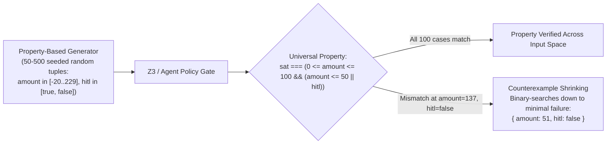
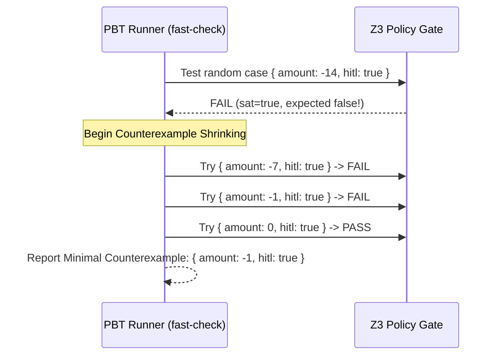

# Chapter 03 — Property-Based Testing for Stochastic Agents

> **Lecture 42 · Chapter 03 of 07** · Level: 🔴 Expert · Phase 10 — Quality, FinOps, Identity & Security
> **Source:** `FDE S08` · **Roadmap Reference:** [`roadmap-v1.md`](../../roadmap-v1.md#lecture-41--neuro-symbolic-verification-trajectory-evals-z3-constraints--gepa)
> **Roadmap topics:** Why example-based unit tests miss AI edge cases · property-based testing (`fast-check` / Hypothesis) · universal invariants across randomized inputs · counterexample shrinking.

---

## 03.0 What this chapter is for

Traditional unit tests check **3 handpicked examples** that the developer thought of:
- `refund($30)` $\rightarrow$ allowed
- `refund($75, approved=true)` $\rightarrow$ allowed
- `refund($120)` $\rightarrow$ blocked

That works for deterministic CRUD apps, but **LLMs are stochastic** and real users send bizarre inputs. Handpicked tests routinely miss **boundary and interaction bugs**: what happens at `amount = -10` (negative refund becomes a charge!), `amount = 0`, `amount = 50` (exact boundary), `amount = 50.01`, `amount = 100` vs. `101`, or split refunds like `$40 + $40`?

**Property-Based Testing (PBT)** flips testing around: instead of writing 3 examples, you state a **universal invariant** that must hold for *all* inputs, and the test runner (`fast-check` in TypeScript, `Hypothesis` in Python) generates **50 to 1,000+ randomized inputs** to try to falsify it.

By the end of this chapter you should be able to:

1. Contrast **Example-Based Testing** with **Property-Based Testing** for stochastic AI systems.
2. State and encode **3 universal agent invariants** (budget conservation, conditional HITL authorization, idempotency).
3. Explain **counterexample shrinking** and why turning `{ amount: 184.73, hitl: false }` into `{ amount: 51, hitl: false }` makes debugging instant.
4. Wire a seeded PBT loop against your **Z3 policy verifier** (`code/Basic Code/src/pbt.ts`) so CI catches off-by-one (`<` vs `<=`) policy bugs.

---

## 03.1 Example-Based vs. Property-Based Testing

| Dimension | Example-Based Unit Test | Property-Based Test (PBT) |
| :--- | :--- | :--- |
| **What You Write** | `3–5` specific `(input, expected)` pairs | A **universal property** + input generators (types/ranges) |
| **Coverage** | Only the cases you remembered | `50–1,000+` randomized cases, automatically probing `0`, `-1`, `MAX`, boundaries |
| **Off-by-one bugs (`50` vs `51`)** | Easily missed unless you guessed `50` | Caught reliably on first run |
| **When It Fails** | Prints `"Expected true, got false"` | **Shrinks** the failing input to the minimal counterexample (e.g., `amount = 51`) |



---

## 03.2 Three Universal Invariants Every Agent Should Test

| Invariant Category | Universal Statement ("For ALL inputs...") | Bug It Catches |
| :--- | :--- | :--- |
| **1. Budget Conservation** | `0 <= totalRefund && totalRefund <= 100` | Negative refunds (`-$50` turning into a credit!) or split-plan bypass (`$40 + $70 = $110`) |
| **2. Authorization / HITL** | `(amount > 50 && !hasHitlApproval) => BLOCKED` | Off-by-one boundary leak (`amount >= 50` vs `amount > 50`) |
| **3. Idempotency** | `run(call, idempotencyKey) === run(replay(call, idempotencyKey))` | Duplicate refunds when an agent retries a timed-out HTTP tool call |

### Concrete Property Test Snippet (`code/Basic Code/src/pbt.ts` style)

```typescript
// Seeded deterministic PRNG so CI failures are 100% reproducible
for (let i = 0; i < 100; i += 1) {
  const amount = Math.floor(rng() * 250) - 20; // covers [-20 .. 229]
  const hitl = rng() > 0.5;
  const result = await verifyPlanWithZ3({ amountUsd: amount, hasHitlApproval: hitl });

  const expectedSat = amount >= 0 && amount <= 100 && (amount <= 50 || hitl);
  assert.equal(result.sat, expectedSat, `Mismatch at amount=${amount}, hitl=${hitl}`);
}
```

---

## 03.3 Counterexample Shrinking: Why Debugging Is Fast

Suppose your Z3 constraint accidentally used `total.ge(50)` instead of `total.gt(50)`, or forgot `total.ge(0)`. The random generator hits a failure at `{ amount: -14, hitl: true }`.

A good PBT library (`fast-check` / `Hypothesis`) doesn't stop there — it runs **shrinking**:
1. Tries `amount = -7` (still fails).
2. Tries `amount = -1` (still fails).
3. Tries `amount = 0` (passes!).
4. Reports the **minimal counterexample**: `{ amount: -1, hitl: true }`.

Instead of staring at a 400-token random JSON blob, you immediately see `amount = -1` — proving in 2 seconds that your lower-bound constraint `total >= 0` is missing!



> [!TIP]
> **Always use a fixed seed (or log the seed on failure) in CI.** Unseeded random tests cause "flaky CI" where a PR fails once and passes on re-run. Logging `seed=4219` lets any engineer reproduce the exact failing sequence locally in 1 second.

---

## 03.4 Traps & Where Property-Based Testing Breaks

| Trap | What Happens | How to Prevent It |
| :--- | :--- | :--- |
| **Calling a live LLM 500 times inside a PBT loop** | Costs `$5+` and takes `10 minutes` per PR | Run PBT against **fast deterministic layers** (Z3 verifier, tool-arg validators, parser/planner logic) in `< 2 s` |
| **Re-implementing the exact buggy logic inside the oracle** | Both code and test have `>` instead of `>=`, so PBT never catches it | Test **inverse/conservation properties** (e.g., `sum(refunds) <= orderTotal`) rather than duplicating the `if/else` |
| **Unseeded randomness in CI** | Flaky builds that cannot be reproduced locally | Pass a fixed seed (e.g., `seed = 42`) or print the failing seed on error |

---

## 03.5 Common mistakes

| # | Common Mistake | Why It Hurts | What To Do Instead |
| :--- | :--- | :--- | :--- |
| 1 | **Relying only on 3–5 handpicked unit test examples** | Misses negative numbers, `0`, exact boundary `50`/`51`, and split-refund sums | Add a **50–500 case PBT suite** over your policy gate and parsers |
| 2 | **Running unseeded random tests in CI** | Non-reproducible failures frustrate engineers and get ignored | Use a **deterministic PRNG seed** and log the seed on any failure |
| 3 | **Using PBT to fuzz live frontier LLM APIs on every commit** | Slow (`minutes`) and expensive | Keep PBT on **Z3 constraints & symbolic validators** (`< 2 s`), and run Trajectory Evals on a curated benchmark |
| 4 | **Skipping boundary weights (`0`, `50`, `51`, `100`, `101`)** | Pure uniform `[0..1000]` rarely hits exact `50` | Combine **explicit boundary values** with randomized PBT ranges |

---

## 03.6 Key takeaways

1. **Example-based tests check what you remembered; Property-Based Testing checks what you forgot.**
2. **State universal invariants** (budget conservation, HITL thresholds, idempotency) across `50–500` randomized inputs.
3. **Counterexample shrinking** reduces noisy random failures to minimal boundaries like `amount = -1` or `amount = 51`.

---

## 03.7 Self-check questions

1. Why do 3–5 handpicked unit tests routinely miss off-by-one (`<=` vs `<`) and negative-input bugs in agent policy gates?
2. State three universal invariants (budget conservation, HITL threshold, idempotency) for an e-commerce refund agent.
3. Explain how **counterexample shrinking** turns a random failure `{ amount: 184, hitl: false }` into `{ amount: 51, hitl: false }`.
4. Why should you run PBT against deterministic Z3/validator layers (`< 2 s`) rather than calling live frontier LLM APIs 500 times per PR?
5. Why is a **fixed PRNG seed** essential when running Property-Based Tests in CI/CD?

---

**Next:** [Chapter 04 — Neuro-Symbolic Verification & Deterministic Invariants](./04_Neuro_Symbolic_Verification_and_Deterministic_Invariants.md)
