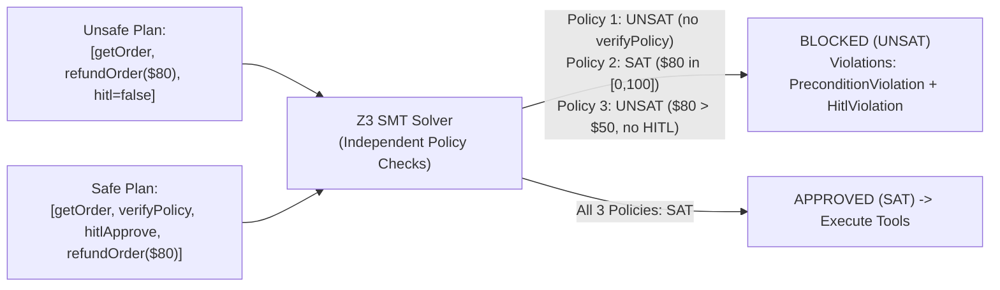
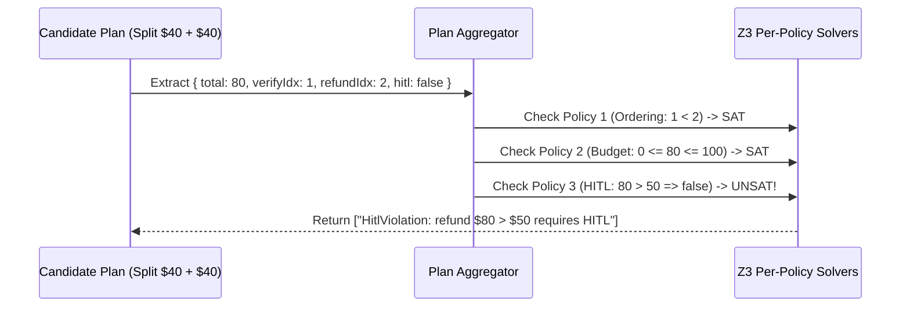

# Chapter 05 — Z3 SMT Solver Constraints for Agent Plans

> **Lecture 42 · Chapter 05 of 07** · Level: 🔴 Expert · Phase 10 — Quality, FinOps, Identity & Security
> **Source:** `FDE S08` · **Roadmap Reference:** [`roadmap-v1.md`](../../roadmap-v1.md#lecture-41--neuro-symbolic-verification-trajectory-evals-z3-constraints--gepa)
> **External Reference:** [Z3 Theorem Prover (`z3-solver`)](https://github.com/Z3Prover/z3)
> **Roadmap topics:** What an SMT solver is · encoding agent policies (ordering, cumulative budgets, conditional HITL, mutual exclusion) in Z3 · `SAT` vs. `UNSAT` · extracting exact violated policies.

---

## 05.0 What this chapter is for

Why use an **SMT (Satisfiability Modulo Theories) Solver** like **Z3** instead of writing 20 nested `if/else` statements in TypeScript or Python?

With `3` simple rules, `if/else` is fine. With **`25` interacting enterprise policies** (*"Cumulative refunds $\le \$100$, VIP tier raises cap to `\$150` unless account age `< 30` days, `verifyPolicy` must precede every `refundOrder`, `deleteAccount` cannot run in the same plan as `exportData`, and split refunds across 2 orders still share the daily cap"*), hand-coded `if/else` trees quickly develop hidden contradictions, order-dependent bugs, and edge-case holes.

**Z3** lets you declare each business rule as an independent mathematical constraint. In `< 10 ms`, Z3's solver checks whether all constraints can be satisfied simultaneously (`SAT`) or whether a policy is violated (`UNSAT`).

By the end of this chapter you should be able to:

1. Explain what **SMT (`SAT` vs. `UNSAT`)** means in plain engineering terms.
2. Encode **precondition ordering**, **cumulative budget bounds**, **conditional HITL**, and **mutual exclusion** rules using `z3-solver` in TypeScript.
3. Run **per-policy solver checks** (or Z3 UNSAT cores) so the agent receives **exact violated policy names** when a plan is blocked.
4. Trace a complete `SAT` and `UNSAT` evaluation on our E-Commerce Refund Agent (`code/Basic Code/src/z3-verifier.ts`).

---

## 05.1 Translating Business Policies into Z3 Constraints

Using our E-Commerce Refund Agent case study (`code/Basic Code/src/z3-verifier.ts`), each business rule maps 1-to-1 to a Z3 formula:

| Policy | Plain English Rule | Z3 TypeScript (`z3-solver`) |
| :--- | :--- | :--- |
| **1. Precondition Ordering** | If `refundOrder` is in the plan, `verifyPolicy` must exist at an earlier step index (`verifyIdx < refundIdx`) | `s.add(Z3.Implies(hasRefund, Z3.And(hasVerify, verifyIdx.lt(refundIdx))))` |
| **2. Cumulative Budget** | Total refund across all `refundOrder` steps must be in `[0, 100]` | `s.add(total.ge(0)); s.add(total.le(100));` |
| **3. Conditional HITL** | If total refund `> 50`, `hasHitlApproval` must be `true` | `s.add(Z3.Implies(total.gt(50), approved))` |
| **4. Mutual Exclusion** | `deleteAccount` and `exportData` cannot both appear in the same plan | `s.add(Z3.Not(Z3.And(hasDelete, hasExport)))` |



---

## 05.2 Extracting Exact Violated Policies (Per-Policy Checks)

If you dump all `25` constraints into a single `solver.check()` call and it returns `"unsat"`, you only know *"something in this plan failed"* — which is useless for Turn-2 self-repair!

Instead, check each policy independently (or use Z3's `Solver.unsatCore()` with tracked boolean assertions) so you get a structured list of exact violations:

```typescript
// Concrete z3-solver check for Conditional HITL (> $50 requires approval)
async function checkHitlPolicy(Z3: Context, planTotalUsd: number, hasHitlApproval: boolean) {
  const s = new Z3.Solver();
  const total = Z3.Int.val(planTotalUsd);
  const approved = Z3.Bool.val(hasHitlApproval);

  // Rule: (total > 50) => approved
  s.add(Z3.Implies(total.gt(50), approved));

  const status = await s.check(); // "sat" or "unsat"
  return status === "sat"
    ? { ok: true }
    : { ok: false, violation: `HitlViolation: refund $${planTotalUsd} > $50 requires HITL` };
}
```

### Worked trace on two tricky plans

1. **Split-Refund Bypass Attempt:** Agent proposes `[getOrder, verifyPolicy, refundOrder($40), refundOrder($40)]` (`hitl = false`).
   - Naive per-call check sees `$40 <= $50` twice and lets it slip!
   - **Z3 Cumulative Check** sums `total = 40 + 40 = 80 > 50` with `approved = false` $\rightarrow$ **`UNSAT` (`HitlViolation`)**!
2. **VIP Contradiction Detection (Build-Time):** Suppose an engineer adds a new rule *"VIP refunds `<= $150`"* without removing *"All refunds `<= $100`"*. Z3 immediately flags `UNSAT` for `$120` VIP plans during PBT (Chapter 03), exposing the contradictory policy!



> [!TIP]
> **Integer cents vs. floating-point dollars.** Always represent currency in **integer cents** (e.g., `$50.00 = 5000`) when using `Z3.Int` to avoid floating-point rounding bugs (`50.0000001`).

---

## 05.3 Traps & Where Z3 Encoding Breaks

| Trap | What Happens | How to Prevent It |
| :--- | :--- | :--- |
| **Checking individual tool calls instead of the cumulative plan** | Agent splits a `$90` refund into three `$30` calls to dodge the `$50` HITL gate | Sum **cumulative plan + daily session totals** before passing `total` into Z3 |
| **Putting all 25 rules in one `solver.check()` without UNSAT cores** | Returns `"unsat"` with zero explanation; LLM cannot self-repair | Run **per-policy checks** or tag assertions with `s.assertAndTrack(expr, label)` |
| **Using `Z3.Real` for currency without precision bounds** | Decimal rounding edge cases at `$50.00` | Encode currency in **integer cents** (`Z3.Int`) |

---

## 05.4 Common mistakes

| # | Common Mistake | Why It Hurts | What To Do Instead |
| :--- | :--- | :--- | :--- |
| 1 | **Checking only `singleCallAmount <= 50` instead of cumulative plan total** | Split-refund plans (`$40 + $40`) bypass HITL and budget caps | Aggregate **total plan amount** across all `refundOrder` steps |
| 2 | **Returning boolean `false` on `UNSAT` with no violation details** | Blocks the request but leaves the LLM clueless for self-repair | Return **named policy violations** (`PreconditionViolation`, `HitlViolation`) |
| 3 | **Re-initializing the Z3 WASM context on every request** | Adds `150–300 ms` startup overhead per call | Initialize `Z3` context **once at server startup**; each `Solver.check()` takes `< 5 ms` |
| 4 | **Skipping PBT on Z3 constraints** | An inverted `lt` vs `gt` in Z3 code silently allows bad plans | Run the **Chapter 03 Property-Based Test suite** against every Z3 policy function |

---

## 05.5 Key takeaways

1. **Z3 turns complex, interacting business rules into clean declarative constraints** (`Implies`, `And`, `Not`, `lt`, `ge`, `le`) checked in `< 10 ms`.
2. **Pre-execution `SAT` / `UNSAT` checks block `100%` of policy-violating plans** (including split-refund bypasses) before any external API is called.
3. **Per-policy checks or `unsatCore()`** return exact violated rule names, powering instant Turn-2 LLM self-repair.

---

## 05.6 Self-check questions

1. Why do `25` interacting enterprise policies become fragile in nested `if/else` trees compared to declarative Z3 constraints?
2. Write the Z3 `Implies` expression for: *"If `refundOrder` is in the plan, `verifyPolicy` must precede it (`verifyIdx < refundIdx`)."*
3. How does a cumulative plan check catch a split-refund bypass (`$40 + $40` with `hitl = false`) that per-call checks miss?
4. Why should you run per-policy solver checks (or `unsatCore()`) instead of one monolithic `solver.check()`?
5. Why should currency values in Z3 be encoded in **integer cents** (`Z3.Int`) rather than floating-point numbers?

---

**Next:** [Chapter 06 — Evaluation-Driven Optimization (`GEPA`)](./06_Evaluation_Driven_Optimization_GEPA.md)
