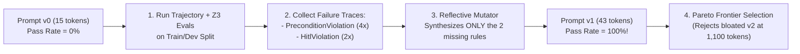
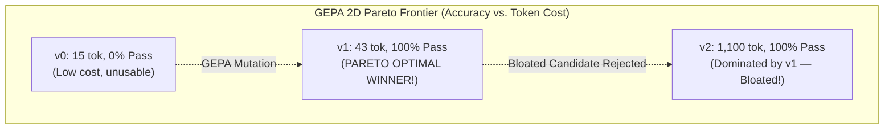

# Chapter 06 — Evaluation-Driven Optimization (`GEPA`)

> **Lecture 42 · Chapter 06 of 07** · Level: 🔴 Expert · Phase 10 — Quality, FinOps, Identity & Security
> **Source:** `FDE S08` · **Roadmap Reference:** [`roadmap-v1.md`](../../roadmap-v1.md#lecture-41--neuro-symbolic-verification-trajectory-evals-z3-constraints--gepa)
> **External Reference:** [GEPA: Reflective Prompt Evolution](https://arxiv.org/abs/2507.19457)
> **Roadmap topics:** Manual prompt tweaking vs. automated reflective evolution (`GEPA`) · Pareto frontier (accuracy vs. token cost) · mutating instructions from Z3/trajectory failure traces · preventing overfitting.

---

## 06.0 What this chapter is for

Once you have built a **Trajectory Evaluator** (Chapter 01) and a **Z3 Policy Verifier** (Chapter 05), you run your baseline system prompt:

> `v0`: *"You are a helpful support agent. Process customer refunds."*

On a 4-case benchmark (`$30`, `$75`, `$45`, `$90`), `v0` scores **`0%` pass rate**:
- Every single case fails `PreconditionViolation` (forgot to call `verifyPolicy` first).
- The `$75` and `$90` cases also fail `HitlViolation` (forgot `requestHitlApproval`).

Instead of an engineer manually guessing prompt edits for hours (*"maybe add ALL CAPS?"*), **GEPA (Genetic-Pareto Reflective Prompt Evolution)** automates prompt optimization directly from those **exact Z3 and trajectory failure traces** — while keeping token cost minimal.

By the end of this chapter you should be able to:

1. Trace the **4-step GEPA Reflective Evolution Loop** (`Evaluate -> Reflect on Failures -> Mutate -> Pareto Select`).
2. Explain why GEPA optimizes on a **2D Pareto frontier** (**Pass Rate** vs. **Prompt Token Cost**) rather than accuracy alone.
3. Walk through a concrete **`v0 -> v1` prompt evolution** driven by Z3 violation traces (`code/Basic Code/src/gepa-optimizer.ts`).
4. Prevent **prompt overfitting** using a `Train/Dev` vs. `Held-Out Test` benchmark split.

---

## 06.1 The 4-Step GEPA Reflective Loop (Worked Example)

Unlike blind random mutation or RL, GEPA uses an LLM **Reflective Mutator** that reads the actual failure diagnostics (`PreconditionViolation`, `HitlViolation`) and writes targeted, minimal rule additions:

### Exact `v0 -> v1` Evolution Trace

- **`v0` (`15` tokens, `0%` pass rate):**
  > *"You are a helpful support agent. Process customer refunds."*
- **Z3 + Trajectory Failure Summary fed to GEPA Mutator:**
  `4/4 failed PreconditionViolation (verifyPolicy must precede refundOrder); 2/4 failed HitlViolation (refund > $50 requires requestHitlApproval).`
- **`v1` (`43` tokens, `100%` pass rate):**
  > *"You are a support agent. Always call `getOrder` then `verifyPolicy` before `refundOrder`. For refunds > \$50, always call `requestHitlApproval` first. Never exceed \$100."*

---

## 06.2 Why Pareto Selection Beats "Highest Accuracy Only"

Without a token-cost objective, automated prompt optimizers suffer from **prompt bloat** — appending 800 words of redundant examples and rules until the prompt hits `1,100+` tokens, increasing TTFT and per-request cost by `25×`.

GEPA maintains a **Pareto Frontier** across two objectives: **maximize Pass Rate** and **minimize Prompt Tokens**:

| Candidate | Prompt Size (Tokens) | Pass Rate | Dominated By | On Pareto Frontier? |
| :--- | :---: | :---: | :--- | :---: |
| **`v0` (Baseline)** | `15` | `0%` | `v1` (much higher accuracy) | ❌ Dominated |
| **`v1` (GEPA Evolved)** | **`43`** | **`100%`** | **None!** | ✅ **Winner (Optimal accuracy/cost)** |
| **`v2` (Bloated 800-word essay)** | `1,100` | `100%` | `v1` (same accuracy, `25×` higher token cost!) | ❌ Dominated |

> [!IMPORTANT]
> **Pareto selection protects your Lecture 40 inference budget.** Remember from Lecture 40 that longer prompts increase prefill FLOPs and KV-cache footprint. Keeping system prompts compact (`43` tokens vs `1,100` tokens) directly reduces `P`-GPU demand.

---

## 06.3 Avoiding Overfitting in GEPA

If you evolve a prompt on 10 training tickets until it hits `100%`, a naive mutator might memorize surface quirks (*"If the customer mentions ORD-101 or `$75`, call HITL"*).

To prevent prompt overfitting:
1. **Split your eval set:** Use `Train/Dev` (`70%`) for GEPA reflection/mutation, and keep a **`Held-Out Test` (`30%`)** set that GEPA never sees, used only for final PR promotion.
2. **Enforce generalizable rules in the mutator prompt:** Instruct the mutator to express rules over general thresholds (`amountUsd > 50`), never hardcoded test IDs (`ORD-101`, `$75`).

---

## 06.4 Traps & Where GEPA Optimization Breaks

| Trap | What Happens | How to Prevent It |
| :--- | :--- | :--- |
| **Evaluating GEPA on the exact same set it mutated on** | Prompt memorizes test examples and fails on real user phrasing | Gate final promotion on a **held-out test split** |
| **Optimizing without a token-length penalty** | Prompt balloons to `2,000+` tokens, blowing up TTFT and cost | Use **Pareto selection** (`passRate` vs. `promptTokens`) |
| **Using GEPA to replace Z3 runtime gates** | Even a `100%`-eval-pass prompt (`v1`) is still probabilistic in production | Use GEPA to maximize **first-turn pass rate** (`0% -> 99%+`), and keep **Z3 at runtime** for `100%` safety |

---

## 06.5 Common mistakes

| # | Common Mistake | Why It Hurts | What To Do Instead |
| :--- | :--- | :--- | :--- |
| 1 | **Hand-tweaking prompts blindly without failure traces** | Slow guesswork; fixes one case while silently breaking two others | Feed **Z3 + Trajectory failure traces** into GEPA |
| 2 | **Selecting candidates solely by highest pass rate** | Rewards `1,000`-token bloated prompts over crisp `43`-token prompts | Select on the **Pareto frontier** (Pass Rate vs. Token Cost) |
| 3 | **Skipping a held-out test split** | Prompt overfits to training examples | Validate the winning candidate on an **unseen held-out benchmark** |
| 4 | **Removing the runtime Z3 gate after GEPA hits `100%`** | A `100%` eval score does not guarantee `100%` compliance on adversarial live inputs | Keep **Z3** as the runtime safety net; use **GEPA** to minimize Turn-1 rejections |

---

## 06.6 Key takeaways

1. **GEPA automates prompt engineering** by reflecting on exact **Z3 and Trajectory failure traces** (`v0` `0%` $\rightarrow$ `v1` `100%`).
2. **Pareto selection** balances pass rate against prompt token length, rejecting bloated prompts (`v2`) in favor of compact winners (`v1`).
3. **Always validate evolved prompts on a held-out test split**, and keep Z3 at runtime so `100%` safety never depends on prompt compliance alone.

---

## 06.7 Self-check questions

1. Name the four steps of the **GEPA Reflective Evolution Loop**.
2. In the `v0 -> v1` refund agent example, what specific Z3 diagnostics did GEPA's Reflective Mutator use to synthesize `v1`?
3. Why does Pareto selection reject `v2` (`1,100` tokens, `100%` pass) in favor of `v1` (`43` tokens, `100%` pass)?
4. How does keeping prompts compact via GEPA directly reduce GPU capacity needs in **Lecture 40**?
5. Why must you keep a **held-out test split** AND keep **runtime Z3 verification** even after GEPA reaches `100%` on `Train/Dev`?

---

**Next:** [Chapter 07 — Integrating Symbolic Gates into CI/CD](./07_Integrating_Symbolic_Gates_into_CI_CD.md)
