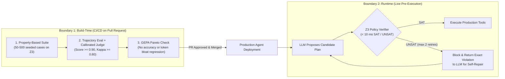
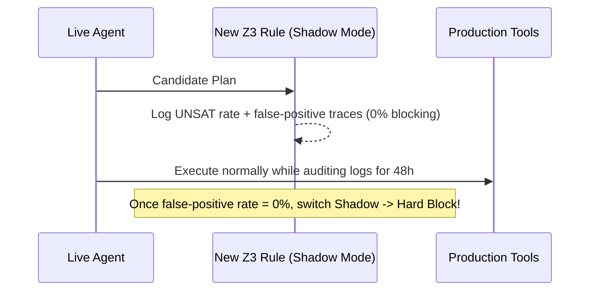

# Chapter 07 — Integrating Symbolic Gates into CI/CD

> **Lecture 42 · Chapter 07 of 07** · Level: 🔴 Expert · Phase 10 — Quality, FinOps, Identity & Security
> **Source:** `FDE S08` · **Roadmap Reference:** [`roadmap-v1.md`](../../roadmap-v1.md#lecture-41--neuro-symbolic-verification-trajectory-evals-z3-constraints--gepa)
> **Roadmap topics:** Runtime vs. build-time verification · wiring Z3, Property-Based Testing, Trajectory Evals, and GEPA into CI/CD · blocking regressions on pull requests.

---

## 07.0 What this chapter is for

Individual verification tools — Trajectory Evals, Calibrated Judges, Property-Based Testing, Z3 SMT Gates, and GEPA — only protect your users if they run **automatically without human willpower** at two distinct engineering boundaries:

1. **Build-Time (CI/CD on every Pull Request):** Runs Property-Based Testing, Trajectory Evals, Judge Calibration, and GEPA regression checks *before* a prompt edit, tool schema change, or model upgrade is merged to `main`.
2. **Runtime (Pre-Execution in Production):** Runs the Z3 SMT Policy Verifier in `< 10 ms` on *every* live candidate action plan *before* any mutating tool executes.

By the end of this chapter you should be able to:

1. Map every Lecture 42 technique to its **Build-Time CI** vs. **Runtime Production** boundary.
2. Define quantitative **CI Release Gate thresholds** that block unsafe, low-kappa, or token-bloated PRs.
3. Wire a complete **GitHub Actions AI Release Gate** (`.github/workflows/ai-gate.yml`) covering TypeScript checks, Z3 PBT, Trajectory Evals, and GEPA Pareto checks.
4. Design a **shadow-mode rollout** strategy when introducing new Z3 policies to an existing production agent.

---

## 07.1 The Two-Boundary Verification Architecture



| Verification Layer | Boundary | Target Latency | Quantitative Gate / Failure Action |
| :--- | :--- | :---: | :--- |
| **Z3 Policy Verifier** | **Runtime** (every mutating plan) | `< 10 ms` | Block execution (`UNSAT`) + return violated policy to planner (max `2` retries, then escalate) |
| **Property-Based Suite (PBT)** | **Build-Time CI** (every PR) | `1–5 s` | Fail PR on **any** counterexample (`0` tolerance) |
| **Trajectory Eval + DB Assertions** | **Build-Time CI** (every PR) | `10–30 s` | Fail PR if `overallScore < 0.90` or any precondition fails |
| **Calibrated Semantic Judge** | **Build-Time CI** (judge/rubric PR) | `15–45 s` | Fail PR if human-label agreement **Cohen's $\kappa < 0.80$** |
| **GEPA Pareto Gate** | **Build-Time CI** (prompt/model PR) | `20–60 s` | Fail PR if held-out pass rate drops OR prompt tokens bloat without accuracy gain |

---

## 07.2 Concrete CI Release Gate Workflow

Here is a production-ready GitHub Actions workflow matching `code/Basic Code/` (`npm test` runs Trajectory Eval + Z3 Policy + 50-case PBT + GEPA Pareto Gate):

```yaml
# .github/workflows/ai-gate.yml
name: Neuro-Symbolic AI Release Gate
on: [pull_request]

jobs:
  verify-agent:
    runs-on: ubuntu-latest
    steps:
      - uses: actions/checkout@v4
      - uses: actions/setup-node@v4
        with:
          node-version: "22"
      - run: npm ci
      - name: Typecheck Agent & Z3 Constraints
        run: npm run typecheck
      - name: Run Z3 PBT, Trajectory Evals & GEPA Pareto Gate
        run: npm test
```

### Safe Rollout: Shadow Mode Before Blocking Mode

When adding a **brand-new Z3 constraint** to an already-live agent, don't flip blocking mode on blindly on Day 1 if you aren't 100% sure the policy matches all legitimate edge cases:



> [!TIP]
> **Shadow mode catches policy bugs before users do.** Running a new Z3 rule in log-only shadow mode for 24–48 hours reveals whether your constraint accidentally blocks valid legacy workflows (e.g., an admin override path) before you turn on hard `UNSAT` blocking.

---

## 07.3 Traps & Where CI/CD Verification Breaks

| Trap | What Happens | How to Prevent It |
| :--- | :--- | :--- |
| **Allowing engineers to "skip AI evals" on hotfix PRs** | A 1-line prompt hotfix silently breaks `verifyPolicy` ordering in production | Make `ai-gate` a **required branch-protection check** on `main` |
| **Running flaky, unseeded evals in CI** | Engineers lose trust in red builds and start clicking "Re-run" until green | Use **seeded PBT**, **deterministic Z3**, and **temperature = 0** in CI trajectory evals |
| **Forgetting to re-run CI gates on *model version* upgrades** | Upgrading `model-v1 -> model-v2` changes tool-calling behavior even when prompts didn't change | Trigger `ai-gate.yml` on **model config / SDK version** changes too |

---

## 07.4 Common mistakes

| # | Common Mistake | Why It Hurts | What To Do Instead |
| :--- | :--- | :--- | :--- |
| 1 | **Running Z3 only in CI tests and not at runtime** | Catches bugs in test cases, but leaves production exposed to live stochastic failures | Run **Z3 at runtime (`< 10 ms`)** before every mutating tool call |
| 2 | **Testing prompts manually in a playground before merging** | Regressions sneak into other cases silently | Enforce **Trajectory Evals + GEPA Pareto checks** on every PR |
| 3 | **Ignoring model-version bumps in CI triggers** | New model checkpoints shift tool-call ordering and JSON adherence | Trigger the full **AI Release Gate** on prompt, tool, Z3, *and* model config diffs |
| 4 | **Enabling strict blocking on an untested new Z3 rule without shadow logging** | Risks blocking legitimate production traffic on day 1 | Run new Z3 rules in **shadow mode** briefly, verify `0` false positives, then enforce |

---

## 07.5 Key takeaways

1. **Runtime Z3 (`< 10 ms`)** is your deterministic `100%` safety net against stochastic LLM mistakes in production.
2. **Build-Time CI/CD (PBT + Trajectory Evals + Calibrated Judges + GEPA)** ensures prompts, Z3 policies, and model upgrades measurably improve without regressions.
3. **Require the AI Release Gate on every PR** (including prompt edits and model version bumps), and roll out brand-new Z3 rules via **shadow mode** first.

---

## 07.6 Self-check questions

1. Which Lecture 42 verification layers run at **Build-Time CI/CD** vs. **Runtime Production**, and what are their target latencies?
2. What quantitative thresholds should block a PR in your **AI Release Gate** for PBT, Trajectory Evals, Cohen's $\kappa$, and GEPA?
3. Why must `.github/workflows/ai-gate.yml` trigger on **model version upgrades** even when no prompt or TypeScript code changed?
4. How does **shadow mode** de-risk rolling out a brand-new Z3 constraint to an existing production agent?
5. Why is running Z3 *only* in CI unit tests insufficient for production safety?

---

**Next:** [Lecture 42 — Complete Notes (Master Consolidation)](./Lecture_42_Complete_Notes.md)
