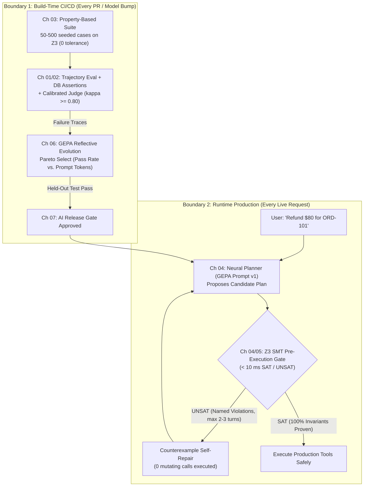

# Lecture 42 — Complete Notes
## Neuro-Symbolic Verification, Trajectory Evals, Z3 Constraints & GEPA

> **Phase:** 10 · Quality, FinOps, Identity & Security · **Level:** 🔴 Expert
> **Running Case Study:** E-Commerce Support Refund Agent (`getOrder`, `verifyPolicy`, `requestHitlApproval`, `refundOrder` · Rules: `verifyPolicy` before `refundOrder`, cumulative refund $\in [0, \$100]$, refund `> $50` requires HITL)

---

## 1. Executive Summary

**Thesis:** Prompt-only guardrails (`~99.5%` compliance) and final-answer evaluations are unsafe for enterprise tool-calling agents; production reliability requires **Trajectory Evaluation** + **Calibrated Judges ($\kappa \ge 0.80$)** + **Property-Based Testing** + **Z3 Pre-Execution Symbolic Gates (`100%` prevention)** + **GEPA Pareto Prompt Evolution** wired into CI/CD.

**The lecture in five sentences:**
1. **Trajectory Evaluation** grades the full execution path (Tool Recall, Precondition Ordering, Argument Accuracy, Step Efficiency) because final-answer Task Evals give `100%` to dangerous runs that over-refund or skip policy checks.
2. Always run **deterministic side-effect assertions** (`< 1 ms`, `$0`) first, reserving **calibrated binary LLM judges** (`reasoning` before `verdict`, **Cohen's $\kappa \ge 0.80$** on `50+` human labels) strictly for prose quality.
3. **Property-Based Testing (PBT)** tests universal invariants (budget conservation, HITL thresholds, idempotency) across `50–500` seeded random inputs and **shrinks** failures to minimal boundaries (`amount = -1` or `51`).
4. **Neuro-Symbolic Verification with Z3** lets the LLM propose a candidate plan while Z3 proves `SAT`/`UNSAT` in `< 10 ms` before any mutating tool runs, returning exact named violations for bounded **counterexample self-repair**.
5. **GEPA** reflects on Z3/trajectory failure traces to evolve compact, **Pareto-optimal** prompts (`v0` `15` tok `0%` $\rightarrow$ `v1` `43` tok `100%`) validated on a held-out split and gated in CI/CD alongside runtime Z3.

| Chapter | Topic | Core Artifact / Takeaway | File |
| :---: | :--- | :--- | :--- |
| **01** | Task vs. Trajectory Evaluation | 4-metric path score (`0.30/0.30/0.25/0.15`) catches silent side effects | [01_Task_Evaluation_vs_Trajectory_Evaluation.md](./01_Task_Evaluation_vs_Trajectory_Evaluation.md) |
| **02** | Tool-Action Correctness & Judges | Deterministic DB assertions first; binary judge with $\kappa \ge 0.80$ | [02_Tool_Action_Correctness_and_Calibrated_Judges.md](./02_Tool_Action_Correctness_and_Calibrated_Judges.md) |
| **03** | Property-Based Testing (PBT) | Seeded `50–500` case invariant fuzzing + counterexample shrinking | [03_Property_Based_Testing_for_Stochastic_Agents.md](./03_Property_Based_Testing_for_Stochastic_Agents.md) |
| **04** | Neuro-Symbolic Verification | "Neural proposes, Symbolic disposes" + 2-turn self-repair loop | [04_Neuro_Symbolic_Verification_and_Deterministic_Invariants.md](./04_Neuro_Symbolic_Verification_and_Deterministic_Invariants.md) |
| **05** | Z3 SMT Solver Constraints | Declarative ordering, cumulative budget, HITL, mutual exclusion | [05_Z3_SMT_Solver_Constraints_for_Agent_Plans.md](./05_Z3_SMT_Solver_Constraints_for_Agent_Plans.md) |
| **06** | Evaluation-Driven Opt (`GEPA`) | Reflective mutation from Z3 traces + 2D Pareto frontier | [06_Evaluation_Driven_Optimization_GEPA.md](./06_Evaluation_Driven_Optimization_GEPA.md) |
| **07** | Integrating Gates into CI/CD | Build-time PR gates + runtime `< 10 ms` Z3 + shadow-mode rollout | [07_Integrating_Symbolic_Gates_into_CI_CD.md](./07_Integrating_Symbolic_Gates_into_CI_CD.md) |

---

## 2. Master Architecture Diagram

---

## 3. Chapter-by-Chapter Short Revision Notes

### 3.1 Chapter 01 — Task Evaluation vs. Trajectory Evaluation
Grading only the final response (**Task Eval**) gave `100%` to a broken run that skipped `verifyPolicy`, over-refunded `$90`, and called `chargeCustomer($45)` to cover it up. **Trajectory Evaluation** inspects the full tool-call path (`code/Basic Code/src/trajectory-eval.ts`) using:
$$\text{overallScore} = 0.30\cdot\text{ToolRecall} + 0.30\cdot\text{PreconditionOrder} + 0.25\cdot\text{ArgAccuracy} + 0.15\cdot\text{StepEfficiency}$$
- **Worked failure:** Skipping `verifyPolicy` (`[getOrder, refundOrder($45)]`) yields `Recall=0.667`, `Order=0.0`, `Args=1.0`, `Eff=1.0` $\rightarrow$ **`0.600 < 0.70`** (rejected!).
- **Clamping & partial order:** Clamp `StepEfficiency = Math.min(1, goldenSteps / actualSteps)` so skipping steps never gets a `1.5` bonus; score partial-order preconditions rather than rigid array equality, and pair with **hard Z3 gates** so safety invariants can never be averaged away.

> 📖 **Need depth?** Read [Chapter 01 — Task Evaluation vs. Trajectory Evaluation](./01_Task_Evaluation_vs_Trajectory_Evaluation.md)

### 3.2 Chapter 02 — Tool-Action Correctness & Calibrated Judges
Separate **Hard Side-Effect Truth** (`order.refundedUsd === 45`, tool order, Zod schemas $\rightarrow$ always deterministic code in `< 1 ms` for `$0`) from **Semantic Quality Truth** (HITL escalation note clarity, tone $\rightarrow$ **Calibrated LLM Judge**). Short-circuit immediately if deterministic assertions fail.
- **Three judge rules:** (1) Use **binary (`PASS`/`FAIL`)** or 3-point (`0/1/2`) rubrics—never `1–10`; (2) Generate **`reasoning` before `verdict`** in JSON to prevent autoregressive lock-in; (3) Add anti-verbosity instructions and use a separate judge model family.
- **Calibration gate:** Validate on **`50+` balanced human-labeled traces** and require **Cohen's $\kappa \ge 0.80$** ($\kappa = (p_o - p_e)/(1 - p_e)$). On a `95%`-positive set, an always-`"PASS"` judge gets `95%` raw accuracy but $\kappa = 0.00$.

> 📖 **Need depth?** Read [Chapter 02 — Tool-Action Correctness & Calibrated Judges](./02_Tool_Action_Correctness_and_Calibrated_Judges.md)

### 3.3 Chapter 03 — Property-Based Testing for Stochastic Agents
Handpicked unit tests miss boundary and interaction bugs (`-10`, `0`, `50` vs. `51`, `100` vs. `101`, split refunds). **Property-Based Testing (`fast-check` / `Hypothesis`)** states universal invariants—**Budget Conservation** (`0 <= total <= 100`), **Authorization/HITL** (`total > 50 => hitl`), and **Idempotency**—and probes `50–500` seeded random inputs.
- **Counterexample shrinking:** When `{ amount: -14, hitl: true }` fails, PBT binary-searches down to the minimal failing input `{ amount: -1, hitl: true }`, pinpointing missing `total >= 0` bounds in seconds.
- **Speed & reproducibility:** Run PBT against fast deterministic Z3/validator layers (`< 2 s`) using a **fixed PRNG seed**, never against live frontier LLM APIs.

> 📖 **Need depth?** Read [Chapter 03 — Property-Based Testing for Stochastic Agents](./03_Property_Based_Testing_for_Stochastic_Agents.md)

### 3.4 Chapter 04 — Neuro-Symbolic Verification & Deterministic Invariants
At `50,000` tickets/day, a `99.5%`-compliant system prompt still leaks **`250` unauthorized refunds daily**. **Neuro-Symbolic Verification** ("Neural proposes, Symbolic disposes") places a deterministic pre-execution gate between LLM planning and tool execution, achieving **`100%` prevention** before any side effect occurs.
- **2-turn counterexample self-repair:** Turn 1 `[getOrder, refundOrder($80)]` returns `UNSAT` with exact violations (`PreconditionViolation`, `HitlViolation`); Turn 2 reads the counterexample and repairs to `[getOrder, verifyPolicy, requestHitlApproval, refundOrder($80)]` (`SAT`).
- **Bounded retries:** Cap at `maxRepairTurns = 2–3` and fail closed to human escalation on impossible requests (`$150 > $100` cap).

> 📖 **Need depth?** Read [Chapter 04 — Neuro-Symbolic Verification & Deterministic Invariants](./04_Neuro_Symbolic_Verification_and_Deterministic_Invariants.md)

### 3.5 Chapter 05 — Z3 SMT Solver Constraints for Agent Plans
When `25` enterprise policies interact, nested `if/else` trees develop hidden contradictions. **Z3** encodes each rule declaratively and checks `SAT`/`UNSAT` in `< 10 ms`:

| Policy | Z3 Constraint (`z3-solver`) |
| :--- | :--- |
| **Ordering** | `Z3.Implies(hasRefund, Z3.And(hasVerify, verifyIdx.lt(refundIdx)))` |
| **Cumulative Budget** | `total.ge(0)` and `total.le(100)` (use integer cents `Z3.Int`) |
| **Conditional HITL** | `Z3.Implies(total.gt(50), approved)` |
| **Mutual Exclusion** | `Z3.Not(Z3.And(hasDelete, hasExport))` |

- **Catching bypasses & explaining failures:** Aggregate **cumulative plan totals** (catching `$40 + $40` split-refunds), initialize Z3 WASM once at startup, and run **per-policy checks** (or `unsatCore()`) so the LLM gets named violations.

> 📖 **Need depth?** Read [Chapter 05 — Z3 SMT Solver Constraints for Agent Plans](./05_Z3_SMT_Solver_Constraints_for_Agent_Plans.md)

### 3.6 Chapter 06 — Evaluation-Driven Optimization (`GEPA`)
**GEPA (Genetic-Pareto Reflective Prompt Evolution)** automates prompt tuning in 4 steps (`Evaluate -> Reflect on Z3/Trajectory Failures -> Mutate -> Pareto Select`). On the refund benchmark, GEPA reads `PreconditionViolation` and `HitlViolation` traces from `v0` (`15` tok, `0%` pass) and synthesizes `v1` (`43` tok, `100%` pass).

| Candidate | Prompt Tokens | Pass Rate | Pareto Status |
| :--- | :---: | :---: | :--- |
| **`v0` (Baseline)** | `15` | `0%` | Dominated by `v1` |
| **`v1` (GEPA Evolved)** | **`43`** | **`100%`** | ✅ **Pareto Winner** |
| **`v2` (Bloated 800-word)** | `1,100` | `100%` | Dominated by `v1` (`25×` cost) |

- **Overfitting & safety:** Evolve on `Train/Dev` (`70%`), gate promotion on `Held-Out Test` (`30%`), and **never remove runtime Z3** even after `100%` eval pass.

> 📖 **Need depth?** Read [Chapter 06 — Evaluation-Driven Optimization (`GEPA`)](./06_Evaluation_Driven_Optimization_GEPA.md)

### 3.7 Chapter 07 — Integrating Symbolic Gates into CI/CD
Verification must run automatically at two boundaries: **Build-Time CI/CD** (every PR, prompt edit, Z3 rule edit, AND **model version upgrade**) and **Runtime Pre-Execution** (`< 10 ms` Z3 gate on every live mutating plan).
- **CI Release Gate thresholds:** PBT (`0` counterexamples), Trajectory Eval (`overallScore >= 0.90`), Calibrated Judge (`Cohen's κ >= 0.80`), GEPA Pareto (no held-out accuracy drop or token bloat).
- **Shadow mode rollout:** When adding a brand-new Z3 constraint to a live agent, run it in log-only shadow mode for `24–48h` to confirm `0` false positives on legacy workflows before enabling hard `UNSAT` blocking.

> 📖 **Need depth?** Read [Chapter 07 — Integrating Symbolic Gates into CI/CD](./07_Integrating_Symbolic_Gates_into_CI_CD.md)

---

## 4. Cheat Sheet & Common Traps

### Quick Reference
| Technique | Target / Threshold | Chapter |
| :--- | :--- | :---: |
| **Trajectory Eval** | `0.30*Recall + 0.30*Order + 0.25*Args + 0.15*Eff >= 0.90` | [01](./01_Task_Evaluation_vs_Trajectory_Evaluation.md) |
| **Calibrated Judge** | Binary `PASS/FAIL`, `reasoning` first, **$\kappa \ge 0.80$** (`50+` labels) | [02](./02_Tool_Action_Correctness_and_Calibrated_Judges.md) |
| **Property-Based Test** | `50–500` seeded random cases, `< 2 s` on Z3/validators | [03](./03_Property_Based_Testing_for_Stochastic_Agents.md) |
| **Neuro-Symbolic** | Neural proposes; Symbolic disposes; max `2–3` repair turns | [04](./04_Neuro_Symbolic_Verification_and_Deterministic_Invariants.md) |
| **Z3 Symbolic Gate** | `< 10 ms` pre-execution `SAT`/`UNSAT`, cumulative totals, integer cents | [05](./05_Z3_SMT_Solver_Constraints_for_Agent_Plans.md) |
| **GEPA Optimization** | 2D Pareto (`Pass Rate` vs. `Tokens`) on `Train/Dev` + `Held-Out` | [06](./06_Evaluation_Driven_Optimization_GEPA.md) |
| **CI/CD & Rollout** | Branch-protected `ai-gate.yml` + `24–48h` shadow mode | [07](./07_Integrating_Symbolic_Gates_into_CI_CD.md) |

### Common Verification Traps
- **Grading final answers only:** Misses silent DB corruption, over-refunds, and cover-up calls.
- **Using LLM judges for DB math or `1–10` scales:** Slow, noisy, and can hallucinate a pass on `$90` vs. `$45`.
- **Checking single tool calls (`$40`) instead of cumulative plans:** Allows `$40 + $40` split-refunds to bypass the `$50` HITL gate.
- **Returning bare `UNSAT` booleans:** Leaves the LLM blind during Turn-2 self-repair; always return named violations.
- **Deleting runtime Z3 after GEPA hits `100%`:** Offline eval perfection does not protect against adversarial live inputs.
- **Skipping CI gates on model-version bumps:** New model checkpoints alter tool-calling order even when prompts stay unchanged.

---

## 5. Self-Check Questions (Release Gate Prep)

1. Why can two refund agent runs return identical final text (`"Refunded $45"`) while one scores `1.000` and the other `0.225` on Trajectory Evaluation?
   *Hint:* Run B skipped `verifyPolicy`, over-refunded `$90`, and called `chargeCustomer($45)`—final text hides intermediate side effects.
2. An LLM judge achieves `95%` raw accuracy on a `95%`-positive dataset by always outputting `"PASS"`. What is its Cohen's $\kappa$, and how do you properly calibrate a judge?
   *Hint:* $\kappa = 0.00$ (`p_o = p_e = 0.95`); calibrate on `50+` balanced human labels until $\kappa \ge 0.80$.
3. How does **counterexample shrinking** in PBT turn `{ amount: -14, hitl: true }` into `{ amount: -1, hitl: true }`, and why must PBT use a fixed PRNG seed?
   *Hint:* Binary-searches down to the minimal boundary failure (`-1`); fixed seeds make CI failures 100% reproducible.
4. How does a cumulative Z3 plan check catch a `$40 + $40` split-refund bypass when `hitl = false`, and why must Z3 return named violations rather than a bare `UNSAT` boolean?
   *Hint:* Sums `total = 80 > 50` before checking `Implies(total > 50, approved)`; named violations drive Turn-2 LLM self-repair.
5. Why does GEPA select `v1` (`43` tokens, `100%` pass) over `v2` (`1,100` tokens, `100%` pass), and why must runtime Z3 stay enabled even when `v1` scores `100%`?
   *Hint:* `v1` dominates `v2` on the 2D Pareto frontier (`25×` lower prefill cost); prompts remain probabilistic on adversarial live inputs.
6. Map every Lecture 42 check to its **Build-Time CI/CD** vs. **Runtime Production** boundary and explain why `.github/workflows/ai-gate.yml` must trigger on model version upgrades.
   *Hint:* Build-Time = PBT, Trajectory Eval, Judge Calibration, GEPA; Runtime = `< 10 ms` Z3 gate; model bumps shift tool-calling behavior.
