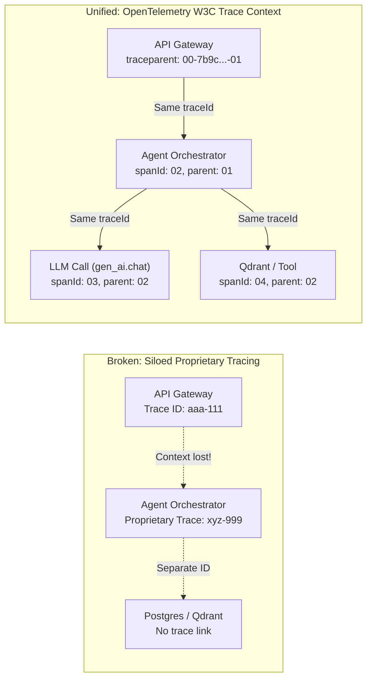
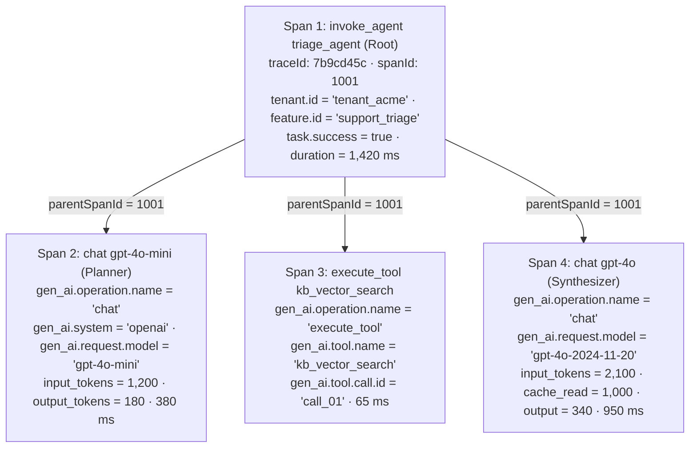

# Chapter 01 — OpenTelemetry (OTel) GenAI Semantic Conventions

> **Lecture 43 · Chapter 01 of 07** · Level: 🟠 Advanced · Phase 10 — Quality, FinOps, Identity & Security
> **Source:** `FDE S17` · **Roadmap Reference:** [`roadmap-v1.md`](../../roadmap-v1.md#lecture-42--ai-observability-opentelemetry-openobserve--focus-finops) · [OpenTelemetry GenAI Semantic Conventions](https://opentelemetry.io/docs/specs/semconv/gen-ai/)
> **Roadmap topics:** Vendor-neutral OTel instrumentation · the `agent -> model -> tool` span tree · `gen_ai.*` semantic conventions · business FinOps attribution (`tenant.id`, `feature.id`, `task.success`) · PII-safe telemetry and cardinality guards.

---

## 01.0 What this chapter is for

Imagine your company runs an **API Gateway** in TypeScript, an **Agent Orchestrator** in Node.js (calling OpenAI and Anthropic), a **RAG Vector Service** in Python (calling Qdrant and Postgres), and a **Self-Hosted Inference Cluster** running vLLM.

If you instrument only the agent with a proprietary LLM-tracing SDK, you create two painful problems:
1. **Vendor lock-in:** Switching observability vendors means rewriting tracing decorators across dozens of services.
2. **Broken trace context:** Your SRE team's dashboard shows an HTTP request hitting the gateway, then a mysterious 4-second black hole, because the proprietary LLM SDK created a *separate* trace ID that never links to Postgres, Redis, or downstream tool APIs.

**OpenTelemetry (OTel)** solves this with a single open standard (`traceId`, `spanId`, `parentSpanId`, and W3C `traceparent` headers). Its **GenAI Semantic Conventions (`gen_ai.*`)** define exact attribute names for prompts, models, token counts, and tool calls so **any** OTel-compatible backend (OpenObserve, Grafana Tempo, Datadog, Honeycomb) understands your AI telemetry out of the box.

By the end of this chapter you should be able to:

1. Explain why **vendor-neutral OTel instrumentation** eliminates tracing silos between AI engineers and SREs.
2. Draw and trace the **`agent -> model -> tool`** span tree with `traceId`, `spanId`, and `parentSpanId`.
3. Map standard **`gen_ai.*` attributes** (tokens, cache reads, finish reasons, tool calls) to cost and debugging questions.
4. Attach **business attribution tags** (`tenant.id`, `feature.id`, `task.success`) to connect latency traces with FinOps.
5. Enforce **PII-safe telemetry** and **low-cardinality metric rules** so you never leak customer secrets or crash your metrics store.

---

## 01.1 The illusion: "We have HTTP logs, so we have observability"

In a traditional REST microservice, a request hits one controller, runs one SQL query, and returns `200 OK` in 40 ms. Standard HTTP access logs tell you almost everything you need.

In an AI agent, a single user click triggers a **non-deterministic tree of calls**:
- A planner LLM call decides which tools to invoke.
- Two RAG or SQL tools run in parallel (one might retry on timeout).
- A synthesizer LLM call reads 3,000 tokens of retrieved context and streams a response.
- A guardrail check validates the output schema.

> [!IMPORTANT]
> **One request, one `traceId`.** Whether a span is emitted by Nginx, a Node.js agent loop, a Python RAG service, or a vLLM worker, W3C `traceparent` propagation keeps every millisecond and every dollar inside a single end-to-end waterfall.

### Two traps siloed tracing creates

| Trap | What it looks like | Why it breaks incident response |
| :--- | :--- | :--- |
| **"LLM latency is 4.2s, blame OpenAI."** | Agent wrapper times the whole turn without child spans | The actual OpenAI call took `650 ms`; a broken Qdrant retry loop inside `execute_tool` burned `3.5 s`. |
| **"HTTP 200 OK means the agent worked."** | Gateway logs `status: 200` on every streamed response | The agent hit `max_iterations`, failed tool auth, and returned `"I cannot help"`—invisible without `task.success`. |

---

## 01.2 Mental Model: The `agent -> model -> tool` Span Tree

Think of a single agent run as a **tree of nested timers (spans)** sharing one `traceId`. Let us trace a real **Support Triage Agent** handling a ticket for `tenant_acme` in `1,420 ms`:

### Why each level of the tree is non-negotiable

1. **Root Span (`invoke_agent`):** Answers *"Did the overall business task succeed (`task.success`), for which customer (`tenant.id`), and how long did the user wait end-to-end?"*
2. **Model Child Spans (`chat`):** Answers *"Which model burned the tokens? Did prompt caching (`cache_read_input_tokens`) actually hit? Why did `gpt-4o` take `950 ms`?"*
3. **Tool Child Spans (`execute_tool`):** Answers *"Did the agent loop 6 times because the SQL or Knowledge Base tool kept returning `401` or `timeout`?"*

### Worked Example: Reading a Span Tree Like an SRE

Suppose the root span took `1,420 ms` and cost `\$0.0089`:
- **Span 2 (`gpt-4o-mini` planner):** `1,200` input tokens + `180` output tokens = `380 ms`.
- **Span 3 (`kb_vector_search`):** `65 ms` (healthy).
- **Span 4 (`gpt-4o-2024-11-20` synthesizer):** `2,100` uncached input tokens + `1,000` cached input tokens + `340` output tokens = `950 ms`. Notice `cache_read_input_tokens = 1,000` tells you prefix caching saved ~`75%–90%` on the static system prompt!
- **Orchestrator overhead:** `1,420 - (380 + 65 + 950) = 25 ms` (JSON parsing and guardrail checks).

---

## 01.3 Standard `gen_ai.*` + Business Attribution Attributes

OTel splits attributes into **GenAI semantic conventions** (understood by every observability UI) and **business FinOps keys** (required for cost and SLO slicing):

| Attribute Key | Span Level | Example Value | Engineering / FinOps Purpose |
| :--- | :--- | :--- | :--- |
| `gen_ai.operation.name` | All | `"invoke_agent"`, `"chat"`, `"execute_tool"` | Classifies span role without fragile string parsing on span names |
| `gen_ai.system` | Model | `"openai"`, `"anthropic"`, `"aws.bedrock"` | Vendor-neutral provider attribution |
| `gen_ai.request.model` | Model | `"gpt-4o-2024-11-20"` | Tracks exact model snapshot (critical for drift debugging) |
| `gen_ai.response.model` | Model | `"gpt-4o-2024-11-20"` | Confirms which model actually served the request |
| `gen_ai.usage.input_tokens` | Model | `2100` | Uncached prompt tokens billed at `1.0x` rate |
| `gen_ai.usage.cache_read_input_tokens` | Model | `1000` | Prefix-cached tokens billed at `0.1x–0.25x` rate |
| `gen_ai.usage.output_tokens` | Model | `340` | Completion + reasoning tokens billed at `3x–5x` rate |
| `gen_ai.response.finish_reasons` | Model | `["stop"]`, `["length"]`, `["content_filter"]` | Spots truncated answers (`"length"`) or safety blocks immediately |
| `gen_ai.tool.name` / `call.id` | Tool | `"kb_vector_search"`, `"call_01"` | Links tool execution back to the exact LLM tool call |
| `tenant.id` / `feature.id` | Root + Child | `"tenant_acme"`, `"support_triage"` | Enables multi-tenant cost, quota, and SLO slicing |
| `task.success` | Root | `true` / `false` | Enables true **Cost per Successful Task (CPST)** |

> [!TIP]
> **Always record `gen_ai.request.model` AND `gen_ai.response.model`.** If a gateway fallback routes a request from `gpt-4o` to `gpt-4o-mini` during an outage, `request.model` shows what you *asked* for while `response.model` shows what *answered*.

---

## 01.4 PII-Safe Telemetry & High-Cardinality Guards

> [!WARNING]
> **Never attach raw user prompts or full LLM completions as default span attributes in production.** Support tickets, medical records, and SQL results contain PII/PCI/PHI. If they land in an unencrypted telemetry index, you create an immediate compliance breach.

### Production Privacy & Cardinality Rules

| Rule | What to Do | What to Avoid |
| :--- | :--- | :--- |
| **1. Metadata by Default** | Record token counts, latency, `finish_reasons`, `prompt_template_version`, and `sha256(prompt)` on spans | Putting raw `user_prompt` or `completion_text` on every prod span |
| **2. Opt-In / Redacted Payloads** | Emit prompt/completion **OTel Events** only in `staging`/`eval`, or pass through a **PII scrubber** in the OTel Collector | Dumping unredacted customer emails, SSNs, or Bearer tokens into traces |
| **3. Low-Cardinality Metrics** | Keep **Metrics** labels bounded (`model`, `feature.id`, `gen_ai.operation.name`, `status`) | Putting `user_id`, `trace_id`, or `session_uuid` into Prometheus/OTel **metric** dimensions (explodes memory!) |
| **4. High-Cardinality in Traces/Logs** | Keep `trace_id`, `call_id`, `tenant_id`, and `release.id` on **Spans and Structured Logs** | Creating 10 million unique metric time-series per day |

---

## 01.5 Common Mistakes

| # | Common Mistake | Why It Hurts | What To Do Instead |
| :---: | :--- | :--- | :--- |
| **1** | **Using a proprietary LLM-only tracing SDK** | Splits your trace IDs from gateway, Postgres, and Redis traces | Instrument with **OpenTelemetry `gen_ai.*`** and propagate W3C `traceparent` |
| **2** | **Losing `parentSpanId` across `Promise.all` or queues** | One agent run fragments into 5 orphan root traces | Pass `rootCtx` explicitly (`tracer.startSpan(..., rootCtx)`) and inject `traceparent` in job payloads |
| **3** | **Marking `SpanStatusCode.OK` when `task.success = false`** | Agent fails business validation or gives up politely, yet dashboards look 100% green | Set `task.success = false` and `SpanStatusCode.ERROR` whenever verification fails |
| **4** | **Putting `tenant.id` or `user.id` on high-volume OTel Metrics** | Millions of label combinations crash your metrics backend | Keep high-cardinality IDs on **Spans/Logs**; keep **Metrics** low-cardinality |
| **5** | **Logging raw prompts & tool outputs in prod spans** | Leaks PII/API keys into telemetry storage and violates SOC 2 / GDPR | Log token counts + `sha256(prompt)` by default; scrub PII in the OTel Collector |

---

## 01.6 Key Takeaways

1. **Vendor-neutral OTel (`gen_ai.*`)** unifies AI agent telemetry with your existing microservices, databases, and queues under one `traceId`.
2. **Model every run as an `agent -> model -> tool` span tree** so you can isolate planner latency, tool retries, and prompt-cache hit rates.
3. **Bridge SRE and FinOps** by stamping `tenant.id`, `feature.id`, `release.id`, and `task.success` on root and child spans.
4. **Protect privacy and backend stability:** never log raw PII prompts by default, and never put high-cardinality IDs into metric labels.

---

### Navigation

- **Next:** [Chapter 02 — Shipping Traces, Metrics & Logs to OpenObserve](./02_Shipping_Traces_Metrics_and_Logs_to_OpenObserve.md)
- **Back to index:** [../index.md](../index.md)
