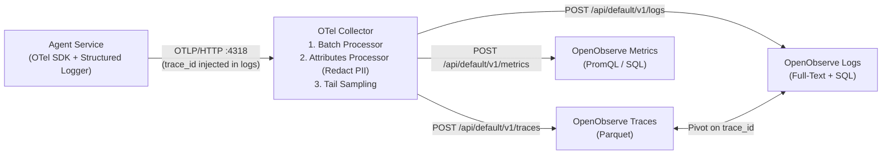
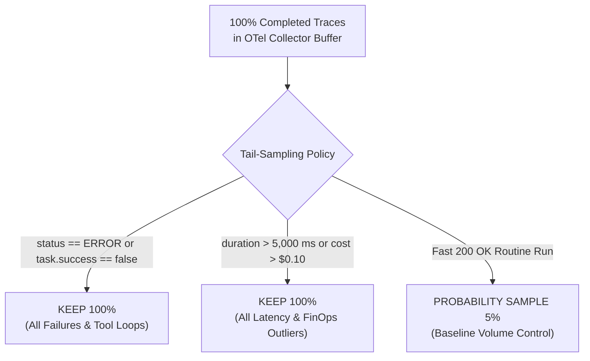

# Chapter 02 — Shipping Traces, Metrics & Logs to OpenObserve

> **Lecture 43 · Chapter 02 of 07** · Level: 🟠 Advanced · Phase 10 — Quality, FinOps, Identity & Security
> **Source:** `FDE S17` · **Roadmap Reference:** [`roadmap-v1.md`](../../roadmap-v1.md#lecture-42--ai-observability-opentelemetry-openobserve--focus-finops) · [OpenObserve Documentation](https://openobserve.ai/docs/)
> **Roadmap topics:** OTel Collector pipeline (Receivers → Processors → Exporters) · OTLP HTTP/gRPC ingestion into OpenObserve · correlating traces, metrics, and logs via `trace_id` · head vs. tail-based sampling.

---

## 02.0 What this chapter is for

Emitting OpenTelemetry spans in process memory is useless unless they are **buffered, scrubbed of secrets, sampled intelligently, and stored** where engineers can query them in seconds during an incident.

**OpenObserve** is an open-source, Rust-based observability backend designed as a high-efficiency alternative to Elasticsearch, Splunk, and Datadog:
- **Native OTLP Ingestion:** Accepts OpenTelemetry **Traces, Metrics, and Logs** directly over OTLP/HTTP (`4318`) or OTLP/gRPC (`4317`).
- **Parquet + Object Storage (S3/MinIO):** Stores telemetry in compressed Apache Parquet files rather than expensive JVM heap/Lucene indexes—cutting storage costs by **10x–30x** for high-volume AI traces.
- **SQL & PromQL Querying:** Lets engineers run standard SQL across `gen_ai.*` span attributes (`SELECT tenant_id, SUM(gen_ai_cost_usd) ...`).

By the end of this chapter you should be able to:

1. Explain why an **OTel Collector** sits between your agent services and OpenObserve.
2. Correlate **Traces, Metrics, and Logs** using a single `trace_id` to debug slow or failed runs.
3. Read and configure a production **`otel-collector.yaml`** pipeline (OTLP receiver, batch, PII redaction, OpenObserve exporter).
4. Contrast **head sampling** vs. **tail-based sampling** and keep 100% of billing records accurate.

---

## 02.1 Three Signals Correlated by `trace_id`

Each telemetry signal answers a different operational question—and **`trace_id` is the glue** connecting them:

| Signal | Best Used For | Example AI Operational Question |
| :--- | :--- | :--- |
| **Traces** | Debugging *one slow or failed agent run* end-to-end | *"Why did `trace_id=7b9cd45c...` take 9.2 seconds? Oh, `execute_tool sql_query` retried 4 times!"* |
| **Metrics** | Fast dashboards, `p95` percentiles, and SLO burn-rate alerts | *"What is `p95(gen_ai.client.operation.duration)` for `gpt-4o` over the last 15 minutes?"* |
| **Logs** | Detailed structured payloads (guardrail blocks, JSON repair diffs, stack traces) | *"Show the exact Zod validation error emitted during `trace_id=7b9cd45c...`."* |



> [!TIP]
> **Inject `trace_id` and `span_id` into every structured JSON log line.** When an alert fires on a metric spike, you jump from the metric → failing trace → exact stderr/Zod log line in two clicks.

---

## 02.2 Why You Put an OTel Collector in the Middle

Never point 50 microservices directly at a remote observability SaaS URL with synchronous HTTP calls. Put an **OpenTelemetry Collector** sidecar or DaemonSet in front:

1. **Zero Request Latency Impact:** Your agent flushes spans to `localhost:4318` in sub-millisecond memory; the Collector batches and retries exports asynchronously.
2. **Centralized PII Redaction:** One `attributes` / `transform` processor strips `authorization`, `cookie`, and regex-matched emails/SSNs across *all* services before anything leaves your VPC.
3. **Backend Portability:** Switching from local Jaeger → OpenObserve → Grafana Cloud is a 4-line Collector YAML change with zero application code redeploys.

### Minimal OTel Collector Config for OpenObserve (`otel-collector.yaml`)

```yaml
receivers:
  otlp:
    protocols:
      http:
        endpoint: 0.0.0.0:4318
      grpc:
        endpoint: 0.0.0.0:4317

processors:
  batch:
    send_batch_size: 512
    timeout: 2s

  # Scrub accidental secrets before leaving the VPC
  attributes/redact:
    actions:
      - key: http.request.header.authorization
        action: delete
      - key: user.email
        action: hash

exporters:
  otlphttp/openobserve:
    endpoint: "http://openobserve:5080/api/default"
    headers:
      Authorization: "Basic ${OPENOBSERVE_AUTH_TOKEN}"

service:
  pipelines:
    traces:
      receivers: [otlp]
      processors: [attributes/redact, batch]
      exporters: [otlphttp/openobserve]
    metrics:
      receivers: [otlp]
      processors: [batch]
      exporters: [otlphttp/openobserve]
    logs:
      receivers: [otlp]
      processors: [attributes/redact, batch]
      exporters: [otlphttp/openobserve]
```

---

## 02.3 Head Sampling vs. Tail-Based Sampling

At 1,000,000 agent runs/day, storing 100% of routine `200 OK` traces can still get noisy and expensive. How do you sample without losing the rare bugs?



| Strategy | Where Decision Happens | Fatal Flaw / Production Benefit |
| :--- | :--- | :--- |
| **Head Sampling (e.g., 10% random)** | At the *start* of the request | **Flaw:** Drops **90% of your errors and latency spikes** because you didn't know the request would fail when it started! |
| **Tail-Based Sampling (Smart)** | In the OTel Collector *after* the trace finishes | **Benefit:** Keeps **100% of errors**, **100% of slow/expensive runs**, and samples only `5%` of fast `OK` runs |

> [!IMPORTANT]
> **FinOps Accuracy Rule:** Even if you tail-sample **traces** at 5% for fast `OK` requests, **never sample billing/cost records**! Emit 100% of token/cost counters via **OTel Metrics** or **FOCUS event logs** so your financial ledger never undercounts customer spend.

---

## 02.4 Common Mistakes

| # | Common Mistake | Why It Hurts | What To Do Instead |
| :---: | :--- | :--- | :--- |
| **1** | **Exporting OTLP directly from app pods to SaaS** | Backpressure or SaaS outages block agent threads and duplicate PII-scrubbing code | Route all services through a local **OTel Collector** with `batch` and retry queues |
| **2** | **Using 10% head sampling in production** | Drops 9 out of 10 rare hallucinations, timeouts, and tool errors | Use **tail-based sampling** to keep 100% of errors and slow/costly traces |
| **3** | **Computing customer billing from sampled traces** | Sampling 5% of `OK` traces undercounts actual token spend by 95% | Keep **100% of cost metrics / FOCUS billing events** unsampled |
| **4** | **Omitting `trace_id` from application logs** | You see a red span in OpenObserve, but can't find the matching Zod/SQL error log | Configure your logger to inject active OTel `trace_id` and `span_id` automatically |

---

## 02.5 Key Takeaways

1. **OpenObserve** ingests native OTLP traces, metrics, and logs into compressed Parquet storage with SQL and PromQL querying.
2. **Correlate all three signals with `trace_id`** so you can move seamlessly from a `p95` metric alert → trace waterfall → exact error log.
3. **Always deploy an OTel Collector** for async batching, centralized PII redaction, and backend portability.
4. **Use tail-based sampling** for traces (keep 100% of errors and outliers) while keeping **100% of FinOps cost records** unsampled.

---

### Navigation

- **Next:** [Chapter 03 — Continuous Quality Monitoring & Drift Detection](./03_Continuous_Quality_Monitoring_and_Drift_Detection.md)
- **Previous:** [Chapter 01 — OpenTelemetry (OTel) GenAI Semantic Conventions](./01_OpenTelemetry_GenAI_Semantic_Conventions.md)
- **Back to index:** [../index.md](../index.md)
