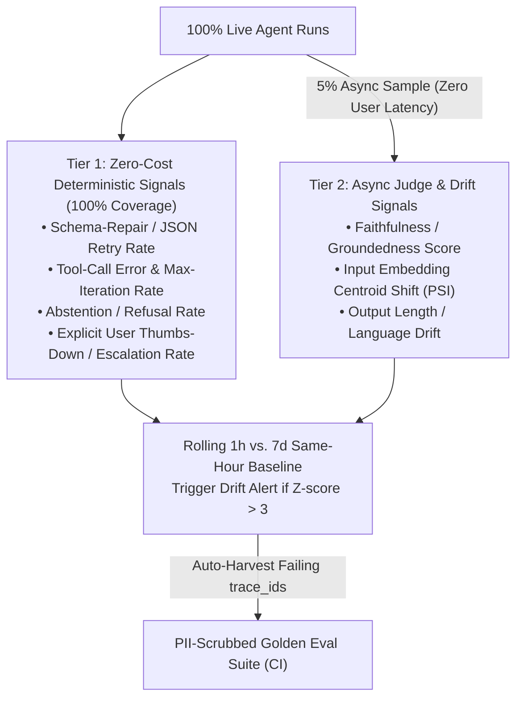
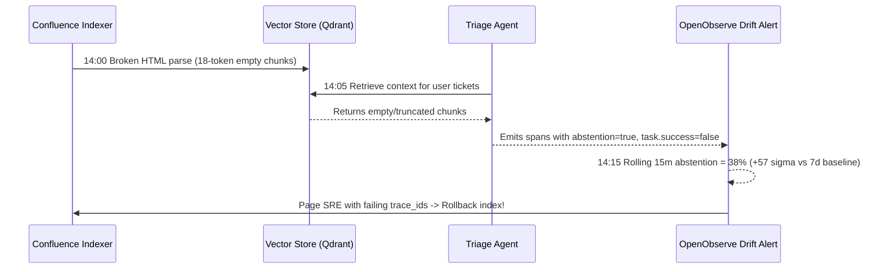

# Chapter 03 — Continuous Quality Monitoring & Drift Detection

> **Lecture 43 · Chapter 03 of 07** · Level: 🟠 Advanced · Phase 10 — Quality, FinOps, Identity & Security
> **Source:** `FDE S17` · **Roadmap Reference:** [`roadmap-v1.md`](../../roadmap-v1.md#lecture-42--ai-observability-opentelemetry-openobserve--focus-finops)
> **Roadmap topics:** Silent AI failures ("0% 5xx, 100% broken") · data, model, and user drift · Tier 1 deterministic `$0` proxies vs. Tier 2 async sampled judges · judge calibration and 7-day baseline comparisons.

---

## 03.0 What this chapter is for

Imagine this real-world Monday morning incident:
- Your offline CI evaluation suite passed `96%` on Friday afternoon.
- Over the weekend, **HTTP `500` rate is `0.00%`**, and `p95` latency looks completely normal.
- On Monday at 9:00 AM, support tickets flood in: *"The contract assistant keeps saying 'I cannot find any payment terms' on every PDF!"*

Nothing crashed. No exception was thrown. Why did the agent silently break?
1. **Upstream Data / RAG Drift:** Someone updated the document parser on Saturday, turning PDF tables into empty whitespace chunks.
2. **Model Provider Drift:** A hosted model alias (`gpt-4o-latest` or a quantized endpoint) received a silent weight/routing update, changing its JSON adherence or refusal threshold.
3. **User Behavior Drift:** A new enterprise tenant uploaded German-language invoices when your golden eval dataset only tested English.

**Continuous Quality Monitoring** bridges the gap between offline CI evals and live production traffic.

By the end of this chapter you should be able to:

1. Distinguish **data/RAG drift**, **model provider drift**, and **user behavior drift** in live production.
2. Design a **two-tier online quality pipeline** combining `$0` deterministic proxies (100% traffic) with async LLM judges (1%–5% traffic).
3. Detect RAG ingestion or schema regressions in minutes using **rolling SQL drift queries** in OpenObserve.
4. Calibrate online judges against human labels and **harvest production failures** back into golden evals.

---

## 03.1 Two Tiers of Online Quality Signals

Running an expensive LLM-as-a-judge on **100% of live traffic** would double your AI bill and add seconds of user-facing latency. Instead, combine **Tier 1 (Zero-Cost Structural Proxies on 100% of traffic)** with **Tier 2 (Async Sampled Judges on 1%–5% of traffic)**:



### Detailed Signal Breakdown

| Signal | Cost | Coverage | What Failure Mode It Catches | Example Alert Rule |
| :--- | :---: | :---: | :--- | :--- |
| **Schema-Repair Rate** | `\$0` | `100%` | Model stopped obeying structured output / Zod schema | Jumps from `0.5%` → `> 4%` over 30m |
| **Tool-Error / Loop Rate** | `\$0` | `100%` | Downstream API changed schema or auth token expired | Tool failures `> 5%` or avg turns/task `> 4.5` |
| **Abstention / Refusal Rate** | `\$0` | `100%` | Broken RAG ingestion (empty chunks) or overly strict safety filter | `"Insufficient evidence"` jumps `4%` → `20%` |
| **User Negative Feedback** | `\$0` | `100%` | Subtle UX, tone, or accuracy regressions | Thumbs-down or human-escalation rate `> 2x` 7d baseline |
| **Async Faithfulness Judge** | Low | `1%–5%` | Hallucinations not caught by schema or tool checks | Rolling 1h faithfulness drops `< 0.85` |

---

## 03.2 Worked Example: Catching RAG Ingestion Drift in 15 Minutes

Suppose your **Support Triage Agent** normally sees these 7-day baseline metrics:
- **Abstention rate:** `3.5%` ($\sigma = 0.6\%$)
- **Avg retrieved chunk length:** `420 tokens`
- **Sampled faithfulness:** `0.93`

At `14:00`, a cron job re-indexes Confluence with a broken HTML stripper:
- By `14:15`, `avg_chunk_length` drops from `420` → `18 tokens`.
- **Abstention rate** spikes from `3.5%` → `38%` (a **+57 $\sigma$** jump!).
- Your OpenObserve alert fires in 15 minutes with the exact `trace_id`s of abstained runs, letting SREs roll back the Confluence index before most customers even notice.

```sql
-- OpenObserve SQL: 15-minute rolling failure & abstention drift check
SELECT feature_id,
       COUNT(*) AS total_runs,
       AVG(CASE WHEN task_success = false THEN 1.0 ELSE 0.0 END) AS failure_rate,
       AVG(rag_avg_chunk_tokens) AS avg_chunk_tokens
FROM default_traces
WHERE gen_ai_operation_name = 'invoke_agent'
  AND _timestamp > NOW() - INTERVAL '15 minutes'
GROUP BY feature_id;
```



---

## 03.3 Calibrating Online Judges & Avoiding Alert Fatigue

1. **Pin Model Snapshots:** Never use floating aliases like `gpt-4o-latest` in production—pin exact snapshots (e.g., `gpt-4o-2024-11-20`) and log `gen_ai.response.model` on every span so you know immediately if a provider routed you elsewhere.
2. **Calibrate Judges Against Human Labels:** Before trusting an automated faithfulness judge for PagerDuty alerts, verify its agreement (Cohen's $\kappa \ge 0.75$ or F1 $\ge 0.85$) on 200 human-labeled production traces.
3. **Compare Against 7-Day Same-Hour Baselines:** Enterprise traffic looks completely different at 2:00 AM Sunday vs. 10:00 AM Tuesday. Compare rolling windows against the same hour/day-of-week baseline to avoid false pages.
4. **Auto-Harvest Failures into Golden Evals:** Every trace flagged by drift detection (`task.success = false` or `faithfulness < 0.7`) should be scrubbed of PII and added to your regression suite so the bug never returns.

> [!IMPORTANT]
> **Never run Tier 2 LLM judges inline on the critical user response path.** Always run them asynchronously on a sampled queue (`1%–5%`) so user latency (`TTFT`) stays unaffected.

---

## 03.4 Common Mistakes

| # | Common Mistake | Why It Hurts | What To Do Instead |
| :---: | :--- | :--- | :--- |
| **1** | **Relying only on HTTP 500s for AI health** | Broken RAG or prompt drift returns `200 OK` while failing 40% of users | Monitor **abstention rate, schema-repair rate, and tool loops** on 100% of traffic |
| **2** | **Running an LLM judge synchronously on 100% of requests** | Doubles token cost and adds 1–3 seconds of latency to every user | Use `$0` deterministic proxies at 100% and **async sampled judges** at 1%–5% |
| **3** | **Using floating model aliases (`gpt-4o-latest`)** | Provider weight updates silently change output formatting overnight | Pin immutable model snapshots and assert on `gen_ai.response.model` |
| **4** | **Alerting on uncalibrated judges or flat thresholds** | Weekend/night traffic shifts trigger constant false PagerDuty pages | Calibrate judges ($\kappa \ge 0.75$) and compare against **7-day same-hour baselines** |

---

## 03.5 Key Takeaways

1. Passing Friday's CI evals does not guarantee Tuesday's production quality—**data drift, model drift, and user drift** happen silently with `0%` HTTP 500s.
2. Combine **100% coverage `$0` deterministic proxies** (schema repairs, tool errors, abstentions, escalations) with **1%–5% async calibrated LLM judges**.
3. Pin model snapshots, compare against **7-day same-hour baselines**, and **auto-harvest failing traces** into your offline golden evaluation dataset.

---

### Navigation

- **Next:** [Chapter 04 — AI SLOs & Error Budgets](./04_AI_SLOs_and_Error_Budgets.md)
- **Previous:** [Chapter 02 — Shipping Traces, Metrics & Logs to OpenObserve](./02_Shipping_Traces_Metrics_and_Logs_to_OpenObserve.md)
- **Back to index:** [../index.md](../index.md)
