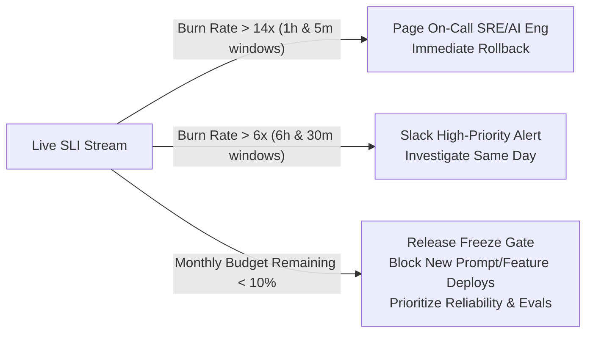

# Chapter 04 — AI SLOs & Error Budgets

> **Lecture 43 · Chapter 04 of 07** · Level: 🟠 Advanced · Phase 10 — Quality, FinOps, Identity & Security
> **Source:** `FDE S17` · **Roadmap Reference:** [`roadmap-v1.md`](../../roadmap-v1.md#lecture-42--ai-observability-opentelemetry-openobserve--focus-finops)
> **Roadmap topics:** Service Level Indicators (SLIs) & Objectives (SLOs) for probabilistic AI · latency (`p95 TTFT`), availability, and task-success SLOs · error budgets & release freezes.

---

## 04.0 What this chapter is for

Traditional microservices measure two SLOs: **Availability (`99.9%` non-5xx)** and **Latency (`p95 < 200 ms`)**. For AI agents, a service can return `200 OK` in `300 ms` and still fail the user (`"I don't know"` or wrong tool call).

**AI SLOs** add **Task Success** and **Streaming Latency (`TTFT` / `TPOT`)** alongside availability, governed by an **Error Budget**.

By the end of this chapter you should be able to:

1. Define the **3-part AI SLO Triad** (TTFT Latency, End-to-End Task Success, Availability).
2. Calculate a monthly **Error Budget** and define what happens when it burns out (feature freeze $\rightarrow$ reliability work).

---

## 04.1 The AI SLO Triad

| SLI (What You Measure) | SLO Target (30-Day Window) | Allowed Error Budget |
| :--- | :---: | :---: |
| **p95 Time-to-First-Token (`TTFT`)** | `<= 600 ms` on `99%` of requests | `1%` slow requests |
| **Task Success Rate** (`task.success === true`) | `>= 92%` across completed runs | `8%` failed/escalated tasks |
| **Gateway Availability** (non-5xx) | `>= 99.9%` | `43.2` minutes downtime/month |

When an unstable prompt or upstream model outage burns **> 50% of the monthly Error Budget in 24 hours**, automated policy **freezes non-critical prompt/feature rollouts** until reliability recovers.

---

## 04.2 Key takeaways

1. **AI SLOs must include Task Success and TTFT**, not just HTTP 5xx availability.
2. **Error budgets turn reliability into an objective release-gate decision.**

---

**Next:** [Chapter 05 — AI FinOps: Cost per Successful Task](./05_AI_FinOps_Cost_per_Successful_Task.md)

# Chapter 04 — AI SLOs & Error Budgets

> **Lecture 43 · Chapter 04 of 07** · Level: 🟠 Advanced · Phase 10 — Quality, FinOps, Identity & Security
> **Source:** `FDE S17` · **Roadmap Reference:** [`roadmap-v1.md`](../../roadmap-v1.md#lecture-42--ai-observability-opentelemetry-openobserve--focus-finops)

---

## 1. Why Traditional Microservice SLOs Fail for AI Agents

In a traditional REST API, SREs agree on two classic **Service Level Objectives (SLOs)**:
- **Availability:** `99.9%` of requests return non-5xx.
- **Latency:** `p95 < 200 ms`.

Apply those to an AI agent and they completely miss the user experience:
1. An agent can return `HTTP 200 OK` and still hallucinate a fake refund policy (`task.success = false`).
2. Streaming responses make total request duration misleading: users don't mind a 4-second total answer if the **first token appears in 400 ms (`TTFT`)**, whereas waiting 3.5 seconds on a blank spinner feels broken.

**AI SLOs** extend SRE discipline to probabilistic systems by measuring **what users actually care about**—and pairing every target with an **Error Budget**.

---

## 2. The 4-Part AI SLO Matrix

| SLI (What You Measure) | How It's Measured in OTel | Example 30-Day SLO Target | Monthly Error Budget |
| :--- | :--- | :---: | :---: |
| **1. Gateway Availability** | `non_5xx / total_requests` | `>= 99.9%` | `0.1%` (`43.2` min downtime/mo) |
| **2. Streaming Responsiveness (`TTFT`)** | `p95` time to first token | `<= 600 ms` on `99%` of requests | `1.0%` slow starts |
| **3. Task Success Rate** | `task.success == true` on root `invoke_agent` span | `>= 95.0%` | `5.0%` failed/escalated tasks |
| **4. Groundedness / Policy Pass Rate** | Guardrail + sampled judge pass rate | `>= 98.0%` | `2.0%` ungrounded/blocked outputs |

> [!NOTE]
> **Notice why `99.9%` Task Success is usually unrealistic (and unnecessary):** Unlike deterministic SQL lookups, open-ended reasoning tasks hit ambiguous user prompts and flaky external APIs. Setting a realistic `95%` Task Success SLO with graceful human escalation is far healthier than pretending an LLM is `99.99%` deterministic.

---

## 3. Worked Example: Error Budget & Burn-Rate Alerting

Suppose your **Contract Review Agent** handles **100,000 tasks per 30-day month**, with a **Task Success SLO of `95.0%`**:
- **Allowed Failures (Error Budget):** $5.0\% \times 100{,}000 = \mathbf{5{,}000\text{ failed tasks/month}}$ ($\approx 166$ failures/day at steady `1x` burn).

Now compare two failure scenarios:
1. **Steady 1x Burn:** You see `150` failed tasks/day. Budget lasts all month—team ships new features normally.
2. **14x Fast Burn (Incident):** A bad prompt deploy causes `20%` task failure (`~667` failures in just 6 hours!). At this burn rate, the entire **30-day error budget will be wiped out in ~2 days**.

### Multi-Window Burn-Rate Policy

---

## 4. Turning Error Budgets into Engineering Governance

Error budgets remove politics between **Product** ("ship the new agent feature faster!") and **SRE/Platform** ("the agent is too unstable!"):
- **When Error Budget > 20% remaining:** Product teams have full autonomy to ship new prompts, tools, and model upgrades behind feature flags.
- **When Error Budget <= 0% (Exhausted):** Automated CI/CD gate blocks non-bugfix AI releases. Engineering sprints pivot to fixing top failure modes (e.g., adding Z3/schema validation, improving RAG retrieval, or adding fallback models) until the rolling 30-day SLO recovers.

---

## 5. Chapter Summary
- Measure AI reliability with a **4-part SLO matrix**: Availability, `TTFT` latency, **Task Success Rate**, and **Groundedness/Policy Pass Rate**.
- Pair every SLO with a concrete **Error Budget** and **multi-window burn-rate alerts** so fast regressions page immediately while slow noise doesn't cause alert fatigue.
- Enforce **objective release freezes** when the error budget runs dry.

---
**Next:** [Chapter 05 — AI FinOps: Cost per Successful Task](./05_AI_FinOps_Cost_per_Successful_Task.md)

