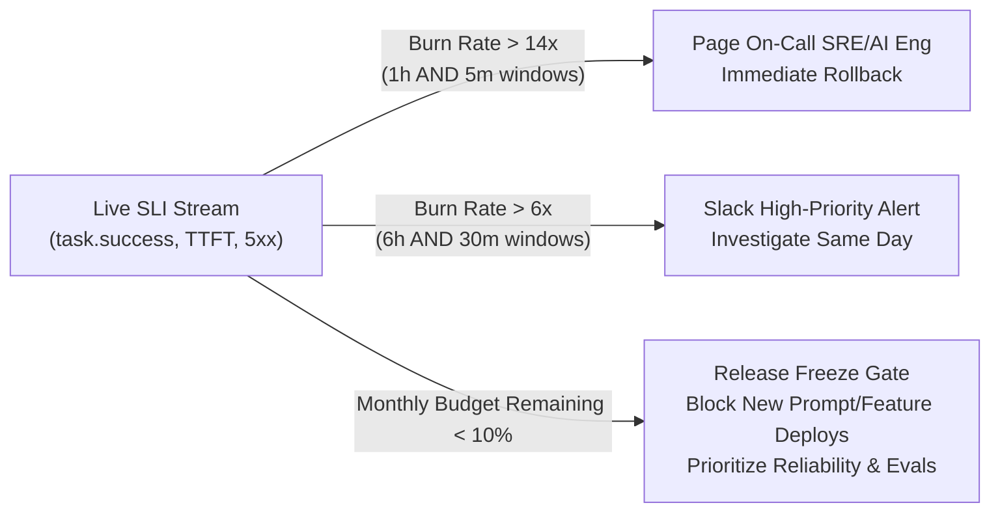
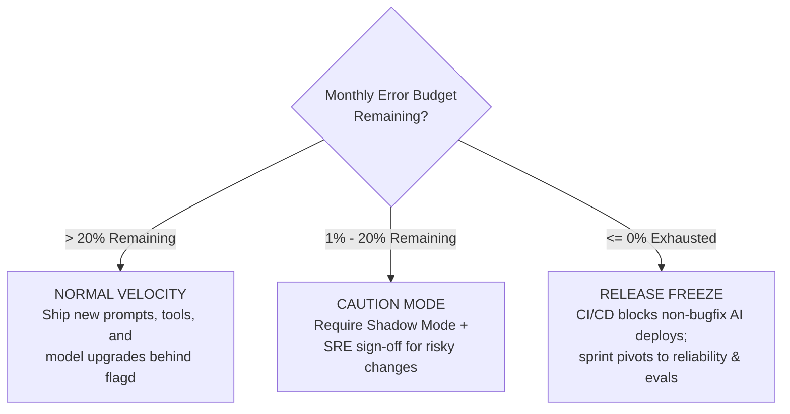

# Chapter 04 — AI SLOs & Error Budgets

> **Lecture 43 · Chapter 04 of 07** · Level: 🟠 Advanced · Phase 10 — Quality, FinOps, Identity & Security
> **Source:** `FDE S17` · **Roadmap Reference:** [`roadmap-v1.md`](../../roadmap-v1.md#lecture-42--ai-observability-opentelemetry-openobserve--focus-finops)
> **Roadmap topics:** Service Level Indicators (SLIs) & Objectives (SLOs) for probabilistic AI · streaming latency (`p95 TTFT`), availability, task-success, and groundedness SLOs · error budgets, multi-window burn-rate alerts, and release freezes.

---

## 04.0 What this chapter is for

In a traditional REST API, SREs agree on two classic **Service Level Objectives (SLOs)**:
- **Availability:** `99.9%` of requests return non-5xx.
- **Latency:** `p95 < 200 ms`.

Apply those two metrics alone to an AI agent and they completely miss the user experience:
1. An agent can return `HTTP 200 OK` in `300 ms` and still hallucinate a fake refund policy (`task.success = false`).
2. Streaming responses make total request duration misleading: users don't mind a 4-second total answer if the **first token appears in 400 ms (`TTFT`)**, whereas waiting 3.5 seconds on a blank spinner feels broken.

**AI SLOs** extend SRE discipline to probabilistic systems by measuring **what users actually care about**—and pairing every target with an **Error Budget** that governs release velocity objectively.

By the end of this chapter you should be able to:

1. Define the **4-part AI SLO Matrix** (Gateway Availability, `p95 TTFT`, Task Success Rate, Groundedness/Policy Pass Rate).
2. Explain why `99.9%` Task Success is usually unrealistic for open-ended agents and how to set healthy targets.
3. Calculate a monthly **Error Budget** and distinguish a steady `1x` burn from a `14x` fast-burn incident.
4. Wire **multi-window burn-rate alerts** and **automated release freezes** into CI/CD governance.

---

## 04.1 The 4-Part AI SLO Matrix

| SLI (What You Measure) | How It's Measured in OTel | Example 30-Day SLO Target | Monthly Error Budget |
| :--- | :--- | :---: | :---: |
| **1. Gateway Availability** | `non_5xx / total_requests` | `>= 99.9%` | `0.1%` (`43.2` min downtime/mo) |
| **2. Streaming Responsiveness (`TTFT`)** | `p95` time to first token | `<= 600 ms` on `99%` of requests | `1.0%` slow starts |
| **3. Task Success Rate** | `task.success == true` on root `invoke_agent` span | `>= 95.0%` | `5.0%` failed/escalated tasks |
| **4. Groundedness / Policy Pass Rate** | Guardrail + sampled judge pass rate | `>= 98.0%` | `2.0%` ungrounded/blocked outputs |

> [!NOTE]
> **Why `99.9%` Task Success is usually unrealistic (and unnecessary):** Unlike deterministic SQL lookups, open-ended reasoning tasks hit ambiguous user prompts and flaky external APIs. Setting a realistic `95%` Task Success SLO with graceful human escalation is far healthier than pretending an LLM is `99.99%` deterministic.

---

## 04.2 Worked Example: Error Budget & Burn-Rate Alerting

Suppose your **Contract Review Agent** handles **100,000 tasks per 30-day month**, with a **Task Success SLO of `95.0%`**:
- **Allowed Failures (Error Budget):** $5.0\% \times 100{,}000 = \mathbf{5{,}000\text{ failed tasks/month}}$ ($\approx 166$ failures/day at steady `1x` burn).

Now compare two failure scenarios:
1. **Steady 1x Burn:** You see `150` failed tasks/day. Your budget lasts all month—the team ships new features and prompt improvements normally.
2. **14x Fast Burn (Incident):** A bad prompt deploy causes `20%` task failure (`~667` failures in just 6 hours!). At this burn rate, the entire **30-day error budget will be wiped out in ~2 days**.

### Multi-Window Burn-Rate Policy

Why check *both* a long window (`1h`) and a short window (`5m`)? Checking only `5m` pages on tiny traffic blips; checking only `1h` notices an outage too late. Requiring **both** windows to exceed the burn-rate threshold gives fast, zero-noise paging:

---

## 04.3 Turning Error Budgets into Engineering Governance

Error budgets remove politics between **Product** (*"ship the new agent feature faster!"*) and **SRE/Platform** (*"the agent is too unstable!"*):

When the budget is exhausted, engineering sprints focus exclusively on top failure modes—adding Zod/Z3 validation, fixing RAG chunking, or configuring fallback models—until the rolling 30-day SLO recovers.

---

## 04.4 Common Mistakes

| # | Common Mistake | Why It Hurts | What To Do Instead |
| :---: | :--- | :--- | :--- |
| **1** | **Tracking only HTTP 5xx and total latency** | Misses silent hallucinations and 4-second blank spinners before first token | Measure **Task Success Rate** and **`p95 TTFT`** alongside availability |
| **2** | **Setting a `99.9%` Task Success SLO on day one** | Probabilistic agents constantly breach it, causing permanent freeze & alert fatigue | Set a realistic **`92%–95%` Task Success SLO** with graceful human fallback |
| **3** | **Alerting on a single 5-minute window** | One noisy batch of bad PDFs wakes up on-call at 3:00 AM | Use **multi-window burn-rate alerts** (`1h + 5m` for page, `6h + 30m` for ticket) |
| **4** | **Having an Error Budget with no release consequence** | Teams ignore red dashboards and keep shipping unstable prompts | Wire `budget_remaining <= 0` to an **automated CI/CD release freeze gate** |

---

## 04.5 Key Takeaways

1. Measure AI reliability with a **4-part SLO matrix**: Gateway Availability, **`TTFT` latency**, **Task Success Rate**, and **Groundedness/Policy Pass Rate**.
2. Pair every SLO with a concrete **Error Budget** and **multi-window burn-rate alerts** so fast regressions page immediately while minor noise doesn't cause alert fatigue.
3. Enforce **objective release freezes** when the error budget runs dry, aligning Product and SRE around reliability.

---

### Navigation

- **Next:** [Chapter 05 — AI FinOps: Cost per Successful Task](./05_AI_FinOps_Cost_per_Successful_Task.md)
- **Previous:** [Chapter 03 — Continuous Quality Monitoring & Drift Detection](./03_Continuous_Quality_Monitoring_and_Drift_Detection.md)
- **Back to index:** [../index.md](../index.md)
