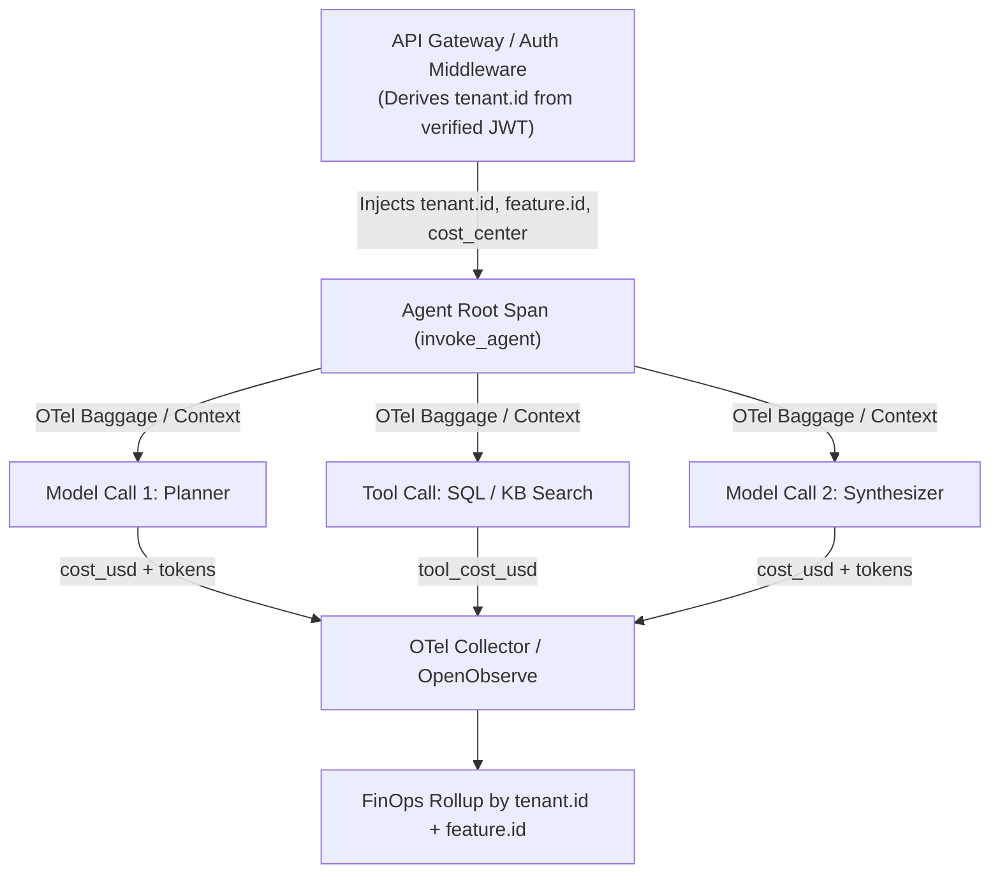
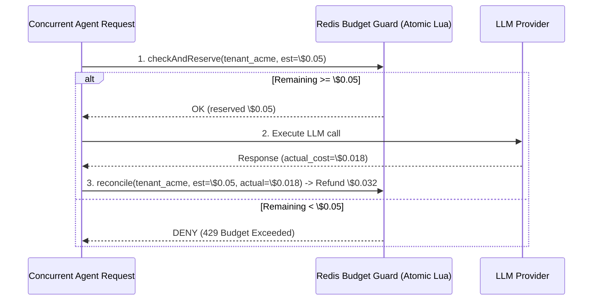

# Chapter 06 — Tenant & Feature Attribution and Hard Budgets

> **Lecture 43 · Chapter 06 of 07** · Level: 🟠 Advanced · Phase 10 — Quality, FinOps, Identity & Security
> **Source:** `FDE S17` · **Roadmap Reference:** [`roadmap-v1.md`](../../roadmap-v1.md#lecture-42--ai-observability-opentelemetry-openobserve--focus-finops)
> **Roadmap topics:** Multi-tenant cost attribution (`tenant.id`, `feature.id`, `cost_center`, `environment`) · allocating shared GPU/PTU and eval overhead · three-layer hard budgets · atomic reserve-and-reconcile concurrency control.

---

## 06.0 What this chapter is for

Imagine your SaaS product has three AI features (`invoice_extraction`, `support_triage`, `contract_review`) used by 500 enterprise customers (`tenant_acme`, `tenant_globex`, ...).

At the end of the month, your OpenAI / Anthropic / Bedrock bill arrives: **\$48,200**. The CFO asks three questions:
1. *"Which customer (`tenant.id`) cost us \$12,000 on a \$500/month plan?"* (Negative gross margin!)
2. *"Did our new `contract_review` feature actually pay for itself?"*
3. *"Why did spend spike \$4,000 at 2:00 AM on Tuesday?"*

Without **mandatory attribution tags** propagated from the API gateway through every OTel span—and **real-time hard budgets** that stop runaway loops before the bill explodes—that \$48,200 invoice is an unallocated black box.

By the end of this chapter you should be able to:

1. Propagate **mandatory attribution dimensions** (`tenant.id`, `feature.id`, `cost_center`, `environment`) from the gateway to every OTel span.
2. Allocate **shared GPU clusters, reserved PTU slack, and CI/eval runs** cleanly between COGS and R&D.
3. Enforce **three layers of real-time budgets** (per-request loop caps, per-tenant sliding windows, global kill-switch).
4. Prevent concurrent overspend using **two-phase atomic reserve-and-reconcile**.

---

## 06.1 Mandatory Attribution Dimensions & Context Propagation



Every root `invoke_agent` span—and every child `chat` / `execute_tool` span—must carry non-nullable attribution tags:

| Tag Key | Example Values | Owner / Purpose |
| :--- | :--- | :--- |
| `tenant.id` | `"tenant_acme"`, `"tenant_free_882"` | Customer chargeback & gross-margin analysis |
| `feature.id` | `"support_triage"`, `"sql_copilot"` | Product P&L and feature ROI |
| `cost_center` | `"eng-platform"`, `"cs-automation"` | Internal FinOps department billing |
| `environment` | `"prod"`, `"staging"`, `"eval"` | Separates customer COGS from CI/eval runs |
| `pricing.tier` | `"enterprise"`, `"pro"`, `"free"` | Enforces tier-specific budget caps |

> [!IMPORTANT]
> **Reject Unattributed Calls in Production:** Enforce the rule *"No `tenant.id` + `feature.id`, no LLM call"* inside your central LLM gateway. Never trust client-supplied `tenant_id` headers—derive `tenant.id` from the verified OIDC JWT (see Lecture 45).

---

## 06.2 Allocating Shared & Overhead Costs

Not every dollar maps cleanly to a single API call. Handle shared infrastructure explicitly so Finance doesn't lump R&D into customer COGS:

| Cost Category | Example | Allocation Strategy |
| :--- | :--- | :--- |
| **Direct Model Spend** | Chat completions for `tenant_acme` | `100%` direct attribution via `tenant.id` |
| **Shared GPU / Self-Hosted Cluster** | vLLM / SGLang H100 node (`\$3/hr`) | Proportional by `(tenant_tokens / total_cluster_tokens)` per hour |
| **Idle Capacity / Reserved Throughput** | Provisioned Throughput (PTU) unused slack | Split across tenants by peak quota reservation or absorbed into `tenant.id = "platform_shared"` |
| **CI/CD & Offline Evals** | Nightly regression suite | Tagged `environment = "eval"` and `cost_center = "ai-eng"` — **never** billed to customer COGS |

---

## 06.3 Hard Budgets & Tiered Enforcement

Monitoring spend *after* the month ends only tells you how much money you already lost. Production AI systems enforce **real-time budgets at three levels**:

1. **Level 1 — Per-Request Token & Iteration Cap (In-Process Guard):** Protects against single-request infinite loops (`max_iterations: 8`, `max_request_cost_usd: \$0.25`, hard `max_tokens` on every call).
2. **Level 2 — Tenant & Feature Sliding-Window Budgets (Gateway Guard):** Tracks cumulative spend in Redis per `(tenant.id, billing_period)`:

| Budget Threshold | Action | User / System Behavior |
| :--- | :--- | :--- |
| **`< 80%` of budget** | `ALLOW` | Normal execution on primary model |
| **`80% – 99%` of budget** | `WARN + DOWNGRADE` | Emit `budget.alert` event; route to cheaper fallback model (e.g., `gpt-4o-mini` / `haiku`) |
| **`>= 100%` of budget** | `BLOCK (HTTP 429)` | Hard circuit breaker rejects new LLM calls; returns structured `BudgetExceededError` |

3. **Level 3 — Global Kill-Switch (Account Protection):** A global daily ceiling (e.g., `\$5,000/day` across all tenants) prevents a buggy deployment or DDoS from draining your cloud/API account overnight.

---

## 06.4 Handling Concurrent Requests: Atomic Reserve-and-Reconcile

A classic concurrency bug in naive budget checks:
1. `tenant_acme` has `\$0.10` remaining.
2. `20` concurrent requests arrive at the exact same millisecond.
3. All `20` check `remaining > 0` → all `20` pass → tenant overspends by `20x`!



```typescript
const check = await budgetGuard.checkAndReserve("tenant_acme", 0.05);
if (!check.allowed) throw new Error("429 Budget Exceeded"); // Hard circuit breaker
try {
  const run = await executeAgent();
  await budgetGuard.reconcile("tenant_acme", 0.05, run.totalCostUsd); // Refund unused estimate
} catch (err) {
  await budgetGuard.reconcile("tenant_acme", 0.05, 0); // Release reservation on pre-call failure
  throw err;
}
```

---

## 06.5 Common Mistakes

| # | Common Mistake | Why It Hurts | What To Do Instead |
| :---: | :--- | :--- | :--- |
| **1** | **Allowing untagged LLM calls in production** | Thousands of dollars appear under `"unknown"` with no owner | Enforce `"No tenant.id + feature.id, no LLM call"` at the central gateway |
| **2** | **Mixing `eval` / CI runs into `prod` tenant billing** | Nightly evals inflate customer COGS and distort gross margins | Tag CI/evals with `environment = "eval"` and `cost_center = "ai-eng"` |
| **3** | **Checking `spend < limit` without atomic reservation** | Concurrent bursts bypass the cap by `10x–20x` | Use **two-phase `checkAndReserve` + `reconcile`** in Redis/Lua |
| **4** | **Only alerting at 100% without a 80% downgrade tier** | Users hit a sudden `429` brick wall instead of graceful degradation | Emit `WARN` + downgrade to budget model at `80%`, hard-block at `100%` |

---

## 06.6 Key Takeaways

1. Tag every OTel span with `tenant.id`, `feature.id`, `cost_center`, and `environment` derived from verified gateway auth.
2. Separate **customer COGS** (`environment=prod`) from **R&D / eval spend** (`environment=eval`) and allocate shared GPU/PTU capacity explicitly.
3. Enforce **three layers of budgets** (per-request loop caps, per-tenant warn/downgrade/block thresholds, global daily circuit breaker) using **atomic reserve-and-reconcile**.

---

### Navigation

- **Next:** [Chapter 07 — FOCUS-Aligned Cost Reporting](./07_FOCUS_Aligned_Cost_Reporting.md)
- **Previous:** [Chapter 05 — AI FinOps: Cost per Successful Task](./05_AI_FinOps_Cost_per_Successful_Task.md)
- **Back to index:** [../index.md](../index.md)
