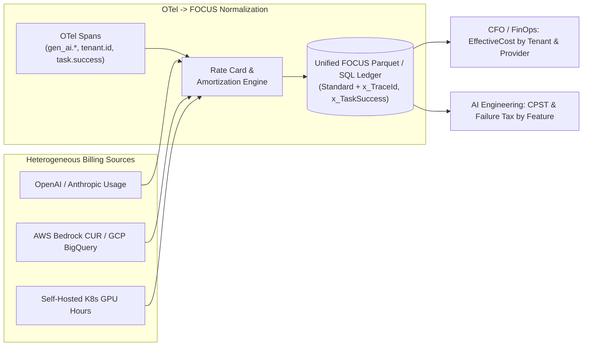
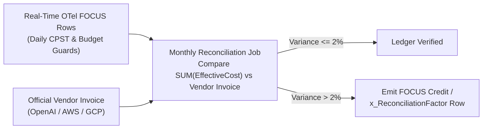

# Chapter 07 — FOCUS-Aligned Cost Reporting

> **Lecture 43 · Chapter 07 of 07** · Level: 🟠 Advanced · Phase 10 — Quality, FinOps, Identity & Security
> **Source:** `FDE S17` · **Roadmap Reference:** [`roadmap-v1.md`](../../roadmap-v1.md#lecture-42--ai-observability-opentelemetry-openobserve--focus-finops)
> **Roadmap topics:** FinOps Open Cost and Usage Specification (FOCUS) · mapping OpenAI/Anthropic/Bedrock/Vertex/K8s GPU bills to FOCUS columns · `EffectiveCost` vs. `BilledCost` · `x_` custom AI columns (`x_TraceId`, `x_TaskSuccess`) · telemetry-to-invoice reconciliation.

---

## 07.0 What this chapter is for

Every AI and cloud vendor formats invoices differently:
- **OpenAI** bills `prompt_tokens`, `cached_tokens`, `completion_tokens` by model snapshot.
- **AWS Bedrock** uses `EffectiveCost`, `lineItem/UsageAmount`, `product/region`.
- **GCP Vertex AI** exports BigQuery rows with `sku.description`, `cost`, `credits`.
- **Self-Hosted K8s GPUs** bill EC2/GKE instance-hours (`BilledCost` for `p5.48xlarge`).

Without a common schema, building a unified *"Total AI Cost by Feature & Tenant"* report requires brittle, one-off ETL scripts for every provider.

**FOCUS (FinOps Open Cost and Usage Specification)**—maintained by the **FinOps Foundation** (Linux Foundation)—is an open, vendor-neutral standard schema for cloud, SaaS, and AI billing data.

By the end of this chapter you should be able to:

1. Map heterogeneous AI provider bills (OpenAI, Bedrock, Vertex, K8s GPUs) into **standard FOCUS v1.0+ columns**.
2. Explain the difference between **`ListCost`**, **`BilledCost`**, and **`EffectiveCost`** (and why unit economics require `EffectiveCost`).
3. Extend FOCUS with **`x_` custom columns** (`x_TraceId`, `x_TaskSuccess`, `x_GenAiTokenType`) to join finance ledgers with OTel traces.
4. Reconcile real-time telemetry-estimated costs against monthly vendor invoices.

---

## 07.1 Core FOCUS Columns Mapped to GenAI

Here is how an AI agent run maps into standard **FOCUS v1.0+** columns:

| FOCUS Column | Type | Meaning | GenAI / Agent Mapping Example |
| :--- | :--- | :--- | :--- |
| `BillingAccountId` | String | Top-level payer account | `"org_acme_ai_prod"` |
| `BillingPeriodStart` / `End` | ISO Timestamp | Invoice cycle window | `"2026-11-01T00:00:00Z"` |
| `ChargePeriodStart` / `End` | ISO Timestamp | Usage window for this row | Span start/end time (or hourly rollup) |
| `ProviderName` | String | Vendor supplying the service | `"OpenAI"`, `"Anthropic"`, `"AWS"`, `"Internal-K8s"` |
| `ServiceCategory` | Enum | High-level service bucket | `"AI and Machine Learning"` (LLMs), `"Compute"` (Agent Pods) |
| `ServiceName` | String | Specific product | `"Azure OpenAI"`, `"Amazon Bedrock"`, `"Vertex AI"` |
| `ResourceId` | String | Model, endpoint, or cluster ID | `"gpt-4o-2024-11-20"`, `"claude-3-5-sonnet"` |
| `ChargeCategory` | Enum | Type of financial charge | `"Usage"`, `"Purchase"` (PTU), `"Credit"` |
| `PricingCategory` | Enum | Pricing model | `"On-Demand"`, `"Committed"` (Reserved PTU) |
| `PricingQuantity` | Decimal | Amount consumed in pricing unit | `12500` (tokens) or `0.25` (GPU-hours) |
| `PricingUnit` | String | Unit of measure | `"Tokens"`, `"1K Tokens"`, `"GPU-Hours"` |
| `ListCost` | Decimal | Retail cost before discounts | `\$0.0625` |
| `EffectiveCost` | Decimal | **Amortized net cost after discounts/credits** | `\$0.0500` |
| `BilledCost` | Decimal | Cash invoice amount in period | `\$0.0500` |
| `Tags` | JSON Map | Business attribution metadata | `{"tenant_id": "acme", "feature_id": "triage"}` |

> [!NOTE]
> **`EffectiveCost` vs. `BilledCost`:** If you prepay `\$120,000` upfront for a 1-year GPU reservation or Bedrock Provisioned Throughput (`Purchase`), `BilledCost` spikes to `\$120,000` in Month 1 and `\$0` in Months 2–12. **`EffectiveCost`** amortizes that `\$10,000/month` evenly so your daily `CPST` unit economics stay accurate all year!

---

## 07.2 Extending FOCUS with `x_` Custom Columns for AI Units

FOCUS explicitly reserves the `x_` prefix for organization-specific extensions. Adding four `x_` columns bridges **OTel observability** and **FOCUS finance**:

| Custom Column | Type | Purpose |
| :--- | :--- | :--- |
| `x_GenAiTokenType` | String | `"input"`, `"cache_read"`, `"output"`, `"reasoning"`, `"tool_call"` |
| `x_TraceId` | String | Links the billing row directly back to the OTel Trace in OpenObserve |
| `x_TaskSuccess` | Boolean | `true` or `false` — enables SQL `CPST` directly on the FOCUS table |
| `x_FeatureId` / `x_TenantId` | String | Promoted first-class columns for fast `GROUP BY` queries |



---

## 07.3 End-to-End Trace-to-FOCUS SQL Example

Because every provider row is normalized into one FOCUS table, **one SQL query** answers both finance and engineering questions:

```json
{
  "BillingAccountId": "org_ai_prod_001",
  "ProviderName": "OpenAI",
  "ServiceCategory": "AI and Machine Learning",
  "ResourceId": "gpt-4o-2024-11-20",
  "PricingQuantity": 3450,
  "PricingUnit": "Tokens",
  "ListCost": 0.01095,
  "EffectiveCost": 0.009855,
  "Tags": { "tenant_id": "tenant_acme", "feature_id": "support_triage" },
  "x_TraceId": "7b9cd45c34a022b8c378cb18a9a568bc",
  "x_TaskSuccess": true
}
```

```sql
SELECT
    Tags['tenant_id'] AS tenant_id,
    Tags['feature_id'] AS feature_id,
    ProviderName,
    SUM(EffectiveCost) AS total_effective_cost_usd,
    COUNT(DISTINCT CASE WHEN x_TaskSuccess THEN x_TraceId END) AS successful_tasks,
    SUM(EffectiveCost) / NULLIF(COUNT(DISTINCT CASE WHEN x_TaskSuccess THEN x_TraceId END), 0) AS cpst_usd
FROM focus_ai_usage
WHERE ServiceCategory = 'AI and Machine Learning'
  AND ChargePeriodStart >= '2026-11-01T00:00:00Z'
GROUP BY 1, 2, 3
ORDER BY total_effective_cost_usd DESC;
```

---

## 07.4 Reconciling Estimated Telemetry Costs vs. Vendor Invoices

Telemetry-calculated costs (`tokens * rate_card`) typically match official vendor invoices within **1%–3%**. Small variances come from rounding rules, enterprise volume-tier discounts applied at month-end, or failed-stream billing edge cases.



---

## 07.5 Common Mistakes

| # | Common Mistake | Why It Hurts | What To Do Instead |
| :---: | :--- | :--- | :--- |
| **1** | **Building custom per-vendor billing schemas** | Every new model provider breaks Finance's SQL dashboards | Normalize all AI & GPU spend into **FOCUS v1.0+** |
| **2** | **Using `BilledCost` for CPST on prepaid PTUs/GPUs** | Month 1 CPST looks `12x` too high and Months 2–12 look free | Always compute unit economics using amortized **`EffectiveCost`** |
| **3** | **Dropping `x_TraceId` during billing ETL** | Finance sees a `\$5,000` spike but engineers can't find the culprit traces | Include **`x_TraceId`** and **`x_TaskSuccess`** on FOCUS AI rows |
| **4** | **Never reconciling telemetry estimates against invoices** | Enterprise volume discounts or rate-card drift silently skew margins | Run a **monthly reconciliation job** and emit adjustment rows if variance `> 2%` |

---

## 07.6 Key Takeaways

1. **FOCUS** eliminates vendor-specific billing silos by normalizing OpenAI, Anthropic, Bedrock, Vertex, and K8s GPU costs into one open schema (`ProviderName`, `ServiceCategory`, `EffectiveCost`, `PricingQuantity`, `Tags`).
2. Use **`EffectiveCost`** (amortized net cost) rather than raw `BilledCost` when computing daily `CPST` unit economics.
3. Adding **`x_TraceId`** and **`x_TaskSuccess`** to FOCUS records creates an unbroken audit chain from **CFO invoice → tenant/feature → exact OTel trace**.

---

### Navigation

- **Previous:** [Chapter 06 — Tenant & Feature Attribution and Hard Budgets](./06_Tenant_and_Feature_Attribution_and_Hard_Budgets.md)
- **Back to index:** [../index.md](../index.md) · **Complete Guide:** [Lecture 43 Complete Notes](./Lecture_43_Complete_Notes.md)
