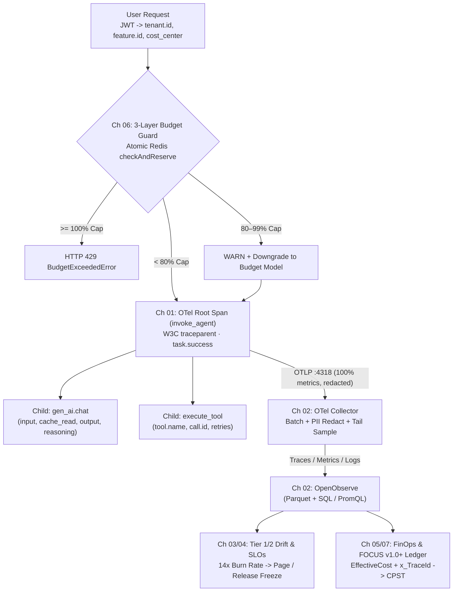

# Lecture 43 — Complete Notes
## AI Observability (`OTel`, `OpenObserve`) & `FOCUS` FinOps

> **Phase:** 10 · Quality, FinOps, Identity & Security · **Level:** 🟠 Advanced
> **Core Goal:** Unify vendor-neutral AI telemetry (`agent -> model -> tool` spans in OpenObserve), drift & SLO governance, real-time tenant budget enforcement, and **Cost per Successful Task (CPST)** reporting in **FOCUS v1.0+** schemas.

---

## 1. Executive Summary

**Thesis:** Traditional HTTP 5xx logs and raw `$/1M token` rate cards are blind to agentic failure modes—hallucinations, broken RAG chunks, retry loops, and concurrent budget overspend; production AI operations require **OpenTelemetry `gen_ai.*` + `trace_id` correlation in OpenObserve**, **two-tier drift & multi-window SLO burn-rate gates**, **atomic hard budgets**, and **FOCUS-aligned CPST accounting**.

**The lecture in five sentences:**
1. **OpenTelemetry (`gen_ai.*`)** unifies API gateways, `agent -> model -> tool` spans, and databases under one W3C `traceId` while keeping PII out of prod spans and high-cardinality IDs off metrics.
2. An **OTel Collector** batches, redacts PII, and runs **tail-based sampling** into **OpenObserve** (Parquet + SQL/PromQL), keeping 100% of error/slow traces while keeping **100% of FinOps cost metrics unsampled**.
3. **Continuous Quality Monitoring** pairs `$0` Tier-1 proxies on `100%` of traffic (schema repairs, tool loops, abstentions) with `1%–5%` async Tier-2 judges compared against **7-day same-hour baselines**.
4. **AI SLOs** (Availability, `p95 TTFT`, Task Success `~95%`, Groundedness) govern release velocity via **Error Budgets**, **multi-window burn-rate alerts (`14x` on `1h+5m`)**, and automated CI **release freezes**.
5. **AI FinOps** optimizes **Cost per Successful Task (CPST)** and **Failure Tax**, enforces 3-layer **atomic reserve-and-reconcile** tenant budgets (`80%` downgrade / `100%` `429`), and normalizes multi-vendor spend into **FOCUS v1.0+** with `EffectiveCost` and `x_TraceId`.

| Chapter | Topic | Core Artifact / Takeaway | File |
| :---: | :--- | :--- | :--- |
| **01** | OTel GenAI Semantic Conventions | `agent -> model -> tool` span tree + `gen_ai.*` + PII/cardinality rules | [01_OpenTelemetry_GenAI_Semantic_Conventions.md](./01_OpenTelemetry_GenAI_Semantic_Conventions.md) |
| **02** | Shipping Signals to OpenObserve | OTel Collector (`batch`, `redact`, `tail sampling`) $\rightarrow$ OpenObserve | [02_Shipping_Traces_Metrics_and_Logs_to_OpenObserve.md](./02_Shipping_Traces_Metrics_and_Logs_to_OpenObserve.md) |
| **03** | Quality Monitoring & Drift | `$0` Tier-1 proxies (100%) + async Tier-2 judges (1–5%) vs. 7d baseline | [03_Continuous_Quality_Monitoring_and_Drift_Detection.md](./03_Continuous_Quality_Monitoring_and_Drift_Detection.md) |
| **04** | AI SLOs & Error Budgets | 4-part SLO matrix + `14x` (`1h+5m`) burn-rate alerts + release freeze | [04_AI_SLOs_and_Error_Budgets.md](./04_AI_SLOs_and_Error_Budgets.md) |
| **05** | AI FinOps: CPST | `CPST` formula, `Failure Tax Ratio`, 4 token rates, 5 cost levers | [05_AI_FinOps_Cost_per_Successful_Task.md](./05_AI_FinOps_Cost_per_Successful_Task.md) |
| **06** | Tenant Attribution & Hard Budgets | `tenant.id` / `feature.id` + 3-layer guards + atomic reserve-reconcile | [06_Tenant_and_Feature_Attribution_and_Hard_Budgets.md](./06_Tenant_and_Feature_Attribution_and_Hard_Budgets.md) |
| **07** | FOCUS-Aligned Cost Reporting | FOCUS v1.0+ `EffectiveCost` + `x_TraceId`/`x_TaskSuccess` + invoice sync | [07_FOCUS_Aligned_Cost_Reporting.md](./07_FOCUS_Aligned_Cost_Reporting.md) |

---

## 2. Master Architecture Diagram

---

## 3. Chapter-by-Chapter Short Revision Notes

### 3.1 Chapter 01 — OpenTelemetry (OTel) GenAI Semantic Conventions
Proprietary LLM tracing SDKs create silos from API gateways and Postgres/Qdrant traces. **OpenTelemetry** propagates one W3C `traceparent` (`traceId`, `spanId`, `parentSpanId`) across a nested **`agent -> model -> tool`** tree: `invoke_agent` (root with `tenant.id`, `feature.id`, `task.success`), `chat` (`gen_ai.system`, `request.model`, `response.model`, `input_tokens`, `cache_read_input_tokens`, `output_tokens`, `finish_reasons`), and `execute_tool` (`tool.name`, `tool.call.id`).
- **Privacy & cardinality rules:** Log token counts + `sha256(prompt)` by default (never raw PII prompts in prod spans); keep high-cardinality IDs (`tenant_id`, `trace_id`) on **Spans/Logs**, never on **Metrics** labels.
- **Status accuracy:** Set `task.success = false` and `SpanStatusCode.ERROR` whenever verification fails, even if HTTP returned `200 OK`.

> 📖 **Need depth?** Read [Chapter 01 — OpenTelemetry (OTel) GenAI Semantic Conventions](./01_OpenTelemetry_GenAI_Semantic_Conventions.md)

### 3.2 Chapter 02 — Shipping Traces, Metrics & Logs to OpenObserve
**OpenObserve** ingests native OTLP (`4318` HTTP / `4317` gRPC) into compressed Apache Parquet on S3/MinIO (`10x–30x` cheaper than Lucene/JVM) with SQL and PromQL querying. All three signals correlate via **`trace_id` + `span_id`** injected into structured logs.
- **OTel Collector in the middle:** Provides async `batch` buffering (`0 ms` app blocking), centralized `attributes/redact` PII scrubbing (`http.request.header.authorization`, `user.email`), and backend portability.
- **Tail-based sampling:** Head sampling (`10%`) drops `90%` of errors; **tail-based sampling** keeps `100%` of `ERROR` / `task.success=false` / slow (`> 5s`) / costly (`> $0.10`) traces and samples `5%` of fast `OK` traces—while **100% of FinOps cost metrics remain unsampled**.

> 📖 **Need depth?** Read [Chapter 02 — Shipping Traces, Metrics & Logs to OpenObserve](./02_Shipping_Traces_Metrics_and_Logs_to_OpenObserve.md)

### 3.3 Chapter 03 — Continuous Quality Monitoring & Drift Detection
Agents silently break with `0%` HTTP 500s due to **Data/RAG Drift** (broken HTML parser $\rightarrow$ `18`-token chunks, abstention spikes `3.5% -> 38%` in 15 min), **Model Provider Drift** (`gpt-4o-latest` alias updates), or **User Drift** (new languages). Combine **Tier 1 `$0` deterministic proxies on `100%` of traffic** (schema-repair rate, tool-error/loop rate, abstention rate, thumbs-down) with **Tier 2 async sampled judges (`1%–5%`)** for faithfulness.
- **Alerting hygiene:** Pin immutable model snapshots (`gpt-4o-2024-11-20`), calibrate judges ($\kappa \ge 0.75$), compare rolling `15m–1h` windows against **7-day same-hour baselines**, and auto-harvest failing `trace_id`s (PII-scrubbed) into golden CI evals.

> 📖 **Need depth?** Read [Chapter 03 — Continuous Quality Monitoring & Drift Detection](./03_Continuous_Quality_Monitoring_and_Drift_Detection.md)

### 3.4 Chapter 04 — AI SLOs & Error Budgets
HTTP `200 OK` and total latency miss hallucinations and blank spinners. Use the **4-part AI SLO Matrix**:

| SLI | Example 30-Day SLO | Monthly Error Budget |
| :--- | :---: | :---: |
| **1. Gateway Availability** | `>= 99.9%` | `0.1%` (`43.2` min/mo) |
| **2. Streaming `p95 TTFT`** | `<= 600 ms` (`99%`) | `1.0%` slow starts |
| **3. Task Success Rate** | `>= 95.0%` (not `99.9%`) | `5.0%` (`5,000` / `100k` tasks) |
| **4. Groundedness / Policy** | `>= 98.0%` | `2.0%` ungrounded/blocked |

- **Burn-rate governance:** Alert on **multi-window burn rates** (`14x` on `1h AND 5m` $\rightarrow$ page; `6x` on `6h AND 30m` $\rightarrow$ Slack) and trigger an automated **CI/CD release freeze** when monthly budget hits `0%`.

> 📖 **Need depth?** Read [Chapter 04 — AI SLOs & Error Budgets](./04_AI_SLOs_and_Error_Budgets.md)

### 3.5 Chapter 05 — AI FinOps: Cost per Successful Task (CPST)
Raw `$/1M tokens` is a vanity metric: a cheap fragile model with a `40%` failure rate and retries costs *more* per solved ticket than a reliable model. Optimize **CPST** and **Failure Tax** ($\text{Failed \& Retry Spend} / \text{Total Spend}$, e.g. `34.7%` in our worked triage example):
$$\text{CPST} = \frac{\sum C_{\text{all\_runs (success + failed)}} + \sum C_{\text{tools}} + \sum C_{\text{eval\_judges}} + \sum C_{\text{human\_escalation}}}{N_{\text{successful\_tasks}}}$$
- **4 token rates:** Uncached input (`1.0x`), `cache_read` (`0.1x–0.25x`), output (`3x–5x`), and `reasoning_tokens` (`3x–5x`).
- **5 CPST levers:** Model cascading/routing, byte-identical prefix prompt caching, tool compaction, loop circuit breakers, and semantic caching.

> 📖 **Need depth?** Read [Chapter 05 — AI FinOps: Cost per Successful Task](./05_AI_FinOps_Cost_per_Successful_Task.md)

### 3.6 Chapter 06 — Tenant & Feature Attribution and Hard Budgets
Enforce *"No `tenant.id` + `feature.id`, no LLM call"* at the gateway (deriving `tenant.id` from the verified OIDC JWT) and propagate `cost_center` and `environment` (`prod` vs. `eval` so CI never inflates customer COGS). Allocate shared GPU/PTU costs proportionally by `(tenant_tokens / total_tokens)`.
- **Three budget layers:** (1) Per-request `max_iterations` / cost cap; (2) Per-tenant sliding window (`< 80%` allow, `80–99%` warn + downgrade model, `>= 100%` `HTTP 429`); (3) Global daily kill-switch.
- **Concurrency safety:** Prevent `20x` burst overspend with **atomic Redis Lua `checkAndReserve` + `reconcile`** (refunding unused estimate or releasing on failure).

> 📖 **Need depth?** Read [Chapter 06 — Tenant & Feature Attribution and Hard Budgets](./06_Tenant_and_Feature_Attribution_and_Hard_Budgets.md)

### 3.7 Chapter 07 — FOCUS-Aligned Cost Reporting
**FOCUS (FinOps Open Cost and Usage Specification)** normalizes OpenAI, Anthropic, Bedrock, Vertex, and K8s GPU bills into one SQL schema (`ProviderName`, `ServiceCategory`, `ResourceId`, `PricingQuantity`, `PricingUnit`, `ListCost`, `EffectiveCost`, `BilledCost`, `Tags`).
- **`EffectiveCost` vs. `BilledCost`:** Use amortized **`EffectiveCost`** for daily CPST so prepaid 1-year GPU/PTU purchases don't spike Month 1 by `12x`.
- **Trace-to-Ledger join + reconciliation:** Add `x_TraceId`, `x_TaskSuccess`, `x_GenAiTokenType`, `x_TenantId`/`x_FeatureId` for single-SQL CPST queries, and reconcile monthly against vendor invoices (emitting adjustments if variance `> 2%`).

> 📖 **Need depth?** Read [Chapter 07 — FOCUS-Aligned Cost Reporting](./07_FOCUS_Aligned_Cost_Reporting.md)

---

## 4. Cheat Sheet & Common Traps

### Quick Reference
| Area | Key Rule / Formula | Chapter |
| :--- | :--- | :---: |
| **OTel Spans** | `invoke_agent` $\rightarrow$ `chat` / `execute_tool`; W3C `traceparent` | [01](./01_OpenTelemetry_GenAI_Semantic_Conventions.md) |
| **Sampling** | Tail-based (`100%` errors/outliers, `5%` OK); `100%` cost metrics | [02](./02_Shipping_Traces_Metrics_and_Logs_to_OpenObserve.md) |
| **Drift** | Tier-1 `$0` proxies (`100%`) + Tier-2 async judges (`1–5%`) | [03](./03_Continuous_Quality_Monitoring_and_Drift_Detection.md) |
| **AI SLOs** | `95%` Task Success, `p95 TTFT`, `14x` (`1h+5m`) burn rate | [04](./04_AI_SLOs_and_Error_Budgets.md) |
| **CPST** | `(All runs + tools + evals + HITL) / verified_successes` | [05](./05_AI_FinOps_Cost_per_Successful_Task.md) |
| **Budgets** | `checkAndReserve` + `reconcile`; `80%` downgrade / `100%` `429` | [06](./06_Tenant_and_Feature_Attribution_and_Hard_Budgets.md) |
| **FOCUS** | `EffectiveCost` + `x_TraceId` + `x_TaskSuccess` (`<= 2%` variance) | [07](./07_FOCUS_Aligned_Cost_Reporting.md) |

### Common Observability & FinOps Traps
- **High-cardinality metric labels:** Putting `user_id` or `trace_id` on OTel Metrics explodes time-series memory; keep them on Spans/Logs.
- **Computing billing from sampled traces:** Tail-sampling `5%` of OK traces undercounts spend by `95%`; keep FinOps metrics `100%` unsampled.
- **Floating model aliases (`gpt-4o-latest`):** Provider updates silently break JSON adherence overnight; pin snapshots and log `gen_ai.response.model`.
- **Non-atomic `spend < limit` checks:** `20` concurrent requests pass the check simultaneously and overspend by `20x`; use Redis Lua `checkAndReserve`.
- **Using `BilledCost` for CPST:** Upfront annual PTU/GPU purchases distort Month 1 COGS; always use amortized `EffectiveCost`.

---

## 5. Self-Check Questions (Release Gate Prep)

1. Why must `tenant.id` and `trace_id` live on **OTel Spans/Logs** rather than **OTel Metric** labels, and why must FinOps cost counters remain **100% unsampled** even under tail-based trace sampling?
   *Hint:* Metric labels explode time-series cardinality; trace sampling drops `95%` of OK runs, which would undercount billing by `95%`.
2. How does a **Tier-1 `$0` abstention/schema-repair monitor** catch a broken RAG HTML parser in 15 minutes when HTTP `500` rate is `0%`?
   *Hint:* Empty chunks cause `abstention` to spike (`3.5% -> 38%`, `+57σ`) vs. the 7-day same-hour baseline.
3. Calculate the monthly error budget for `100,000` tasks at a `95%` Task Success SLO, and explain why multi-window burn-rate alerts require **both** `1h` and `5m` windows.
   *Hint:* `5,000` allowed failures/mo (`~166/day`); `5m` alone pages on blips while `1h` alone reacts too late.
4. Why can a `\$0.15/1M` model have a *higher* **Cost per Successful Task (CPST)** than a `\$1.50/1M` model, and how do **Failure Tax** and **atomic `checkAndReserve` + `reconcile`** protect margins?
   *Hint:* `40%` failure + retries + HITL escalations inflate CPST; `checkAndReserve` prevents `20x` concurrent burst overspend.
5. Why does FOCUS unit-economics SQL use **`EffectiveCost`** instead of `BilledCost`, and which `x_` columns link a CFO invoice row back to a specific OpenObserve trace?
   *Hint:* `EffectiveCost` amortizes prepaid PTUs/GPUs evenly; `x_TraceId` and `x_TaskSuccess` join finance ledgers to OTel traces.
