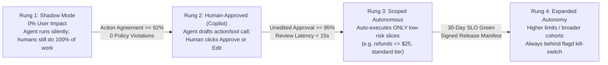

# Chapter 01 — The Progressive Autonomy Ladder

> **Lecture 43 · Chapter 01 of 07** · Level: 🟠 Advanced · Phase 10 — Quality, FinOps, Identity & Security
> **Source:** `FDE S18` · **Roadmap Reference:** [`roadmap-v1.md`](../../roadmap-v1.md#lecture-43--progressive-autonomy-feature-flags-openfeatureflagd--safe-releases)

---

## 1. Intuition: Why You Don't Hand a New Hire the Company Credit Card on Day 1

Think about how you onboard a new junior support engineer:
- **Week 1 (Shadowing):** They sit next to a senior rep, watch tickets come in, and write down what they *would* have replied—without sending anything to customers.
- **Week 2 (Drafting for Approval):** They draft replies and refund requests, and a senior rep clicks **Approve** or **Edit** before anything goes out.
- **Week 3 (Scoped Independence):** They are allowed to auto-approve simple refunds under \$25 on standard orders; anything bigger or unusual still goes to a senior rep.
- **Month 2 (Full Trust):** After weeks of clean audits, their scope expands.

**AI agents are probabilistic interns.** Yet teams routinely deploy an agent straight from staging to *"autonomous production execution"*—and then act surprised when a 2% edge-case hallucination turns into 200 unauthorized refunds or broken CRM records in an afternoon.

**Progressive Autonomy** turns trust into an engineering state machine: **every rung is earned with measured production evidence, never guesswork.**

---

## 2. The Four-Rung Progressive Autonomy Ladder

### Detailed Comparison of Each Rung

| Rung | Who Executes Write Actions? | User Sees Agent Output? | Blast Radius | Primary Metric to Graduate |
| :--- | :--- | :---: | :---: | :--- |
| **1. Shadow Mode** | Human only (agent runs silently in background) | No | **Zero** | **Action Agreement Rate** (agent draft vs. actual human decision) |
| **2. Human-Approved** | Human clicks `Approve`, `Edit`, or `Reject` | Draft only | **Low** (human catches bad calls) | **Unedited Approval Rate** & **Edit Distance** |
| **3. Scoped Autonomous** | Agent auto-executes **within strict bounds** | Yes (scoped slice only) | **Bounded** (capped \$ / reversible tools) | **Task Success Rate**, **CPST**, & **0 Policy Breaches** |
| **4. Expanded Production** | Agent auto-executes across cohorts | Yes | **Controlled** (SLO + `<30s` rollback) | **Error Budget Remaining** & **Audit Pass Rate** |

---

## 3. Worked Example: Shipping an E-Commerce Refund Agent

Suppose your company processes **10,000 refund tickets per week** (average refund: \$42):

1. **Week 1 — Rung 1 (Shadow Mode):**
   - When a human agent opens Ticket `#8812` (`"Damaged mug, $18.50"`), the AI agent runs silently in parallel and logs: `{ tool: "issue_refund", amount: 18.50 }`.
   - **What you catch safely:** On 140 tickets where the customer had *already* received a replacement, the agent still proposed a refund! Because it was in Shadow Mode, **\$0 was lost**. You fix the system prompt + tool check.
2. **Week 2 — Rung 2 (Human-Approved Copilot):**
   - Support reps now see a pre-filled **"AI Suggested Refund: \$18.50 [Approve] [Edit]"** card in their UI (see AG-UI in Lecture 37).
   - **Graduation Check:** Over 2,000 tickets, reps click **Approve without editing** on **96.4%** of tickets.
3. **Week 3 — Rung 3 (Scoped Autonomous):**
   - Via `flagd`, you allow automatic execution **only** when **every** guardrail passes:
     - `amount_usd <= 25`
     - `customer_tier != "vip_escalated"`
     - `customer_refunds_last_30d < 3`
     - `tenant_id` is in the `canary_10pct` cohort
   - Any ticket outside those bounds automatically falls back to **Rung 2 (Human-Approved)**.
4. **Week 4+ — Rung 4 (Expanded Autonomy):**
   - After 14 days of green SLOs and zero policy breaches, you raise `max_auto_refund_usd` from `25` $\rightarrow$ `75` in `flagd` without touching application code.

---

## 4. Designing Machine-Enforceable Scope Boundaries

Never treat autonomy as a single global on/off switch. Define **four orthogonal scope dimensions** enforced deterministically in code (not in the prompt!):

| Scope Dimension | Safe Rung 3 Example | Escalates to Rung 2 (Human) |
| :--- | :--- | :--- |
| **Monetary Cap** | `refund_amount <= $25` | `refund_amount > $25` |
| **Reversibility** | `add_ticket_tag`, `draft_note` | `delete_user`, `wire_payout`, `cancel_subscription` |
| **Verifier / Confidence** | Schema valid + Z3 policy pass + confidence `>= 0.90` | Missing order ID or confidence `< 0.90` |
| **Velocity / Rate Limit** | Max `3` auto-refunds per user/day | `>= 4` requests in 24h (fraud / loop protection) |

---

## 5. Common Pitfalls vs. Production Fixes

| Pitfall | What Goes Wrong | Production Fix |
| :--- | :--- | :--- |
| **Asking the LLM to enforce its own scope** (`"Don't refund over $25"`) | Prompt injection or math errors bypass the rule | Enforce `amount <= max_auto_refund_usd` in **deterministic code / `flagd`** |
| **Alert fatigue in Rung 2** | Agent asks human approval for trivial read-only steps | Only gate **mutating / external write** tools; auto-run read-only searches |
| **Skipping Rung 1 (Shadow) because CI evals passed** | Live messy inputs break edge-case tool calls on Day 1 | Always soak in Shadow Mode on real traffic before exposing users |

---

## 6. Chapter Summary
- Climb trust step-by-step: **Shadow $\rightarrow$ Human-Approved $\rightarrow$ Scoped Autonomous $\rightarrow$ Expanded Production**.
- Every graduation requires **objective production metrics** (agreement rate, unedited approval rate, SLO compliance).
- Enforce scope bounds (**dollar caps, reversibility, velocity limits**) in deterministic code backed by `flagd`, never via prompt instructions alone.

---
**Next:** [Chapter 02 — OpenFeature & `flagd` for AI Runtime Control](./02_OpenFeature_and_flagd_for_AI_Runtime_Control.md)

