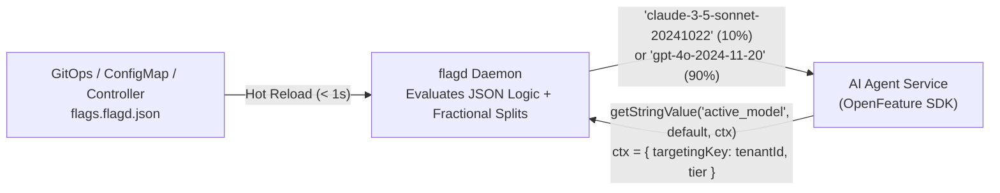

# Chapter 02 — OpenFeature & `flagd` for AI Runtime Control

> **Lecture 43 · Chapter 02 of 07** · Level: 🟠 Advanced · Phase 10 — Quality, FinOps, Identity & Security
> **Source:** `FDE S18` · **Roadmap Reference:** [`roadmap-v1.md`](../../roadmap-v1.md#lecture-43--progressive-autonomy-feature-flags-openfeatureflagd--safe-releases)
> **External References:** [OpenFeature Specification](https://openfeature.dev/) · [flagd Documentation](https://flagd.dev/)

---

## 1. Intuition: Why Deployments Are Too Slow for AI Incidents

Imagine your agent uses `gpt-4o-2024-11-20`, hardcoded in `src/config.ts`.
At 2:15 PM on Friday, you want to:
- Shift `10%` of traffic to `claude-3-5-sonnet-20241022`, OR
- Drop `tenant_acme` from `autonomous` back to `human_approved` because they reported an edge case, OR
- Route free-tier users to `gpt-4o-mini` to protect your gross margin.

If any of those requires **editing code $\rightarrow$ running CI $\rightarrow$ building a Docker image $\rightarrow$ rolling Kubernetes pods**, your reaction time is **15–45 minutes**. During an AI outage or runaway loop, 30 minutes is an eternity.

**OpenFeature + `flagd`** separates **code deployments** (slow, heavy) from **AI runtime configuration** (instant, `< 1 second`, zero pod restarts).

---

## 2. How OpenFeature & `flagd` Fit Together

Think of **OpenFeature** like **OpenTelemetry** (Lecture 42):
- **OpenFeature** is the **CNCF vendor-neutral SDK interface** in your application (`client.getStringValue(...)`). Your code never locks into LaunchDarkly, Split, or Statsig.
- **`flagd`** is the **lightweight, open-source evaluation daemon** (runs as a Kubernetes sidecar or standalone service) that watches a declarative `flags.flagd.json` file (from GitOps, ConfigMap, HTTP, or S3) and evaluates rules locally in microseconds.



---

## 3. Typed AI Flags: More Than Just Booleans

Traditional feature flags are often `true/false`. AI runtime control uses **typed flags** across five core levers:

| Flag Key | Type | Example Variants | Runtime Control Purpose |
| :--- | :---: | :--- | :--- |
| `active_model` | `String` | `"gpt-4o-2024-11-20"`, `"claude-3-5-sonnet-20241022"`, `"gpt-4o-mini"` | Instant model routing & migration |
| `prompt_version` | `String` | `"2.4.0"`, `"2.5.0-rc1"` | Switch system prompt template without redeploy |
| `autonomy_mode` | `String` | `"shadow"`, `"human_approved"`, `"autonomous"` | Step tenants up/down the autonomy ladder |
| `shadow_enabled` | `Boolean` | `true` / `false` | Toggle background dark-launch mirroring |
| `canary_weight_pct` | `Number` | `0`, `1`, `10`, `50`, `100` | Dial canary traffic smoothly or zero it out instantly |
| `max_auto_refund_usd` | `Number` | `25`, `75` | Tune Rung 3 monetary guardrail in real time |

---

## 4. Concrete `flags.flagd.json` Walkthrough

```json
{
  "$schema": "https://flagd.dev/schema/v0/flags.json",
  "flags": {
    "active_model": {
      "state": "ENABLED",
      "variants": {
        "baseline": "gpt-4o-2024-11-20",
        "canary": "claude-3-5-sonnet-20241022",
        "budget": "gpt-4o-mini"
      },
      "defaultVariant": "baseline",
      "targeting": {
        "if": [
          { "==": [{ "var": "tier" }, "free"] },
          "budget",
          {
            "fractional": [
              ["baseline", 90],
              ["canary", 10]
            ]
          }
        ]
      }
    }
  }
}
```

### Step-by-Step Evaluation Trace
1. **Request A (`{ targetingKey: "tenant_free_1", tier: "free" }`):**
   - First `if` condition matches `tier == "free"` $\rightarrow$ immediately returns `"gpt-4o-mini"` (`variant: "budget"`).
2. **Request B (`{ targetingKey: "tenant_acme", tier: "enterprise" }`):**
   - Not `free` tier $\rightarrow$ enters `fractional` rule.
   - `flagd` hashes `targetingKey` (`"tenant_acme"`) into a deterministic `0..99` bucket (say, `bucket = 42`).
   - Since `42 >= 10` (canary weight), it returns `"gpt-4o-2024-11-20"` (`variant: "baseline"`).
   - **Crucial property:** Every turn from `"tenant_acme"` hashes to `42`—so Turn 1, Turn 2, and Turn 3 stay on the **exact same model**, preserving prompt-cache hits and consistent tone!

---

## 5. Stickiness & Fail-Safe Defaults

> [!IMPORTANT]
> **Two Golden Rules of AI Feature Flags:**
> 1. **Sticky `targetingKey`:** Use `tenantId` or `sessionId` (not a random UUID per turn) so multi-turn conversations never flip models mid-chat.
> 2. **Fail-Safe Defaults:** Always pass the **safest, most conservative** default to OpenFeature (`getStringValue("autonomy_mode", "human_approved", ctx)`). If `flagd` is ever unreachable, the agent degrades safely to human approval—never to `autonomous`!

---

## 6. Chapter Summary
- **OpenFeature** provides the vendor-neutral SDK contract; **`flagd`** evaluates declarative JSON targeting rules in microseconds with `< 1s` hot-reload.
- Control **model selection, prompt version, autonomy rung, canary percentage, and dollar caps** at runtime without pod restarts.
- Use deterministic **`targetingKey` hashing** for session stickiness and always configure **fail-safe conservative defaults**.

---
**Next:** [Chapter 03 — Shadow Mode & Dark Launches](./03_Shadow_Mode_and_Dark_Launches.md)

