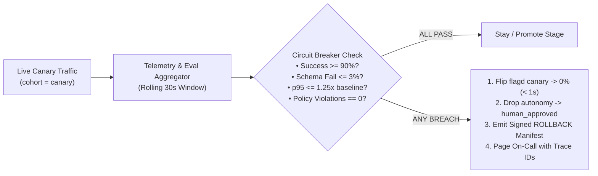

# Chapter 06 — Automated Rollback & Incident Recovery

> **Lecture 43 · Chapter 06 of 07** · Level: 🟠 Advanced · Phase 10 — Quality, FinOps, Identity & Security
> **Source:** `FDE S18` · **Roadmap Reference:** [`roadmap-v1.md`](../../roadmap-v1.md#lecture-43--progressive-autonomy-feature-flags-openfeatureflagd--safe-releases)

---

## 1. Speed Matters: 30 Seconds vs. 30 Minutes

When a canary deployment starts hallucinating, timing out, or burning 5x tokens, **humans are too slow**:
- It takes 5–10 minutes for an engineer to notice Slack/PagerDuty, open a laptop, log into VPN, figure out *which* change caused it, and merge a Git revert.
- In 10 minutes at 100 req/sec, **60,000 requests** hit the broken canary!

**Automated Rollback** connects your live telemetry/eval loop directly to `flagd` so a degraded canary triggers **self-healing rollback to the baseline manifest in < 30 seconds**—zero human intervention required.

---

## 2. The Closed-Loop Rollback Architecture



---

## 3. Four Mandatory Automated Rollback Triggers

| Trigger | Threshold Example | Why It Must Auto-Rollback Immediately |
| :--- | :--- | :--- |
| **1. Canary Success Collapse** | `task_success < 90%` (min `n >= 20` runs) | Canary is actively failing user tasks |
| **2. Schema / JSON Breakage** | `schema_fail_rate > 3%` | Downstream parsers/tools are crashing on malformed outputs |
| **3. Latency / Timeout Spike** | `p95_latency > 1.25x baseline` or `> 3,000 ms` | Upstream provider throttled or model entered infinite reasoning loop |
| **4. Policy / Safety Breach** | `policy_violations >= 1` | **Zero-tolerance** — even 1 PII leak or unauthorized write triggers instant halt |

> [!IMPORTANT]
> **Two-Stage Safety Net:** On rollback, don't just revert `active_model` back to the baseline—also **downgrade `autonomy_mode` from `autonomous` $\rightarrow$ `human_approved`** if the incident involved tool-execution errors.

### Concrete Rollback Event Output (`< 30s` SLA)
```json
{
  "rolledBack": true,
  "reason": "Canary taskSuccessRate 40.0% < 90.0%",
  "rollbackElapsedMs": 0.005,
  "postRollbackFlagd": { "canaryWeightPct": 0, "autonomyMode": "human_approved" }
}
```

---

## 4. Model Migration Playbook (Step-by-Step)

When migrating from **Model A** (e.g., `gpt-4o`) to **Model B** (e.g., `claude-3-5-sonnet` or a self-hosted quantized Llama):

1. **Pin & Baseline:** Record Model A's 7-day `task_success`, `p95 TTFT`, `CPST`, and `schema_fail_rate`.
2. **Offline Golden Suite:** Run Model B against your golden dataset + adversarial red-team set (must pass `>= baseline`).
3. **Prompt Re-Tuning:** Never assume a prompt tuned for OpenAI works identically on Anthropic or Llama—adjust XML/JSON formatting and stop sequences, then version as a new `prompt_hash`.
4. **Shadow Mode (`10%` for 24h):** Verify action equivalence `>= 94%` with mocked write tools.
5. **Eval-Gated Canary (`1% -> 10% -> 50% -> 100%`):** Automated rollback armed with `< 30s` `flagd` circuit breaker.
6. **Signed Manifest & Decommission:** Emit `PROMOTED` manifest; keep Model A warm in `flagd` for 7 days for instant 1-click fallback.

---

## 5. Incident Recovery & Post-Incident Checklist

Once `flagd` auto-reverts within 30 seconds and the bleeding stops:
1. **Verify Recovery:** Confirm OpenObserve `task_success` and `p95` return to baseline within 2 minutes.
2. **Quarantine Failing Traces:** Export the failing canary `trace_id`s and add anonymized reproductions to your golden eval suite so CI catches this regression permanently.
3. **Audit Any Partial Side Effects:** If the canary ran in Rung 3 (`autonomous`), query audit logs for all write tool calls during the canary window and compensate/refund affected tenants.
4. **Keep Canary Locked:** Require manual engineering sign-off (`canary_locked = true`) before re-enabling the flag so a flapping script can't re-trigger the broken canary.

---

## 6. Chapter Summary
- **Automated rollback** cuts incident blast radius from 30 minutes to **< 30 seconds** by wiring live eval metrics directly to `flagd`.
- Trigger instant rollback on **task-success drops, schema failures, latency spikes, or any policy violation**.
- Always follow the **6-step Model Migration Playbook** (Baseline $\rightarrow$ Offline Eval $\rightarrow$ Prompt Tune $\rightarrow$ Shadow $\rightarrow$ Eval-Gated Canary $\rightarrow$ Signed Manifest).

---
**Next:** [Chapter 07 — Technical UAT & Customer Handover Sign-Off](./07_Technical_UAT_and_Customer_Handover_SignOff.md)

